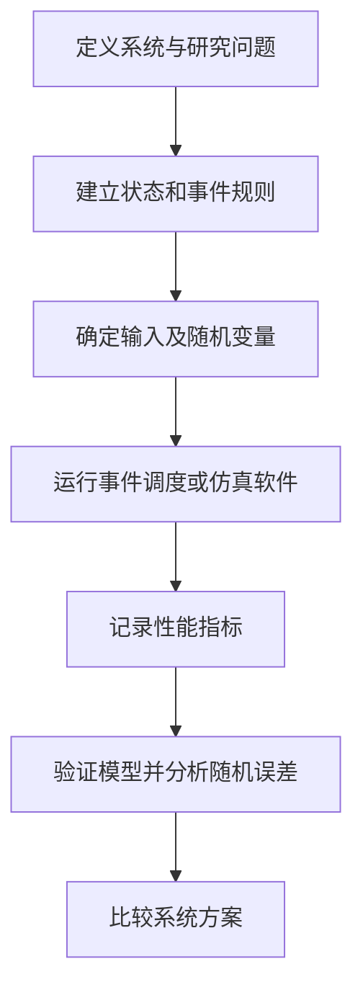

# 系统建模与仿真 · System Modeling & Simulation

以**概念理解、数学推导、事件计算、模型实现和统计分析**为主线，系统整理仿真的核心知识。每个主题尽量包含定义、公式、可计算的例子和常见错误，适合从基础逐步学习，也可作为随时查阅的知识手册。

## 学习地图

| 模块 | 知识重点 | 学习资料 |
| --- | --- | --- |
| 01 基础与随机数 | 系统、实体、状态、事件；线性同余法；均匀性与独立性检验；随机变量生成 | [完整笔记](notes/01-random-numbers.md) |
| 02 离散事件与排队 | 未来事件表、事件推进、FCFS、双并行服务台、M/M/1 | [完整笔记](notes/02-discrete-event-queue.md) |
| 03 项目工序与 Arena | 工序先后关系、并行与汇合、资源约束、Arena 建模流程、验证 | [完整笔记](notes/03-arena-project-process.md) |
| 04 输出分析与实验设计 | 终止型与稳态仿真、预热期、批均值、置信区间、共同随机数、方差缩减 | [完整笔记](notes/04-output-analysis.md) |
| 05 练习与解析 | 随机数、分布变换、排队手算、统计估计、并行工序与方案比较 | [基础题 1–9](exercises/01-core-exercises.md) · [进阶题 10–18](exercises/02-advanced-exercises.md) |
| 06 可运行示例 | 双服务台共享队列、M1 优先、离散事件推进、等待时间与利用率 | [Python 示例](examples/m1_priority_queue.py) |

## 核心流程

仿真分析需要同时回答五个问题：

1. **系统里有什么？** 明确实体、资源、状态、队列与边界。
2. **系统怎样变化？** 把到达、开始、完成、离开等事件规则写清楚。
3. **不确定性从哪来？** 选择输入数据、概率分布和随机数生成方式。
4. **如何判断模型正确？** 用手算小样例、极端情况和守恒关系验证。
5. **结果有多可靠？** 区分单次运行与独立重复，报告估计误差与适用条件。

## 建议学习顺序

**第一阶段：随机输入。** 从 $U(0,1)$、LCG、卡方与 KS 检验开始，再用反函数法和 Box–Muller 生成目标随机变量。

**第二阶段：事件计算。** 掌握未来事件表和双服务台逐事件推进，分清按顾客平均的等待时间、按时间平均的队长及资源利用率。

**第三阶段：模型实现。** 将流程转换为实体、资源、工序和事件，理解工序并行与汇合；在 Arena 或代码中复现确定性样例。

**第四阶段：输出分析。** 比较终止型和稳态实验，学习预热期、独立重复、置信区间、批均值与方差缩减。

**第五阶段：综合练习。** 每道题先独立完成，再对照“题目—标准答案—完整解析”；对模型题重点核查假设和事件处理顺序。

## 记号速查

| 记号 | 含义 |
| --- | --- |
| $U$ | $U(0,1)$ 均匀随机数 |
| $A_i, S_i, B_i, D_i$ | 顾客 $i$ 的到达、服务时长、开始服务、离开时刻 |
| $W_{q,i}, W_i$ | 排队等待时间、系统逗留时间 |
| $L_q(t)$ | 时刻 $t$ 等待队列中的实体数量 |
| $\rho$ | 资源忙碌时间比例；在 $M/M/1$ 中为 $\lambda/\mu$ |
| $\lambda,\mu$ | 到达率与服务率（用于对应排队模型） |
| $\overline Y,s^2,r$ | 多次重复的样本均值、方差、重复次数 |

## 使用说明

公式通过 GitHub 原生数学公式渲染，流程关系通过 Mermaid 展示。所有例题采用明确写出的假设，避免把某个具体数值示例当成普遍结论。运行 Python 示例仅需 Python 3.10 或更高版本，不依赖第三方库。

