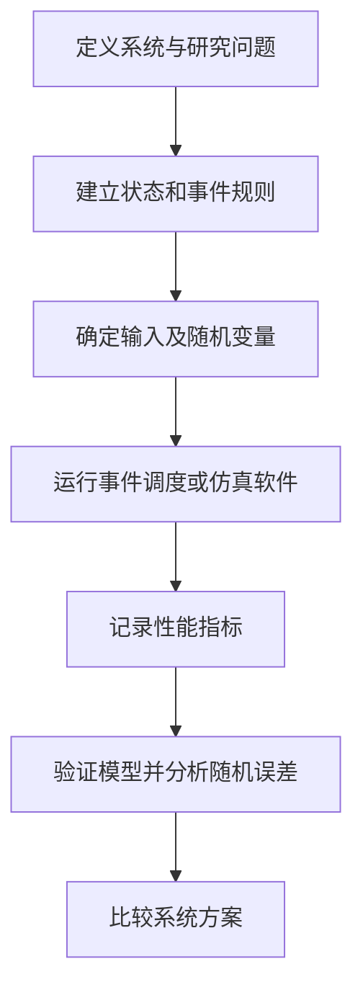
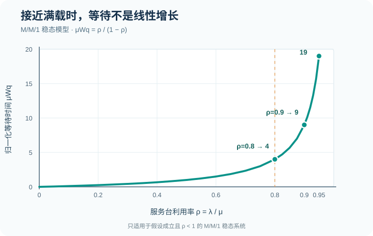
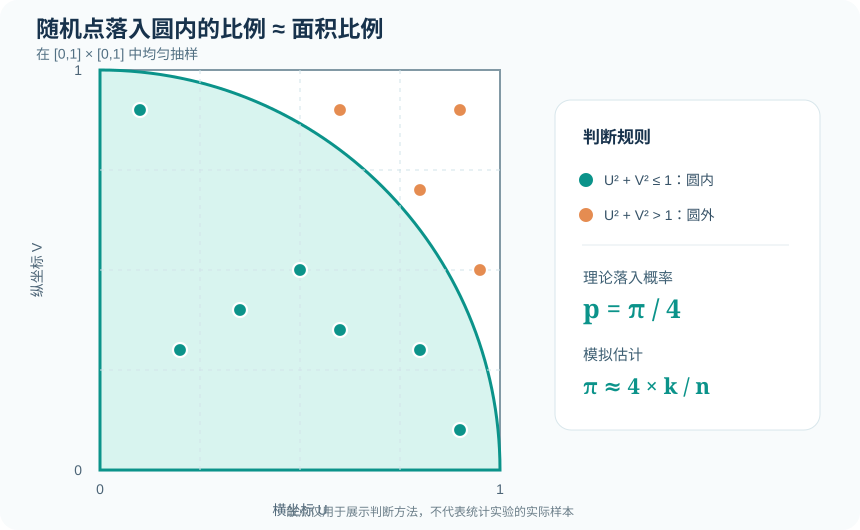

# 系统建模与仿真 · System Modeling & Simulation

以<strong>概念理解、数学推导、事件计算、模型实现和统计分析</strong>为主线，系统整理仿真的核心知识。每个主题尽量包含定义、公式、可计算的例子和常见错误，适合从基础逐步学习，也可作为随时查阅的知识手册。

> <strong>重点专题｜手工离散事件仿真</strong>：从四个零件、M1→运输→M2 的串联加工题出发，逐时刻填写 TNOW/FEL、画机器时间线与队长阶梯图，并区分 `t=10` 截面与全部完工。<strong>[进入零件加工专题](manual-event-simulation/README.md)</strong>。

## 学习地图

| 模块 | 知识重点 | 学习资料 |
| --- | --- | --- |
| <strong>重点专题：零件加工事件调度</strong> | 基础模型、完整 FEL 推演、两机串联与单机截尾、队长面积、利用率及变式 | <strong>[专题主页](manual-event-simulation/README.md)</strong> · [概念与状态](manual-event-simulation/00-concepts-and-rules.md) · [FEL 明细](manual-event-simulation/03-fel-ledger.md) · [指标详解](manual-event-simulation/04-statistics-and-variants.md) |
| 01 基础与随机数 | 系统、实体、状态、事件；线性同余法；均匀性与独立性检验；随机变量生成 | [完整笔记](notes/01-random-numbers.md) |
| 02 离散事件与排队 | 未来事件表、事件推进、FCFS、双并行服务台、M/M/1 | [完整笔记](notes/02-discrete-event-queue.md) |
| 03 项目工序与 Arena | 工序先后关系、并行与汇合、资源约束、Arena 建模流程、验证 | [完整笔记](notes/03-arena-project-process.md) |
| 04 输出分析与实验设计 | 终止型与稳态仿真、预热期、批均值、置信区间、共同随机数、方差缩减 | [完整笔记](notes/04-output-analysis.md) |
| 05 输入建模 | 观测数据、泊松到达、指数间隔、三角分布、拟合与敏感性分析 | [完整笔记](notes/05-input-modeling.md) |
| 06 排队理论 | Little 定律、M/M/1、M/M/c、Erlang C、拥塞与稳定条件 | [完整笔记](notes/06-queueing-theory.md) · [拥塞曲线](assets/mm1-congestion.svg) |
| 07 蒙特卡洛 | 随机抽样、面积估计、标准误、库存成本与共同随机数 | [完整笔记](notes/07-monte-carlo.md) · [几何示意图](assets/monte-carlo-circle.svg) |
| 08 练习与解析 | 30 道题，覆盖随机数、事件推进、统计输出、输入建模、排队论与蒙特卡洛 | [基础题 1–9](exercises/01-core-exercises.md) · [进阶题 10–18](exercises/02-advanced-exercises.md) · [专题题 19–30](exercises/03-input-queue-montecarlo.md) |
| 09 可运行示例 | 双服务台事件调度；库存蒙特卡洛与精确期望核验 | [双服务台 Python](examples/m1_priority_queue.py) · [库存蒙特卡洛 Python](examples/monte_carlo_inventory.py) |

## 核心流程

仿真分析需要同时回答五个问题：

1. <strong>系统里有什么？</strong> 明确实体、资源、状态、队列与边界。
2. <strong>系统怎样变化？</strong> 把到达、开始、完成、离开等事件规则写清楚。
3. <strong>不确定性从哪来？</strong> 选择输入数据、概率分布和随机数生成方式。
4. <strong>如何判断模型正确？</strong> 用手算小样例、极端情况和守恒关系验证。
5. <strong>结果有多可靠？</strong> 区分单次运行与独立重复，报告估计误差与适用条件。

## 图解两个关键现象

<strong>高利用率为什么不等于低成本？</strong> 在 `M/M/1` 的模型条件下，`ρ` 越接近 1，平均排队时间以非线性方式增大。

<strong>随机抽样为什么能估计面积？</strong> 在单位正方形中反复抽点，落入四分之一圆的比例趋近 `π/4`。

## 建议学习顺序

<strong>第一阶段：随机输入。</strong> 从 `U(0,1)`、LCG、卡方与 KS 检验开始，再用反函数法和 Box–Muller 生成目标随机变量。

<strong>第二阶段：事件计算。</strong> 掌握未来事件表和双服务台逐事件推进，分清按顾客平均的等待时间、按时间平均的队长及资源利用率。

<strong>第三阶段：模型实现。</strong> 将流程转换为实体、资源、工序和事件，理解工序并行与汇合；在 Arena 或代码中复现确定性样例。

<strong>第四阶段：输出分析。</strong> 比较终止型和稳态实验，学习预热期、独立重复、置信区间、批均值与方差缩减。

<strong>第五阶段：随机输入与排队论。</strong> 从数据构造输入分布，再学习 `M/M/1`、`M/M/c` 和 Little 定律，观察拥塞对性能的影响。

<strong>第六阶段：蒙特卡洛与方案比较。</strong> 用随机抽样估计概率和成本，并通过精确小样例核验程序。

<strong>第七阶段：综合练习。</strong> 每道题先独立完成，再对照“题目—标准答案—完整解析”；对模型题重点核查假设、单位和事件处理顺序。

## 记号速查

| 记号 | 含义 |
| --- | --- |
| `U` | `U(0,1)` 均匀随机数 |
| `A_i, S_i, B_i, D_i` | 顾客 `i` 的到达、服务时长、开始服务、离开时刻 |
| `W_(q,i), W_i` | 排队等待时间、系统逗留时间 |
| `L_q(t)` | 时刻 `t` 等待队列中的实体数量 |
| `ρ` | 资源忙碌时间比例；在 `M/M/1` 中为 `λ/μ` |
| `λ,μ` | 到达率与服务率（用于对应排队模型） |
| `Ȳ,s²,r` | 多次重复的样本均值、方差、重复次数 |

## 使用说明

为兼容不同 Markdown 预览器，公式采用 Unicode 数学符号与代码式计算表达，流程关系通过 Mermaid 展示。所有例题采用明确写出的假设，避免把某个具体数值示例当成普遍结论。运行 Python 示例仅需 Python 3.10 或更高版本，不依赖第三方库。

