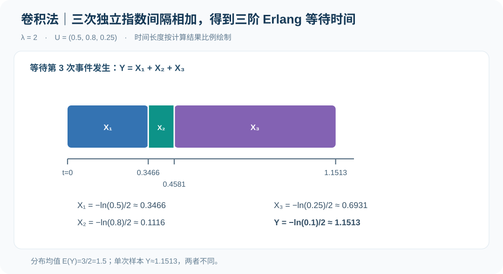
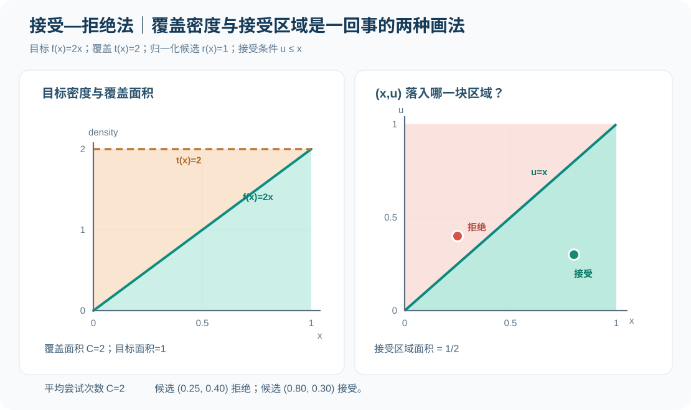
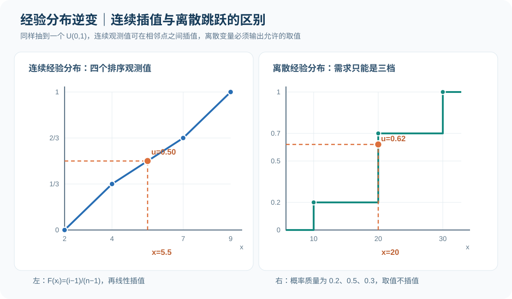

# 随机变量专项练习 06｜卷积、接受—拒绝、Gamma 与经验分布（图解）

[返回总目录](../README.md) · [上一题：逆变与函数变换](2026-random-variate-transforms-visual.md) · [第四讲原课件笔记](../notes/04-random-variate-generation.md) · [期末计算题集](2026-calculation-workbook.md)

第四讲前半部分研究如何把均匀数直接变换为指定分布。本节接着处理三种实际困难：目标变量是若干独立随机变量之和；目标密度可算但反分布函数难算；没有可信的理论分布，只有观测数据或频数表。

教材给出的对应方法分别是卷积法、接受—拒绝法以及经验分布抽样。Gamma 分布的 GB、GS 生成算法属于接受—拒绝法的具体实现。例题采用课件中的算法约定，数字重新设计，目的是练习每一步计算，不把示例数据冒充为原板书的取值。

| 已知条件 | 可采用的方法 | 判断时抓住哪一步 |
| --- | --- | --- |
| 等待若干次事件，每次间隔独立且服从相同指数分布 | 卷积法生成 Erlang | 各指数间隔独立、率参数一致，最后求和 |
| 已知目标密度，但没有简洁的逆 CDF | 接受—拒绝法 | 找到完全覆盖目标密度的函数，按密度比接受 |
| 需要一般形状参数的 Gamma 随机变量 | GB 或 GS | 先判 `a` 所在区间，再执行对应的分支与接受条件 |
| 有连续原始观测值 | 排序值之间线性插值 | 在相邻数据点对应的累计概率之间求反函数 |
| 只有连续变量的分组频数 | 组内线性插值 | 先选累计频数所在组，再用组内相对位置插值 |
| 目标只可能取有限几个离散值 | 离散累计概率抽样 | 落在哪个累计概率区间，就返回对应的离散值 |

## 一、题目 1｜卷积法：三次指数等待时间为什么得到 Erlang 分布？

设某系统相邻事件间隔 `X₁,X₂,X₃` 相互独立，均服从率参数 `λ=2` 的指数分布。现在从一次事件之后开始计时，等待后续第三次事件发生。给定三个相互独立的均匀数 `u₁=0.5、u₂=0.8、u₃=0.25`，使用 `Xᵢ=−ln(Uᵢ)/λ` 生成间隔，计算总等待时间、理论均值与方差。

<strong>答案。</strong> 三段等待间隔约为 `0.3466、0.1116、0.6931`；总时间 `Y=ln(10)/2≈1.1513`。理论分布是三阶 Erlang（也即形状 3、率 2 的 Gamma），理论均值 `1.5`，方差 `0.75`。

### 第一步：先把每一段间隔生成出来

```math
\begin{aligned}
x_1&=-\frac{\ln0.5}{2}\approx0.3466,\\
x_2&=-\frac{\ln0.8}{2}\approx0.1116,\\
x_3&=-\frac{\ln0.25}{2}\approx0.6931.
\end{aligned}
```

等待第三次事件的总时间是前三段长度相加，不是取其中最大值：

```math
\begin{aligned}
Y&=X_1+X_2+X_3\\
&=-\frac{1}{2}(\ln U_1+\ln U_2+\ln U_3)\\
&=-\frac{1}{2}\ln(U_1U_2U_3).
\end{aligned}
```

```math
y=-\frac{\ln(0.5\times0.8\times0.25)}{2}
=-\frac{\ln0.1}{2}
=\frac{\ln10}{2}\approx1.1513.
```



这张时间轴的三个色块顺序连接：第二段从第一段终点开始，第三段从第二段终点开始。它表示一个样本的时间组成；<strong>不能把单次样本值 `1.1513` 与该分布的理论均值 `1.5` 混为一谈。</strong>

### 第二步：分布和矩为什么可以直接得出？

若 `Xᵢ` 是相互独立、率参数同为 `λ` 的指数变量，`Y=ΣXᵢ` 服从 `n` 阶 Erlang 分布，其密度为：

```math
f_Y(y)=\frac{\lambda^n y^{n-1}e^{-\lambda y}}{(n-1)!},\qquad y>0.
```

它是 Gamma 分布在正整数形状参数下的特例。由期望的线性性和独立时方差的可加性：

```math
E(Y)=\frac{n}{\lambda}=\frac{3}{2}=1.5,
\qquad
\operatorname{Var}(Y)=\frac{n}{\lambda^2}=\frac{3}{4}=0.75.
```

“同样的率参数”关系到能否直接得到普通 Erlang；“相互独立”关系到卷积密度和方差的计算。若不同间隔率参数不一致，不能继续套用同一个 `Eₙ(λ)` 公式。编程时若 `n` 很大，最好计算 `−Σln(Uᵢ)/λ`，避免先求许多小数乘积导致浮点下溢。

## 二、题目 2｜接受—拒绝法：怎样看懂覆盖函数和接受区域？

希望生成目标密度为 `f(x)=2x`（`0≤x≤1`）的随机变量。为展示接受—拒绝法，选择覆盖函数 `t(x)=2`（`0≤x≤1`，区间外为 0）。计算归一化的候选密度、接受概率、平均尝试次数，并判断下面两次尝试：第一次 `(x,u)=(0.25,0.40)`，第二次 `(x,u)=(0.80,0.30)`。

<strong>答案。</strong> 覆盖面积 `C=2`，候选密度 `r(x)=1`；给定候选 `x` 的接受条件是 `u≤x`。第一次拒绝，第二次接受并输出 `0.80`。单次尝试的无条件接受概率为 `1/2`，平均需尝试 `2` 次。

### 第一步：验证覆盖关系，并把覆盖函数归一化

```math
f(x)=2x,\qquad t(x)=2,\qquad 0\leq x\leq1.
```

因为 `2≥2x`，整个支持集上都满足 `t(x)≥f(x)`。覆盖函数的面积：

```math
C=\int_0^1t(x)\,dx=\int_0^1 2\,dx=2.
```

但 `t(x)` 本身面积为 2，不能当作概率密度直接抽样。要先除以 `C`：

```math
r(x)=\frac{t(x)}{C}=\frac{2}{2}=1,
\qquad 0\leq x\leq1.
```

因此候选 `X` 从 `U(0,1)` 中抽取；另需抽一个与候选独立的随机数 `U` 决定是否接受。

### 第二步：计算接受条件，再看图

```math
P(\text{accept}\mid X=x)
=\frac{f(x)}{t(x)}=\frac{2x}{2}=x.
```

所以实际比较规则是 `u≤x`。



左图显示目标密度 `2x` 始终在覆盖线 `t(x)=2` 下方，右图则把一次尝试画成单位正方形中的一点 `(x,u)`。点若落在对角线 `u=x` 的下方或线上则接受；落在上方则拒绝。

本题两次尝试按顺序为：

| 尝试 | 候选 `x` | 检验随机数 `u` | 比较 | 操作 |
| ---: | ---: | ---: | --- | --- |
| 1 | 0.25 | 0.40 | `0.40>0.25` | 拒绝，不输出 |
| 2 | 0.80 | 0.30 | `0.30≤0.80` | 接受，输出 `0.80` |

### 第三步：为什么留下来的样本密度恰好是 `2x`？

给定候选落在 `x` 附近，候选密度为 `r(x)`；再乘以条件接受概率 `f(x)/t(x)`，得到“落在此处并被接受”的密度权重：

```math
r(x)\frac{f(x)}{t(x)}
=\frac{t(x)}{C}\frac{f(x)}{t(x)}
=\frac{f(x)}{C}.
```

单次尝试在任意位置被接受的总概率为：

```math
P(A)=\int\frac{f(x)}{C}\,dx=\frac{1}{C}=\frac{1}{2}.
```

因此在“已经接受”的条件下，新变量的密度为：

```math
f_{X\mid A}(x)=\frac{f(x)/C}{1/C}=f(x).
```

这说明拒绝操作不是简单删掉异常值，而是在改变候选样本各位置的保留比例。重复尝试的成功概率恒为 `1/C`，独立尝试下平均次数为 `C=2`。本例的目标 `2x` 实际上可以用简单的逆变公式 `X=√U` 精确生成；这里选择接受—拒绝法只是为了把原理完整展示出来。

## 三、题目 3｜Gamma 参数先弄清：形状、率与尺度不是一回事

课件采用 `Gamma(a,b)`，第一个参数 `a>0` 是形状（shape），第二个参数 `b>0` 是<strong>率（rate）</strong>，密度为：

```math
f(x)=\frac{b^a}{\Gamma(a)}x^{a-1}e^{-bx},\qquad x>0.
```

它的均值与方差：

```math
E(X)=\frac{a}{b},\qquad
\operatorname{Var}(X)=\frac{a}{b^2}.
```

某些软件使用第二个参数作为尺度（scale），即 `1/b`；直接把数值复制过去会得到不同分布。因此做题时先看清课件/软件的参数化。

生成时常先得到 `G∼Gamma(a,1)`，再设置 `X=G/b`，便得到 `Gamma(a,b)`。对形状参数：

| 形状 `a` | 课件适用方法 | 原理 |
| --- | --- | --- |
| `a=1` | 指数逆变 | Gamma 退化为指数分布 |
| `a=n≥2` 为整数 | 卷积法 | `n` 个独立 `E(1)` 变量相加 |
| `a>1` 非整数 | GB 接受—拒绝算法 | 候选分布与快速接受检验 |
| `0<a<1` | GS 接受—拒绝算法 | 按候选分布的两个区间分段抽样与检验 |

注意 `a=1` 不属于 `0<a<1` 或 `a>1`，不能不判断就套用 GB/GS。

## 四、题目 4｜GB 算法：快速接受条件怎样逐项计算？

使用课件的 GB 算法生成 `Gamma(a=2.5,b=2)`，已给定独立均匀数 `u₁=0.5、u₂=0.5`。计算中间量并说明是否接受，最后写出率参数为 2 时的输出。

<strong>答案。</strong> `λ=2`、`v=0`、`x=2.5`、`z=0.125`、`w=−ln4≈−1.3863`，快速接受统计量 `w+d−θz≈0.5553>0`，因此接受。最后输出 `x/b=2.5/2=1.25`。

### 第一步：按课件约定写出参数

GB 算法在本节中的 `λ` 是计算用常数，不是指数分布的率参数：

```math
\lambda=\sqrt{2a-1},\qquad
\theta=4.5,\qquad d=1+\ln\theta.
```

对于 `a=2.5`：

```math
\lambda=\sqrt{2\times2.5-1}=2,
\qquad d=1+\ln4.5\approx2.5041.
```

### 第二步：用两个均匀数生成候选值

```math
\begin{aligned}
v&=\frac{1}{\lambda}\ln\frac{u_1}{1-u_1}
=\frac{1}{2}\ln1=0,\\
x&=a e^v=2.5,\\
z&=u_1^2u_2=0.5^2\times0.5=0.125,\\
w&=(a+\lambda)v+a-\ln4-x
=-\ln4\approx-1.3863.
\end{aligned}
```

### 第三步：先执行快速接受，再决定要不要做完整检查

```math
\begin{aligned}
w+d-\theta z
&=-1.3863+2.5041-4.5\times0.125\\
&\approx0.5553>0.
\end{aligned}
```

所以本次可以直接接受。如果这一步没有通过，<strong>并不能立即拒绝</strong>，还需要再检查课件给出的完整条件 `ln z≤w`；第二步也不成立时才舍弃候选值，返回重新抽样。本例快速接受已通过，不需要再用第二条件作决定。

由于算法先生成的是 `Gamma(2.5,1)`，题目要求 `Gamma(2.5,2)`，因此最终还要把接受的 `x` 除以率参数 2。

## 五、题目 5｜GS 算法：为什么候选抽样与接受条件都要分段？

使用课件 GS 算法生成 `Gamma(a=0.5,b=2)`，给定独立均匀数 `u₁=0.4、u₂=0.5`。要求计算分段常数、候选值、接受条件及最终输出。

<strong>答案。</strong> `b₀=1+a/e≈1.18394`，`z=b₀u₁≈0.47358≤1`，使用左分支得到候选值 `x=z^(1/a)=z²≈0.22428`。因为 `u₂=0.5≤e^(−x)≈0.799`，接受；最后按率参数缩放得到 `x/2≈0.11214`。

GS 算法使用分段覆盖函数，课件设：

```math
t(x)=
\begin{cases}
\dfrac{x^{a-1}}{\Gamma(a)},&0<x\leq1,\\
\dfrac{e^{-x}}{\Gamma(a)},&x>1.
\end{cases}
```

因为目标 Gamma(a,1) 密度为 `f(x)=x^(a−1)e^(−x)/Γ(a)`，所以当 `0<x≤1` 时 `f(x)/t(x)=e^(−x)`；当 `x>1` 时比值为 `x^(a−1)`。这就解释了两支不同的接受判据。

### 第一步：算分段常数，选候选分支

```math
\begin{aligned}
b_0&=1+\frac{a}{e}=1+\frac{0.5}{e}\approx1.18394,\\
z&=b_0u_1\approx1.18394\times0.4\approx0.47358.
\end{aligned}
```

因为 `z≤1`，使用左分支：

```math
x=z^{1/a}=z^2\approx0.22428.
```

若实际计算遇到 `z>1`，则应使用另一支 `x=−ln((b₀−z)/a)`，而不是把 `z^(1/a)` 继续套到底。

### 第二步：按所在分支验收，再进行率参数缩放

```math
e^{-x}\approx e^{-0.22428}\approx0.7991>u_2=0.5.
```

因此接受 `x`，最后输出：

```math
Y=\frac{x}{b}\approx\frac{0.22428}{2}=0.11214.
```

这里的 `b₀` 是 GS 算法的候选分布常数，而目标 `Gamma(a,b)` 的 `b=2` 是率参数，两个字母相近但用途不同。课件用 `z=b₀u₁` 做候选分支选择，再根据候选 `x` 落在哪一段判断是否接受，不能颠倒。

## 六、题目 6｜只有连续观测值：为什么生成结果可以不在原数据里？

某工序的四次历史加工时间按升序为 `2、4、7、9` 分钟，没有选定可信的理论分布。按课件“相邻排序值之间线性插值”的连续经验分布抽样法，给定 `u=0.5`，计算生成时长。

<strong>答案。</strong> 对应第二段 `4` 到 `7` 之间，生成 `x=5.5` 分钟。

课件对排序后的 `n` 个观测值使用如下累计概率位置：

```math
F(x_{(i)})=\frac{i-1}{n-1},\qquad i=1,\ldots,n.
```

对于本题 `n=4`，四个观察值的累计位置分别为 `0、1/3、2/3、1`。因此 `u=0.5` 落在第二个和第三个数据之间，所在区间的相对进度为：

```math
\frac{0.5-1/3}{2/3-1/3}=\frac{1}{2}.
```

据此对加工时间做线性插值：

```math
x=4+\frac{1}{2}(7-4)=5.5.
```



左图通过相邻数据点连线，使 CDF 成为连续分段线性函数；因此结果可以处于两个观测值之间。这不同于统计课上直接以 `Fₙ(x)=#(Xᵢ≤x)/n` 定义的阶梯经验 CDF，也不同于“从历史四个观测值中随机抽一个”的简单重抽样。

若存在重复观测值导致某段水平距离为零，连续线性插值的密度表达需要另行处理，不能出现除以零的组距。

## 七、题目 7｜只有分组频数：先选区间，再在组内插值

某作业时间只有分组统计，第一组 `[0,10)` 有 2 条、第二组 `[10,20)` 有 3 条、第三组 `[20,30]` 有 5 条。假设在每个组内均匀分布。给定 `u=0.38`，按连续分组经验分布求一次抽样结果。

<strong>答案。</strong> 落在第二组，输出 `x=16` 分钟。

先列表计算累计概率：

| 区间 | 频数 `nᵢ` | 累计频数 `Nᵢ` | 累计概率 |
| --- | ---: | ---: | ---: |
| `[0,10)` | 2 | 2 | 0.2 |
| `[10,20)` | 3 | 5 | 0.5 |
| `[20,30]` | 5 | 10 | 1.0 |

`0.2<0.38<0.5`，因此选第二组。组内进度为：

```math
q=\frac{0.38-0.2}{0.5-0.2}=0.6.
```

利用第二组宽度 `20−10=10`：

```math
x=10+0.6\times10=16.
```

一般地，若组端点为 `[a_(i−1),a_i)`、总样本量为 `n`，已选中第 `i` 个频数 `nᵢ>0` 的组，则：

```math
x=a_{i-1}+
\frac{nu-N_{i-1}}{n_i}(a_i-a_{i-1}).
```

本方法的“组内均匀”是一项额外假设，并非只凭频数表就能得知真实组内分布。遇到频数为零的组要跳过，不能除以零；组宽不等时要使用该组实际宽度。

## 八、题目 8｜离散需求：为什么只选类别、不做线性插值？

某零件一天的需求只可能是 `10、20、30` 个，对应概率 `0.2、0.5、0.3`。按课件累计概率抽样法，分别计算 `u=0.62` 和 `u=0.91` 时的需求量。

<strong>答案。</strong> `u=0.62` 返回 20 个；`u=0.91` 返回 30 个。

先算累计概率：

```math
P_1=0.2,\qquad P_2=0.7,\qquad P_3=1.0.
```

| 均匀数区间 | 输出需求 | 对应概率 |
| --- | ---: | ---: |
| `0<u≤0.2` | 10 | 0.2 |
| `0.2<u≤0.7` | 20 | 0.5 |
| `0.7<u<1` | 30 | 0.3 |

`0.62` 在第二段，`0.91` 在第三段。图中的离散 CDF 是阶梯函数：在 `10、20、30` 三个取值处跳跃，跳跃高度分别等于三项概率。<strong>若把 0.62 在 `20` 与 `30` 之间插成 26.2，这个输出根本不属于允许的需求取值集合。</strong>

对于理想连续的均匀数，精确取到累计概率边界的概率为零；但手算题可能故意指定边界，因此应统一按照课件 `P_(i−1)<u≤P_i` 的约定答题。

## 九、概念辨析与解题模板

<strong>判断 1。</strong> “几个独立指数随机变量相加，得到的分布一定还是指数分布。”

<strong>答案：错误。</strong> 同率的多个独立指数变量之和为 Erlang；只有一项时才是原来的指数分布。

<strong>判断 2。</strong> “只要覆盖函数在大部分地方高于目标密度，就能使用接受—拒绝法。”

<strong>答案：错误。</strong> 必须在所有相关的支持集上满足 `t(x)≥f(x)`（可忽略零测集差异），否则目标的一部分区域会被候选模型错误地遗漏。

<strong>判断 3。</strong> “GB 的第一个快速接受条件没通过，应该立刻舍弃候选值。”

<strong>答案：错误。</strong> 课件明确要求继续判断第二个完整接受条件；两个都不满足时才拒绝。

<strong>判断 4。</strong> “Gamma(a,b) 在课件中的 `b` 是尺度，所以接受 `Gamma(a,1)` 样本后应该乘以 `b`。”

<strong>答案：错误。</strong> 本课件 `b` 是率，目标输出是 `X/b`，而不是 `bX`。

<strong>判断 5。</strong> “连续经验分布插值抽样与离散经验分布累计概率抽样是同一个步骤。”

<strong>答案：错误。</strong> 前者在排序值或分组区间之间插值，可以生成连续新数值；后者直接返回允许集合中的某个离散值。

<strong>判断 6。</strong> “某取舍算法一次尝试接受率为 0.4，说明一定会在两次或三次尝试后成功。”

<strong>答案：错误。</strong> 平均尝试次数为 `1/0.4=2.5`，不是每一次都恰好尝试 2.5 次，也不是对单个样本的成功次数保证。

计算时可统一按四个问题推进：输入是什么分布；目标分布是什么；是否存在必须保持的独立性和参数条件；得到结果后是否要进一步做分支判别、拒绝循环或率参数缩放。具体到题目，卷积法应把每个分量与总和同时列出；接受—拒绝法应把候选、概率比值与判定顺序分别列出；经验分布法应先列累计概率表，再执行区间选择与反求。
