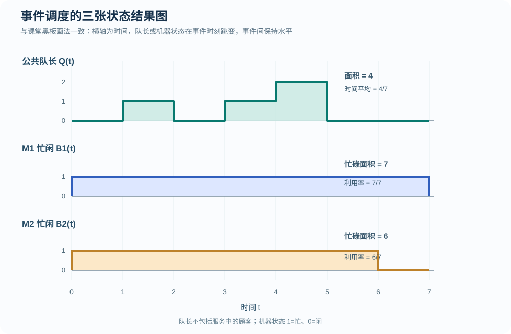
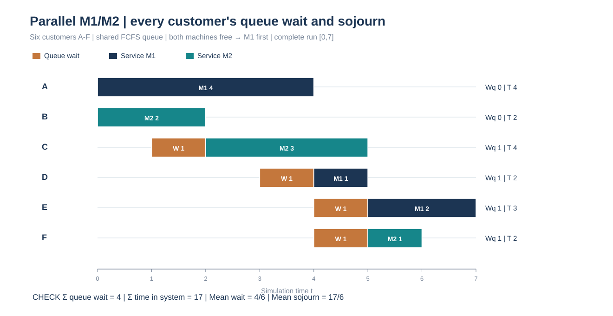
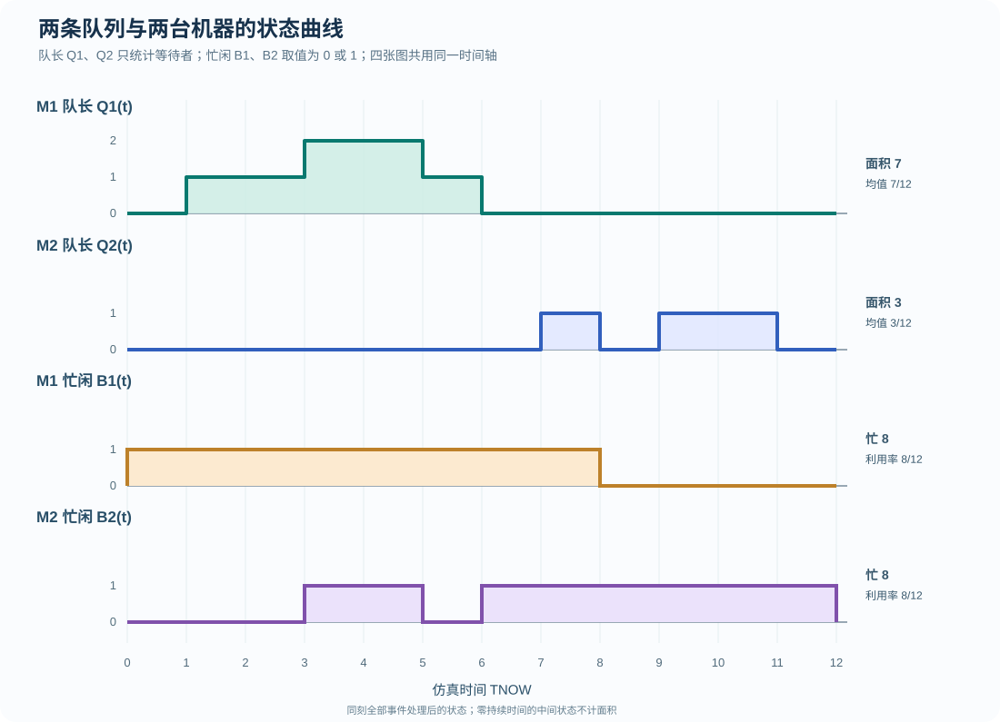
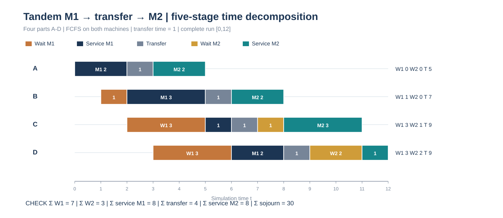
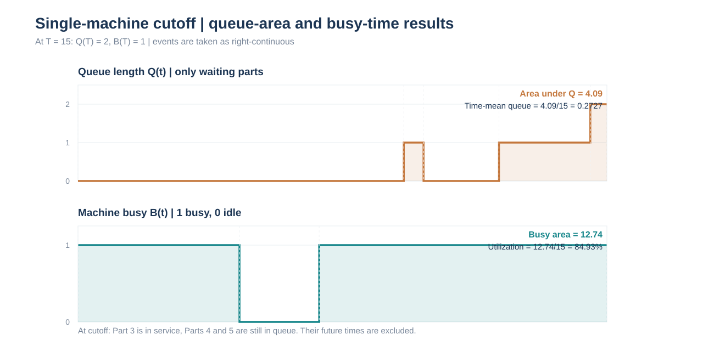
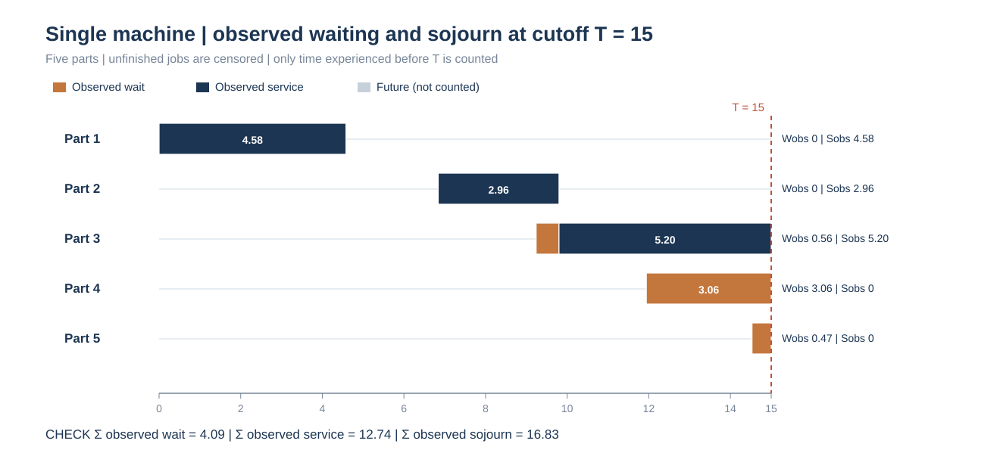

# 期末手工仿真加练｜三种结构的完整 FEL 账本与指标核查

[返回总目录](../README.md) · [手工事件调度专题](../manual-event-simulation/README.md) · [单机截尾详解](../manual-event-simulation/02-single-machine-five-parts.md) · [双机并联原练习](2026-event-drill-parallel.md) · [双机串联原练习](2026-event-drill-tandem.md)

这份练习专门对齐 2026 年 11 月 9 日手工仿真课堂的答题形式：<strong>每推进到一个事件时刻，要明确 TNOW、刚执行的事件、处理后系统状态，以及按绝对时刻升序排列的完整未来事件表 FEL。</strong> 每行是本时刻处理结束后独立的一张快照，不是只写“新插入了哪个事件”。表中的数据复用本仓库此前的三道独立练习，与课堂录音示范的事件规则一致，但不冒充录音板书原题。

与期末范围相匹配，本页只训练单机、两机并联、两机串联；同刻事件执行优先级由每道题明确约定。<strong>同刻事件先后不会影响时间面积</strong>，但若它们竞争同一设备，仍可能影响谁先开工及最终结果，因此不能把“同刻任意顺序都一样”当作无条件规则。

## 一、统一答题方法：每一张表都要有四类信息

本页为了方便横向检查，将课堂要求的实体、时钟、FEL 和指标合并成大表。真正写在试卷上，可以每发生一个事件就重画如下四个内容：

| 板块 | 应填写的内容 | 常见漏项 |
| --- | --- | --- |
| 实体与资源 | 各机器正在加工谁，哪位零件正在运输，各队列中谁先谁后 | 只记忙闲、不记零件编号 |
| 当前时钟 TNOW | 从 FEL 取出的最早待发生时刻 | 把加工时长错当绝对事件时刻 |
| 未来事件表 FEL | 所有<strong>尚未执行</strong>事件，按计划发生时刻升序完整列出 | 只写新增项，或把已经发生的旧事件保留在表内 |
| 输出指标 | 队长 Q、忙闲 B、每位零件等待/逗留，以及每段时间的面积累积 | 先更新队长再算上一时段面积 |

例如事件表从 <code>t=1</code> 跳到 <code>t=2</code>，应先取 <code>[1,2)</code> 期间保持不变的旧状态积累：

```math
\Delta A_Q=Q(1^+)\,(2-1),\qquad
\Delta A_{B_k}=B_k(1^+)\,(2-1).
```

之后才删除 <code>t=2</code> 的事件、执行它引起的状态转移、插入新事件并对整个 FEL 重新排序。若多个事件同刻，先按题目给定的同刻规则处理并记录最终状态，零持续时间的临时状态对面积没有贡献。

## 二、双机并联：六位顾客、公共 FCFS 队列、M1 优先

顾客 A—F 的到达时刻为 <code>0、0、1、3、4、4</code>，相应加工时长为 <code>4、2、3、1、2、1</code>。两台机器均空闲时优先 M1，只有一台空闲时直接使用空闲机器。若某时刻同时有完工与新到达，先处理完工并将已有等待者分派，再处理新到达。为节省手算符号，初始化时<strong>一次性安排全部六个已知外部到达</strong>，后续不再二次生成到达事件。

<code>A(X)@t</code> 表示顾客 X 在时刻 t 到达系统；<code>D(X,Mk)@t</code> 表示 X 在机器 Mk 于 t 完工、离开系统。顾客没有开工前，不应先给它安排未来完工事件。

### 2.1 初始快照与全过程

初始化：<code>TNOW=0</code>，M1、M2 空闲，公共等待队列为空，观察截止时间以全部顾客完工为准。

```text
FEL(初始)：A(A)@0，A(B)@0，A(C)@1，A(D)@3，A(E)@4，A(F)@4
```

| TNOW | 本时刻从 FEL 执行并删除 | 处理后的 M1 / M2 | 公共等待队列 Q | 处理后完整 FEL（时间升序） |
| ---: | --- | --- | --- | --- |
| 0 | A(A)、A(B) | A `[0,4)` / B `[0,2)` | `[]` | `A(C)@1; D(B,M2)@2; A(D)@3; D(A,M1)@4; A(E)@4; A(F)@4` |
| 1 | A(C) | A / B | `[C]` | `D(B,M2)@2; A(D)@3; D(A,M1)@4; A(E)@4; A(F)@4` |
| 2 | D(B,M2)，C 开始 M2 | A / C `[2,5)` | `[]` | `A(D)@3; D(A,M1)@4; A(E)@4; A(F)@4; D(C,M2)@5` |
| 3 | A(D) | A / C | `[D]` | `D(A,M1)@4; A(E)@4; A(F)@4; D(C,M2)@5` |
| 4 | D(A,M1)，先让 D 开始 M1，再执行 A(E)、A(F) | D `[4,5)` / C | `[E,F]` | `D(C,M2)@5; D(D,M1)@5` |
| 5 | D(C,M2)、D(D,M1)，E、F 依次接替 | E `[5,7)` / F `[5,6)` | `[]` | `D(F,M2)@6; D(E,M1)@7` |
| 6 | D(F,M2) | E / 空闲 | `[]` | `D(E,M1)@7` |
| 7 | D(E,M1) | 空闲 / 空闲 | `[]` | 空表，六人全部离开 |

在 <code>t=4</code> 这一步，不能按“E 和 F 刚到达”就抢占已排队的 D。若考场要求显式划掉已发生的 FEL 事件，可以在重画的快照中写 ~~D(A,M1)@4~~，随后完整誊写未发生项并补上 <code>D(D,M1)@5</code>；不要只写一个“新增 D@5”。

### 2.2 用时间区间的旧状态累加队长与忙碌面积

| 区间 | Q | B1 | B2 | 队长面积增加 Q×Δt | M1 忙碌增加 | M2 忙碌增加 |
| --- | ---: | ---: | ---: | ---: | ---: | ---: |
| `[0,1)` | 0 | 1 | 1 | 0 | 1 | 1 |
| `[1,2)` | 1 | 1 | 1 | 1 | 1 | 1 |
| `[2,3)` | 0 | 1 | 1 | 0 | 1 | 1 |
| `[3,4)` | 1 | 1 | 1 | 1 | 1 | 1 |
| `[4,5)` | 2 | 1 | 1 | 2 | 1 | 1 |
| `[5,6)` | 0 | 1 | 1 | 0 | 1 | 1 |
| `[6,7)` | 0 | 1 | 0 | 0 | 1 | 0 |
| <strong>总面积</strong> | — | — | — | <strong>4</strong> | <strong>7</strong> | <strong>6</strong> |





逐人等待 <code>(0,0,1,1,1,1)</code>，故累计等待为 <code>4</code>、平均等待 <code>4/6=2/3</code>；六人系统逗留 <code>(4,2,4,2,3,2)</code>，合计 <code>17</code>、平均逗留 <code>17/6≈2.8333</code>。队长面积 <code>4</code> 恰等于累计等待；全部加工时长 <code>13</code> 恰等于两台机器忙碌面积 <code>7+6</code>。

```math
\overline Q=\frac{4}{7}\approx0.5714,\qquad
\rho_1=\frac{7}{7}=100\%,\qquad
\rho_2=\frac{6}{7}\approx85.71\%.
```

注意平均等待按六人除，时间平均队长和利用率按 7 个时间单位的观察窗口除。系统内顾客人数是 <code>Q+B1+B2</code>，它与等待队列人数 Q 不是同一个指标。

## 三、双机串联：M1 → 运输 1 → M2，两条 FCFS 队列

四件零件 A—D 的外部到达时刻是 <code>0、1、2、3</code>；M1 加工时长 <code>(2,3,1,2)</code>；M2 加工时长 <code>(2,2,3,1)</code>；每件离开 M1 后须运输一个时间单位才到达 M2。初始化时一次排定四件已知外部到达事件。记 <code>A1(X)</code> 为从外部到达 M1，<code>D1(X)</code> 为完成 M1，<code>A2(X)</code> 为运输后到达 M2，<code>D2(X)</code> 为完成 M2 并离开系统。

### 3.1 初始化与完整事件账本

初始化：<code>TNOW=0</code>，M1/M2 均空闲，两条队列为空，无运输中零件，FEL 是 <code>A1(A)@0; A1(B)@1; A1(C)@2; A1(D)@3</code>。

| TNOW | 执行并删除的事件 | 处理后 M1 / Q1 | 处理后 M2 / Q2 | 运输中 | 处理后完整 FEL（时间升序） |
| ---: | --- | --- | --- | --- | --- |
| 0 | A1(A) | A `[0,2)` / `[]` | 空闲 / `[]` | 无 | `A1(B)@1; D1(A)@2; A1(C)@2; A1(D)@3` |
| 1 | A1(B) | A / `[B]` | 空闲 / `[]` | 无 | `D1(A)@2; A1(C)@2; A1(D)@3` |
| 2 | D1(A)、A1(C)；B 接替 M1 | B `[2,5)` / `[C]` | 空闲 / `[]` | A `[2,3)` | `A1(D)@3; A2(A)@3; D1(B)@5` |
| 3 | A1(D)、A2(A) | B / `[C,D]` | A `[3,5)` / `[]` | 无 | `D1(B)@5; D2(A)@5` |
| 5 | D1(B)、D2(A)；C 接替 M1 | C `[5,6)` / `[D]` | 空闲 / `[]` | B `[5,6)` | `D1(C)@6; A2(B)@6` |
| 6 | D1(C)、A2(B)；D 接替 M1 | D `[6,8)` / `[]` | B `[6,8)` / `[]` | C `[6,7)` | `A2(C)@7; D1(D)@8; D2(B)@8` |
| 7 | A2(C) | D / `[]` | B / `[C]` | 无 | `D1(D)@8; D2(B)@8` |
| 8 | D1(D)、D2(B)；C 接替 M2 | 空闲 / `[]` | C `[8,11)` / `[]` | D `[8,9)` | `A2(D)@9; D2(C)@11` |
| 9 | A2(D) | 空闲 / `[]` | C / `[D]` | 无 | `D2(C)@11` |
| 11 | D2(C)；D 接替 M2 | 空闲 / `[]` | D `[11,12)` / `[]` | 无 | `D2(D)@12` |
| 12 | D2(D) | 空闲 / `[]` | 空闲 / `[]` | 无 | 空表，四件全部离开系统 |

<strong>串联题需要同时核对两种到达：</strong>外部到达 M1 的时刻是 <code>0、1、2、3</code>；运输后实际到达 M2 的时刻是 <code>3、6、7、9</code>。不能把 <code>D1(X)</code> 当成系统离开，也不能在完成 M1 的瞬间就为零件安排 M2 完工事件，必须等它到达 M2 并真正开工。

### 3.2 两条队列、两台机器分别累计时间面积

| 区间 | Q1 | Q2 | B1 | B2 | ΔA(Q1) | ΔA(Q2) | ΔA(B1) | ΔA(B2) |
| --- | ---: | ---: | ---: | ---: | ---: | ---: | ---: | ---: |
| `[0,1)` | 0 | 0 | 1 | 0 | 0 | 0 | 1 | 0 |
| `[1,2)` | 1 | 0 | 1 | 0 | 1 | 0 | 1 | 0 |
| `[2,3)` | 1 | 0 | 1 | 0 | 1 | 0 | 1 | 0 |
| `[3,5)` | 2 | 0 | 1 | 1 | 4 | 0 | 2 | 2 |
| `[5,6)` | 1 | 0 | 1 | 0 | 1 | 0 | 1 | 0 |
| `[6,7)` | 0 | 0 | 1 | 1 | 0 | 0 | 1 | 1 |
| `[7,8)` | 0 | 1 | 1 | 1 | 0 | 1 | 1 | 1 |
| `[8,9)` | 0 | 0 | 0 | 1 | 0 | 0 | 0 | 1 |
| `[9,11)` | 0 | 1 | 0 | 1 | 0 | 2 | 0 | 2 |
| `[11,12)` | 0 | 0 | 0 | 1 | 0 | 0 | 0 | 1 |
| <strong>合计</strong> | — | — | — | — | <strong>7</strong> | <strong>3</strong> | <strong>8</strong> | <strong>8</strong> |





两条队列的累计等待是 <code>ΣW1=7</code> 和 <code>ΣW2=3</code>，分别与队长面积 <code>7、3</code> 一致；运输总时间 <code>4</code> 计入系统逗留，但不计入任一队长或机器忙碌面积。两台设备的加工总时间各为 8，所以在 <code>[0,12)</code> 窗口内：

```math
\begin{aligned}
\overline Q_1&=\frac{7}{12},\qquad\overline Q_2=\frac{3}{12},\\
\rho_1&=\frac{8}{12}=\frac{2}{3},\qquad\rho_2=\frac{8}{12}=\frac{2}{3},\\
\sum_iT_i&=\underbrace{7}_{\mathrm{M1\ queue}}+\underbrace{8}_{\mathrm{M1\ service}}
+\underbrace{4}_{\mathrm{transfer}}+\underbrace{3}_{\mathrm{M2\ queue}}+\underbrace{8}_{\mathrm{M2\ service}}=30.
\end{aligned}
```

四件零件系统逗留分别为 <code>5、7、9、9</code>，平均逗留 <code>30/4=7.5</code>。必须直到完成 M2、离开最后一道工序才结算每件零件的完整系统逗留。

## 四、单机：固定时刻 T=15 截止，FEL 仍可能非空

五件零件的累计到达时刻为 <code>0、6.84、9.24、11.94、14.53</code>，加工时长为 <code>4.58、2.96、5.86、3.21、3.11</code>。本题规定固定时钟截止 <code>T=15</code>。这次采用另一种同样正确的 FEL 生成方式：<strong>每执行一个到达事件，才安排下一件到达</strong>，并将 <code>END@15</code> 作为终止事件预先放入 FEL。两个生成方式不可在同一道手算中混用，以免重复到达。

<code>Ai</code> 表示零件 i 外部到达；<code>Di</code> 表示它真正完成 M1 并离开系统。初始化的 FEL 为 <code>A1@0; END@15</code>。

| TNOW | 本时刻执行并删除 | M1 处理后状态 | 等待队列 | 处理后完整 FEL（时间升序） |
| ---: | --- | --- | --- | --- |
| 0 | A1 | 加工零件 1，完工计划 4.58 | `[]` | `D1@4.58; A2@6.84; END@15` |
| 4.58 | D1 | 空闲 | `[]` | `A2@6.84; END@15` |
| 6.84 | A2 | 加工零件 2，计划 9.80 | `[]` | `A3@9.24; D2@9.80; END@15` |
| 9.24 | A3 | 继续加工零件 2 | `[3]` | `D2@9.80; A4@11.94; END@15` |
| 9.80 | D2，零件 3 开工 | 加工零件 3，计划 15.66 | `[]` | `A4@11.94; END@15; D3@15.66` |
| 11.94 | A4 | 继续加工零件 3 | `[4]` | `A5@14.53; END@15; D3@15.66` |
| 14.53 | A5 | 继续加工零件 3 | `[4,5]` | `END@15; D3@15.66` |
| 15.00 | END | 零件 3 正在加工 | `[4,5]` | `D3@15.66` 尚未执行；仿真结束 |

注意在 <code>t=15</code> 停止时，零件 3 尚有 0.66 时间单位服务未完成；零件 4、5 仍在等待。<strong>FEL 里仍有 D3@15.66 并不意味着已经完工。</strong> 截止时累计到达 5 件、完工 2 件、加工中 1 件、排队 2 件。

### 4.1 截尾统计：指标只积到 T=15

| 区间 | Q | B（单机忙=1） | Δ队长面积 | Δ忙碌面积 |
| --- | ---: | ---: | ---: | ---: |
| `[0,4.58)` | 0 | 1 | 0 | 4.58 |
| `[4.58,6.84)` | 0 | 0 | 0 | 0 |
| `[6.84,9.24)` | 0 | 1 | 0 | 2.40 |
| `[9.24,9.80)` | 1 | 1 | 0.56 | 0.56 |
| `[9.80,11.94)` | 0 | 1 | 0 | 2.14 |
| `[11.94,14.53)` | 1 | 1 | 2.59 | 2.59 |
| `[14.53,15)` | 2 | 1 | 0.94 | 0.47 |
| <strong>合计</strong> | — | — | <strong>4.09</strong> | <strong>12.74</strong> |





截至 15 已经发生的逐件排队等待是 <code>(0,0,0.56,3.06,0.47)</code>，累计 <code>4.09</code>；机器忙碌累计 <code>12.74</code>；五件零件的<strong>已观察逗留</strong>合计为 <code>4.09+12.74=16.83</code>。但已完工零件只有 1、2，因此不能把这五件的截尾逗留直接当作五件完整逗留时间的平均。

```math
\overline Q_{[0,15]}=\frac{4.09}{15}\approx0.2727,\qquad
\rho_{[0,15]}=\frac{12.74}{15}\approx84.93\%.
```

## 五、反向检查：四组等式和不同分母

| 需要检查什么 | 每条轨迹中应有的对应关系 | 常见错误 |
| --- | --- | --- |
| 队长面积 | <code>∫Q(t)dt = Σ每件已发生的等待时间</code>，串联需分 Q1、Q2 | 把正在加工的零件计入 Q |
| 设备忙碌面积 | <code>∫Bk(t)dt = Σ在 Mk 上已发生的加工时间</code> | 把尚未发生的计划加工时间计入截止窗口 |
| 系统逗留 | 完工系统中 <code>Ti = 最后离开−外部到达</code>；完整阶段耗时之和亦应等于 Ti | 串联从离开 M1 就结算，漏掉运输/M2 |
| 各类分母 | 平均等待/逗留按符合口径的实体数除；时间平均队长/利用率按观察时长除 | 将平均等待除以时间，或利用率除以零件数 |

考试若要求“每个时刻都完整抄表”，建议一开始在纸上留出 FEL 固定栏位：抄上一张表的所有未执行项，划掉已经执行的事件，再补入新事件、按时刻排序。只有排队和机器状态变化却没有在时间积分中留下持续区间，或只给出一行最终答案没有过程，都难以充分说明计算来源。
