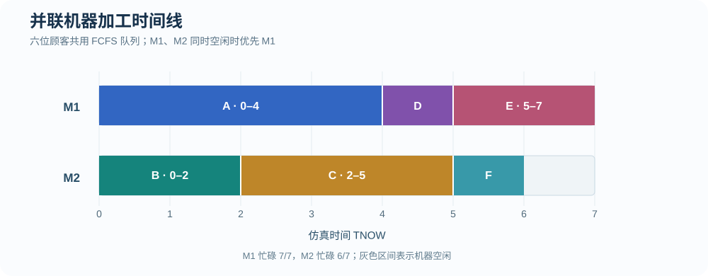
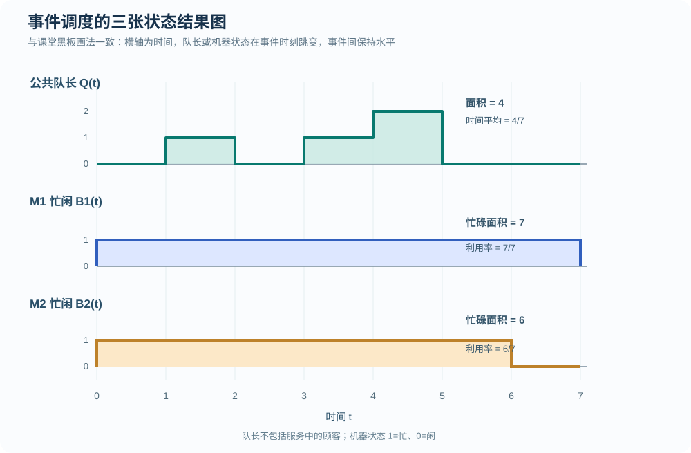
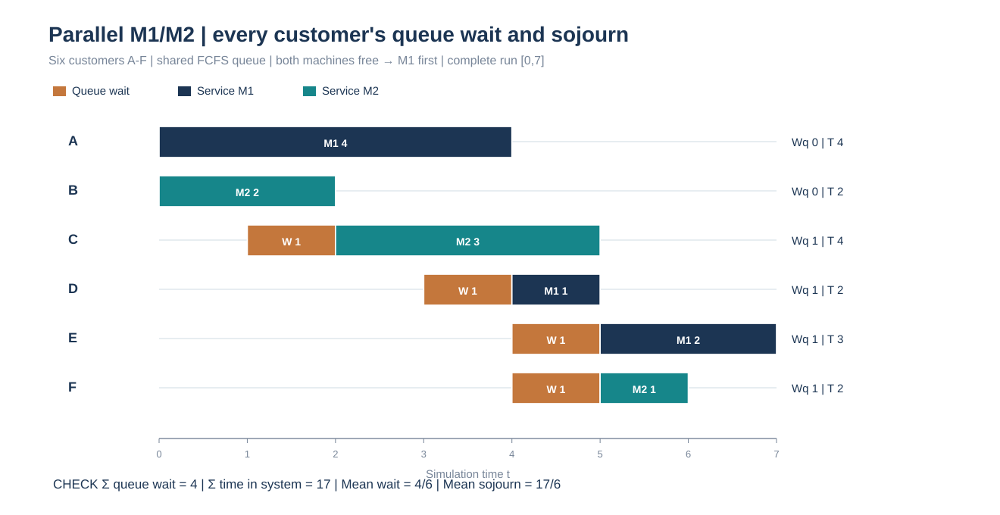

# 事件调度图解练习 01｜双机并联、M1 优先与同刻事件

[返回总目录](../README.md) · [计算专项题集](2026-calculation-workbook.md) · [下一题：双机串联](2026-event-drill-tandem.md) · [事件调度专题](../manual-event-simulation/README.md)

这一题接续前面的 M1 优先练习。数据是为了训练解题而重新设计的，并非课堂原题。结果图采用课堂黑板中的表达方式：<strong>时间为横轴，队长和设备忙闲为纵轴，用阶梯线表示状态变化</strong>。

> [本题逐事件完整 FEL 快照与队长／忙碌面积逐段核算](2026-event-complete-fel-ledger.md)——补足每个事件时刻应抄全的未来事件表。

## 题目

六位顾客 A—F 到达一个双机并联系统，只有一条公共 FCFS 等待队列。M1、M2 同时空闲时优先分配 M1；仅一台空闲时直接使用该机器。若同刻既有加工完成又有新顾客到达，<strong>先执行完工并向已有队列分派</strong>，再按 A—F 的顺序处理该时刻新到达。两台机器都不允许中断服务。

| 顾客 | A | B | C | D | E | F |
| --- | ---: | ---: | ---: | ---: | ---: | ---: |
| 到达时刻 | 0 | 0 | 1 | 3 | 4 | 4 |
| 服务时长 | 4 | 2 | 3 | 1 | 2 | 1 |

求各顾客使用的机器、开始/结束时刻和等待时间；写出事件表，画加工时间线、公共队长 `Q(t)` 和两台机器的忙闲函数，计算平均等待、时间平均队长和利用率。观察窗口从 `t=0` 到最后一位顾客离开。

## 答案

| 顾客 | 机器 | 到达 | 开始服务 | 完成服务 | 排队等待 | 系统逗留 |
| --- | --- | ---: | ---: | ---: | ---: | ---: |
| A | M1 | 0 | 0 | 4 | 0 | 4 |
| B | M2 | 0 | 0 | 2 | 0 | 2 |
| C | M2 | 1 | 2 | 5 | 1 | 4 |
| D | M1 | 3 | 4 | 5 | 1 | 2 |
| E | M1 | 4 | 5 | 7 | 1 | 3 |
| F | M2 | 4 | 5 | 6 | 1 | 2 |

最后离开时刻为 `7`。<strong>平均等待 = `2/3`；时间平均公共队长 = `4/7`；M1 利用率 = `1`；M2 利用率 = `6/7`。</strong>

## 第一步：逐事件更新系统

| TNOW | 本时刻发生的事件 | M1（处理后） | M2（处理后） | 公共等待队列（处理后） |
| ---: | --- | --- | --- | --- |
| 0 | A、B 到达；两机初始空闲，先分 A→M1，再分 B→M2 | A `[0,4)` | B `[0,2)` | 空 |
| 1 | C 到达，两台均忙 | A | B | C |
| 2 | B 完成，C 出队进入 M2 | A | C `[2,5)` | 空 |
| 3 | D 到达，两台均忙 | A | C | D |
| 4 | A 完成，队首 D 开始 M1；随后 E、F 到达 | D `[4,5)` | C | E、F |
| 5 | D、C 同时完成；E 分配 M1、F 分配 M2 | E `[5,7)` | F `[5,6)` | 空 |
| 6 | F 完成，M2 空闲 | E | 空 | 空 |
| 7 | E 完成，M1 空闲，系统清空 | 空 | 空 | 空 |

本题最容易出错的是 `t=4`。A 一完工，D 已经排队，必须先由 D 接替 M1。不能因为 E、F 也是在 `t=4` 到达，就让他们越过 D。`t=5` 时两台机器同时空闲，队列中的 E、F 依序分配给 M1、M2。

可以单独抽查未来事件表（FEL）。例如 `t=4` 所有事件处理结束后，下一批已安排的事件是 `D 完成 M1@5`、`C 完成 M2@5`；`t=5` 处理结束后，变为 `F 完成 M2@6`、`E 完成 M1@7`。<strong>队列中的 E、F 不是“服务完成事件”，在尚未开工前不能提前安排其完成时刻。</strong>

## 第二步：画机器加工时间线



逐台检查：M1 加工 A 四个单位、D 一个、E 两个，连续忙碌 `4+1+2=7`；M2 加工 B 两个、C 三个、F 一个，合计忙碌 `2+3+1=6`，在 `[6,7)` 空闲。

## 第三步：按课堂黑板形式画三张结果曲线



队长曲线不是服务台内的顾客数，而是<strong>尚未开始服务的人数</strong>。因此 C 在 `t=2` 开始服务后，`Q(t)` 立即回到 0；D 在 `t=4` 出队时，队列先变空，随后 E、F 到达使队长变为 2。同一时刻可以有多次状态更新，结果曲线只需记录该时刻全部事件处理完后的状态，零持续时间的中间状态不产生面积。

按非零队列区间求面积：

```math
\begin{aligned}
\int_0^7Q(t)\,dt
&=1(2-1)+1(4-3)+2(5-4)\\
&=4,\\
\overline Q&=\frac{4}{7}\approx0.5714.
\end{aligned}
```

根据机器状态图 `B_1(t)`、`B_2(t)`，忙为 1、闲为 0：

```math
\rho_1=\frac{\int_0^7B_1(t)\,dt}{7}=\frac{7}{7}=1,
\qquad
\rho_2=\frac{\int_0^7B_2(t)\,dt}{7}=\frac{6}{7}.
```

## 第四步：用逐人时间做反向核查

```math
\begin{aligned}
\sum_i W_{q,i}&=0+0+1+1+1+1=4,\\
\overline W_q&=\frac{4}{6}=\frac{2}{3},\\
\sum_i T_i&=4+2+4+2+3+2=17,\\
\sum_i p_i+\sum_i W_{q,i}&=13+4=17.
\end{aligned}
```

总等待时间 `4` 与公共队列曲线面积 `4` 一致，这是检查是否漏算某位顾客等待的重要办法。<strong>注意三个分母不同：</strong> 平均等待按顾客数 `6` 除，时间平均队长按观察时长 `7` 除，利用率也按时间窗口 `7` 除。

## 第五步：逐位顾客的等待与系统逗留时间图



图的横轴是绝对仿真时刻，横条起点对应顾客到达，橙色是服务前的排队等待，深蓝与青色分别表示在 M1、M2 的加工。每行最右侧同时给出该顾客的等待 <code>Wq</code> 与系统逗留 <code>T</code>。没有橙色段表示到达即开始加工，并不意味着其逗留时间为零。

| 顾客 | 等待区间 | 加工区间 | 核算 |
| --- | --- | --- | --- |
| A | 无 | M1 `[0,4)` | `T=4−0=4=0+4` |
| B | 无 | M2 `[0,2)` | `T=2−0=2=0+2` |
| C | `[1,2)` | M2 `[2,5)` | `T=5−1=4=1+3` |
| D | `[3,4)` | M1 `[4,5)` | `T=5−3=2=1+1` |
| E | `[4,5)` | M1 `[5,7)` | `T=7−4=3=1+2` |
| F | `[4,5)` | M2 `[5,6)` | `T=6−4=2=1+1` |

由同一组时间区间可以从三个方向检查答案：六人排队等待之和 `4`，必须等于 `Q(t)` 的面积 `4`；六人加工时长之和 `13`，必须等于两台机器忙碌面积之和 `7+6`；六人系统逗留之和 `17`，必须等于 `4+13`。求平均等待用人数 `6` 作分母，求平均队长和利用率用仿真窗口长度 `7` 作分母。

## 易错点：M1 优先的适用条件

“M1 优先”只在<strong>两台机器同时可用、又有顾客等待服务</strong>时用于打破选择上的平局；不代表必须等 M1 空闲。C 在 `t=2` 直接使用刚释放的 M2，若错误地等待 M1 到 `t=4`，整个事件表及三张结果图都会改变。
