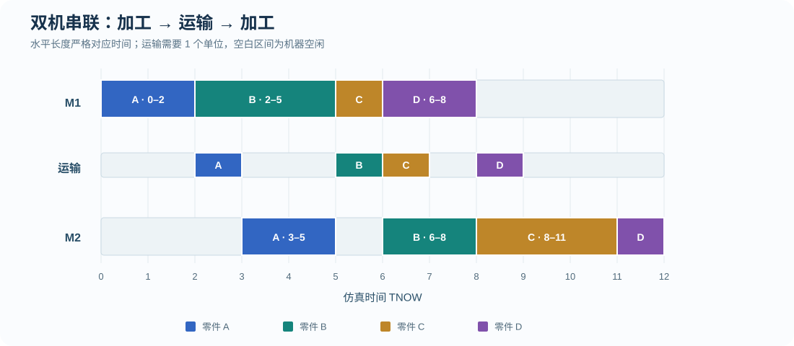
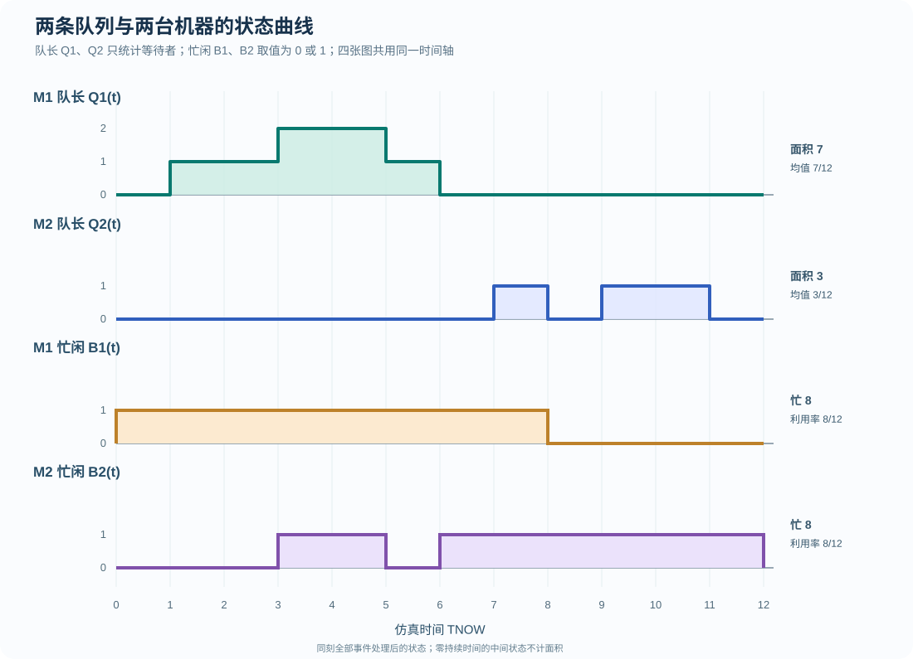
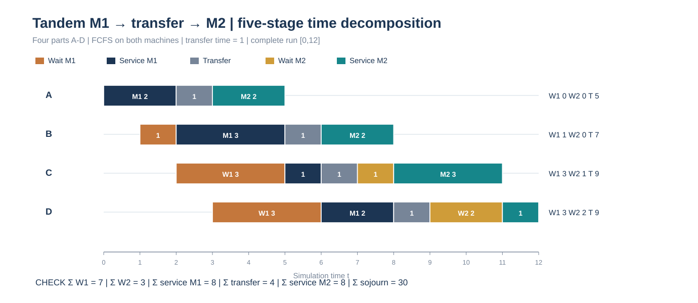

# 事件调度图解练习 02｜双机串联、运输延迟与两条队列

[返回总目录](../README.md) · [上一题：双机并联](2026-event-drill-parallel.md) · [计算专项题集](2026-calculation-workbook.md) · [原课堂串联例题](../manual-event-simulation/01-tandem-four-parts.md)

这道题是新的独立练习，结构与课堂的 `M1 → 运输 → M2` 模型相同，但输入数据不同。沿用黑板所画的队长和设备忙闲结果图，增加两条队列的独立轨迹，以便从图形读出面积、等待时间及设备利用率。

## 题目

四件零件 A—D 到达 M1，依次经过<strong>M1 加工 → 运输 1 个时间单位 → M2 加工 → 离开系统</strong>。M1、M2 每次只能加工一件，两台均为 FCFS；各自有独立等待队列。运输时间固定为 `1`，不占用机器，也没有运输资源容量限制。机器初始空闲，同刻完成事件优先于新到达；已在队列中等待的零件不能被后来者插队。

| 零件 | A | B | C | D |
| --- | ---: | ---: | ---: | ---: |
| 外部到达 M1 时刻 | 0 | 1 | 2 | 3 |
| M1 加工时长 | 2 | 3 | 1 | 2 |
| M2 加工时长 | 2 | 2 | 3 | 1 |

求两个工序的开始与结束、运输后到达 M2 的时刻、两条队列各自等待、系统逗留、完整 FEL 事件表。画机器与运输时间线，分别画 `Q1(t)、Q2(t)、B1(t)、B2(t)` 四张阶梯结果图，计算队长面积、时间平均队长与两台机器利用率。

## 答案

| 零件 | 到达 M1 | M1 开始 | M1 完成 | 到达 M2 | M2 开始 | M2 完成 | M1 等待 | M2 等待 | 系统逗留 |
| --- | ---: | ---: | ---: | ---: | ---: | ---: | ---: | ---: | ---: |
| A | 0 | 0 | 2 | 3 | 3 | 5 | 0 | 0 | 5 |
| B | 1 | 2 | 5 | 6 | 6 | 8 | 1 | 0 | 7 |
| C | 2 | 5 | 6 | 7 | 8 | 11 | 3 | 1 | 9 |
| D | 3 | 6 | 8 | 9 | 11 | 12 | 3 | 2 | 9 |
| <strong>合计</strong> | — | — | — | — | — | — | <strong>7</strong> | <strong>3</strong> | <strong>30</strong> |

系统在 `t=12` 清空。平均系统逗留为 `30/4=7.5`；M1 和 M2 的忙碌总时长均为 `8`，<strong>在 `[0,12)` 观察窗口中，两台机器利用率均为 `8/12=2/3`</strong>。两条队列的时间平均长度分别为 `7/12` 和 `3/12`。

## 第一步：先处理第一道工序，再算运输时刻

对同一台 FCFS 单机，开始时刻不能早于实体抵达，也不能早于前一件完工：

```math
S_{i1}=\max(A_{i1},D_{i-1,1}),\qquad
D_{i1}=S_{i1}+p_{i1}.
```

本题 M1 依次处理 A `[0,2)`、B `[2,5)`、C `[5,6)`、D `[6,8)`。其中 C 到达于 `2`，等到 `5` 才能加工，等待 `3`；D 到达于 `3`，直到 `6` 才能加工，也等待 `3`。

零件完工 M1 以后，并不会立即“到达 M2”。运输时长 `\tau=1`，必须单独加上：

```math
A_{i2}=D_{i1}+\tau,\qquad \tau=1.
```

所以四件零件实际到达 M2 的时刻为 `3、6、7、9`。这一列是串联题里最值得单独列出的中间结果。

## 第二步：根据 M2 到达时刻再排第二条队列

M2 在 `t=3` 首次接收 A，加工到 `5`。B 到 `6` 才到达，因此 `[5,6)` 是 M2 的空闲时间。B 从 `6` 加工到 `8`；C 已在 `7` 到达，只能等待 B 完成。`t=8` 时 C 出队开始加工，直到 `11`。D 在 `9` 到达，必须等 C 于 `11` 完工，故 D 在 M2 的等待时长为 `2`。

```math
\begin{aligned}
W_{q,1}&=(0,1,3,3),\\
W_{q,2}&=(0,0,1,2),\\
\overline W_{q,1}&=\frac{7}{4}=1.75,\\
\overline W_{q,2}&=\frac{3}{4}=0.75.
\end{aligned}
```

<strong>这里不是两台可互相替代的并联机器。</strong> 即便 M2 在 `[5,6)` 空闲，M1 上正在加工的 C 也不能直接改到 M2 服务，因为它必须先完成 M1 并运输。

## 第三步：TNOW 与 FEL 的关键事件逐项推进

下表“事件处理后队列”只列等待者，不包含正在加工或运输的零件。同刻事件执行完以后，才确定该时刻的最终队列状态。

| TNOW | 本时刻处理的事件 | M1（处理后） | M2（处理后） | Q1 | Q2 |
| ---: | --- | --- | --- | --- | --- |
| 0 | A 到 M1，立即开始加工；安排 A 的 M1 完工事件 `@2` | A `[0,2)` | 空 | 空 | 空 |
| 1 | B 到达，M1 忙 | A | 空 | B | 空 |
| 2 | A 完成 M1，安排 A 到 M2 `@3`；B 开始 M1；C 到达 M1 | B `[2,5)` | 空 | C | 空 |
| 3 | D 到达 M1；A 运输完抵达 M2，立即开工 | B | A `[3,5)` | C、D | 空 |
| 5 | B 完成 M1，安排 B 到 M2 `@6`；C 开始 M1；A 完成 M2 离开系统 | C `[5,6)` | 空 | D | 空 |
| 6 | C 完成 M1，安排 C 到 M2 `@7`；D 开始 M1；B 到 M2 并开工 | D `[6,8)` | B `[6,8)` | 空 | 空 |
| 7 | C 到 M2，因 B 忙而排队 | D | B | 空 | C |
| 8 | D 完成 M1，安排 D 到 M2 `@9`；B 完成 M2 离开；C 接替 M2 | 空 | C `[8,11)` | 空 | 空 |
| 9 | D 到 M2，因 C 忙而排队 | 空 | C | 空 | D |
| 11 | C 完成 M2 离开；D 接替 M2 | 空 | D `[11,12)` | 空 | 空 |
| 12 | D 完成 M2 离开，全部完成 | 空 | 空 | 空 | 空 |

<strong>抽查 FEL 是否写对：</strong> 在 `t=5` 两件完工事件处理结束后，计划的最早事件包括 `C 完成 M1@6`、`B 到 M2@6`，还保留外部已知的其他后续事件（如适用）；在 `t=8` 处理完两件完工事件后，至少有 `D 到 M2@9` 和 `C 完成 M2@11`。严格区分“B 完成 M1@5”“B 到达 M2@6”“B 完成 M2@8”三个事件，不得合并为一次离开系统。

## 第四步：画加工、运输、M2 加工的完整时间线



图中每个色块是一件零件的一个阶段。运输期间仍属于系统内逗留时间，但不占用任一机器。M1 从 `[0,8)` 一直加工；M2 的忙碌区间是 `[3,5)` 和 `[6,12)`，两台机器都没有任何时间重叠加工两件零件。

## 第五步：画课堂强调的四张状态结果图



读第一条曲线 `Q1(t)`：在 `[1,3)` 有一个等待者（先是 B，后是 C）；`[3,5)` 有两个等待者 C、D；`[5,6)` 仅 D 等待，其余时段队列为空。

```math
\begin{aligned}
\int_0^{12}Q_1(t)\,dt
&=1(3-1)+2(5-3)+1(6-5)\\
&=2+4+1=7,\\
\overline Q_1&=\frac{7}{12}\approx0.5833.
\end{aligned}
```

第二条曲线 `Q2(t)`：C 在 `[7,8)` 等待，D 在 `[9,11)` 等待。注意 `[8,9)` 队列是空的，虽然 C 正在 M2 加工，它也不计入等待队列。

```math
\begin{aligned}
\int_0^{12}Q_2(t)\,dt
&=1(8-7)+1(11-9)=3,\\
\overline Q_2&=\frac{3}{12}=0.25.
\end{aligned}
```

最后两条是机器忙闲状态 `B_1(t)`、`B_2(t)`，而非队长。机器忙时曲线取 `1`，空闲时取 `0`。所以：

```math
\begin{aligned}
\rho_1&=\frac{\int_0^{12}B_1(t)\,dt}{12}=\frac{8}{12}=\frac{2}{3},\\
\rho_2&=\frac{\int_0^{12}B_2(t)\,dt}{12}=\frac{2+6}{12}=\frac{2}{3}.
\end{aligned}
```

## 第六步：系统逗留时间与守恒核对

零件系统逗留从<strong>最初进入 M1 系统</strong>开始，一直算到<strong>完成 M2 离开</strong>。不能从到达 M2 开始，也不能仅把两段加工时间相加。

```math
\begin{aligned}
T_A&=5-0=5,\\
T_B&=8-1=7,\\
T_C&=11-2=9,\\
T_D&=12-3=9,\\
\overline T&=\frac{5+7+9+9}{4}=7.5.
\end{aligned}
```

将四件零件所有阶段耗时相加，得到第二种核对方式：

```math
\underbrace{7}_{\mathrm{M1\ queue}}
+\underbrace{8}_{\mathrm{M1\ service}}
+\underbrace{4}_{\mathrm{transfer}}
+\underbrace{3}_{\mathrm{M2\ queue}}
+\underbrace{8}_{\mathrm{M2\ service}}
=30.
```

结果恰好等于 `5+7+9+9=30`。同时，队长曲线面积分别是 `7` 和 `3`，与两条队列所有零件等待时间之和一致。若三者不一致，通常说明某个同刻事件分配、运输到达时刻或队长阶梯区间遗漏了。

## 第七步：四个零件逐件拆成五段，核对完整逗留



横轴仍然是<strong>绝对时刻</strong>，不是把所有零件的横条都平移到零时刻。每条横条依次包含 M1 等待、M1 加工、运输、M2 等待、M2 加工五种可能的时间段；某段长度为零时不画色块。图右侧的 <code>W1</code>、<code>W2</code> 和 <code>T</code> 可以逐行与事件表比较。

| 零件 | M1 等待 | M1 加工 | 运输 | M2 等待 | M2 加工 | 系统逗留 T |
| --- | ---: | ---: | ---: | ---: | ---: | ---: |
| A | 0 | 2 | 1 | 0 | 2 | 5 |
| B | 1 | 3 | 1 | 0 | 2 | 7 |
| C | 3 | 1 | 1 | 1 | 3 | 9 |
| D | 3 | 2 | 1 | 2 | 1 | 9 |
| 合计 | 7 | 8 | 4 | 3 | 8 | 30 |

因此，`ΣT=ΣW1+Σp1+Σ运输+ΣW2+Σp2=7+8+4+3+8=30`。两台机器的忙闲曲线面积分别为 `8`，与两列加工时长之和一致；两条队长曲线面积分别为 `7` 与 `3`，与两列排队等待之和一致。<strong>运输过程属于系统逗留，但既不是排队等待，也不算任何一台加工机器的忙碌时间。</strong>

## 别把时刻 12 的结果写成时刻 8 的结果

本题观察到最后完工的 `t=12`，所以所有系统逗留都有完整数据，利用率分母是 `12`。若题目改为 `t=8` 截止，D 才完成 M1 尚未完成 M2，C 也刚进入 M2；只能统计截至 `8` 的机器忙碌时间和队长面积，并明确完工实体的统计口径，不能仍然套用四位零件完整逗留时间 `5、7、9、9`。
