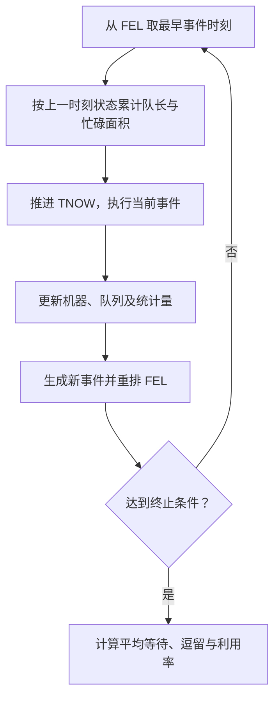

# 期末复习专题｜课堂串讲、重点辨析与计算题训练

[返回学习目录](../README.md) · [手工事件调度专题](../manual-event-simulation/README.md) · [第三讲：随机数](../notes/03-random-number-generation-testing.md) · [第四讲：随机变量](../notes/04-random-variate-generation.md) · [第六讲：输出分析](../notes/06-output-analysis.md) · [八讲覆盖检查](2026-coverage-audit.md) · [16 道计算专项](2026-calculation-workbook.md)

本章依据 2026 年 11 月 9 日两段《系统仿真》课堂录音的转写整理：第一段约 40 分钟，教师在黑板上演示两台机器并联、串联时如何推进未来事件表；第二段约 33 分钟，依次讨论随机数、随机变量、输入分析、输出分析以及期末题型。它是<strong>复习专题</strong>，不是原课程新增的第九讲，也不替代第一至第八讲的完整课件笔记。

阅读时注意证据边界。下文的“课堂强调”指能从带时间戳转写中交叉确认的意思；“专项推导”及“训练例题”是为了学会做题而补充的内容。自动转写在板书报数和个别术语上存在错词，因此不把不清楚的数字、题量或者推测写成教师确定宣布的考试要求。

> <strong>新增图解训练</strong>：对照课堂黑板中的队长与设备忙闲结果图，完成 [双机并联 M1 优先练习](2026-event-drill-parallel.md) 和 [双机串联运输练习](2026-event-drill-tandem.md)；两题的数据均为独立设计，不是课件原题。

## 一、先弄清楚期末究竟在考什么

这次串讲呈现出两条比较明确的线索：一条是模型怎样随着事件而改变，另一条是用随机输入得到仿真结果后，怎样检验与估计结果。前者对应事件调度表，后者贯穿随机数、随机变量和统计输出。只背公式无法解决前者；只会画系统流程图，也不足以解决后者。

| 主题 | 课堂依据 | 复习时应做到什么 | 不能据此推断什么 |
| --- | --- | --- | --- |
| 手工事件调度 | 录音一 04:19、30:27；录音二 32:02 | 会写完整初始表并逐事件推进；重点练单机、双机并联、双机串联 | 不能把“不讲三台机器”解释为所有三节点结构在任何题中都绝对不出现 |
| 线性同余发生器 | 录音二 00:00—06:00 | 会构造满周期条件，递推出前若干项 | 录音中模数和乘子有识别误差，某个示例数字不是唯一标准答案 |
| 随机数检验 | 录音二 06:18—12:30 | 会区分卡方、K–S、游程、连贯性和扑克检验；能看懂数列中的“连” | “一般不让算整批检验”不是绝对免考计算的承诺 |
| 随机变量生成 | 录音二 12:34—22:28 | 会逆变法、变换后密度证明；理解接受—拒绝法 | 不能把较长的分布证明讲解降成仅背概念 |
| 输入分析 | 录音二 22:49—23:36 | 依次做独立性判别、分布假设、参数估计、拟合检验 | 不能漏掉独立性这个先行步骤 |
| 输出分析 | 录音二 23:50—29:45 | 会以独立重复的运行均值构造置信区间，并用试算法确定最少重复次数 | 不能把同一次运行内部的数据全部当作相互独立的重复 |
| 概念判断与问答 | 录音二 29:50—31:43 | 能判断正误并解释原因，熟悉事件和状态、验证和确认等容易混淆的关系 | 录音未给出可信的完整题量、分值分布 |

教师谈到了问答以及较大的计算题，但并未可靠地限定“整张卷只有一道计算题”。本章因此按<strong>可识别的计算任务</strong>组织练习，不以猜测题量安排复习。

## 二、手工仿真：从系统规则到完整未来事件表

### 2.1 为什么一道题需要写这么多张表

离散事件仿真并不要求在每一秒都重新计算。系统只有在到达、完成加工、资源释放等事件发生时才改变状态。教师在录音一 08:52—09:20 特别提醒，未来事件表要按照<strong>事件预计发生的时刻</strong>排序，而不是按照它被写入表中的先后排序。

每处理一个事件时，至少有四个对象需要同步维护：

1. 仿真时钟 `TNOW`：当前推进到了哪个时刻。
2. 系统状态：每台机器忙还是闲，正在加工哪件零件，队列中有哪些零件。
3. 未来事件表 `FEL`：哪些事件已经被安排、但还没有发生。
4. 统计记录：零件的到达、开工、完工时刻，队长面积和机器忙碌时间。

“状态”与“事件”是两件事。事件是某个时刻发生的状态改变，例如零件 1 完成 M1 加工；状态则说明该时刻系统处于什么状况，例如 M1 空闲、Q1 中还有零件 2。一般是<strong>事件发生引起状态变化</strong>，状态和加工规则再决定可以安排什么后续事件。

### 2.2 每次推进时，固定按这个顺序操作



在时刻 `t` 到下一个事件时刻 `t'` 之间，如果队长为 `Q(t)`、机器忙闲指示量为 `B(t)`（忙为 1、闲为 0），那么这一段的统计面积增加：

```math
\Delta A_Q=Q(t)(t'-t),\qquad
\Delta A_B=B(t)(t'-t)
```

一定先使用上一事件处理后的状态累计面积，再执行下一个事件。如果先改变队长、再计算刚刚过去的时间段，就会低估或高估等待面积。

录音一 30:27—30:57 还强调了卷面留痕：每个时刻的表都应完整呈现，不能反复在前一张表上涂改到看不出原先状态。实际答题时可以把已执行事件标记为“已处理”，然后在下一行完整写出剩余 FEL。

### 2.3 单机、并联、串联的区别

单机模型中，外部到达的零件如果碰到忙碌机器，就进入一个队列。机器完成一件零件后，如果队列非空，立即取队首零件开始加工。零件完成该机器的加工，就离开整个系统。

两台并联机器相当于两台设备处理同一种工序。录音一 03:26—04:08 演示的规则是：两台都空闲时优先 M1；只有一台空闲时去空闲机器；两台都忙时排队。如果题目采用一个共享队列，就必须在机器释放时从共享队列接走队首零件，而不能在顾客到达时强制分配到两个独立队列。

两台串联机器则是两道先后工序：零件需要完成 M1，然后运输，再到 M2 加工，最后才能离开系统。因此，<strong>完成 M1 不是完成整个系统</strong>。M1 和 M2 前可能各有自己的等待队列，排队时间需要分开记录。

### 2.4 串联模型的四种事件规则

| 当前事件 | 必须检查或安排的下一步 |
| --- | --- |
| 零件 `i` 从外部到达 M1 | 若还有后续到达，安排下一零件到达；M1 空闲则开工并安排 `i` 完成 M1，否则进入 Q1 |
| 零件 `i` 完成 M1 | 安排 `i` 在运输结束后到达 M2；若 Q1 非空，队首零件立即使用 M1，并安排其完成 M1 |
| 零件 `i` 到达 M2 | M2 空闲则开工并安排 `i` 完成 M2，否则进入 Q2 |
| 零件 `i` 完成 M2 | 结算 `i` 的系统逗留时间；若 Q2 非空，让队首零件开始 M2 加工并安排其完工 |

上述规则是对录音一 25:50—26:16、34:39—34:55 具体推演的技术化整理。录音末尾有一处含糊的“离开 M1 可能引发自己离开 M2”表述；在事件调度中不能照字面理解为跳过运输和 M2 加工，应以前后工序的完整因果关系为准。

“到达 M1 一定引发下一个到达”也有边界：如果系统只规定四个零件，那么第四个零件到达后就不再安排第五个到达。

### 2.5 完整例题：四个零件经过 M1、运输、M2

以下是专项训练题，采用仓库[手工事件调度专题](../manual-event-simulation/03-fel-ledger.md)中的可复核数据，便于与已有笔记交叉检查。它不声称逐个数字都来自录音板书。

四个零件按 FCFS 规则先在 M1 加工，运输 1 个时间单位后进入 M2。两台机器都只能同时加工一件零件，且加工不可中断。

| 零件 | 到达 M1 时刻 | M1 加工时间 | M2 加工时间 |
| ---: | ---: | ---: | ---: |
| 1 | 0 | 5 | 3 |
| 2 | 3 | 5 | 4 |
| 3 | 4 | 3 | 5 |
| 4 | 6 | 1 | 4 |

用 `A1(i)` 表示零件 `i` 到达 M1，用 `D1(i)` 表示它完成 M1；`A2(i)` 和 `D2(i)` 则对应到达、完成 M2。本例采用老师演示的方式：每次发生一个外部到达，再安排下一个零件到达。记录的 FEL 均为处理完当前事件之后的剩余事件。

| TNOW | 当前执行事件 | M1 及 Q1 | M2 及 Q2 | 处理后未来事件表 |
| ---: | --- | --- | --- | --- |
| 初始化 | 尚未执行 | 空闲 / `[]` | 空闲 / `[]` | `0:A1(1)` |
| 0 | `A1(1)` | 1 加工至 5 / `[]` | 空闲 / `[]` | `3:A1(2), 5:D1(1)` |
| 3 | `A1(2)` | 1 加工 / `[2]` | 空闲 / `[]` | `4:A1(3), 5:D1(1)` |
| 4 | `A1(3)` | 1 加工 / `[2,3]` | 空闲 / `[]` | `5:D1(1), 6:A1(4)` |
| 5 | `D1(1)` | 2 加工至 10 / `[3]` | 空闲 / `[]` | `6:A1(4), 6:A2(1), 10:D1(2)` |
| 6 | `A1(4), A2(1)` | 2 加工 / `[3,4]` | 1 加工至 9 / `[]` | `9:D2(1), 10:D1(2)` |
| 9 | `D2(1)` | 2 加工 / `[3,4]` | 空闲 / `[]` | `10:D1(2)` |
| 10 | `D1(2)` | 3 加工至 13 / `[4]` | 空闲 / `[]` | `11:A2(2), 13:D1(3)` |
| 11 | `A2(2)` | 3 加工 / `[4]` | 2 加工至 15 / `[]` | `13:D1(3), 15:D2(2)` |
| 13 | `D1(3)` | 4 加工至 14 / `[]` | 2 加工 / `[]` | `14:A2(3), 14:D1(4), 15:D2(2)` |
| 14 | `A2(3), D1(4)` | 空闲 / `[]` | 2 加工 / `[3]` | `15:A2(4), 15:D2(2)` |
| 15 | `A2(4), D2(2)` | 空闲 / `[]` | 3 加工至 20 / `[4]` | `20:D2(3)` |
| 20 | `D2(3)` | 空闲 / `[]` | 4 加工至 24 / `[]` | `24:D2(4)` |
| 24 | `D2(4)` | 空闲 / `[]` | 空闲 / `[]` | 空表，全部完工 |

例如时刻 5，零件 1 完成 M1，不能直接写它离开系统。应安排零件 1 于时刻 `5+1=6` 到达 M2。同时 M1 腾出资源，Q1 中零件 2 立即开工，预计于时刻 `5+5=10` 完成 M1。

时刻 15 同时有两件事：零件 2 完成 M2，零件 4 到达 M2。零件 3 已在 Q2 中等待，因此按 FCFS 应先于零件 4 接受 M2 加工。这里可以同刻成组处理，但资源分配仍必须遵守队列规则；“同一时刻谁先谁后都无所谓”不能不加条件地使用。

从事件历史中整理出每件零件的时间：

| 零件 | M1 等待 | M2 等待 | 总等待 | 最终离开时刻 | 系统逗留时间 |
| ---: | ---: | ---: | ---: | ---: | ---: |
| 1 | 0 | 0 | 0 | 9 | 9 |
| 2 | 2 | 0 | 2 | 15 | 12 |
| 3 | 6 | 1 | 7 | 20 | 16 |
| 4 | 7 | 5 | 12 | 24 | 18 |

由此可求：

```math
\overline W_q=\frac{0+2+7+12}{4}=5.25
```

```math
\overline W=\frac{9+12+16+18}{4}=13.75
```

若以整个 `[0,24]` 为观察窗口，Q1 的队长面积等于四件零件在 Q1 的等待时间总和 `15`，Q2 面积为 `6`。所以时间平均队长分别为：

```math
\overline L_{q1}=\frac{15}{24}=0.625,\qquad
\overline L_{q2}=\frac{6}{24}=0.25
```

两台机器的实际忙碌时长分别是 `14` 和 `16`，利用率为：

```math
\rho_1=\frac{14}{24}\approx58.33\%,\qquad
\rho_2=\frac{16}{24}\approx66.67\%
```

还要核对终止条件。若题目写的是“到时刻 10 终止”，绝不能把时刻 15、20、24 的结果算进当前观察窗口。固定时间停止和“全部零件完成后停止”属于不同统计口径。

> 本节另有 [LCG 满周期计算专项](2026-lcg-full-period-drill.md)：沿用课堂讨论的 `m=3900`，展开三条条件、前十次商与余数、完整周期验证和失败参数反例；所有用于演算的乘子、增量与种子均明确标注为自选。

## 三、线性同余随机数发生器：不仅会递推，还要会构造

### 3.1 先理解四个符号

混合同余法的基本递推式为：

```math
X_{n+1}=(aX_n+c)\bmod m,\qquad
U_{n+1}=\frac{X_{n+1}}{m}
```

`m` 是模数，决定整数状态的范围；`a` 是乘子；`c` 是增量；`X₀` 是初始种子。给出了 `m,a,c` 还不能确定唯一序列，必须知道从哪个种子开始。计算第一个新随机数时求的是 `X₁`，不要直接把 `X₀/m` 当作第一项。

### 3.2 为什么三个满周期条件缺一不可

对 `c≠0` 的混合同余发生器，Hull–Dobell 满周期条件为：

1. `c` 与 `m` 互素。
2. `m` 的每个不同素因子都整除 `a−1`。
3. 如果 `m` 能被 4 整除，那么 `a−1` 也必须能被 4 整除。

三条同时成立，生成器的状态周期长度就是 `m`。注意“满周期”是关于状态能否遍历的数学条件，不意味着任意有限样本都会完全符合统计独立性。

### 3.3 给定模数 3900，应当怎样定参数

课堂转写在录音二 02:55—04:30 展示了拆分模数、检查素因子和 4 的条件的思路。这里用 `m=3900` 演示一组自拟的可行参数；板书最终具体数字识别不清，不能把本例参数当作老师唯一指定的答案。

```math
3900=2^2\times3\times5^2\times13
```

不同素因子是 `2,3,5,13`，它们的乘积是 `390`，但因为模数能够被 4 整除，还必须补充因子 4 的条件。最小公倍数为：

```math
\operatorname{lcm}(2,3,5,13,4)=780
```

所以可以取 `a−1=780`，得到 `a=781`。增量取 `c=7`，因为 `gcd(7,3900)=1`，满足第一条。

为了完整展示递推，再<strong>额外指定种子 `X₀=1`</strong>：

| 项目 | 计算 | 结果 |
| --- | --- | ---: |
| `X₁` | `(781×1+7) mod 3900` | 788 |
| `X₂` | `(781×788+7) mod 3900` | 3135 |
| `X₃` | `(781×3135+7) mod 3900` | 3142 |
| `X₄` | `(781×3142+7) mod 3900` | 809 |
| `X₅` | 继续同样递推 | 36 |
| `X₆` | 继续同样递推 | 823 |
| `X₇` | 继续同样递推 | 3170 |
| `X₈` | 继续同样递推 | 3177 |
| `X₉` | 继续同样递推 | 844 |
| `X₁₀` | 继续同样递推 | 71 |

因此前十个均匀随机数写成 `788/3900, 3135/3900, …, 71/3900` 即可。老师在录音二 05:40—06:00 特别提示，可以保留这样的分数形式，没有必要把每一项除成小数。

> <strong>配套图解</strong>：本章关于卡方、K–S、上升游程、连贯性和扑克检验的辨析，现已展开成[随机数检验完整例题与结果图](2026-randomness-tests-visual.md)，包含按课件定义重新绘制的游程分段。

## 四、随机数检验：分清检验对象，不必死背一堆统计量

随机数检验至少要区分两个维度：数值分布是否接近均匀，以及序列之间是否表现出不应有的相关结构。两者不能互相替代。例如一串数的直方图可能接近均匀，但排列可能按照固定规律重复。

| 方法 | 主要检验什么 | 怎样理解其统计思路 |
| --- | --- | --- |
| 卡方均匀性检验 | 分组频数 | 比较每组实际出现次数与理论应出现次数的差距 |
| K–S 检验 | 累积分布 | 比较经验分布函数与理论分布函数之间的最大距离 |
| 游程检验 | 数列上升段的长度与个数 | 沿数列观察连续上升的区段，检查其出现规律 |
| 连贯性检验 | 相邻变化的方向及符号连 | 相邻两项上升记 `+`，下降记 `−`，再统计连续同号的段落 |
| 扑克检验 | 数位重复模式 | 将一定长度的数字按相同数位组合分类，再与理论频数比较 |

录音二 07:23—07:56 明确对比了卡方和 K–S：前者从频数入手，后者直接比较分布。08:04—11:21 则反复要求能指出游程和连贯性检验中的“连”有几个、长度分别是多少。

例如给出序列 `0.41, 0.68, 0.89, 0.69, 0.84, 0.74, 0.91, 0.55`。比较相邻两项，得到符号：

```text
0.41 → 0.68 → 0.89 → 0.69 → 0.84 → 0.74 → 0.91 → 0.55
        +       +       −       +       −       +       −
```

连续同号分组为 `++ | − | + | − | + | −`。因此有 6 个符号连，长度依次为 `2,1,1,1,1,1`。至于“游程长度”究竟按数值项数还是相邻变化次数定义，必须按题目和课件约定；同一上升段在这两种口径下会相差 1，不能混用。

扑克检验不只看“某一个数字出现了几次”，而是对固定位数的数字形成一类类重复模式，例如全部不同、一对相同、全部相同。考概念时应把这个分类思想说清。

> <strong>六道详细推导与结果图</strong>：若需要按题一步步计算指数/三角逆变，证明 `Y=U²` 的密度，以及解释 Box–Muller 的 Jacobian 和独立性，参见[第四讲随机变量图解专项](2026-random-variate-transforms-visual.md)。

> <strong>第四讲后半部分计算专项</strong>：卷积法、接受—拒绝法、Gamma 的 GB/GS 算法及经验分布抽样，附八道逐步计算题和三张结果图。[进入完整图解练习](2026-convolution-rejection-empirical-visual.md)。

## 五、随机变量生成：逆变法、取舍法和分布证明

### 5.1 从均匀随机数生成目标分布

均匀随机数 `U∼U(0,1)` 是一个基础输入。仿真可能要求的是指数到达间隔、正态误差或其他分布，因此需要把均匀随机数变换成目标变量。

逆变法的核心是：已知目标随机变量 `X` 的分布函数 `F_X(x)`，令 `U=F_X(X)`，再求分位函数。如果 `F_X` 连续且可逆，得到：

```math
X=F_X^{-1}(U)
```

对于指数分布，`F_X(x)=1-e^{-\lambda x}`（`x≥0`），解出：

```math
X=-\frac{1}{\lambda}\ln(1-U)
```

因为 `1−U` 本身也服从 `U(0,1)`，也可以使用 `X=−ln U/λ`。两种方法生成的分布相同，但在同一个已给定的数值 `u` 上，其计算结果通常不同；考试时应按照题目给定的变换公式计算。

### 5.2 为什么函数变换必须证明密度

教师在录音二 15:13—21:25 花了较长时间强调：给定一个变换函数，不是凭“看起来像指数分布”就结束，而是应通过反函数、取值范围和导数把目标密度推出来。

例题：`U∼U(0,1)`，参数 `λ>0`，令：

```math
X=-\frac{1}{\lambda}\ln U
```

证明 `X` 服从参数为 `λ` 的指数分布。

<strong>第一步：确认取值范围。</strong> 因为 `0<U<1`，所以 `ln U<0`，从而 `X>0`。反过来，若 `x≥0`，则 `e^{-λx}` 位于 `(0,1]` 内，才能使用均匀分布在该区间的密度 `f_U(u)=1`。

<strong>第二步：求反函数。</strong>

```math
U=e^{-\lambda X}
```

<strong>第三步：应用一元变量变换公式。</strong>

```math
\begin{aligned}
f_X(x)
&=f_U\!\left(e^{-\lambda x}\right)
\left|\frac{d}{dx}e^{-\lambda x}\right|\\
&=1\cdot\left|-\lambda e^{-\lambda x}\right|\\
&=\lambda e^{-\lambda x},\qquad x\geq0
\end{aligned}
```

当 `x<0` 时，`f_X(x)=0`。因此所得密度正是指数分布的密度，命题得证。关键不是把导数写对就够了，还要解释为什么原均匀密度恰好等于 1；这正是教师反复提示的容易漏写处。

也可以使用分布函数法：

```math
\begin{aligned}
F_X(x)
&=P\left(-\frac{\ln U}{\lambda}\leq x\right)\\
&=P\left(U\geq e^{-\lambda x}\right)\\
&=1-e^{-\lambda x},\qquad x\geq0
\end{aligned}
```

然后对 `F_X(x)` 求导，得到同样的密度。这两条证明路线都成立。

### 5.3 取舍法为何不是简单地“生成后删除”

接受—拒绝法用于目标密度不容易求反函数的情形。先选择容易抽样的候选密度 `g(x)`，再找一个常数 `M`，使 `f(x)≤Mg(x)`。从 `g` 抽出候选值 `Y`，再抽一个均匀数 `V`，仅当：

```math
V\leq\frac{f(Y)}{Mg(Y)}
```

时接受 `Y`，否则重新抽样。这样得到的已接受样本才具有目标密度 `f`。录音二 13:33—14:40 主要强调了覆盖、抽样、保留与舍弃的思想，没有可靠地要求现场手推复杂 Gamma 取舍算法。

二维函数变换则需要用 Jacobian 行列式处理两个变量之间的密度变换。本次串讲没有完整展开二维计算，复习时至少应理解其原理，并参考[第四讲的二维变换与 Box–Muller](../notes/04-random-variate-generation.md)。

> <strong>第五讲结果图解训练</strong>：完整演算四阶自相关、密度直方图、指数/正态 MLE、卡方分组频数和 K–S 最大 CDF 差距。[进入输入分析专项 07](2026-input-analysis-visual.md)。

## 六、输入分析：为什么独立性必须排在第一步

输入分析的对象是实际系统的观测数据，例如顾客到达间隔或机器加工时间。它要回答的不是“我喜欢哪一个分布”，而是“从已有数据出发，哪个分布可以合理代表这个随机过程”。

教师在录音二 22:49—23:36 明确给出了四步顺序：

| 步骤 | 解决的问题 | 常用工具 |
| --- | --- | --- |
| 1. 独立性判别 | 观测之间是否有明显依赖，能否按独立样本处理 | 散点图、自相关图、序列检查 |
| 2. 分布形式假定 | 数据大致像指数、正态、泊松还是其他分布 | 直方图、离散概率图及过程机理 |
| 3. 分布参数估计 | 选定分布后，参数数值应是多少 | 矩估计、极大似然估计 |
| 4. 分布假设检验 | 所选分布与数据的偏差是否可以接受 | 卡方、K–S 等拟合优度检验 |

例如一组到达间隔看起来右偏，可以先考虑指数分布。但如果这些间隔存在明显周期性相关，那么直接按独立指数样本估计并调用普通拟合检验，前提就可能不成立。这就是为什么不能跳过第一步直接开始拟合。

> <strong>第六讲输出分析结果图训练</strong>：对照四张图练习独立重复置信区间、试算法找最少次数、预热删除和批次划分，以及配对公共随机数的标准误。[进入输出分析专项 08](2026-output-analysis-visual.md)。

> <strong>第七讲模型验证与确认图解训练</strong>：用事件守恒与队长阶梯图检查程序，使用单样本与历史输入配对 t 检验判断均值差异，并对照区间理解“不拒绝不等于已证明有效”。[进入验证与确认专项 09](2026-model-verification-validation-visual.md)。

## 七、输出分析：独立重复、置信区间和试算法

这是录音二 23:50—29:45 讲得最具体的统计计算模块。教师特别指出：同一次仿真运行中依次记录的顾客结果可能相关，不能把所有观测堆在一起，当作完全独立的样本来求置信区间。

### 7.1 “三次运行，每次四个数”究竟怎么处理

设进行 `R` 次相互独立的仿真，第 `r` 次运行内部得到 `m` 个观测 `X_{r1},…,X_{rm}`。先计算各次运行的平均结果：

```math
Y_r=\frac{1}{m}\sum_{j=1}^{m}X_{rj}
```

再用 `R` 个运行均值 `Y₁,…,Y_R` 估计系统平均性能：

```math
\overline Y=\frac{1}{R}\sum_{r=1}^{R}Y_r
```

运行均值的样本标准差为：

```math
S=\sqrt{\frac{1}{R-1}\sum_{r=1}^{R}(Y_r-\overline Y)^2}
```

在独立重复运行、相关统计条件满足的情况下，可构造平均性能的双侧 `1−α` 置信区间：

```math
\overline Y\pm t_{1-\alpha/2,R-1}\frac{S}{\sqrt R}
```

因此半长为：

```math
h(R)=t_{1-\alpha/2,R-1}\frac{S}{\sqrt R}
```

注意分母是 `√R`、自由度是 `R−1`。不是“运行次数乘每次观测数”，也不是每次运行内部的观测总数减一。

录音中老师说，若每次运行都恰好有四个数，那么直接对全部十二个数求总平均，数值上可能恰好与三个运行均值的平均相同；但这并不使“把十二个数直接求样本标准差”变成正确方法。若各次运行的观测数不等，甚至连这两种平均值也不一定相等。

### 7.2 试算法为什么先固定标准差，再变动次数

“我希望区间估计的误差不超过 `β`，究竟要重复运行几次？”这类题目不是直接求现有区间，而是求一个满足精度要求的计划运行次数。

设已经进行 `R₀` 次先导运行，并求得运行均值的标准差 `S₀`。在试算阶段暂时把 `S₀` 当作以后波动大小的估计，只改变候选总次数 `r`：

```math
h(r)=t_{1-\alpha/2,r-1}\frac{S_0}{\sqrt r}
```

寻找最小整数 `r` 使：

```math
h(r)\leq\beta,\qquad h(r-1)>\beta
```

这里 `S₀` 固定不变。试算 `r=17` 和 `r=18` 时，并不存在真实的第 17、18 次新观测，因此不能凭空为它们重新计算一个标准差。实际补做新的仿真以后，再用新收集到的运行均值重新计算实际半长；先导试算只是确定运行计划，不能保证补做后一定精确等于预估值。

### 7.3 完整计算题：从十二个数到最少重复次数

三次独立运行，每次四个观测：

| 运行 | 四个观测值 | 运行均值 |
| --- | --- | ---: |
| 第 1 次 | `7,8,8,9` | 8 |
| 第 2 次 | `9,10,10,11` | 10 |
| 第 3 次 | `11,12,12,13` | 12 |

要求双侧 95% 置信区间半长不超过 `β=1`。给定：`t_{0.975,16}=2.120`、`t_{0.975,17}=2.110`。求至少需多少次独立运行，若先导运行已完成，还需追加几次。

先计算运行均值总平均：

```math
\overline Y=\frac{8+10+12}{3}=10
```

运行均值标准差：

```math
S_0=\sqrt{\frac{(8-10)^2+(10-10)^2+(12-10)^2}{3-1}}=2
```

固定 `S₀=2`，试算相邻两个整数：

```math
h(17)=2.120\times\frac{2}{\sqrt{17}}\approx1.028>1
```

```math
h(18)=2.110\times\frac{2}{\sqrt{18}}\approx0.995\leq1
```

因此 `17` 次还不够，而 `18` 次已经满足要求，在半长随候选运行次数递减的条件下得到：

```math
R_{\min}=18,\qquad \Delta R=18-3=15
```

<strong>标准答案：</strong>按先导标准差估计，至少总共需要 18 次独立运行；已经做过 3 次，还需要补做 15 次。

教师在录音二 28:48—29:23 提醒，考试不要从 3 开始一个一个机械试算，可以先试较大的值，再回到临界附近。卷面最后要列出相邻两个次数的结果，证明“至少”二字成立；如果只计算 `h(18)≤1` 而不验证 `h(17)>1`，推导是不完整的。

## 八、概念题的判断方式：知道为什么错，比背结论更重要

| 常见说法 | 判断与正确解释 |
| --- | --- |
| “未来事件表按事件加入表格的先后顺序排列。” | 错。核心依据是预计发生时刻；同刻事件另按题目规定的优先级处理 |
| “系统状态先变化，然后才引起已经发生的那个事件。” | 一般表述错误。事件发生使状态改变，改变后的状态可能进一步产生新事件安排 |
| “一个 LCG 满周期，就能保证所有相邻项完全独立。” | 错。周期性质不等于独立性或有限样本的统计质量 |
| “K–S 与卡方检验都是直接比较分组频数。” | 错。卡方从分组频数出发；K–S 比较经验与理论累积分布 |
| “已经有 3 次运行、每次 4 个输出，就可以用 12 个数的标准差构造 12 个独立重复的置信区间。” | 错。要从三个独立运行均值构造样本标准差，按 3 个运行均值建立区间 |
| “完成 M1 的零件已离开串联系统。” | 错。还需运输、到达 M2、加工并完成 M2 |
| “模型验证和模型确认是一件事。” | 错。验证检查模型有没有被正确实现；确认判断模型能否合理代表现实系统 |
| “同一时刻发生的所有事件，任意处理次序都不会影响结果。” | 错。要检查 FCFS、资源优先级、到达与完成事件的同刻规则 |

另有一些老师未在本次录音中详细复述、却仍属于完整课程知识体系的概念，例如终态与稳态仿真、预热期、批均值、方差衰减技术、验证和确认、仿真优化。没有被这次串讲覆盖，不等于一定不考。复习时仍需利用八讲笔记完成概念覆盖。

## 九、把本次串讲放回八讲知识体系

| 原课程章节 | 本次串讲直接涉及的重点 | 笔记中仍需保留的全章内容 |
| --- | --- | --- |
| 第一讲：仿真概述 | 未单独展开 | 仿真定义、模型分类、实施步骤、适用条件 |
| 第二讲：仿真原理 | 事件、状态、FEL、单机、双机并联与串联 | Monte Carlo、Buffon 投针、独立重复、事件与过程两种建模观点 |
| 第三讲：随机数生成与检验 | LCG 满周期；卡方、K–S、游程、连贯性、扑克概念 | 平方取中、基本参数检验及检验统计量的完整方法 |
| 第四讲：随机变量生成 | 逆变法、取舍法、分布证明、一元与二维变换 | 近似法、卷积法、Box–Muller、经验分布等 |
| 第五讲：仿真输入分析 | 独立性—分布假定—参数估计—拟合检验 | 图形分析、极大似然、拟合检验细节与无数据时的处理 |
| 第六讲：仿真输出分析 | 独立重复、置信区间、规定精度试算法、方差衰减概念 | 终态与稳态、预热删除、批均值及方差衰减的具体公式 |
| 第七讲：模型验证与确认 | 未明确逐项串讲 | 验证与确认、确认三步法、单样本或配对检验 |
| 第八讲：仿真优化 | 未明确逐项串讲 | 决策变量与目标、模式搜索、响应曲面、有限差分与 SPSA |

复习顺序建议基于计算准备的复杂程度，而非假定老师已经保证了某一类题必考：先做第六讲的独立重复与试算法，再做第四讲的变量变换证明；随后练第三讲同余发生器构造和第二讲完整事件表。最后按第一至第八讲逐章检查概念题，不应因为录音没有提及某一章就整章跳过。

## 十、考前自测：能否独立完成这些任务

| 自测任务 | 完成标准 |
| --- | --- |
| 给 `m=3900`，构造满周期 LCG | 能写三项条件、正确分解模数并说明自己的参数为什么合格 |
| 已知 `X₀`，写出前十个随机数 | 能准确逐项取模、不把种子当第一项，分数可以不化小数 |
| 辨认上升游程与符号连 | 能准确指出变化方向、连的个数和长度，并说明计数口径 |
| 对指数变换做分布证明 | 能写取值范围、反函数、导数绝对值或分布函数推导，不能只报结果 |
| 解释取舍法 | 能讲清覆盖密度、候选值、接受判据和重新抽样的逻辑 |
| 写输入分析四步 | 必须从独立性判别开始，不能从分布假设直接开始 |
| 用三次运行、每次四个数据求置信区间 | 先求运行均值，再对运行均值计算样本方差和 t 区间 |
| 用试算法求最少运行次数 | 先导标准差固定，列 `r−1` 和 `r` 两个边界，并区分总次数与补做次数 |
| 手推单机与双机并联 | 能按照给定路由规则逐时刻写 TNOW、状态和完整 FEL |
| 手推双机串联 | 能记录两级排队、运输时间、M2 完工与系统逗留时间 |
| 计算队长面积和利用率 | 知道按时间积分与按零件取平均的分母不同 |
| 完成全章概念判断 | 能说明错误原因，尤其是事件与状态、终态与稳态、验证与确认的区别 |

相关资料可直接回看：[第二讲事件仿真](../notes/02-simulation-principles.md)、[第三讲随机数](../notes/03-random-number-generation-testing.md)、[第四讲变量生成](../notes/04-random-variate-generation.md)、[第五讲输入分析](../notes/05-simulation-input-analysis.md)、[第六讲输出分析](../notes/06-output-analysis.md)及[手工事件调度完整专题](../manual-event-simulation/README.md)。
