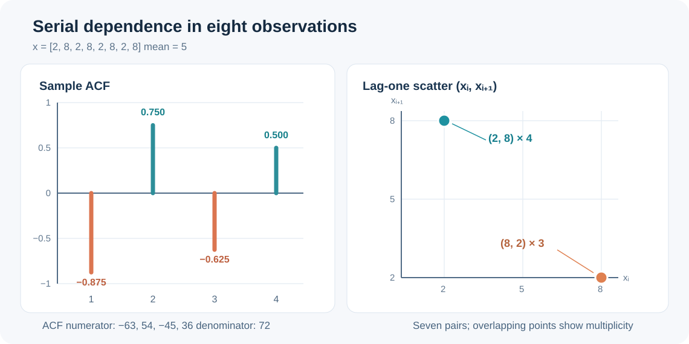
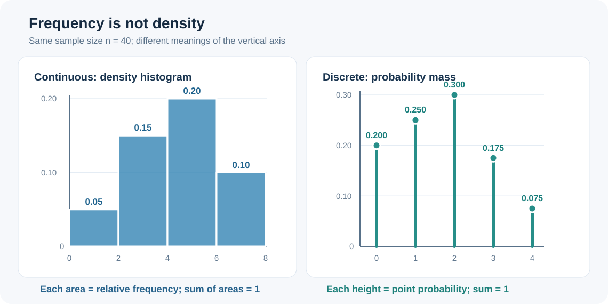
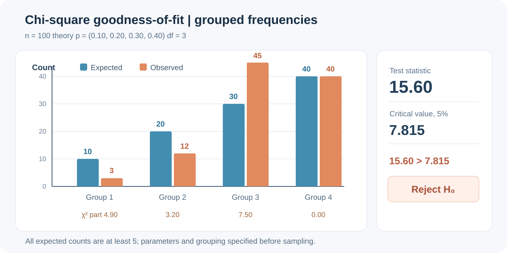
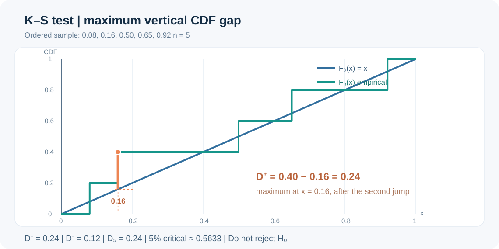

# 仿真输入分析专项练习 07｜相关图、密度直方图、MLE 与拟合检验（图解）

[返回总目录](../README.md) · [上一题：卷积、取舍法与经验分布](2026-convolution-rejection-empirical-visual.md) · [第五讲完整笔记](../notes/05-simulation-input-analysis.md) · [计算题册](2026-calculation-workbook.md)

本章对应 `simulation5_v3.pdf` 的第五讲。题目围绕课件中的四个步骤组织：先判断样本是否有明显依赖，再通过图形选择候选分布，然后估计参数，最后做拟合优度检验。图形按照题设数据重新绘制，数值可逐项复算；它们是课堂方法的训练图，不代替课件原图中的具体样本。

| 看到什么题目 | 先做什么 | 最后检查什么 |
| --- | --- | --- |
| 相关图、相邻点散点图 | 写出样本均值和滞后样本协方差分子 | 相关不等于独立，零相关也不证明独立 |
| 连续数据的直方图 | 计算组宽及每组频数 | 密度柱的面积之和为 1 |
| 离散数据的分布线图 | 列不同取值的频数及频率 | 各点概率之和为 1 |
| 极大似然估计 | 写出似然、对数似然、导数 | 参数含义、取值范围和单位 |
| 卡方拟合检验 | 由理论概率求期望频数 | 自由度、期望频数和上侧临界值 |
| K–S 拟合检验 | 将样本排序，算跳跃前后两种差距 | 理论分布是否完全指定、是否连续 |

## 一、题目 1｜自相关与相邻散点图：交替序列如何计算？

给定按先后顺序记录的 8 次观测：

```text
2, 8, 2, 8, 2, 8, 2, 8
```

使用第五讲给出的样本自相关系数计算方法，求滞后 1 至 4 阶的自相关，并画出相邻观测散点图。判断“这组数据各次观测相互独立”是否有依据。

<strong>答案。</strong> 样本均值为 `5`；第一至第四阶自相关依次是 `−0.875、0.750、−0.625、0.500`。相邻散点集中于 `(2,8)` 与 `(8,2)` 两个位置，表现出明显交替结构，不能把这些数据当作没有依赖的 IID 输入。

### 第一步：计算统一的分母

```math
\bar x=\frac{2+8+2+8+2+8+2+8}{8}=5.
```

每个观测相对均值的偏差交替为 `−3、3、−3、3、−3、3、−3、3`，所以：

```math
\sum_{i=1}^{8}(x_i-\bar x)^2=8\times3^2=72.
```

### 第二步：分别计算滞后乘积之和

第五讲采用的样本自相关写作：

```math
\widehat\rho_j=
\frac{\sum_{i=1}^{n-j}(x_i-\bar x)(x_{i+j}-\bar x)}
{\sum_{i=1}^{n}(x_i-\bar x)^2}.
```

滞后 1 时共有 `7` 对相邻偏差，每对乘积都是 `−9`，因此：

```math
\widehat\rho_1=\frac{7\times(-9)}{72}=-0.875.
```

滞后 2 时共有 `6` 对偏差，每对乘积都是 `9`，因此：

```math
\widehat\rho_2=\frac{6\times9}{72}=0.750.
```

同理：

```math
\widehat\rho_3=\frac{5\times(-9)}{72}=-0.625,
\qquad
\widehat\rho_4=\frac{4\times9}{72}=0.500.
```

### 第三步：将“相关系数”和“相邻点”放在同一张图里



左图在奇数阶出现负相关，在偶数阶出现正相关；右图共有 7 个相邻点对，其中 `(2,8)` 出现 4 次，`(8,2)` 出现 3 次。这里的散点重叠是重复观测，不是只有两个数据点。题目是小样本示例，<strong>应解读结构，不能把大样本自相关置信界直接套在 8 个观测上作正式显著性检验。</strong>

## 二、题目 2｜直方图：频率、密度和面积不能混用

采集 40 个连续型服务时间样本，分为四组，组宽均为 2 分钟，观察频数分别为 `4、12、16、8`。列出频率及密度高度，并检验直方图总面积。

<strong>答案。</strong> 频率依次为 `0.10、0.30、0.40、0.20`；概率密度直方图的四个高度依次为 `0.05、0.15、0.20、0.10`，总面积为 `1`。

### 第一步：先用频数除以样本量

| 区间（分钟） | 频数 `fᵢ` | 频率 `fᵢ/40` | 密度高度 `fᵢ/(40×2)` | 矩形面积 |
| --- | ---: | ---: | ---: | ---: |
| `[0,2)` | 4 | 0.10 | 0.05 | 0.10 |
| `[2,4)` | 12 | 0.30 | 0.15 | 0.30 |
| `[4,6)` | 16 | 0.40 | 0.20 | 0.40 |
| `[6,8]` | 8 | 0.20 | 0.10 | 0.20 |
| 合计 | 40 | 1.00 | — | 1.00 |

### 第二步：把“概率属于面积”写出来

```math
h_i=\frac{f_i}{n\Delta b},\qquad
\sum_{i=1}^{4}h_i\Delta b
=2(0.05+0.15+0.20+0.10)=1.
```



左图的每个矩形<strong>面积</strong>对应频率。若把 0.10、0.30、0.40、0.20 原样写作密度高度，总面积会变成 2，不再是合法的密度直方图。四组是本题给定的分组；实际绘图还应尝试不同的组数，并结合课件提出的 `1+log₂(n)` 经验规则。

## 三、题目 3｜离散型输入：为什么不能再除以组宽？

另有 40 天缺陷数记录。缺陷数为 `0、1、2、3、4` 的天数依次为 `8、10、12、7、3`。求经验概率质量函数，并说明与上一题的直方图有何区别。

<strong>答案。</strong> 这五个取值的估计概率依次为 `0.200、0.250、0.300、0.175、0.075`，其和为 `1`，不需要除以组宽。

### 第一步：逐项计算点概率

```math
\begin{aligned}
\widehat p(0)&=8/40=0.200,\\
\widehat p(1)&=10/40=0.250,\\
\widehat p(2)&=12/40=0.300,\\
\widehat p(3)&=7/40=0.175,\\
\widehat p(4)&=3/40=0.075.
\end{aligned}
```

### 第二步：检查概率总和

```math
0.200+0.250+0.300+0.175+0.075=1.
```

上一题配图右侧使用离散线条表示这些点概率。对于离散输入，概率集中在 `0、1、2、3、4` 这些允许值上，不能认为从 `x=1` 到 `x=2` 之间还存在连续密度。两张图即使外观相似，纵轴的统计意义仍不同。

## 四、题目 4｜指数分布 MLE：从原始数据算到下一次抽样

五个独立到达间隔为 `1、2、2、3、4` 分钟，假设它们同分布于率参数为 `λ` 的指数分布。求 MLE，求间隔不超过 3 分钟的拟合概率。若下一次生成使用 `u=0.75`，再用第四讲的逆变法给出一次模拟间隔。

<strong>答案。</strong> `λ̂=5/12≈0.4167` 次/分钟，拟合平均间隔为 `2.4` 分钟，`P(X≤3)≈0.7135`，用 `u=0.75` 生成的间隔约为 `3.3271` 分钟。

### 第一步：写似然并取对数

```math
\begin{aligned}
L(\lambda)
&=\prod_{i=1}^{5}\lambda e^{-\lambda x_i}
=\lambda^5e^{-12\lambda},\\
\ell(\lambda)&=5\ln\lambda-12\lambda.
\end{aligned}
```

### 第二步：求驻点并检查最大值

```math
\frac{d\ell}{d\lambda}=\frac{5}{\lambda}-12=0
\quad\Longrightarrow\quad
\widehat\lambda=\frac{5}{12}.
```

```math
\frac{d^2\ell}{d\lambda^2}=-\frac{5}{\lambda^2}<0.
```

### 第三步：代入指数 CDF，再做逆变抽样

```math
\begin{aligned}
P(X\leq3)
&=1-e^{-\widehat\lambda\times3}
=1-e^{-1.25}\approx0.7135,\\
X&=-\frac{\ln(1-u)}{\widehat\lambda}
=-\frac{12\ln(0.25)}{5}\approx3.3271.
\end{aligned}
```

第五讲负责从数据估计分布；第四讲负责从该拟合分布中生成样本。两次计算的对象不同：`λ̂` 是基于五次观测的参数估计，`3.3271` 是一次模拟生成的随机样本。

## 五、题目 5｜正态方差 MLE：为什么分母不是 `n−1`？

在 IID 正态模型下，已观察 `2、4、4、6`。求均值 MLE、方差 MLE 和常用无偏样本方差，并说明三者的关系。

<strong>答案。</strong> `μ̂=4`；方差 MLE 为 `2`，无偏样本方差为 `8/3≈2.6667`。

### 第一步：列出偏差平方

```math
\bar x=\frac{2+4+4+6}{4}=4,
\qquad\sum_{i=1}^{4}(x_i-4)^2=4+0+0+4=8.
```

### 第二步：区别估计准则

```math
\widehat{\sigma}^2_{\mathrm{MLE}}=\frac{8}{4}=2,
\qquad
s^2=\frac{8}{4-1}=\frac{8}{3}.
```

如果题目问极大似然估计，应使用分母 `n`；如果明确要求通常意义下的无偏样本方差，应使用 `n−1`。这两个数字的差别来自统计性质，不是计算误差。若要求标准差，则分别再开平方，不能把方差的结果直接当标准差。

## 六、题目 6｜卡方拟合检验：完整频数表与拒绝区域

某理论分布在四个互不重叠区间的概率为 `0.10、0.20、0.30、0.40`。抽得 `n=100` 个独立样本，观察频数为 `3、12、45、40`。理论概率和分组规则均在抽样前确定，未估计任何模型参数。已知 `α=0.05`、`χ²₀.₉₅(3)=7.815`，完成拟合优度检验。

<strong>答案。</strong> 理论期望频数为 `10、20、30、40`；卡方统计量 `15.60`，自由度 `3`，因为 `15.60>7.815`，在 5% 显著性水平下拒绝 `H₀`。

### 第一步：期望频数由理论概率决定

```math
E_i=np_i.
```

| 区间 | 理论概率 `pᵢ` | 实际频数 `Oᵢ` | 期望频数 `Eᵢ` | `(Oᵢ−Eᵢ)²/Eᵢ` |
| --- | ---: | ---: | ---: | ---: |
| 第 1 组 | 0.10 | 3 | 10 | 4.90 |
| 第 2 组 | 0.20 | 12 | 20 | 3.20 |
| 第 3 组 | 0.30 | 45 | 30 | 7.50 |
| 第 4 组 | 0.40 | 40 | 40 | 0.00 |
| 合计 | 1.00 | 100 | 100 | 15.60 |

### 第二步：计算统计量及自由度

```math
\begin{aligned}
\chi^2
&=\frac{(3-10)^2}{10}
+\frac{(12-20)^2}{20}
+\frac{(45-30)^2}{30}
+\frac{(40-40)^2}{40}\\
&=4.90+3.20+7.50+0=15.60.
\end{aligned}
```

由于模型参数事先完全给定，`p=0`，有效分组 `k=4`：

```math
\nu=k-p-1=4-0-1=3.
```

### 第三步：用结果图解释偏差从哪里来



第一和第三组的实际/理论频数差距较大，其中第三组贡献了 `7.50`，第 4 组完全相符所以贡献为 `0`。卡方统计量反映的是<strong>所有分组的加权偏差</strong>，不能只根据“最后一组很接近”便认为拟合良好。

本题每组理论期望频数均不小于 5，符合课堂手算采用卡方近似时的常见频数要求。若某些组 `Eᵢ` 过小，应考虑按合理方式合并相邻组，并重新计算有效组数与自由度。

## 七、题目 7｜K–S 检验：最大差距发生在跳跃前还是跳跃后？

检验五个独立样本是否来自<strong>事先完全指定</strong>的 `U(0,1)` 分布。已排序样本为 `0.08、0.16、0.50、0.65、0.92`，记理论 CDF 为 `F₀(x)=x`。计算 `D⁺、D⁻、D₅`。如题目另给 5% 显著性水平下的双侧临界值约为 `0.5633`，判断是否拒绝原假设。

<strong>答案。</strong> `D⁺=0.24`，`D⁻=0.12`，故 `D₅=0.24`；因为 `0.24<0.5633`，不拒绝“样本来自 U(0,1)”的原假设。

### 第一步：把经验 CDF 的跳跃前后都列出来

```math
\begin{aligned}
D^+&=\max_i\left(\frac{i}{5}-F_0(x_{(i)})\right),\\
D^-&=\max_i\left(F_0(x_{(i)})-\frac{i-1}{5}\right).
\end{aligned}
```

| `i` | `x₍ᵢ₎` | `F₀(x₍ᵢ₎)` | `i/5−F₀(x₍ᵢ₎)` | `F₀(x₍ᵢ₎)−(i−1)/5` |
| --- | ---: | ---: | ---: | ---: |
| 1 | 0.08 | 0.08 | 0.12 | 0.08 |
| 2 | 0.16 | 0.16 | 0.24 | −0.04 |
| 3 | 0.50 | 0.50 | 0.10 | 0.10 |
| 4 | 0.65 | 0.65 | 0.15 | 0.05 |
| 5 | 0.92 | 0.92 | 0.08 | 0.12 |

### 第二步：分别取最大值，不是最大绝对差的平均

```math
\begin{aligned}
D^+&=\max(0.12,0.24,0.10,0.15,0.08)=0.24,\\
D^-&=\max(0.08,-0.04,0.10,0.05,0.12)=0.12,\\
D_5&=\max(D^+,D^-)=0.24.
\end{aligned}
```



在 `x=0.16`，理论 CDF 的高度为 `0.16`，经验 CDF 在第二次跳跃后达到 `2/5=0.40`。两者的垂直距离是 `0.40−0.16=0.24`，恰好给出 `D⁺`。<strong>只在跳跃点的左侧计算，或只把曲线上的五个点相连，都可能漏掉真正的最大差距。</strong>

### 第三步：与正确的临界值比较

这里 `F₀` 连续且完全指定，没有从这五个样本中估计均匀分布参数，所以可使用该设定下的标准双侧 K–S 临界值。`0.24` 小于题给临界值，故不拒绝 `H₀`，并不等于证明样本一定均匀。

## 八、题目 8｜估计参数之后，检验自由度怎样变化？

把 80 个独立连续观测划分到五个分组，先用同一批数据估计候选分布的两个参数。某课程题目明确采用第五讲的常规卡方自由度规则 `ν=k−p−1`。求自由度，并解释为何不能在所有情况下机械套用。另判断：如果使用这批样本估计正态分布均值和方差，是否可以直接用完全指定分布的标准 K–S 表？

<strong>答案。</strong> 按题目指定的课件规则，`ν=5−2−1=2`。但实际卡方拟合检验的参考分布还受分组方式及估参方法影响；同一批样本拟合正态参数后，不能直接使用完全指定 CDF 的标准 K–S 临界值。

### 推导及规则适用条件

卡方检验以 `k` 组实际频数为基础，总频数已固定，独立波动的维数通常先减一。如果又通过相应方法估计 `p` 个自由参数，课程中的标准近似自由度写为：

```math
\nu=k-1-p=5-1-2=2.
```

实际分析时，若参数来自未分组原始数据的估计、分组边界又根据数据调整，统计量的参考分布未必满足上述简单规则，必要时应采用合适的校准方法。K–S 检验的关键是理论分布 `F₀` 在检验前是否已经完全指定；若均值与方差由同一组样本拟合，通常应采用适用于估参情形的检验（例如相应的 Lilliefors 方法或参数自助法），不能继续把原表视为严格有效。

## 九、题目 9｜输入分布的业务边界：正态工序时间会产生负数吗？

模型假设加工时长服从 `N(10,4²)`（单位：分钟），求一次抽样产生负时间的概率。再说明为什么“将所有负值直接改为零”会改变输入分布。

<strong>答案。</strong> `P(X<0)=Φ(−2.5)≈0.00621`，即约 `0.62%`。把负值直接替换成 0，会使 0 处出现额外的概率质量，不再保持原来的正态分布。

```math
P(X<0)=P\left(Z<\frac{0-10}{4}\right)
=\Phi(-2.5)\approx0.00621.
```

样本量足够大时，0.62% 也可能对应可观数量的无效工序时间。应根据实际过程选择正值分布、合理的截断分布或其他能够解释业务机制的方案，而不能默默删除或改写不方便的观测结果。

## 十、题目 10｜完整输入分析的先后顺序

某工厂想将一批设备维修间隔输入仿真软件。团队已画出右偏直方图，又用极大似然估计出某个指数率参数，并获得一个不显著的拟合检验结果；但数据按时间排列呈现明显的高低交替。能否因此直接把这些间隔作为 IID 指数输入？还应补充什么分析？

<strong>答案。</strong> 不能。首先要检查并解释高低交替的来源；如果这是系统性依赖，就需要针对运行机制使用分时段、状态依赖或其他合适的过程模型。直方图和单变量拟合检验关注的是边际分布形状，并不能证明观测之间相互独立。

完整流程的顺序应是：核对数据单位与记录规则，检查自相关和相邻依赖，结合业务机制提出候选输入模型，估计参数，对分布与依赖结构进行相应检验，最后决定仿真如何生成随机输入。只有这些假设与模型目的相符时，才值得做后续运行与输出分析。

## 十一、六道快速判断题

<strong>判断 1。</strong> “某组观测的第一阶样本自相关等于零，因此这些观测相互独立。”

<strong>答案：错误。</strong> 不相关不推出独立；也可能存在更高阶或非线性依赖。

<strong>判断 2。</strong> “连续型概率密度直方图中，某矩形的高度必须小于 1。”

<strong>答案：错误。</strong> 概率由面积表示；组宽很小时，密度高度可以大于 1。

<strong>判断 3。</strong> “离散型缺陷件数的概率质量图需要把各点频率再除以连续区间组宽。”

<strong>答案：错误。</strong> 各点的概率质量已经由对应频数除以样本量得到。

<strong>判断 4。</strong> “同一组正态样本的方差 MLE 和无偏样本方差永远完全相同。”

<strong>答案：错误。</strong> 一般分别使用分母 `n` 和 `n−1`。

<strong>判断 5。</strong> “拟合优度检验未拒绝原假设，就证明所选分布是真实分布。”

<strong>答案：错误。</strong> 未拒绝只说明当前检验没有足够证据排斥该模型。

<strong>判断 6。</strong> “用同一批数据估计正态均值与标准差后，可以不作调整直接使用完全指定分布的标准 K–S 临界值。”

<strong>答案：错误。</strong> 估参改变检验统计量的零假设参考分布。

## 复习时的计算顺序

遇到相关图，先求均值、统一分母，再逐阶计算滞后乘积；遇到直方图，先辨认连续还是离散，再决定用面积还是点概率；遇到 MLE，先写密度与似然，最后核对参数单位；遇到卡方检验，先列表算 `Oᵢ、Eᵢ` 和各组贡献；遇到 K–S 检验，必须把跳跃前后两列偏差同时算完。四张图的坐标和标记都与本章数据一一对应，可以用来反向检查手算。

[返回总目录](../README.md) · [第五讲完整笔记](../notes/05-simulation-input-analysis.md) · [下一讲：仿真输出分析](../notes/06-output-analysis.md)
