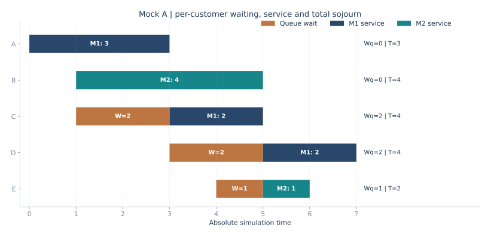
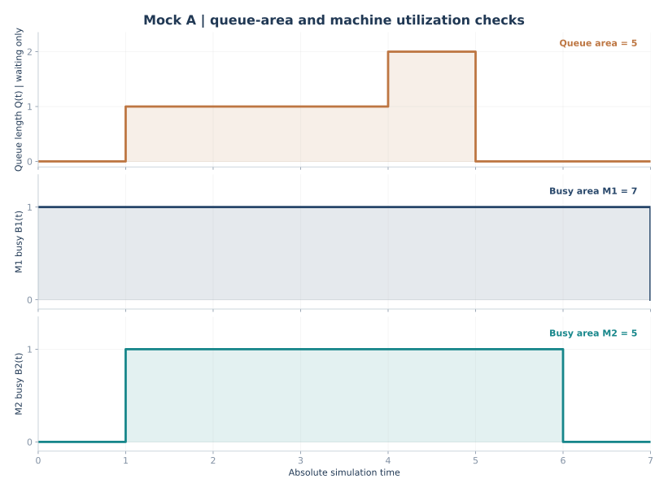

# 期末综合模拟卷 A｜双机并联的事件调度法

> 2026 秋·系统仿真；依据 11 月 9 日课堂复习范围自编。总分 100 分、各题分值为练习设计，不代表教师公布的正式卷面分值。<strong>题目下直接附答案、推导与核验方式</strong>。建议先遮住答案独立完成。

[返回三套卷总目录](2026-mock-exams-index.md) · [事件调度全表专项](2026-event-complete-fel-ledger.md) · [录音考点总复习](2026-final-review.md)

## 第一部分：概念判断与改错（10 题×3 分＝30 分）

### 1．“系统状态改变会自动产生一个事件，因此事件是状态变化的结果。”

<strong>答案：错误。</strong> 离散事件仿真用事件描述特定时刻发生的活动；事件的发生会导致系统状态改变，并可能安排将来的事件。例如，零件加工完成是事件，执行后机器状态由“忙”变“闲”；若队列非空，机器随即开始处理下一零件并预约新的“加工完成”事件。这里必须区分“事件引起状态变化”与“某个状态条件允许事件规则安排后续事件”。

### 2．“未来事件表按事件被插入表格的先后顺序处理。”

<strong>答案：错误。</strong> 未来事件表（FEL）按<strong>事件预定发生的仿真时刻</strong>排序。新安排的事件即使刚刚插入，只要发生时刻较早，也必须排在更晚发生的事件前面。相同时刻事件须按题目指定的并发处理规则执行，不能默认所有处理顺序对资源分配都无影响。

### 3．“排队长度包括正在机器上接受加工的零件。”

<strong>答案：错误。</strong> 在本题约定下，`Q(t)` 仅表示<strong>等待服务</strong>的零件数量，不包含正在加工的零件。若题目询问系统内零件数，则等于等待数加正在加工数。

### 4．“两台并联机器均空闲时，应由学生自行决定把零件送到哪一台。”

<strong>答案：错误。</strong> 资源选择遵守题目给出的规则。本卷明确规定两台均空闲时优先 M1；只有一台空闲时使用那一台；两台都忙则进入共享 FCFS 队列。

### 5．“一个零件从系统到达到最终离开之间的时间，等于它的排队等待时间与服务时间之和。”

<strong>答案：正确（本卷双机并联、无额外运输时间）。</strong> 即 `T_i=W_{q,i}+S_i`。对于有多工序及运输时间的串联系统，必须再计入所有工序的等待与服务，以及运输时间。

### 6．“机器利用率可以用‘总排队时间÷仿真时长’计算。”

<strong>答案：错误。</strong> 某机器在统计区间 `[0,H]` 的利用率为机器<strong>忙碌时间之和／H</strong>，亦即机器忙闲指示函数曲线下的面积除以 `H`；客户排队时间属于不同指标。

### 7．“计算时间平均队长时，只要把各事件时刻观察到的队长取算术平均即可。”

<strong>答案：错误。</strong> 不同时段长度不同，必须按时长加权：`L_q=(1/H)∫_0^H Q(t)dt`。离散事件手算时逐个区间计算“区间队长×区间宽度”。

### 8．“在给定仿真终止时长的题目里，所有未来事件都必须处理完才能终止。”

<strong>答案：错误。</strong> 若规定在 `H` 时刻停止，则不处理 `H` 之后的事件，但统计量按题目规定截断；若规定完成第 `k` 个零件后停止，则执行相应完成事件即终止。务必先确认终止口径。

### 9．“事件调度法每推进一步，只需列出本次新增的事件。”

<strong>答案：错误。</strong> 考试要求展示<strong>当前完整 FEL</strong>：保留尚未发生的旧事件，插入新事件并按时间排序，对已经执行的事件做处理标记。只写新增事件会使后续结果无法检查。

### 10．“只要零件已经离开串联系统中的 M1，它的系统逗留时间就可以结算。”

<strong>答案：错误。</strong> 若 M1 后仍要到 M2，则离开 M1 仅表示完成第一工序，系统逗留时间必须等零件离开最后一道工序时才能计算。本卷是并联系统，零件离开其被分配的机器即离开系统。

## 第二部分：简答与证明（4 题×10 分＝40 分）

### 11．简述离散事件仿真的事件调度法。解释时钟、系统状态和 FEL 各自承担的作用。

<strong>参考答案：</strong>

仿真时钟是“当前事件发生的模拟时间”，不会按固定步长一秒一秒增加，而是跳到 FEL 中最早的事件时刻。系统状态描述时刻的机器忙闲、排队人数及正在加工对象等；FEL 则记录“未来已经预约、尚未发生”的事件及其绝对发生时刻。三者不可替代：时钟负责时间，状态负责当前情况，FEL 负责下一步发生什么。

初始时设置时钟与状态，列出第一个到达事件；每轮从 FEL 选最早事件，跳钟，处理事件，更新资源和队列，安排新的未来事件，同时积累等待时间、队长面积和机器忙碌面积。重复至达到明确的终止条件。应当把状态更新、事件表更新和统计量更新当作同一轮中的三个检查动作。

### 12．仿真模型的 Verification 与 Validation 分别是什么？分别举一个检验方法。

<strong>参考答案：</strong>

<strong>Verification（验证实现正确性）</strong>关心：程序和事件规则是否正确实现了已定义的模型。可用三名零件的确定性样例人工推算 FEL，再与代码输出逐项比对。

<strong>Validation（确认现实适用性）</strong>关心：模型假设和输出能否合理描述真实系统。可对实际产线进行观测，比较真实的平均逗留时间、设备繁忙程度与仿真结果，并检查到达率、加工时长等分布假设。前者回答“做得对不对”，后者回答“做的是不是现实中要研究的系统”。

### 13．简述输入分析的四个步骤，并解释为什么必须先检验输入数据的独立性。

<strong>参考答案：</strong>

输入分析依次是<strong>独立性判别 → 分布形式假定 → 参数估计 → 拟合优度检验</strong>。独立性可通过数据时间顺序图、相邻数据散点图、自相关分析进行初步检查；分布形式可由直方图和概率图辅助判断；参数估计使用矩估计或极大似然估计；最后通过适合的卡方或 K–S 方法检验假设是否与数据明显冲突。

先检查独立性是因为“各次到达间隔独立同分布”是许多经典输入模型的关键假设。若原数据有显著周期性或自相关，直接拟合一个边际分布并独立抽样会抹掉时间结构，即便样本频数看上去吻合，也可能低估拥堵和等待。检验方法应与数据特性和模型假设匹配。

### 14．设 `U~U(0,1)`、`λ>0`，定义 `X=−ln(U)/λ`。证明 X 服从参数 λ 的指数分布。

<strong>参考答案：</strong>

由于 `0<U<1`，有 `−ln(U)≥0`，故 `X≥0`；当 `x<0` 时，`F_X(x)=0`。当 `x≥0` 时，

```math
\begin{aligned}
F_X(x)&=P(X\le x)\\
&=P\left(-\frac{1}{\lambda}\ln U\le x\right)\\
&=P(U\ge e^{-\lambda x})\\
&=1-e^{-\lambda x}.
\end{aligned}
```

上式最后一步成立，因为 `x≥0` 且 `λ>0` 使得 `e^{−λx}∈(0,1]`，可以使用均匀分布的分布函数。由此在 `x>0` 求导：

```math
f_X(x)=\begin{cases}\lambda e^{-\lambda x},&x\ge0,\\0,&x<0.\end{cases}
```

它正是参数 λ 的指数密度，得证。利用变换密度公式也可得到同一结果，但同样不能省略取值区间判断。

## 第三部分：大计算题（30 分）

### 15．双机并联系统的完整事件调度及统计指标

五个零件按下表抵达一个拥有两台并联机器的系统。每个零件只在其中一台机器加工一次，服务不中断；两台机器共用一个 FCFS 等待队列。

| 零件 | A | B | C | D | E |
| --- | ---: | ---: | ---: | ---: | ---: |
| 到达时刻 | 0 | 1 | 1 | 3 | 4 |
| 所需加工时间 | 3 | 4 | 2 | 2 | 1 |

资源选择规则：只有一台空闲就使用空闲机器；两台都空闲，优先 M1；若都忙则入队。相同时刻按“<strong>完成事件优先于到达事件</strong>”；同时有两台加工完成时先处理 `M1` 的离开事件，之后处理 `M2` 的离开事件；到达事件按零件字母顺序处理。初始时 FEL 已列入五个到达事件。处理完最后一个零件的完成事件即终止。

要求：①按事件时序填写<strong>每次处理后完整 FEL</strong>，并记录两机器状态、队列；②计算每个零件的排队时间与系统逗留时间；③求平均排队时间、平均系统逗留时间、时间平均队长及两机器利用率；④用时间轴或阶梯图核验统计结果。

#### （1）先给出完整结果表

| 零件 | 到达 `A_i` | 机器 | 开始加工 `B_i` | 离开 `D_i` | 等待 `Wq=B−A` | 逗留 `T=D−A` |
| --- | ---: | --- | ---: | ---: | ---: | ---: |
| A | 0 | M1 | 0 | 3 | 0 | 3 |
| B | 1 | M2 | 1 | 5 | 0 | 4 |
| C | 1 | M1 | 3 | 5 | 2 | 4 |
| D | 3 | M1 | 5 | 7 | 2 | 4 |
| E | 4 | M2 | 5 | 6 | 1 | 2 |
| <strong>合计</strong> | — | — | — | — | <strong>5</strong> | <strong>17</strong> |



从图上看，C 在 `t=1` 到达，M1 忙到 `t=3` 才轮到 C，等待 `2`；D 在 `t=3` 排在 C 后面，在 `t=5` 才开始，等待 `2`；E 在 `t=4` 入队，于 `t=5` 转入 M2，等待 `1`。服务时间颜色标注在对应机器上，因此同一张图还能核查机器派工与加工时间是否一致。

#### （2）逐事件记录完整未来事件表

记 `A(X)@t` 为零件 X 在时刻 t 到达；`D(X,Mj)@t` 为零件 X 在时刻 t 从 Mj 加工完成并离开系统。下表 FEL 列<strong>执行当前行事件后仍未处理的全部事件</strong>，按时刻排序；教师要求的手写“复制整张旧表、划去已处理项”可按此列完整誊写，不能只抄新增事件。

| 步 | 当前时钟及刚执行事件 | 处理动作（已完成的旧事件在手写表中划去） | M1 | M2 | 等待队列 | <strong>处理后的完整 FEL</strong> |
| ---: | --- | --- | --- | --- | --- | --- |
| 0 | `t=0` 初始化 | 五次到达已预约 | 空 | 空 | 空 | `A(A)@0; A(B)@1; A(C)@1; A(D)@3; A(E)@4` |
| 1 | `t=0 A(A)` | A 进 M1，预约 A 在 3 完成 | A | 空 | 空 | `A(B)@1; A(C)@1; D(A,M1)@3; A(D)@3; A(E)@4` |
| 2 | `t=1 A(B)` | B 进 M2，预约 B 在 5 完成 | A | B | 空 | `A(C)@1; D(A,M1)@3; A(D)@3; A(E)@4; D(B,M2)@5` |
| 3 | `t=1 A(C)` | 两机都忙，C 进队列 | A | B | C | `D(A,M1)@3; A(D)@3; A(E)@4; D(B,M2)@5` |
| 4 | `t=3 D(A,M1)` | A 离开；C 从队列进入 M1，加工至 5 | C | B | 空 | `A(D)@3; A(E)@4; D(C,M1)@5; D(B,M2)@5` |
| 5 | `t=3 A(D)` | M1、M2 都忙，D 入队 | C | B | D | `A(E)@4; D(C,M1)@5; D(B,M2)@5` |
| 6 | `t=4 A(E)` | E 排在 D 后面 | C | B | D,E | `D(C,M1)@5; D(B,M2)@5` |
| 7 | `t=5 D(C,M1)` | C 离开；队首 D 进 M1，加工至 7 | D | B | E | `D(B,M2)@5; D(D,M1)@7` |
| 8 | `t=5 D(B,M2)` | B 离开；队首 E 进 M2，加工至 6 | D | E | 空 | `D(E,M2)@6; D(D,M1)@7` |
| 9 | `t=6 D(E,M2)` | E 离开，M2 空闲 | D | 空 | 空 | `D(D,M1)@7` |
| 10 | `t=7 D(D,M1)` | D 离开，系统清空并终止 | 空 | 空 | 空 | `∅` |

注意 `t=3` 与 `t=5` 各有两个事件。仿真钟在同一时刻可以处理多个事件，<strong>不能因为已经处理了同一时刻的第一个事件，就把另一个事件跳过去</strong>。尤其在 `t=5`，因为题目指定 M1 的完成先于 M2，队首 D 被分配给 M1，而 E 随后分配给 M2。

#### （3）逐区间积分：队长、忙闲与统计面积

在相邻两个事件时刻之间，队长和机器忙闲不会改变，因此可对每个区间使用“状态值 × 时长”。

| 时间区间 | 长度 `Δt` | 等待队列及 `Q` | `Q·Δt` | M1 忙 `B1` | `B1·Δt` | M2 忙 `B2` | `B2·Δt` |
| --- | ---: | --- | ---: | ---: | ---: | ---: | ---: |
| `[0,1)` | 1 | 空；0 | 0 | 1 | 1 | 0 | 0 |
| `[1,3)` | 2 | C；1 | 2 | 1 | 2 | 1 | 2 |
| `[3,4)` | 1 | D；1 | 1 | 1 | 1 | 1 | 1 |
| `[4,5)` | 1 | D,E；2 | 2 | 1 | 1 | 1 | 1 |
| `[5,6)` | 1 | 空；0 | 0 | 1 | 1 | 1 | 1 |
| `[6,7)` | 1 | 空；0 | 0 | 1 | 1 | 0 | 0 |
| <strong>合计</strong> | <strong>7</strong> | — | <strong>5</strong> | — | <strong>7</strong> | — | <strong>5</strong> |



从阶梯图取每段矩形面积，得到队长曲线面积 `5`，M1 忙碌面积 `7`，M2 忙碌面积 `5`。注意机器忙闲图在同一时刻服务对象更替时仍维持 `B=1`，因为没有空闲时间间隔。

#### （4）逐个计算指标，不混用分母

五个零件均已完成，统计终止时刻为 `H=7`：

```math
\begin{aligned}
\overline W_q&=\frac{0+0+2+2+1}{5}=1,\\
\overline T&=\frac{3+4+4+4+2}{5}=3.4,\\
\overline L_q&=\frac{0\times1+1\times2+1\times1+2\times1}{7}=\frac{5}{7}\approx0.7143,\\
U_1&=\frac{3+2+2}{7}=1=100\%,\\
U_2&=\frac{4+1}{7}=\frac{5}{7}\approx71.43\%.
\end{aligned}
```

<strong>一致性核查。</strong> 每个零件满足 `T=Wq+S`，所以 `17=5+(3+4+2+2+1)=5+12`。另外，本例全部到达者均已离开，<strong>全部零件等待时间总和 `5`</strong>恰好等于<strong>等待队长曲线面积 `5`</strong>，这是排队手算很有用的守恒检查。两台机器忙碌面积总和 `7+5=12`，也等于全部加工时间总和 `12`。

## 考场自检

这一题最容易丢分的不是最后的四个均值，而是 `t=3` 和 `t=5` 的同刻事件、FEL 漏项、误把在加工零件计入队列、以及把“客户平均等待时间”的分母 `5` 与“时间平均队长”的分母 `7` 混为一谈。检查时先核对零件级时间线，再核对 FEL，最后用三条面积守恒校验全部数字。
