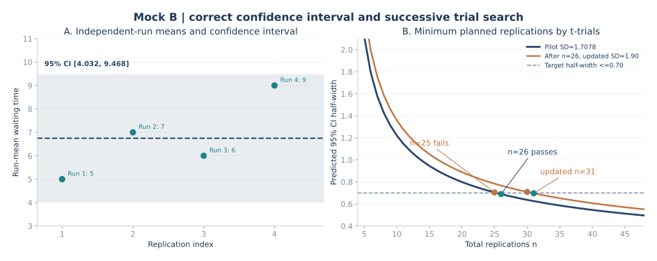

# 期末综合模拟卷 B｜输出分析、置信区间与试算法

> 2026 秋·系统仿真；依据 11 月 9 日课堂复习范围自编。练习卷按 100 分设计，正式考试题量与分值以教师公布为准。每题下附答案。<strong>本卷的 12 个原始观测值不能直接当作 12 次独立重复。</strong>

[返回三套卷总目录](2026-mock-exams-index.md) · [输出分析 8 题 4 图](2026-output-precision-priority-drill.md) · [录音考点总复习](2026-final-review.md)

## 第一部分：概念判断与改错（10 题×3 分＝30 分）

### 1．“只要收集了 12 个输出数据，均值置信区间的自由度就是 11。”

<strong>答案：错误。</strong> 自由度由用于估计置信区间的<strong>独立统计观测数</strong>决定。本题 4 次独立重复、每次 3 个观测，先形成 4 个重复均值；用这 4 个均值估计方差时自由度为 `4−1=3`。

### 2．“在独立重复仿真中，每次运行内部的相邻输出一定是独立的。”

<strong>答案：错误。</strong> 同一次运行内的排队长度、等待时间等往往存在自相关。不同重复之间若使用独立随机流，才可以把每次运行的适当汇总统计量作为独立观测。

### 3．“样本方差的分母必须是重复次数 n，不能用 n−1。”

<strong>答案：错误。</strong> 本课使用重复均值的<strong>无偏样本方差</strong>，分母为 `n−1`：`S²=Σ(Y_i−Ȳ)²/(n−1)`。

### 4．“同样的样本标准差下，增加独立重复次数通常能缩小均值置信区间的半长。”

<strong>答案：正确。</strong> 半长 `h=t_(n−1,1−α/2)·S/√n`，当 `S` 固定且置信水平不变时，增加 `n` 通常降低 `h`。

### 5．“95% 置信区间意味着真均值有 95% 的概率落在已经得到的固定区间里。”

<strong>答案：错误（按经典频率学派解释）。</strong> 总体真均值在经典模型中是固定常数；95% 指使用这一随机建区间方法反复抽样时，长期约有 95% 的区间覆盖真均值，不应直接赋予该固定参数一个事后概率。

### 6．“试算法验证最小重复次数时，只要找出一个满足精度的 n 就足够。”

<strong>答案：错误。</strong> 还应按同一套试算公式证明 `n−1` 不满足，从而确认最小整数 `n`。若过程中样本标准差更新，必须说明采用哪一个固定估计值进行试算。

### 7．“已有 4 次独立重复，再算出至少需要 26 次，意味着还要追加 26 次。”

<strong>答案：错误。</strong> `26` 是计划<strong>总次数</strong>，已有 `4` 次，需追加 `26−4=22` 次（假定原 4 次可计入本次实验计划）。

### 8．“稳态仿真与终止型仿真完全相同，都应把初始化瞬间当作稳态数据。”

<strong>答案：错误。</strong> 终止型系统通常关注给定起始条件及终止规则下的性能；稳态分析关注长期运行性质，可能需要识别并剔除初始化带来的暂态偏差（预热期）。

### 9．“在同一组实验下，预先固定随机数流可以使结果完全没有统计误差。”

<strong>答案：错误。</strong> 固定随机种子有利于结果复现，但不能消除模型结果随随机输入变化的抽样误差。比较方案时可适当使用共同随机数来降低差值估计的方差。

### 10．“卡方拟合检验与 K–S 检验本质上都只比较每组实际频数和理论频数。”

<strong>答案：错误。</strong> 卡方拟合优度检验以分组频数差异为基础；一元 K–S 检验比较经验累积分布函数与理论累积分布函数的最大偏离。后者不需要先划分频数组。

## 第二部分：简答题（4 题×10 分＝40 分）

### 11．为什么输出分析时“4 次重复、每次 3 个数”不能直接把 12 个数混在一起计算标准差？

<strong>参考答案：</strong>

研究目标是“<strong>每次运行的平均表现</strong>在重复间如何波动”。当不同重复使用独立随机流时，每次运行的平均值可以作为独立观测；但同一次运行内的输出通常存在时序相关性，其方差包含不同于重复均值之间的变异信息。因此，先分别求 `Y_1,…,Y_4`，再计算这四个值之间的样本标准差。直接合并 12 个观测求标准差，会把运行内波动混入针对“运行均值”的标准误估计，从而影响置信区间。

若每次观测数相同，`12` 个数的总体算术平均与 `4` 个运行均值的算术平均在数值上恰好相同；<strong>平均值相同，不代表标准差与有效样本量相同</strong>。如果每次观测数不同，是否需要加权还取决于要估计的究竟是顾客层面平均还是重复运行层面平均。

### 12．解释终止型仿真、稳态仿真、预热期和批均值法。

<strong>参考答案：</strong>

终止型仿真有自然终点，例如“一天营业结束”或“第 100 个零件完成”，研究指标依赖规定的起点和终点。稳态仿真考察系统长期运行条件下的统计性能，不应把起始空队列造成的暂态影响直接当作长期平均。

预热期是从运行开始到系统进入相对稳定的阶段；在稳态估计中可删去该阶段数据以缓解初始化偏差，但预热长度要有依据，过长会丢失有效信息。批均值法把一条充分长的稳态运行分为多个批次，对每批求平均，以批均值建立方差估计；批与批之间仍可能有相关性，因此批长和批数需要合理选择。它与“多次独立重复”的结构不完全相同。

### 13．什么是共同随机数（CRN）？为什么在两个方案比较中可能降低方差？

<strong>参考答案：</strong>

共同随机数是比较 A、B 两个方案时，让两方案尽可能使用具有对应关系的随机输入：例如第 `i` 个到达间隔、同一个顾客的服务需求使用相同的随机数。设对第 `i` 次配对得到两个方案的输出 `Y_{A,i}`、`Y_{B,i}`，关心差值 `D_i=Y_{A,i}−Y_{B,i}`。其方差满足：

```math
\operatorname{Var}(D_i)=\operatorname{Var}(Y_{A,i})+\operatorname{Var}(Y_{B,i})-2\operatorname{Cov}(Y_{A,i},Y_{B,i}).
```

若对应输入使两方案输出形成正协方差，则差值的波动可能降低，从而用较少重复看清方案差异。<strong>共同随机数并非总会降低方差</strong>：若协方差为负，反而可能使差值方差增加；还需保证配对机制具有可比性。

### 14．什么是置信区间的“半长”？与样本标准差、标准误、精度要求之间是什么关系？

<strong>参考答案：</strong>

置信区间写作 `Ȳ±h`，`h` 就是半长（half-width），即从区间中心到任一端点的距离。独立重复的样本标准差 `S` 衡量各次重复均值之间的离散程度；均值的标准误估计是 `SE=S/√n`；95% 双侧区间半长为 `h=t_(0.975,n−1)×SE`。

精度要求若表述为“95% 置信区间半长不超过 0.70”，要满足的是 `h≤0.70`，而不是“标准差不超过 0.70”或“区间总宽度不超过 0.70”（后者对应 `2h`）。

## 第三部分：大计算题（30 分）

### 15．四次独立重复的置信区间，以及达到目标半长的最少重复次数

某终止型系统已独立仿真四次，每次输出三个等待时间观测值。四次的随机流相互独立，每次三条观测来自同一次运行，不可视为三次独立重复。

| 运行编号 | 本次记录的三个观测值 |
| ---: | --- |
| 1 | `4, 5, 6` |
| 2 | `6, 7, 8` |
| 3 | `5, 6, 7` |
| 4 | `8, 9, 10` |

已知独立重复均值的双侧 95% 置信区间使用 Student t 分布；`t(0.975,3)=3.182446`。完成以下任务：

（1）计算四次运行均值、总体均值估计、重复均值的无偏样本方差及标准差；

（2）计算现有四次独立重复的 95% 置信区间；

（3）希望半长至多为 `0.70`，<strong>固定使用本次得到的试运行标准差 `S₀`</strong>估计后续所需运行总数，用 t 分布<strong>试算法</strong>找到最小整数 `n`，写出 `n−1` 与 `n` 两次边界判断；

（4）设真正完成 26 次运行后重新估计，发现 `S₂₆=1.90`。判断此时是否真正达到精度。如果仍以 `1.90` 作为下一阶段固定估计值，重新试算总次数，说明应追加多少次，并解释是否能保证最终达到目标。

#### （1）每次运行先求平均，再求跨运行方差

四个运行均值：

```math
Y_1=\frac{4+5+6}{3}=5,\quad
Y_2=\frac{6+7+8}{3}=7,\quad
Y_3=6,\quad Y_4=9.
```

均值估计：

```math
\overline Y=\frac{5+7+6+9}{4}=\frac{27}{4}=6.75.
```

跨运行样本方差（分母是 `n−1=3`）：

```math
\begin{aligned}
S_0^2&=\frac{(5-6.75)^2+(7-6.75)^2+(6-6.75)^2+(9-6.75)^2}{4-1}\\
&=\frac{3.0625+0.0625+0.5625+5.0625}{3}\\
&=\frac{35}{12}\approx2.916667,\\
S_0&=\sqrt{\frac{35}{12}}\approx1.707825.
\end{aligned}
```

#### （2）先计算标准误，再乘 t 临界值

```math
\begin{aligned}
SE(\overline Y)&=\frac{S_0}{\sqrt4}=0.853913,\\
h_4&=t_{0.975,3}\times\frac{S_0}{\sqrt4}
=3.182446\times0.853913\approx2.717531,\\
CI_{95\%}&=[6.75-2.717531,\ 6.75+2.717531]\\
&\approx[4.032469,\ 9.467531].
\end{aligned}
```

这里的 `n` 为 <strong>4 次独立运行</strong>，绝不是 12 条观测。因为 `n=4`，查 t 表的自由度为 <strong>3</strong>。

#### （3）固定 S₀ 的试算法：从粗试到最小整数

对计划总次数 `n` 的试算公式是：

```math
h(n;S_0)=t_{0.975,n-1}\frac{1.707825}{\sqrt n}.
```

先把 `n` 粗略增大，再在目标附近回跳（老师课堂建议的试法）。下表列出最后必须展示的相邻边界点：

| 总次数 `n` | `t_(0.975,n−1)` | 试算半长 `h(n;S₀)` | 是否满足 `h≤0.70` |
| ---: | ---: | ---: | --- |
| 25 | ≈2.063899 | <strong>0.704956</strong> | 不满足 |
| 26 | ≈2.059539 | <strong>0.689806</strong> | 满足 |

<strong>答：按当前试运行标准差预测，最少需要 26 次独立重复；已完成 4 次，还需追加 22 次。</strong> `n=25` 不过、`n=26` 通过，两个数同时写出才解释了“最少”的含义。

#### （4）标准差更新后，必须重新检查真实半长

真正做完 26 次后发现 `S₂₆=1.90`，则实际半长不是第（3）问中<strong>事前预测</strong>的 `0.689806`，而是

```math
h_{26,\mathrm{actual}}=t_{0.975,25}\frac{1.90}{\sqrt{26}}\approx0.767427>0.70.
```

因此<strong>尚未满足</strong>精度要求。如果把更新后的 `1.90` 暂时固定为下一次规划依据：

| 总次数 `n` | 用 `S=1.90` 预测的半长 | 是否满足 `h≤0.70` |
| ---: | ---: | --- |
| 30 | <strong>0.709472</strong> | 不满足 |
| 31 | <strong>0.696926</strong> | 满足 |

故更新后的<strong>计划总次数</strong>为 `31`，需要在当前 26 次基础上追加 `5` 次。不过这只是第二轮试算法的预测：真正做完 31 次后还要用全部 31 个重复均值重估标准差、重新计算半长；若标准差继续变化，最终精度未必自动保证。



左图强调置信区间建立在<strong>四个运行均值</strong>上；右图用两条标准差假定下的半长曲线比较：`S₀=1.707825` 时 `25→26` 跨过精度线，更新为 `S=1.90` 后 `30→31` 才跨过精度线。图中的水平虚线表示 `h=0.70`，与“区间总宽”无关。

## 考场自检

老师重点强调了三个动作：先得到每次运行的一个均值，样本方差分母用“独立重复次数减一”，用试算法时最后展示 `n−1` 与 `n` 两个相邻值。另外必须区分<strong>用试运行标准差计算的计划次数</strong>与<strong>追加运行后用新数据计算的实际置信区间</strong>。前者是实验设计，后者才是精度是否达标的证据。
