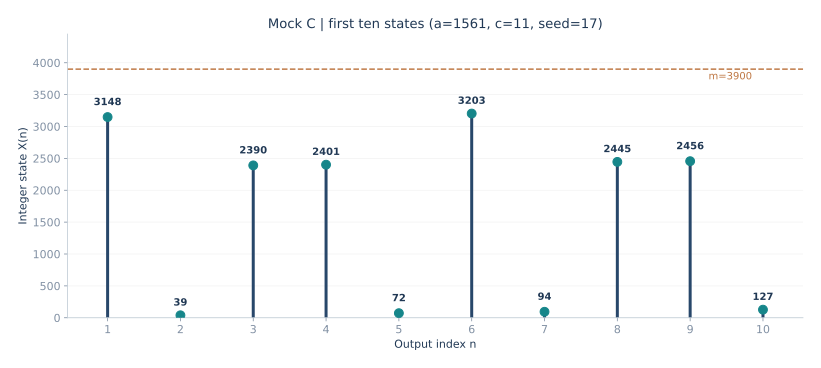

# 期末综合模拟卷 C｜线性同余法构造与随机数生成

> 2026 秋·系统仿真；依据 11 月 9 日课堂复习范围自编。练习卷总分 100 分、分值安排不代表正式试卷。题目下直接给出标准答案、完整计算和说明。<strong>本卷使用老师课堂提到的 `m=3900`，但刻意换用另一组合法参数，以检验是否真正理解满周期条件。</strong>

[返回三套卷总目录](2026-mock-exams-index.md) · [满周期构造专项](2026-lcg-full-period-drill.md) · [录音考点总复习](2026-final-review.md)

## 第一部分：概念判断与改错（10 题×3 分＝30 分）

### 1．“混合线性同余发生器只需要模数 m 与增量 c 互素，就一定满周期。”

<strong>答案：错误。</strong> 混合同余发生器若要对给定模数取得长度 `m` 的满周期，还必须要求 `a−1` 被 `m` 的每个不同素因子整除，并且当 `4|m` 时满足 `4|(a−1)`。三项缺一不可。

### 2．“当 m=3900 时，a−1 只要被 2、3、5、13 整除即可，不用考虑 4。”

<strong>答案：错误。</strong> `3900=2²×3×5²×13` 含有因子 `4`，因此除了所有不同素因子，还必须检查 `4|(a−1)`。

### 3．“给定 m=3900，选取 c=11 违反了 c 与 m 互素的要求。”

<strong>答案：错误。</strong> `3900` 的素因子只有 `2、3、5、13`，`11` 与 `3900` 没有大于 1 的公因子，`gcd(11,3900)=1`，因此 `c=11` 合法。

### 4．“线性同余法输出的整数 Xn 一定满足 0≤Xn<m。”

<strong>答案：正确。</strong> 按通常取非负余数的模运算，`Xn=(aXn−1+c) mod m` 的值在 `0,…,m−1` 内。对应 `U_n=Xn/m` 在 `[0,1)` 内；<strong>它是伪随机数，不代表连续均匀变量绝不取 0</strong>。

### 5．“如果 LCG 的周期达到 m，就能证明它满足所有随机性检验。”

<strong>答案：错误。</strong> 满周期仅说明状态循环长度最大，不保证局部序列没有可检出的规律，也不保证高维独立性或适合某个具体仿真需求。还需考察均匀性、序列相关性与适用性。

### 6．“卡方拟合优度检验需把数据分组，并比较实际频数与期望频数。”

<strong>答案：正确。</strong> 适用前提、分组方式、期望频数大小等也会影响检验。

### 7．“K–S 检验只能检查是否有连续两个相同数字出现。”

<strong>答案：错误。</strong> 一元 K–S 检验比较经验累积分布与给定理论分布的最大垂直差距；数字重复模式属于扑克检验等序列特征测试的范围。

### 8．“设 U~U(0,1)，利用连续目标分布的反函数 F⁻¹(U)，可以构造该分布的随机变量。”

<strong>答案：正确（按广义分位数函数理解）。</strong> 对连续、严格单调的 `F` 可直接求反函数；对一般分布可使用广义逆 `F^{-1}(u)=inf{x:F(x)≥u}`。生成后可通过分布函数检验。

### 9．“取舍法对候选样本的接受概率永远是 1。”

<strong>答案：错误。</strong> 取舍法通过包络密度生成候选样本，然后按目标密度与包络的相对大小随机接受或拒绝；接受率一般小于 1。

### 10．“记录一个随机数生成器的种子、模数、乘数和增量，有利于复现实验结果。”

<strong>答案：正确。</strong> 对确定性的伪随机发生器，这些参数与调用顺序决定后续状态序列。用于比较仿真结果时，还需保存模型版本和随机流使用方式。

## 第二部分：简答与证明（4 题×10 分＝40 分）

### 11．写出混合线性同余发生器的递推公式及满周期三个条件。

<strong>参考答案：</strong>

```math
X_{n+1}=(aX_n+c)\bmod m,\qquad U_{n+1}=\frac{X_{n+1}}{m}.
```

`m` 是模数，`a` 是乘数，`c` 是增量，`X₀` 是种子。对混合线性同余发生器，满足 Hull–Dobell 满周期条件：`gcd(c,m)=1`；`m` 的所有不同素因子均整除 `a−1`；若 `m` 为 4 的倍数，还需 `4|(a−1)`。当这些条件成立时，生成器状态周期为 `m`。这并不能替代独立性、均匀性等质量检验。

### 12．分别解释卡方检验、K–S 检验、游程检验、连贯性检验和扑克检验的基本对象。

<strong>参考答案：</strong>

卡方检验通过<strong>频数</strong>比较：将数据划分为区间，核对观察频数与假定分布下的期望频数。K–S 检验通过<strong>累积分布函数</strong>比较，查看经验 CDF 和理论 CDF 的最大差距。

游程检验把序列按数值变化方向、相对中位数的位置等指定规则划分连续段，本课主要练习按上升／下降方向数游程。连贯性检验（课堂的正负号例子）先逐项比较相邻两数，生成 `+` 与 `−` 的符号，再统计连续同号的“连”。扑克检验考察一个随机数的若干位数字的重复模式，例如四位数字中出现一对、两对、三同号、四同号的情况，并比较模式频数与理论预期。不同检验针对的统计特征不同，不能把通过一个检验理解为所有性质都已满足。

### 13．已知 U~U(0,1)，怎样生成服从区间 [a,b] 上均匀分布的随机变量？证明其分布。

<strong>参考答案：</strong>

取 `b>a`，定义 `X=a+(b−a)U`。当 `x<a` 时 `F_X(x)=0`；当 `a≤x≤b`，

```math
\begin{aligned}
F_X(x)&=P(a+(b-a)U\le x)\\
&=P\left(U\le\frac{x-a}{b-a}\right)\\
&=\frac{x-a}{b-a}.
\end{aligned}
```

当 `x>b` 时 `F_X(x)=1`。在区间内部求导得到 `f_X(x)=1/(b−a)`，故为区间 `[a,b]` 上均匀分布。这里要先证明 `(x−a)/(b−a)∈[0,1]` 才能直接代入均匀分布 CDF。

### 14．解释取舍法的“覆盖—生成—取舍”思路，以及为何包络常数影响效率。

<strong>参考答案：</strong>

若目标密度为 `f(x)`，选择容易抽样的候选密度 `g(x)`，找到 `M≥1`，使对目标分布的全部可能取值都满足 `f(x)≤M g(x)`。首先从 `g` 生成候选 `Y`，再另取独立 `V~U(0,1)`。当 `V≤f(Y)/(M g(Y))` 时接受 `Y`，否则拒绝并重新生成。被接受的 `Y` 服从 `f`。

如果包络成立且密度均已归一化，平均接受率为 `1/M`：常数越大，拒绝越多。课堂所说“目标面积／覆盖面积”在概率密度语言下即 `1/M`。不能直接对目标密度外的候选点使用接受率为 1 的结论。

## 第三部分：大计算题（30 分）

### 15．m=3900 的满周期线性同余发生器与前十个随机数

现规定 `m=3900`，种子 `X₀=17`，请构造一个<strong>满周期的混合线性同余发生器</strong>，使乘数 `a` 满足 `a−1=1560`；增量可取 `c=11`。题目要求：

（1）写出递推式并对 `3900` 做素因子分解；

（2）逐项检验 `a`、`c` 是否满足满周期条件，求理论周期；

（3）用<strong>完整整数乘加、整除与取余</strong>的过程求 `X₁,…,X₁₀`，把随机数写成分数 `Xn/3900`，不要求换算成小数；

（4）解释满周期与统计随机性为什么不是一回事。

#### （1）构造递推式与分解模数

由于 `a−1=1560`，可得 `a=1561`；取 `c=11`，递推式为

```math
X_{n+1}=(1561X_n+11)\bmod3900,\qquad U_{n+1}=\frac{X_{n+1}}{3900},\qquad X_0=17.
```

对模数质因数分解：

```math
3900=39\times100=3\times13\times2^2\times5^2.
```

所有<strong>不同素因子</strong>为 `2、3、5、13`。本课关键额外条件是 `4|3900`，因此除了 `2、3、5、13`，还需确保 `4|(a−1)`。

#### （2）三个满周期条件全部核查

| Hull–Dobell 条件 | 本题核验 | 结论 |
| --- | --- | --- |
| `gcd(c,m)=1` | `gcd(11,3900)=1` | 满足 |
| 每个素因子整除 `a−1` | `1560/2=780`，`/3=520`，`/5=312`，`/13=120` | 满足 |
| 若 `4|m` 则 `4|(a−1)` | `3900/4=975`；`1560/4=390` | 满足 |

因此满足混合线性同余发生器的满周期条件，<strong>理论周期为 `3900`</strong>。题目如果让你自己选 `a`，应先计算 `lcm(2,3,5,13,4)=780`，从 `a−1=780k` 构造乘数：如 `k=1` 得 `a=781`，本题 `k=2` 得 `a=1561`。

#### （3）前十个状态：乘加后取模，分数不用除成小数

每行都计算 `1561×上一步状态+11`，再写成 `3900×商+余数`：

| `n` | 原始乘加 `1561·X_(n−1)+11` | 除以 3900 的整数商 | 取余得到 `Xn` | 随机数 `Un` |
| ---: | ---: | ---: | ---: | --- |
| 1 | `1561×17+11=26548` | 6 | <strong>3148</strong> | `3148/3900` |
| 2 | `1561×3148+11=4914039` | 1260 | <strong>39</strong> | `39/3900` |
| 3 | `1561×39+11=60890` | 15 | <strong>2390</strong> | `2390/3900` |
| 4 | `1561×2390+11=3730801` | 956 | <strong>2401</strong> | `2401/3900` |
| 5 | `1561×2401+11=3747972` | 961 | <strong>72</strong> | `72/3900` |
| 6 | `1561×72+11=112403` | 28 | <strong>3203</strong> | `3203/3900` |
| 7 | `1561×3203+11=4999894` | 1282 | <strong>94</strong> | `94/3900` |
| 8 | `1561×94+11=146745` | 37 | <strong>2445</strong> | `2445/3900` |
| 9 | `1561×2445+11=3816656` | 978 | <strong>2456</strong> | `2456/3900` |
| 10 | `1561×2456+11=3833827` | 983 | <strong>127</strong> | `127/3900` |

第一行示例：

```math
\begin{aligned}
1561\times17+11&=26548,\\
26548&=3900\times6+3148,\\
X_1&=3148,\qquad U_1=\frac{3148}{3900}.
\end{aligned}
```

第二行也可核验：`4,914,039=3,900×1,260+39`。此后每行都应该同时检查 `0≤Xn<3900` 和 `乘加数=商×3900+余数`。这是比逐项心算更不容易出错的答卷写法。



图中横轴是第 `n` 个状态，纵轴是 <strong>`Xn` 的整数值</strong>，橙色虚线为模数 `3900`。每一个状态都应在 `[0,3900)`；图像本身不能说明它们“统计上独立”。

#### （4）满周期并不等于随机性质量合格

满周期说明从任意种子出发，要经历 `3900` 个不同状态才回到起点；但<strong>确定性生成机制</strong>仍可能在相邻项之间呈现可识别的代数结构。尤其在高维点集、短子序列和特定仿真输入下，可能暴露相关性；因此还需结合课程中的卡方、K–S、游程、连贯性、扑克等检验理解统计性质。也不能因为生成器是满周期，就把 `Xn/3900` 错当作真正连续独立的均匀随机变量。

## 考场自检

注意三个不同层级：先写清 `X` 的整数递推，再证明 `a、c、m` 满足满周期条件，最后才是写前十个分数形式的随机数。题目问“前十个随机数”时<strong>不能只抄满周期参数而不计算状态</strong>；反过来，即使十个取余全算对了，没有满周期三条件的逐项检验也不是完整构造题。
