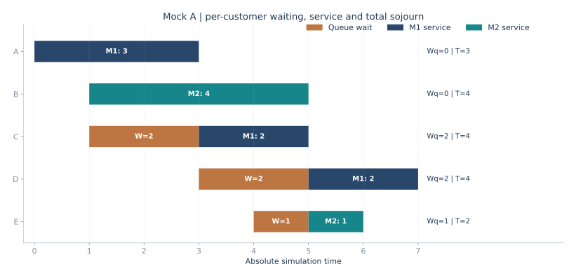
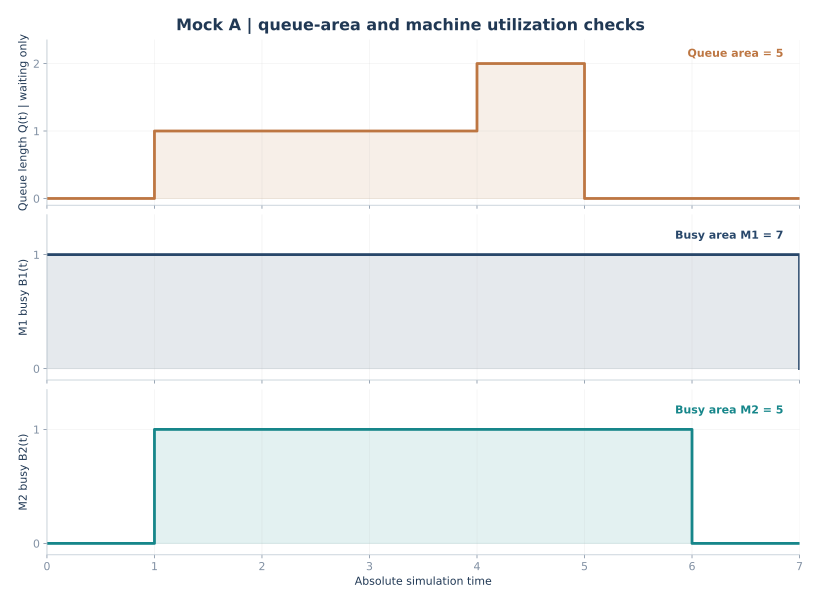
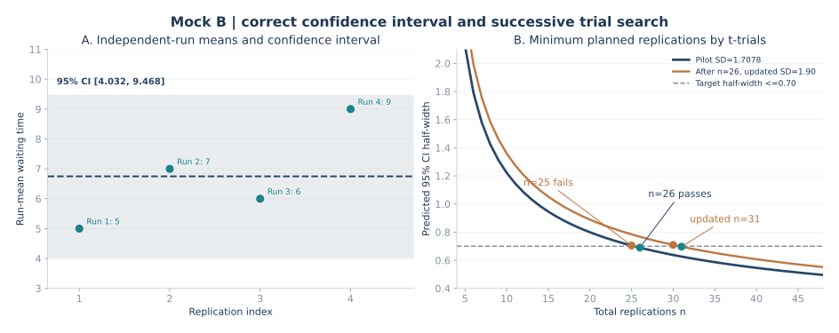
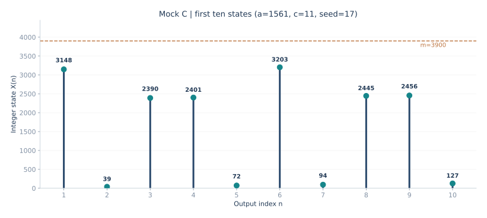

# 2026 秋｜系统仿真期末综合模拟卷 A／B／C

[返回课程主页](../README.md) · [课堂录音复习要点](2026-final-review.md) · [16 道计算题专项](2026-calculation-workbook.md)

依据 2026 年 11 月 9 日两段课堂录音的考点线索，为课程编制三套<strong>可直接做、可逐题对照答案</strong>的综合模拟卷。每套卷均含十道概念判断与改错、四道简答题和一道 30 分大计算题。100 分制和题目组合是训练安排，<strong>并非教师公布的正式考试题量或分值</strong>。

三套卷的区别只在<strong>大计算题的训练落点</strong>。老师强调的三个计算方向全部各有完整一套；概念和问答题分布覆盖随机数检验、随机变量生成与证明、输入分析、输出分析、验证与确认及手工仿真规则。

| 模拟卷 | 大计算题 | 关键计算与答题产物 | 阅读 |
| --- | --- | --- | --- |
| <strong>A：事件调度</strong> | 两机并联、M1 优先、共享 FCFS 队列 | <strong>每一事件处理后的完整 FEL</strong>；五零件时间线；队长与忙闲阶梯图；等待、逗留、队长面积、两机利用率 | [开始 A 卷](2026-mock-a-event.md) |
| <strong>B：输出分析</strong> | 独立重复均值、95% 置信区间与达到半长精度的试算法 | 四次运行均值与方差；正确自由度；<strong>n−1 不合格、n 合格</strong>；更新标准差后重新计算；半长试算图 | [开始 B 卷](2026-mock-b-output.md) |
| <strong>C：随机数发生器</strong> | `m=3900` 混合 LCG 满周期构造 | 素因子与 4 的整除条件；`gcd(c,m)`；<strong>前十项整数取余、商及分数</strong>；状态可视化 | [开始 C 卷](2026-mock-c-lcg.md) |

## 两种练习方法

<strong>第一遍：按正式考试独立作答。</strong> 各卷概念题先写对错和一句纠错，简答题先写关键公式与条件，大计算题把完整过程做完，再看题下解析。A 卷尤其要先画出三部分“实体状态／仿真时钟／未来事件表”，每次处理都完整写出待发生事件，不能只记新增项。

<strong>第二遍：只盯计算错误。</strong> A 卷用三个面积守恒式检查：全部零件等待之和＝队长面积；全部加工时间之和＝两机器忙碌面积之和；全部零件逗留之和＝全部等待与服务之和。B 卷检查独立运行次数、t 自由度、半长和边界相邻两点；C 卷检查乘数条件、`4|(a−1)` 与十个取余式。

## 计算结果图示（各卷附完整题目与公式）

### A 卷：不是只算平均等待时间，还要画出系统全过程

### B 卷：独立重复置信区间及试算法两个临界点

### C 卷：线性同余发生器前十项

## 与原专项的关系

这三套卷主要用于综合练习，不取代按章节学习的完整材料。若 A 卷手工事件表尚不熟练，先看[单机／并联／串联的完整 FEL 账本](2026-event-complete-fel-ledger.md)；若 B 卷试算法比较薄弱，先做[输出分析重点 8 题](2026-output-precision-priority-drill.md)；若 C 卷对满周期条件不熟，回到[LCG 构造专项](2026-lcg-full-period-drill.md)。

全部图示由可运行的绘图脚本生成，数据与解答表一一对应：[查看四图生成脚本](../scripts/build_exam_mock_figures.py)。
