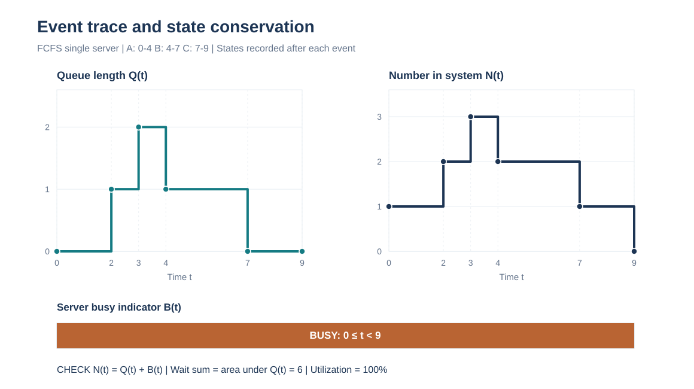
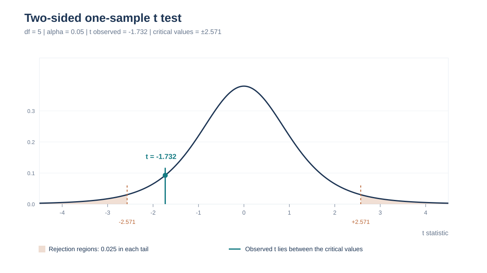
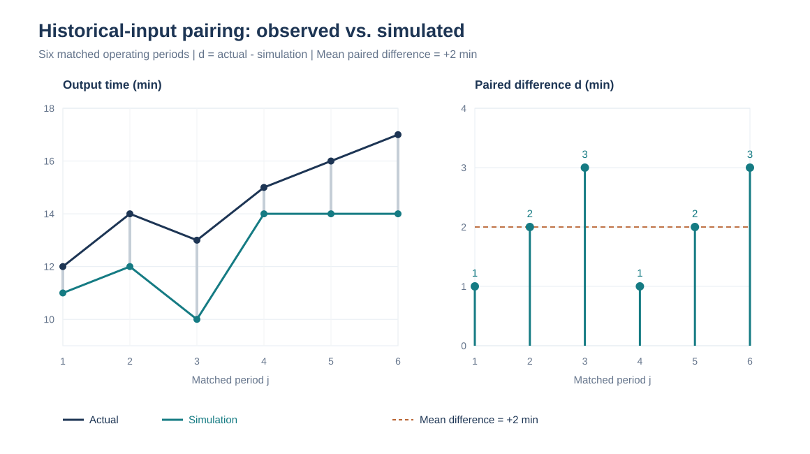
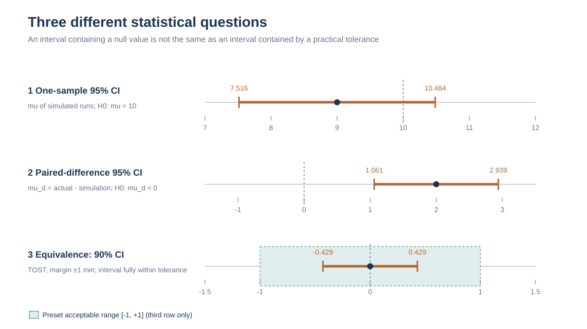

# 模型验证与确认专项练习 09｜事件核验、单样本与配对 t 检验（图解）

[返回总目录](../README.md) · [上一题：输出分析图解](2026-output-analysis-visual.md) · [第七讲完整笔记](../notes/07-model-validation.md) · [期末复习总章](2026-final-review.md)

本章对应课程第七讲 `simulation7_v3.pdf`。它包含两项不同的工作：一是检查仿真程序是否遵守规定的逻辑，二是检查模型是否足以代表实际系统。前者侧重事件追踪、守恒关系和极端测试；后者侧重模型假设、相同输入条件下的输出比较。课件给出的两种统计比较方法分别是单样本 `t` 检验和配对 `t` 检验。

以下题目均为重新设计的训练数据。四张结果图由题目中的同一组数值生成，并非直接复制课件截图。题目下方先列答案，再给出计算过程；图中的临界值和置信区间均与文字采用同一套精度。

| 题目看到的材料 | 实际要检查的对象 | 应当采用的方法 |
| --- | --- | --- |
| 逐事件到达、排队、加工与离开记录 | 程序有没有按规则执行 | Trace、状态不变量、手工核验 |
| 业务规则、结构假设、输入分布 | 模型能否合理描述实际系统 | 直观考察、假设检查、敏感性分析 |
| 已知实际平均指标 `μ₀`，`R` 个独立仿真运行均值 | 仿真均值是否与实际基准不同 | 单样本 `t`，自由度 `R−1` |
| 同一历史输入下的 `k` 对实际与仿真输出 | 实际—仿真的平均配对差是否为零 | 配对 `t`，自由度 `k−1` |
| 现实与仿真各一组，且没有明确配对 | 两组独立总体均值是否不同 | 两独立样本比较，不能强行配对 |

## 一、题目 1｜验证和确认究竟检查什么？

判断下列六项工作属于程序验证（Verification）、模型确认（Validation）还是二者都不能直接保证，并说明理由。

（1）把所有到达间隔设为常数，核对模型是否按 FCFS 处理三位顾客；（2）检查排队规则是否与现场真实执行的优先级规则一致；（3）让熟悉车间的管理人员审查工序流程；（4）检查每次离开事件后系统人数是否守恒；（5）比较相同订单流量下的现场平均等待时间与模型均值；（6）程序连续运行十万步没有报错，因此宣布模型有效。

<strong>答案。</strong>（1）验证；（2）确认；（3）确认中的直观合理性检查；（4）验证；（5）确认中的输出比较；（6）既不足以证明验证完成，更不能证明确认完成。

### 逐项讲解

验证是在“模型已经规定如何运行”的前提下，检查程序有没有照着规定执行。例如模型写明 FCFS，程序就不能先处理后到达的顾客；实体进入系统使人数加一，离开系统使人数减一。使用常量数据、事件跟踪表、边界测试能帮助发现这样的错误。

确认需要另一类证据：模型规定的规则本身是不是现实世界中有意义的简化。如果现实系统存在紧急订单插队，而模型规定 FCFS，程序完全忠实地实现 FCFS 仍不足以说明模型适合研究紧急订单的交付时间。确认的“三步法”可记为：先作直观考察及灵敏度分析，再检查结构与数据假设，最后在可比工况下比较模型输出与实际数据。

“没有报错”只说明执行没有发生明显的程序故障。事件可能重复调度、队长可能少减一次、服务台可能被同时占用，而软件仍正常给出最终平均数。因此模型运行稳定与模型正确是两件事。

## 二、题目 2｜事件跟踪：三位顾客的程序输出能否通过核验？

一个单服务台采用 FCFS，服务不可中断；服务台一旦空闲立即接待队首顾客。到达与服务数据如下。

| 顾客 | 到达时刻 | 服务时长 |
| --- | ---: | ---: |
| A | 0 | 4 |
| B | 2 | 3 |
| C | 3 | 2 |

要求填写各顾客开始和结束服务时刻、等待时间，并写出每次事件处理完成之后的队长 `Q`、忙碌状态 `B(t)` 和系统内人数 `N`。约定 `Q` 不包括正在服务的顾客。

<strong>答案。</strong> A、B、C 的服务开始时刻分别为 `0、4、7`，服务结束时刻分别为 `4、7、9`，排队等待时间分别为 `0、2、4`。逐事件状态如下表。

| 时刻 | 事件及随后动作 | 服务中的顾客 | 等待队列 | `Q` | `B(t)` | `N` |
| ---: | --- | --- | --- | ---: | ---: | ---: |
| 0 | A 到达，立即开始服务 | A | 空 | 0 | 1 | 1 |
| 2 | B 到达，进入队尾 | A | B | 1 | 1 | 2 |
| 3 | C 到达，进入队尾 | A | B、C | 2 | 1 | 3 |
| 4 | A 离开，B 立即开始服务 | B | C | 1 | 1 | 2 |
| 7 | B 离开，C 立即开始服务 | C | 空 | 0 | 1 | 1 |
| 9 | C 离开 | 空 | 空 | 0 | 0 | 0 |

### 第一步：由前一名顾客的完成时刻推出后一名的服务时刻

```math
\begin{aligned}
T_A^{\mathrm{start}}&=0,&T_A^{\mathrm{finish}}&=0+4=4,\\
T_B^{\mathrm{start}}&=\max(2,4)=4,&T_B^{\mathrm{finish}}&=4+3=7,\\
T_C^{\mathrm{start}}&=\max(3,7)=7,&T_C^{\mathrm{finish}}&=7+2=9.
\end{aligned}
```

因此等待时间等于“开始服务 − 到达”：

```math
W_{q,A}=0-0=0,\qquad W_{q,B}=4-2=2,\qquad W_{q,C}=7-3=4.
```

### 第二步：用不变量判断事件状态有没有更新错

任何一个事件处理完成后都应满足：

```math
N(t)=A(t)-D(t)=Q(t)+B(t),\qquad B(t)\in\{0,1\}.
```

这里 `A(t)` 是累计到达数，`D(t)` 是累计完成并离开的顾客数，`B(t)` 是服务台忙碌指示量。在 `t=4`，已有三人到达、一人离开，所以 `N=3−1=2`；B 正在服务，C 在队列中，故 `N=Q+B=1+1=2`。若程序在 `t=4` 报告 `Q=2`，就表明 A 完成服务后没有正确地将 B 从队列移出。



图中是<strong>事件处理完毕后的右连续状态曲线</strong>。同一时刻既结束服务又开始下一人服务时，按本题规则先完成离开与队首转入，记录该时刻所有操作处理完成之后的状态；因此 `t=4` 和 `t=7` 时服务台仍忙碌。

## 三、题目 3｜用面积再次验证：队长曲线和等待时间为什么必须相符？

继续使用题目 2 的三位顾客，求观察区间 `[0,9]` 的总排队时间、队长曲线面积、时间平均等待队长和服务台利用率。若某仿真程序给出“总等待时间 = 8”，应怎样定位错误？

<strong>答案。</strong> 顾客总等待时间为 `6`，队长曲线面积也为 `6`；时间平均队长 `6/9=2/3`，利用率为 `9/9=100%`。程序报告 `8` 时与手算及面积恒等关系不一致，应逐事件追踪队长增减或顾客等待的起止时刻。

### 第一步：从顾客角度求等待时间总和

```math
\sum_iW_{q,i}=0+2+4=6.
```

### 第二步：从系统角度求队长曲线下的面积

根据题目 2 的事件表，`[2,3)` 内队长为 1，`[3,4)` 内为 2，`[4,7)` 内为 1；其余时段队长为 0。因此：

```math
\begin{aligned}
\int_0^9Q(t)\,dt&=1(3-2)+2(4-3)+1(7-4)\\
&=1+2+3=6,\\
\overline Q&=\frac{1}{9}\int_0^9Q(t)\,dt=\frac{2}{3}.
\end{aligned}
```

系统在 `[0,9)` 始终至少有一名顾客占用服务台，所以忙碌总时长为 `4+3+2=9`；利用率为 `9/9=1`。这个恒等关系成立，是因为三个顾客的等待都完整落在观察区间内；若在有人仍排队时截断计算，必须考虑观察窗口以外尚未完成的等待时间，不能直接套用“等于所有顾客最终等待时间总和”。

### 第三步：定位问题的优先级

先看 `t=2、3、4、7` 四个队长变点是否正确，再看从到达到开始服务的个人等待时间。若队长曲线面积正确而个人等待总和错误，应检查服务开始事件的时间戳与等待统计；若二者都错，则首先检查事件状态更新。用两个独立的计算途径交叉验证，比只盯住最后的平均数更容易找出程序问题。

## 四、题目 4｜已知实际基准：完整完成单样本 t 检验

实际系统的平均等待时间基准被题目视为已知常数 `μ₀=10` 分钟。使用拟合后的输入理论分布，独立仿真 `R=6` 次，每次取一个日均等待时间，结果为：`8、9、10、7、11、9`。在双侧 `α=0.05` 下检验模型是否与现实均值不同，并计算模拟均值的 95% 置信区间。已知 `t₀.₉₇₅(5)=2.571`。

<strong>答案。</strong> `R=6`，模拟均值 `9` 分钟，样本方差 `2`，标准误约 `0.5774`，`t≈−1.732`；因为 `|t|<2.571`，不拒绝均值等于 10 的原假设。95% 置信区间约为 `[7.516,10.484]` 分钟。

### 第一步：确定统计单位和假设

每次仿真内部可能有很多名顾客，但这里用于检验的是<strong>六个独立运行均值</strong>，所以标准误中的样本量为 `6`，自由度为 `5`。

```math
H_0:\mu=10,\qquad H_1:\mu\ne10,\qquad df=R-1=5.
```

### 第二步：计算样本均值、样本方差和标准误

```math
\begin{aligned}
\overline Y&=\frac{8+9+10+7+11+9}{6}=9,\\
S^2&=\frac{(8-9)^2+(9-9)^2+(10-9)^2+(7-9)^2+(11-9)^2+(9-9)^2}{5}\\
&=\frac{1+0+1+4+4+0}{5}=2,\\
SE(\overline Y)&=\frac{\sqrt 2}{\sqrt 6}=\sqrt{\frac{1}{3}}\approx0.5774.
\end{aligned}
```

### 第三步：计算检验统计量并与临界值比较

```math
t=\frac{\overline Y-\mu_0}{S/\sqrt R}
=\frac{9-10}{\sqrt{1/3}}\approx-1.732.
```

双侧拒绝域为 `t<−2.571` 或 `t>2.571`，本题的 `−1.732` 不落在拒绝域内。



图中两侧橙色阴影合计代表 `α=0.05` 的拒绝域，竖直蓝线是本题实际得到的 `t≈−1.732`。样本均值比基准低 1 分钟，但这个差异相对于六次运行均值的波动尚不足以在 5% 水平拒绝原假设。

### 第四步：用置信区间核对统计判断

```math
\begin{aligned}
CI_{95\%}&=9\pm2.571\times\sqrt{1/3}\\
&\approx9\pm1.484=\boxed{[7.516,10.484]}.
\end{aligned}
```

现实基准 `10` 落在区间内，与双侧检验不拒绝的结论一致。但区间的范围仍然很宽，这不能证明模型的平均误差一定很小。

## 五、题目 5｜同一组输出：单侧和双侧判断可以直接互换吗？

仍使用题目 4 的 `t≈−1.732`、`df=5`。若研究问题事先改为“模型是否系统性低估平均等待时间”，写出单侧原、备择假设，使用 `α=0.05` 的临界值 `−2.015` 作判定。再求模拟均值的 90% 双侧置信区间，已知 `t₀.₉₅(5)=2.015`。

<strong>答案。</strong> 单侧备择假设是 `H₁: μ<10`，统计量 `−1.732>−2.015`，仍不拒绝原假设。90% 双侧区间约为 `[7.837,10.163]`，包含基准 `10`。

### 检验方向必须在看结果之前确定

一个合适的单侧写法是：

```math
H_0:\mu\geq10,\qquad H_1:\mu<10.
```

计算统计量时使用零假设边界 `μ₀=10`，左尾拒绝域为 `t<−2.015`。本题没有达到这一临界线。不能先看到均值为 9，再临时把双侧检验改为左侧检验以争取显著性；单侧方向应由研究问题预先决定。

90% 双侧区间为：

```math
CI_{90\%}=9\pm2.015\sqrt{1/3}
\approx9\pm1.163=\boxed{[7.837,10.163]}.
```

注意“5% 单侧检验”和“90% 双侧区间”使用同一个 `2.015` 分位数，但它们检验的备择假设不同；对应的区间判定要看边界位置，不能把二者的统计结论简单视为同一件事。

## 六、题目 6｜共用历史输入：配对 t 检验能否发现系统性低估？

对六个互不重叠、可以近似视为独立的历史业务时段，仿真模型读取与现场相同的输入记录。下面是现场实际平均完成时间 `Zⱼ` 与模型输出 `Yⱼ`，单位为分钟。在双侧 `α=0.05` 下检验模型与现场是否存在平均差异。已知 `t₀.₉₇₅(5)=2.571`。

| 场景 `j` | 1 | 2 | 3 | 4 | 5 | 6 |
| --- | ---: | ---: | ---: | ---: | ---: | ---: |
| 现场 `Zⱼ` | 12 | 14 | 13 | 15 | 16 | 17 |
| 仿真 `Yⱼ` | 11 | 12 | 10 | 14 | 14 | 14 |
| 配对差 `dⱼ=Zⱼ−Yⱼ` | 1 | 2 | 3 | 1 | 2 | 3 |

<strong>答案。</strong> 配对差平均值 `2` 分钟，样本方差 `0.8`，标准误约 `0.3651`，`t≈5.477`。因为大于临界值 `2.571`，拒绝“平均差为零”的原假设；差值为正，表示模型在这些场景下平均<strong>低估</strong>完成时间。95% 差值置信区间约为 `[1.061,2.939]` 分钟。

### 第一步：为什么以六个差值为统计样本

同一个时段的现场与模拟经历同一组输入，应计算每对差值，再用六个差值做一个单样本检验。将 `Zⱼ` 与 `Yⱼ` 打散成两组数据，会丢失相同场景的对应关系。

```math
d=(1,2,3,1,2,3),\qquad H_0:E(d)=0,\quad H_1:E(d)\ne0.
```

### 第二步：计算配对差均值、方差、标准误

```math
\begin{aligned}
\overline d&=\frac{1+2+3+1+2+3}{6}=2,\\
S_d^2&=\frac{(-1)^2+0^2+1^2+(-1)^2+0^2+1^2}{6-1}
=\frac{4}{5}=0.8,\\
SE(\overline d)&=\sqrt{\frac{0.8}{6}}\approx0.3651.
\end{aligned}
```

### 第三步：检验并计算偏差区间

```math
\begin{aligned}
t&=\frac{\overline d}{S_d/\sqrt6}
=\frac{2}{\sqrt{0.8/6}}\approx5.477,\\
CI_{95\%}(\mu_d)&=2\pm2.571\sqrt{0.8/6}\\
&\approx\boxed{[1.061,2.939]}.
\end{aligned}
```



左图将每个场景的两项输出放在相同横坐标上。右图是它们逐对相减后形成的六个差值。因为六个差值全部大于 0，且均值差的置信区间不包含 0，可以判断模型对该指标存在显著的平均低估。这里的结论限于模型与真实系统在这些历史工况下的比较；仍需分析究竟是输入分布、结构规则还是其他模型假设造成偏差。

## 七、题目 7｜为什么不能看见两列数据就做配对 t 检验？

三种场景分别应如何选择统计比较方法？

（A）现实系统的长期平均处理时间被题目直接给定为 `μ₀=8`；模型独立重复 10 次，得到 10 个运行均值。

（B）现场记录了 8 个星期的输入序列，每个星期的相同输入又送入仿真模型，现场与模型各得一个星期平均值。

（C）现场抽取了 10 个随机工作日，模拟独立运行 12 次，两组数据来自不同工况且没有按日配对。

<strong>答案。</strong>（A）单样本 `t`，自由度 9；（B）如果 8 组配对差具有适用的独立性及分布条件，则使用配对 `t`，自由度 7；（C）不能机械配对，需要先确认工况可比，之后才可能进行两独立样本比较，例如不假设方差相等的 Welch `t` 检验。

### 决定公式的是样本的对应关系，不是表格的列数

（A）已知基准被当作常数，所有抽样误差来自模拟的十个独立运行均值，所以检验 `\overline Y−μ₀`，使用 `S_Y/√{10}`。如果 `μ₀` 也只是从少量现场记录估出来的，就不能忽略现场估计的不确定性。

（B）应先算 `dⱼ=Zⱼ−Yⱼ`，再检验 `\overline d`。配对可以减少相同负荷或相同输入带来的共同波动，但八个星期是否互相独立需要检查；连续周的季节性或趋势会影响简单配对 `t` 的适用性。

（C）不应该把第一位现场工作日硬配第一位模拟运行。样本量甚至不同，更能看出配对关系并不存在。若两边所处工况本来不同，直接统计检验也可能把工况差异误判为模型误差，必须先调整比较设计。

## 八、题目 8｜“不显著”就等于模型误差已经足够小吗？

某业务部门事先规定，平均等待时间模型的实际—模拟偏差只要处于 `−1` 至 `1` 分钟之间就可以接受。六个历史场景的配对差为 `−0.8、−0.4、0、0.2、0.4、0.6` 分钟。计算差值均值、标准误、双侧 95% 置信区间；再作显著性水平 5% 的双单侧等效性检验（TOST），已知 `t₀.₉₇₅(5)=2.571`、`t₀.₉₅(5)=2.015`。

<strong>答案。</strong> 差值均值 `0`，样本方差 `0.272`，标准误约 `0.2129`；95% 区间约 `[-0.547,0.547]`，不拒绝均值差为零。TOST 对应的 90% 区间为 `[-0.429,0.429]`，完全位于预定容忍区间 `(-1,1)` 内，因此可在本题假设下认为<strong>平均偏差</strong>符合这项误差要求。

### 第一步：普通配对 t 检验说明什么

```math
\begin{aligned}
\overline d&=\frac{-0.8-0.4+0+0.2+0.4+0.6}{6}=0,\\
S_d^2&=\frac{0.64+0.16+0+0.04+0.16+0.36}{5}
=\frac{1.36}{5}=0.272,\\
SE&=\sqrt{\frac{0.272}{6}}\approx0.2129,\\
CI_{95\%}&=0\pm2.571(0.2129)\approx[-0.547,0.547].
\end{aligned}
```

由于 `t=0`，无法拒绝平均差为零。但普通显著性检验的“不拒绝”本身并不构成“模型满足业务精度”的证明：样本量太少、方差太大也可能不拒绝。

### 第二步：在事先约定的业务误差范围内判断

TOST 考察的目标与普通差异检验不同。对于显著性水平 `0.05`、容忍界限 `Δ=1`，对应的便捷区间判据是：<strong>90% 双侧置信区间是否完全在 `(-Δ,Δ)` 内</strong>。

```math
CI_{90\%}=0\pm2.015(0.2129)
\approx\boxed{[-0.429,0.429]}\subset(-1,1).
```



图中同时展示了三种不同问题：单样本检验是否覆盖现实基准、配对检验的偏差是否覆盖零、等效性检验的区间是否完整处于事先规定的容忍带。即使本题通过平均偏差的等效性判断，也不能由此推断模型对高峰期、方差、尾部延误和其他服务规则都准确。TOST 是为了理解“适用性”而补充的扩展方法，<strong>并非第七讲课件所要求的必考统计检验</strong>。

## 九、题目 9｜确认的三步法怎样落实到真实系统？

研究者准备建立一家医院门诊的排队仿真模型。现场存在普通患者与急诊患者两类人群，现有数据包含挂号、候诊、就诊、离开的时间戳；研究者打算用模型评估“增加一个诊室是否可以降低 95% 分位等待时间”。请分别安排验证活动、确认的三步法和输出比较所需的实验设计。

<strong>答案。</strong> 程序验证应检查时间推进、患者优先级、诊室占用和状态守恒；确认先核对患者路径及优先规则的直观合理性，随后检查结构与输入分布假设，最后用未参与调参的历史时期校验真实与模拟的 95% 分位等待时间。若采用成对历史时期，必须保持输入和比较指标一致，不能拿日均等待时间的 `t` 检验替代分位数验证。

### 为什么第七讲的统计公式不是模型确认工作的全部

第一，<strong>验证</strong>：制作只有两名普通患者和一名急诊患者的确定性事件样例，检查急诊插入队列的规则、诊室是否被重复占用，以及每个时刻“已到达 − 已离开 = 在系统人数”。然后测试大量患者同时到达、诊室停诊和到达率骤升的情景。预期拥堵上升本身不一定是程序错误。

第二，<strong>直观确认</strong>：与实际工作人员核对就诊路线、挂号与分诊顺序、紧急患者优先程度、休息与交班规则；再改变诊室数量和到达流量，检查等待时间变化趋势是否符合系统机理。如果模型预测“增加诊室一定导致等待变长”，应首先查原因，但也需要考虑模型中是否存在资源共享、重分配等机制，不能仅凭单调直觉直接判定错误。

第三，<strong>假设确认</strong>：结构上确认是否遗漏急诊优先权和诊室可用时间；数据上检查到达过程是否随时段变化、患者服务时长是否分人群、记录里的“计划时间”是否被错误当作实际就诊时间。

第四，<strong>输出确认</strong>：划分用于估计参数的校准时期和独立的验证时期。在相同历史输入下比较模拟与实际，并至少报告均值、95% 分位数及高峰时段队长。课件中的单样本或配对 `t` 方法主要检验<strong>均值</strong>；若研究目标是 95% 分位等待时间，就还需要选择适合分位数的区间或重抽样方法，不能直接把均值检验的结果当作分位数证据。

## 十、题目 10｜综合看图：四张结果图应该分别读出什么？

将本章四张图与下面四项结论匹配，并解释关键判断位置：

（A）按事件记录检查排队状态是否守恒；（B）判断一个给定的 `t` 值是否落入双侧拒绝域；（C）同一历史时段两种输出之间存在怎样的差值；（D）差值区间是否包含零、能否满足预定容忍误差。

<strong>答案。</strong> 事件阶梯图对应（A）；`t` 分布尾部图对应（B）；现场—模拟配对折线及差值图对应（C）；三组置信区间图对应（D）。

### 图形题在卷面上的四个检查位置

对于（A），先找每次事件的横坐标，再读取它之后的队长、人数和忙碌状态，检验 `N=Q+B`。不要把事件发生前的左极限和事件处理后的右连续值混在一起。

对于（B），先看双侧还是单侧，再看自由度与 `α` 的临界值。本题 `df=5`、双侧 5%，拒绝域是 `|t|>2.571`，`−1.732` 没有越界。不能因为点在零左侧就认定“显著低估”。

对于（C），图上现场值高于模拟值的竖直距离，就是同一场景下 `d=Z−Y` 的正差；正的总体平均差说明模型倾向低估，前提是变量和单位一致。

对于（D），普通双侧差异检验看置信区间是否跨过零；采用预先指定 `±Δ` 的等效性判断时，要求整个相应置信区间落在容忍区间内。“零在区间内”与“整个区间在容忍带内”是两套不同标准。

## 第七讲答题检查表

| 常见写法 | 应纠正为 |
| --- | --- |
| 模型运行不报错，所以模型有效 | 无报错不等于通过事件规则验证，更不等于通过模型确认 |
| 看到现场和模型各有一列数据，就做配对 t | 先确认是否来自<strong>相同历史输入场景</strong>，且一一对应 |
| 六次运行产生几百条顾客数据，自由度取几百减一 | 按第七讲独立重复法，独立统计单位是六个运行均值，`df=5` |
| 单样本统计量分母使用总体 `S` | 必须用均值标准误 `S/√R` |
| 配对统计量分母用 `S_Z/√k` | 应先计算 `dⱼ=Zⱼ−Yⱼ`，分母是 `S_d/√k` |
| `p>0.05` 说明模型已被证明正确 | 只能说明差异检验不拒绝；实际适用性还要看误差界限、覆盖工况和其他指标 |
| 比较均值通过，所以 95% 分位数也准确 | 不同统计指标需要各自的确认依据 |

[返回总目录](../README.md) · [上一题：输出分析图解](2026-output-analysis-visual.md) · [第七讲完整笔记](../notes/07-model-validation.md) · [下一讲：仿真优化基础](../notes/08-simulation-optimization.md) · [第八讲十题图解](2026-simulation-optimization-visual.md)
