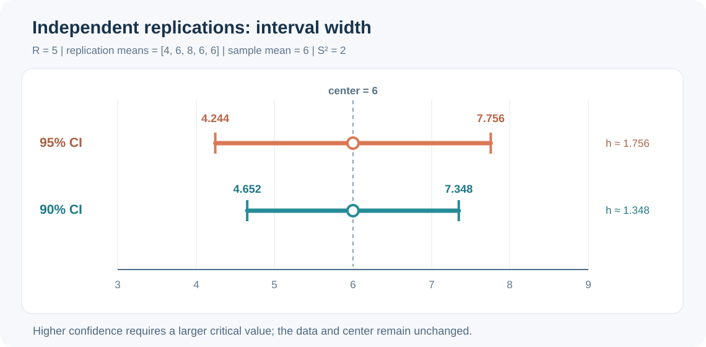
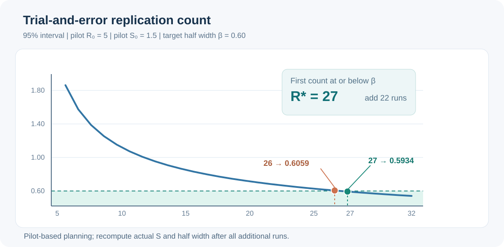
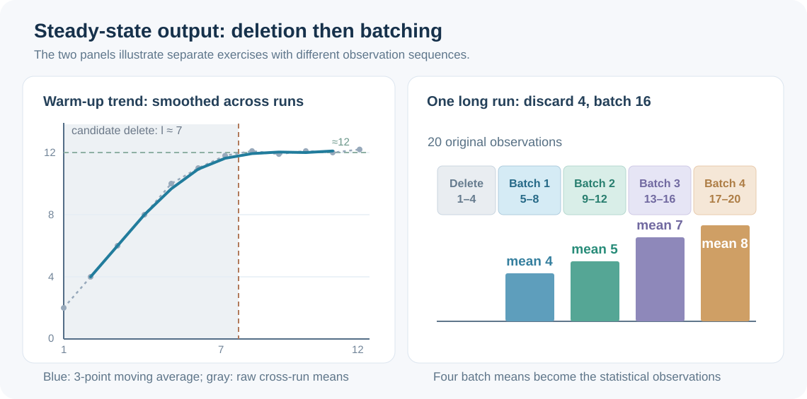
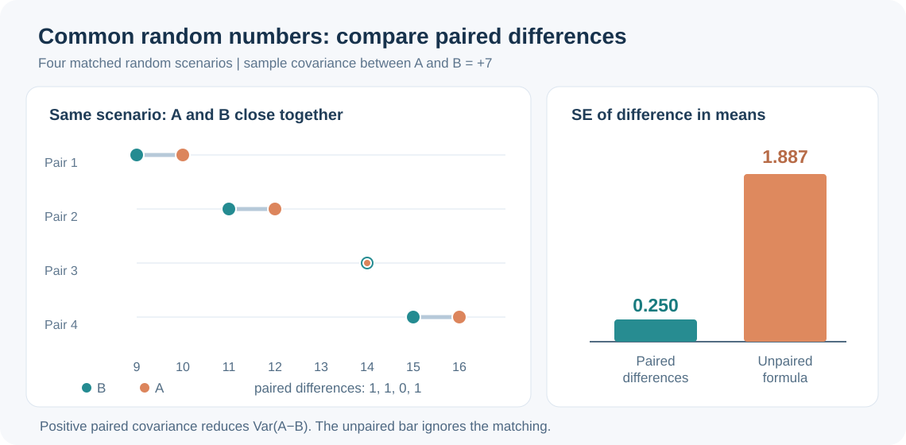

# 仿真输出分析专项练习 08｜独立重复、精度试算、稳态与方差缩减（图解）

[返回总目录](../README.md) · [上一题：输入分析图解](2026-input-analysis-visual.md) · [第六讲完整笔记](../notes/06-output-analysis.md) · [下一题：模型验证与确认图解](2026-model-verification-validation-visual.md) · [期末复习总章](2026-final-review.md)

本章对应 `simulation6_v3.pdf`。与第五讲“从观测数据选择输入分布”不同，第六讲回答的是：模型运行完后，怎样从带随机波动的输出中估计系统性能，怎样控制置信区间的宽度，以及如何避免把相关输出误当成独立样本。题目数字专为训练重新设置，四张结果图由相同数据计算得到，并非对课件截图的照搬。

| 研究场景 | 用什么作为统计单位 | 关键判断 |
| --- | --- | --- |
| 有自然终止条件，多次独立运行 | 每次运行的一个均值，共 `R` 个 | 置信区间自由度 `R−1` |
| 规定允许误差 `β` | 先导运行的标准差 `S₀` | 逐个尝试整数 `R`，并更新 `t` 临界值 |
| 单次长运行，初期明显不同 | 观测顺序与平滑曲线 | 删除初始瞬态，但不自动消除自相关 |
| 多次长运行，各自删去前 `l` 项 | 删除后的运行均值 | 重复—删除法 |
| 一次长运行，分成 `n` 批 | 每批的平均值 | 批长需足够大，批均值近似独立 |
| 比较两个系统方案 | 同一随机场景下的配对差 | 公共随机数希望方案输出正相关 |
| 估计单个系统均值 | 对偶配对均值或控制变量修正输出 | 负协方差、已知控制变量期望 |

## 一、题目 1｜独立重复：为什么不能把每位顾客当作独立样本？

某终态排队系统每次模拟一整个工作日，一天内部服务 20 位顾客。独立运行五次，得到五个“当日平均等待时间”（分钟）：`4、6、8、6、6`。计算总体日均等待时间的 90% 和 95% 双侧置信区间。已知自由度 4 时 `t₀.₉₅=2.132`，`t₀.₉₇₅=2.776`。

<strong>答案。</strong> 五次运行均值的总平均为 `6` 分钟，样本方差为 `2`；90% 区间约为 `(4.652,7.348)`，95% 区间约为 `(4.244,7.756)`。自由度是 `5−1=4`，不是 `5×20−1=99`。

### 第一步：先确定五个独立统计单位

```math
\overline X=\frac{4+6+8+6+6}{5}=6.
```

虽然模型一共产生 `100` 条顾客等待记录，但每一天内部的等待时间受到同一天拥堵状态影响，不保证独立。课件的方法是先求每天的平均值，再将五个独立运行均值作为样本。

### 第二步：用运行均值求样本标准差和标准误

```math
\begin{aligned}
S^2&=\frac{(4-6)^2+(6-6)^2+(8-6)^2+(6-6)^2+(6-6)^2}{5-1}\\
&=\frac{8}{4}=2,\\
S&=\sqrt2,\qquad SE=\frac{S}{\sqrt5}=\sqrt{\frac{2}{5}}\approx0.6325.
\end{aligned}
```

### 第三步：分别求两个置信区间的半长

```math
\begin{aligned}
h_{90\%}&=2.132\sqrt{\frac{2}{5}}\approx1.3484,\\
h_{95\%}&=2.776\sqrt{\frac{2}{5}}\approx1.7557.
\end{aligned}
```

因此：

```math
\begin{aligned}
CI_{90\%}&=6\pm1.3484\approx(4.652,7.348),\\
CI_{95\%}&=6\pm1.7557\approx(4.244,7.756).
\end{aligned}
```



图中两个区间的中心都等于 `6`。提高置信水平没有改变这批观测的均值，只是采用了更大的 `t` 临界值，因此区间变宽。若题目要求“估计精度”，通常看的是区间半长，而不是把左右端点相减后得到的整个宽度。

## 二、题目 2｜规定绝对精度：为什么是试到 27 次而不是代一个固定 `1.96`？

先做 `R₀=5` 次独立运行，得到运行均值的先导标准差 `S₀=1.5`。希望 95% 双侧置信区间的半长不超过 `β=0.60`。采用第六讲的试算法，估算总共需要多少次运行，还要补做几次。可使用 `t₀.₉₇₅(4)=2.776`、`t₀.₉₇₅(25)≈2.05954`、`t₀.₉₇₅(26)≈2.05553`。

<strong>答案。</strong> 在固定先导标准差 `1.5` 的试算中，`R=26` 的半长约为 `0.6059`，尚不满足要求；`R=27` 的半长约为 `0.5934`，首次达到 `0.60`。因此计划总次数 `R*=27`，补做 `27−5=22` 次。

### 第一步：先看已经做的五次是否足够

```math
h(5)=t_{0.975}(4)\frac{1.5}{\sqrt5}
=2.776\times\frac{1.5}{\sqrt5}
\approx1.8625>0.60.
```

### 第二步：把重复次数当作整数逐一试算

公式不是只含 `R` 的平方根，`t` 分位数也随自由度 `R−1` 改变：

```math
h_0(R)=t_{0.975}(R-1)\frac{S_0}{\sqrt R}
=t_{0.975}(R-1)\frac{1.5}{\sqrt R}.
```

对于两个临界整数：

```math
\begin{aligned}
h_0(26)&=2.05954\frac{1.5}{\sqrt{26}}\approx0.6059>0.60,\\
h_0(27)&=2.05553\frac{1.5}{\sqrt{27}}\approx0.5934\leq0.60.
\end{aligned}
```

完整试算表可以从 `R=5` 递增检查。对固定的 `S₀`，本题半长随 `R` 增加而下降：

| 总运行次数 `R` | 5 | 10 | 15 | 20 | 24 | 25 | 26 | 27 | 28 |
| --- | ---: | ---: | ---: | ---: | ---: | ---: | ---: | ---: | ---: |
| 预计半长 `h₀(R)` | 1.8625 | 1.0730 | 0.8307 | 0.7020 | 0.6334 | 0.6192 | 0.6059 | 0.5934 | 0.5816 |



### 第三步：明确“计划次数”与“实际精度”的区别

补做次数为 `22`。完成总计 27 次独立运行后，必须用<strong>全部 27 个真实运行均值</strong>重新计算标准差及实际置信区间半长。因为先导 `S₀` 只是一项估计，即便计划半长小于 0.60，也不意味着最终统计量必然达标。题目若要求的是“保证达到精度”，还需要额外说明对应的顺序抽样或保证方法，不能把先导试算法说成绝对保证。

## 三、题目 3｜稳态预热期：平滑曲线究竟用来决定什么？

一个长期运行的系统从空队列开始。五次独立运行在相同观测序号上的输出先跨运行平均，得到序列：

```text
j:    1     2     3     4     5     6     7     8     9    10    11    12
均值:  2.0   4.0   6.0   8.0  10.0  11.0  11.8  12.1  11.9  12.1  12.0  12.2
```

采用左右各一个观测的移动平均窗口（`ω=1`），计算第 5、7、8、9 项的平滑结果，并从图形上提出一个需要进一步核查的预热删除长度。

<strong>答案。</strong> 第 5、7、8、9 项平滑值依次约为 `9.667、11.633、11.933、12.033`。曲线前段明显上升，约在第 7—8 项附近开始围绕 `12` 波动；可将删除前 `7` 项作为初步方案，再用更长的轨迹和重复实验检验。

### 第一步：明确跨运行均值已经计算完成

本题给出的 12 项不是同一次运行的原始数据，而是把各次独立运行的第 `j` 个观测值先平均后得到的 `\overline X_j`。这一步可削弱单次运行的随机波动，使初始过渡更清楚。

### 第二步：进行三点移动平均

```math
\overline X_j^{(1)}
=\frac{\overline X_{j-1}+\overline X_j+\overline X_{j+1}}{3}.
```

```math
\begin{aligned}
\overline X_5^{(1)}&=\frac{8+10+11}{3}=9.667,\\
\overline X_7^{(1)}&=\frac{11+11.8+12.1}{3}=11.633,\\
\overline X_8^{(1)}&=\frac{11.8+12.1+11.9}{3}=11.933,\\
\overline X_9^{(1)}&=\frac{12.1+11.9+12.1}{3}=12.033.
\end{aligned}
```



左图灰色范围标记了一种候选预热区间，但并没有统计上保证第 8 项恰好进入稳态。课件的图形法用于寻找明显趋势消退的位置，不提供通用的机械阈值。真正实施时要权衡预热删除过少的偏差和删除过多的样本浪费。

## 四、题目 4｜重复—删除法：先删再按运行求均值

四次独立稳态仿真，每次收集 6 个顺序输出，每次都删除前两项（`l=2`）。下表为完整数据，求删除后的四个运行均值及总体均值 95% 置信区间。已知 `t₀.₉₇₅(3)=3.182`。

| 运行 | `j=1` | `j=2` | `j=3` | `j=4` | `j=5` | `j=6` |
| --- | ---: | ---: | ---: | ---: | ---: | ---: |
| 1 | 1 | 2 | 2 | 3 | 3 | 4 |
| 2 | 1 | 3 | 4 | 5 | 5 | 6 |
| 3 | 2 | 3 | 5 | 6 | 6 | 7 |
| 4 | 1 | 2 | 7 | 8 | 8 | 9 |

<strong>答案。</strong> 删除后四次运行的均值是 `3、5、6、8`，总平均 `5.5`，运行均值间样本方差 `13/3`，95% 区间约为 `(2.188,8.812)`。

### 第一步：每行只保留第 3—6 项

```math
\begin{aligned}
\overline X_1&=(2+3+3+4)/4=3,\\
\overline X_2&=(4+5+5+6)/4=5,\\
\overline X_3&=(5+6+6+7)/4=6,\\
\overline X_4&=(7+8+8+9)/4=8.
\end{aligned}
```

### 第二步：用四个运行均值建立区间

```math
\begin{aligned}
\overline X_{RD}&=\frac{3+5+6+8}{4}=5.5,\\
S_{RD}^2&=\frac{(3-5.5)^2+(5-5.5)^2+(6-5.5)^2+(8-5.5)^2}{3}\\
&=\frac{6.25+0.25+0.25+6.25}{3}=\frac{13}{3},\\
SE&=\sqrt{\frac{S_{RD}^2}{4}}=\sqrt{\frac{13}{12}}\approx1.0408,\\
h&=3.182\sqrt{\frac{13}{12}}\approx3.3119.
\end{aligned}
```

```math
CI_{95\%}=5.5\pm3.3119\approx(2.188,8.812).
```

本题总共有 `24` 项原始输出，其中删除 `8` 项，保留 `16` 项。但构造区间使用的是<strong>4 个独立运行均值</strong>，因此自由度 `3`。删除预热观测是为了降低初始状态偏差，并不能证明某一次运行内部的剩余输出已经独立。

## 五、题目 5｜批平均值法：为什么一共 20 条记录却只有 4 批？

某稳态仿真只进行一次长运行，前 4 个观测 `0、0、1、2` 是预热阶段，随后保留 16 个输出：

```text
2,4,5,5  |  4,5,5,6  |  6,7,7,8  |  6,8,9,9
```

按顺序分成 `n=4` 批，每批 `b=4` 项。计算批均值、整体均值及形式上的 95% 置信区间；为完成手算，题目假定这四个批均值可近似视为独立且正态。已知 `t₀.₉₇₅(3)=3.182`。

<strong>答案。</strong> 批均值为 `4、5、7、8`，总体均值为 `6`，批均值方差 `10/3`，区间约为 `(3.095,8.905)`。

### 第一步：先删预热，再分批求平均

```math
\begin{aligned}
\overline X_1&=(2+4+5+5)/4=4,\\
\overline X_2&=(4+5+5+6)/4=5,\\
\overline X_3&=(6+7+7+8)/4=7,\\
\overline X_4&=(6+8+9+9)/4=8.
\end{aligned}
```

图中右侧按时间顺序标出了“先删 4 项，再分四批”的边界，每个色块上方注明批均值。不能先把全部 20 项平均，再声称这些观测构成 20 次独立重复。

### 第二步：用批均值计算标准误和区间

```math
\begin{aligned}
\overline X&=\frac{4+5+7+8}{4}=6,\\
S_b^2&=\frac{(4-6)^2+(5-6)^2+(7-6)^2+(8-6)^2}{3}=\frac{10}{3},\\
SE&=\sqrt{\frac{10/3}{4}}=\sqrt{\frac{5}{6}}\approx0.9129,\\
h&=3.182\sqrt{\frac{5}{6}}\approx2.9048,\\
CI_{95\%}&=6\pm2.9048\approx(3.095,8.905).
\end{aligned}
```

这里的批长 `b=4` 只是便于手算。在实际相关序列中，短批之间可能仍有较强相关性，从而使上述区间失去标称覆盖率。更长的批次、对批均值的相关性检查，以及有效批次数的权衡仍然必要。

## 六、题目 6｜公共随机数：要比较的是每一对输出之差

比较两个仿真方案 A、B。四次配对运行使用相互对应的随机情景，输出如下：

| 配对 | A | B | A−B |
| --- | ---: | ---: | ---: |
| 1 | 10 | 9 | 1 |
| 2 | 12 | 11 | 1 |
| 3 | 14 | 14 | 0 |
| 4 | 16 | 15 | 1 |

计算配对差均值及其标准误。再计算如果忽略配对，按两个独立样本均值相减得到的标准误，说明为什么公共随机数可能有效。

<strong>答案。</strong> 配对差均值 `0.75`、其标准误 `0.25`；若错误地忽略本题的配对关系，按两个独立样本计算得到的标准误约为 `1.8875`。本例方案输出之间的正协方差明显减小了差值估计的方差。

### 第一步：对每一对计算差值

```math
\begin{aligned}
Z_i&=A_i-B_i=(1,1,0,1),\\
\overline Z&=\frac{1+1+0+1}{4}=0.75,\\
S_Z^2&=\frac{3(1-0.75)^2+(0-0.75)^2}{3}=0.25,\\
SE_{\mathrm{paired}}&=\sqrt{0.25/4}=0.25.
\end{aligned}
```

### 第二步：明确不配对时会遗漏什么

```math
\begin{aligned}
S_A^2&=\frac{(10-13)^2+(12-13)^2+(14-13)^2+(16-13)^2}{3}
=\frac{20}{3},\\
S_B^2&=\frac{(9-12.25)^2+(11-12.25)^2+(14-12.25)^2+(15-12.25)^2}{3}
=\frac{22.75}{3}.
\end{aligned}
```

假如 A、B 真是独立样本，差值均值的标准误公式才是：

```math
SE_{\mathrm{unpaired}}=
\sqrt{\frac{S_A^2}{4}+\frac{S_B^2}{4}}
=\sqrt{3.5625}\approx1.8875.
```



本题同一配对内输出协方差的样本估计为 `7`，从差值方差恒等式可以反推：

```math
S_Z^2=S_A^2+S_B^2-2S_{AB}
=\frac{20}{3}+\frac{22.75}{3}-2\times7=0.25.
```

公共随机数法想降低的是<strong>两个方案之差</strong>的方差，因此希望配对输出正相关；但是否真的减少方差必须由输出协方差决定。使用相同的随机种子却没有保持输入业务对应关系，也不一定得到有效配对。

## 七、题目 7｜对偶变量：为什么互补均匀数有时能完全抵消波动？

目标输出定义为 `X=3+2U`，其中 `U∼U(0,1)`。两次运行分别使用 `U` 和 `1−U`。若第一次抽到 `u=0.2`，求两次输出及配对均值；比较配对均值的理论方差与两次独立抽样平均值的方差。

<strong>答案。</strong> 两次输出是 `3.4、4.6`，配对均值恰好为 `4`。在这一特定线性模型中，每一对的均值都是 `4`，方差为 `0`；若采用两次独立抽样，它们平均值的方差为 `1/6`。

```math
\begin{aligned}
X^{(1)}&=3+2(0.2)=3.4,\\
X^{(2)}&=3+2(0.8)=4.6,\\
\overline X_{\mathrm{pair}}&=(3.4+4.6)/2=4.
\end{aligned}
```

更一般地，直接代入任意 `0≤u≤1`：

```math
\frac{(3+2u)+[3+2(1-u)]}{2}=4,
```

所以配对估计量是常数 `4`。另一方面：

```math
\operatorname{Var}(X)=4\operatorname{Var}(U)=4/12=1/3,
\quad
\operatorname{Var}\left(\frac{X_1+X_2}{2}\right)=\frac{1/3}{2}=1/6
```

最后一个公式只适用于 `X₁、X₂` 相互独立的比较情形。对偶变量法的配对结果希望负相关，故配对平均的方差中协方差项为负。这里得到零方差是线性输出的特殊结果；对于非线性或复杂仿真，并不保证所有对偶运行都会完全抵消波动。

## 八、题目 8｜控制变量：最优系数、方差降低幅度与单次修正

仿真输出 `X` 的方差为 `9`。选取一个期望已知的控制变量 `Y`，有 `E(Y)=10`、`Var(Y)=4`、`Cov(X,Y)=3`。设修正量 `X_c=X−a(Y−10)`。求最优 `a`、修正后最小方差及方差下降比例。若某次观测 `X=30,Y=12`，求修正值。

<strong>答案。</strong> `a*=3/4=0.75`，最小方差 `6.75`，比原方差下降 `25%`；这次修正值为 `28.5`。

```math
\begin{aligned}
\operatorname{Var}(X_c)
&=9+4a^2-6a,\\
\frac{d\operatorname{Var}(X_c)}{da}&=8a-6=0,\\
a^*&=0.75.
\end{aligned}
```

代回：

```math
\begin{aligned}
\operatorname{Var}(X_c)_{\min}
&=9-\frac{3^2}{4}=6.75,\\
\frac{9-6.75}{9}&=0.25,\\
x_c&=30-0.75(12-10)=28.5.
\end{aligned}
```

其理论期望不会因为选定常数 `a` 而改变：

```math
E(X_c)=E(X)-a[E(Y)-10]=E(X).
```

这里的结论假设 `E(Y)=10` 真正已知且系数 `a` 是固定值。若先用同一小样本拟合修正系数再分析修正均值，需要进一步考虑估参带来的有限样本误差。

## 九、题目 9｜平均队长：时间平均不是状态值的算术平均

某次运行在 `0≤t≤10` 分钟内，排队人数如下：`0—2` 分钟为 0，`2—4` 分钟为 1，`4—7` 分钟为 3，`7—10` 分钟为 1。求这次运行的时间平均排队人数，并解释为什么不能把四个状态值直接求平均。

<strong>答案。</strong> 队长曲线下的总面积 `14`，时间平均队长 `14/10=1.4`；四个状态值算术平均为 `1.25`，它忽略了不同状态的持续时间。

```math
\begin{aligned}
A&=0\times2+1\times2+3\times3+1\times3=14,\\
\overline L_q(10)&=\frac{A}{10}=1.4.
\end{aligned}
```

这一题和前面零件排队的阶梯图属于同一统计思路。第六讲构造的是<strong>多次独立运行所得到的运行指标</strong>的置信区间，因此每一次运行必须先正确计算自己的时间平均队长，再用这些运行指标实施统计分析。

## 十、六道快速判断题

<strong>判断 1。</strong> “五次独立仿真运行，每次记录 20 个相关顾客等待时间，所以 `t` 区间自由度一定是 99。”

<strong>答案：错误。</strong> 若将每次的平均等待时间作为独立统计单位，自由度为 `5−1=4`。

<strong>判断 2。</strong> “相同样本下，提高双侧置信水平，置信区间通常会变窄。”

<strong>答案：错误。</strong> 临界值通常增加，区间随之变宽。

<strong>判断 3。</strong> “规定精度试算法算出计划重复次数后，实际补做运行不需要再重新计算标准差。”

<strong>答案：错误。</strong> 必须重新估计实际半长，因为先导标准差不是固定真值。

<strong>判断 4。</strong> “删除稳态模型的预热数据后，剩余原始观测一定独立。”

<strong>答案：错误。</strong> 预热删除主要处理初始瞬态，自相关可能继续存在。

<strong>判断 5。</strong> “比较两个方案时，如果公共随机数产生正输出协方差，就可能降低方案差值估计的方差。”

<strong>答案：正确。</strong> 差值方差中包含 `−2Cov(A,B)`。

<strong>判断 6。</strong> “对偶变量和公共随机数都要求输出负相关，才能降低方差。”

<strong>答案：错误。</strong> 对偶配对均值希望负相关，公共随机数配对差希望正相关。

## 解题时先分清三个层次

原始顾客观测或逐时刻状态不是天然独立的统计样本；独立运行均值可以用于终态或重复—删除法；长运行划分的批均值只有在批长足够大、批间依赖可忽略时才适合近似 `t` 区间。计算时先决定统计单位，再算均值与方差，最后才查 `t` 临界值。

若题目出现预热期，先处理初始瞬态；若出现规定精度，按整数试算并在追加实验后重算；若出现两种方案比较，先写每对差值；若出现已知期望的辅助变量，再考虑控制变量校正。不同方法可以组合，但每一种方法的估计目标和方差公式必须对应。

[返回总目录](../README.md) · [第六讲完整笔记](../notes/06-output-analysis.md) · [下一题：模型验证与确认图解](2026-model-verification-validation-visual.md) · [下一讲：模型验证与确认](../notes/07-model-validation.md)
