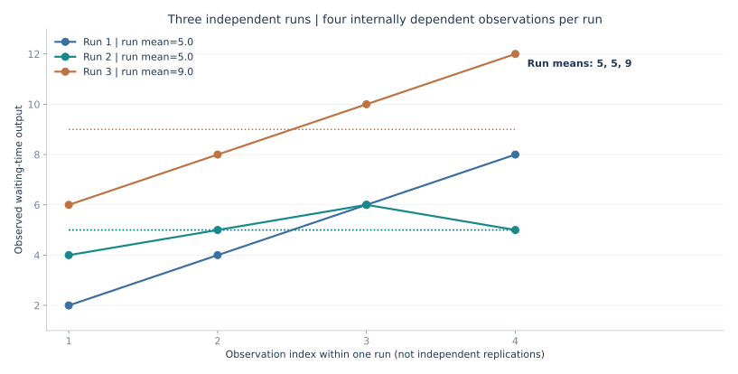
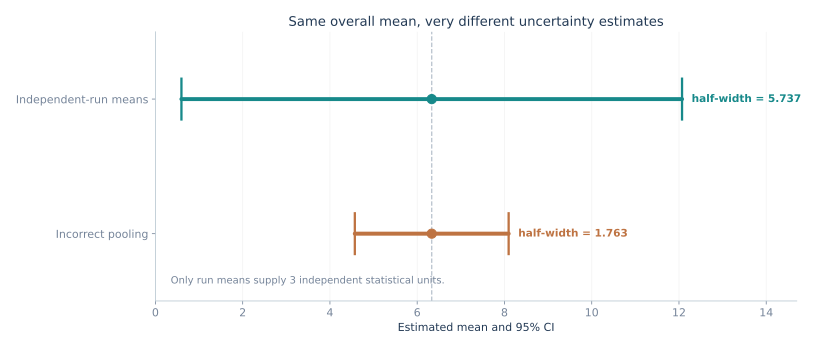
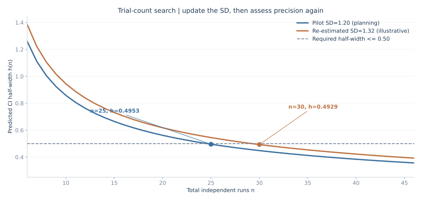
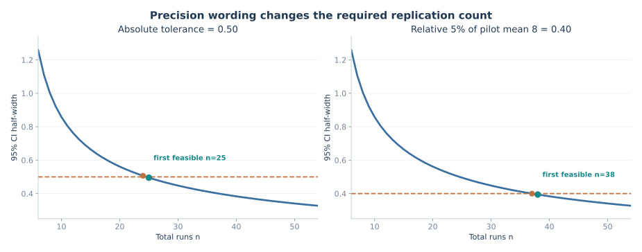

# 期末重点加练｜独立重复的统计单位、置信区间与试算法

[返回总目录](../README.md) · [输出分析完整大题 B 卷](2026-mock-b-output.md) · [第六讲输出分析图解 08](2026-output-analysis-visual.md) · [课堂录音期末总纲](2026-final-review.md) · [第六讲笔记](../notes/06-output-analysis.md)

2026 年 11 月 9 日的期末复习串讲对输出分析有两项特别明确的要求：<strong>先把每次独立运行的观测汇总为一个运行均值；试算法要给出首次达标次数 n 及相邻未达标次数 n−1 的半长。</strong> 下面围绕这两条要求安排八道题，题目下直接列答案，再给完整计算。所有数字均为新编练习；文中的四张图与相应算式使用同一组数据。

## 一、先固定统计单位和精度符号

设共进行 R 次独立重复运行，第 r 次内部有 m 个顾客观测值 X(r,j)。每个运行得到一个均值 Y(r)，再用这 R 个<strong>运行均值</strong>估计总体平均绩效：

```math
\begin{aligned}
Y_r&=\frac{1}{m}\sum_{j=1}^m X_{rj},\\
\overline Y_R&=\frac{1}{R}\sum_{r=1}^R Y_r,\\
S_Y^2&=\frac{1}{R-1}\sum_{r=1}^R(Y_r-\overline Y_R)^2,\\
h_R&=t_{1-\alpha/2,R-1}\frac{S_Y}{\sqrt{R}},\\
CI_{1-\alpha}&=[\overline Y_R-h_R,\,\overline Y_R+h_R].
\end{aligned}
```

这里的 R 是<strong>独立运行次数</strong>，m 是单次运行内部的观测量，两者不能互换。半长 h 表示“均值向两侧各延伸多远”，整段区间的长度是 2h。对不同批次观测数量不相等的情形，先明确要估计“一个典型运行的平均绩效”还是“所有观测按个体加权的平均绩效”，不能在不说明目标的情况下混用加权方式。

## 题 1｜3 次运行、每次 4 个数：怎样构造正确置信区间？

一个排队系统独立重复仿真 3 次，每次记录 4 个顾客的等待时间。下面的数字具有明显的运行内共同波动，不保证 12 个观测值彼此独立。

| 独立运行 | 顾客 1 | 顾客 2 | 顾客 3 | 顾客 4 |
| --- | ---: | ---: | ---: | ---: |
| 第 1 次 | 2 | 4 | 6 | 8 |
| 第 2 次 | 4 | 5 | 6 | 5 |
| 第 3 次 | 6 | 8 | 10 | 12 |

构造“独立运行平均等待时间”的 95% 双侧置信区间。已知 <code>t(0.975,2)=4.303</code>。

<strong>答案：</strong>三次运行均值为 <code>5、5、9</code>，总均值为 <code>19/3≈6.333</code>，运行均值间样本方差为 <code>16/3≈5.333</code>，半长约为 <code>5.737</code>，95% 区间约为 <code>(0.596,12.070)</code>。

### 完整计算



第一步，每次运行单独求均值：

```math
\begin{aligned}
Y_1&=(2+4+6+8)/4=5,\\
Y_2&=(4+5+6+5)/4=5,\\
Y_3&=(6+8+10+12)/4=9,\\
\overline Y_3&=(5+5+9)/3=19/3\approx6.3333.
\end{aligned}
```

第二步，标准差的计算对象是 <code>(5,5,9)</code>，而不是原来的 12 个数。注意分母是 <code>3−1=2</code>：

```math
\begin{aligned}
S_Y^2&=\frac{(5-19/3)^2+(5-19/3)^2+(9-19/3)^2}{3-1}\\
&=\frac{16/9+16/9+64/9}{2}=\frac{16}{3},\\
S_Y&=\frac{4}{\sqrt{3}}\approx2.3094,\\
SE&=\frac{S_Y}{\sqrt{3}}=\frac{4}{3}\approx1.3333.
\end{aligned}
```

第三步，按自由度 <code>df=3−1=2</code> 查 t 分位数：

```math
\begin{aligned}
h&=4.303\times\frac{4}{3}\approx5.737,\\
CI_{95\%}&=\frac{19}{3}\pm5.737\\
&\approx(0.596,\,12.070).
\end{aligned}
```

本题区间较宽不是算错，而是因为实际上只有三次独立运行、自由度只有 2。更多顾客观测能够改善每次运行内均值的稳定性，但不能机械地把 12 条运行内记录视作 12 次独立仿真。

## 题 2｜为什么“12 个数一起算标准差”会明显失真？

仍用题 1 的数据，有人把所有 12 个数直接合并，求出一个样本标准差，然后按 <code>n=12</code>、<code>df=11</code> 计算 95% 置信区间。请算出这条错误路径的半长，并解释错误发生在哪一步。已知 <code>t(0.975,11)=2.201</code>。

<strong>答案：</strong>两种算法的平均数都为 <code>6.333</code>，但错误合并后样本标准差约为 <code>2.774</code>，得到错误半长约 <code>1.763</code>，显著小于按三个运行均值计算的正确半长 <code>5.737</code>。

### 错误路径如何产生



12 个数的总和为 <code>76</code>、平方和为 <code>566</code>，因此错误合并时：

```math
\begin{aligned}
\overline X_{12}&=76/12=19/3,\\
S_{\rm pooled}^2&=\frac{566-76^2/12}{12-1}=\frac{254}{33}\approx7.6970,\\
S_{\rm pooled}&\approx2.7743,\\
h_{\rm naive}&=2.201\times\frac{2.7743}{\sqrt{12}}\approx1.763.
\end{aligned}
```

本例每次恰好都有四个数，所以“全体 12 个数平均”与“先求三个运行均值再平均”数值相同。但<strong>样本标准差及标准误不能这样处理</strong>：12 个数的内部相关结构被错误忽略，临界值所用自由度也从 2 错写成 11，使置信区间过窄。图中的橙色区间只用于展示错误结果，不能作为符合独立重复假设的有效推断区间。

如果各次运行观测数量不相等，连两种平均数都未必相同。比如三个运行分别记录 2、4、8 项，三个运行均值分别为 5、6、10，那么对运行均值等权平均是 <code>(5+6+10)/3=7</code>；按 14 条观测直接加权平均则是 <code>(2×5+4×6+8×10)/14≈8.143</code>。应根据题目定义的目标量选择统计单位，而不是默认“均值总无所谓”。

## 题 3｜给定绝对精度，怎样用试算法找最小运行次数？

已经独立运行 <code>R0=6</code> 次，六个运行均值的先导标准差为 <code>S0=1.20</code>。要求 95% 双侧置信区间半长不超过 <code>β=0.50</code>。采用<strong>保持先导标准差 S0 不变的规划试算法</strong>，问预计至少需要运行多少次，还需补做几次？

<strong>答案：</strong>试算总次数 <code>R=25</code> 首次达标；<code>R=24</code> 不达标。计划总次数为 <code>25</code>，在原有六次的基础上再做 <code>19</code> 次。

### 先确定检验式、再大步试探

```math
h_0(R)=t_{0.975,R-1}\frac{1.20}{\sqrt R}\leq0.50.
```

这里下标 0 强调<strong>使用先导标准差规划次数</strong>，不代表真实补做完成后的区间半长一定符合目标。刚做六次时 <code>h0(6)≈1.2593</code>，明显不够。可以先跳到 10、20、30 来定位，再回到临界整数附近逐一试：

| 总运行数 R | t 临界值（95% 双侧） | 预计半长 h0(R) | 是否满足 ≤0.50 |
| ---: | ---: | ---: | --- |
| 6 | 2.571 | 1.2593 | 否 |
| 10 | 2.262 | 0.8584 | 否 |
| 20 | 2.093 | 0.5616 | 否 |
| 24 | 2.0687 | 0.5067 | 否 |
| 25 | 2.0639 | 0.4953 | 是 |
| 26 | 2.0595 | 0.4847 | 是 |

关键是最后两行的临界点：

```math
\begin{aligned}
h_0(24)&=2.06866\times\frac{1.20}{\sqrt{24}}\approx0.5067>0.50,\\
h_0(25)&=2.06390\times\frac{1.20}{\sqrt{25}}\approx0.4953\leq0.50.
\end{aligned}
```

在固定 <code>S0</code> 的规划计算中，随着 R 增加，半长递减，故上面相邻两次的结果可证明<strong>首次达标的试算整数是 25</strong>。补做次数是 <code>25−6=19</code>，而不是 25 次。对这类考题，答案必须同时呈现“24 次超限”和“25 次达标”，不能只写一个近似根。

## 题 4｜已经按计划做满 25 次，为何仍可能没有达到精度？

继续题 3。实际补做结束后，全部 25 个运行均值重新计算得到的样本标准差是 <code>S25=1.32</code>，并非先导的 1.20。请计算实际区间半长，判断是否达标；若将 1.32 暂时当作新的规划标准差，求下一轮试算需要的总次数。

<strong>答案：</strong>实际半长 <code>h25≈0.5449&gt;0.50</code>，未达标。若固定新估计标准差 <code>1.32</code> 再试算，则 <code>R=29</code> 约为 <code>0.5021</code>、<code>R=30</code> 约为 <code>0.4929</code>；新计划总次数为 30，需在 25 次基础上再做 5 次，然后重新计算。

### 复核不等于照搬先导结果



```math
h_{25}=t_{0.975,24}\frac{1.32}{\sqrt{25}}
=2.06390\frac{1.32}{5}\approx0.5449>0.50.
```

更新标准差后，新一轮固定估计的相邻整数计算为：

```math
\begin{aligned}
h_{\rm new}(29)&=2.04841\frac{1.32}{\sqrt{29}}\approx0.5021>0.50,\\
h_{\rm new}(30)&=2.04523\frac{1.32}{\sqrt{30}}\approx0.4929\leq0.50.
\end{aligned}
```

这不是说实际第 30 次一定达标。因为增加五次数据后，样本标准差还会变化，必须对全部 30 个运行均值重新计算实际区间。<strong>固定标准差的试算法用于计划运行次数；完成新增运行后的区间检验必须使用真实更新的标准差。</strong> 不宜将上述规划计算理解为“只要补做到 30 次，数学上便绝对保证精度”。

## 题 5｜“相对精度 5%”与“绝对半长 0.50”一样吗？

沿用 <code>S0=1.20</code>、95% 双侧置信水平和六次先导运行。题目改为“置信区间半长不超过均值的 5%”，先导样本均值 <code>Ȳ0=8</code>。本题采用固定先导均值的规划口径，求首次达标的整数运行次数。

<strong>答案：</strong>相对要求换成绝对半长上限是 <code>β=5%×8=0.40</code>；在固定先导均值与标准差的规划中，<code>R=37</code> 的半长约为 <code>0.4001</code>，略超限，<code>R=38</code> 的半长约为 <code>0.3944</code>，首次达标。相较绝对上限 0.50 所需的 25 次，这里需要 38 次。



```math
\begin{aligned}
\beta_{\rm rel}&=0.05\times8=0.40,\\
h_0(37)&\approx0.40010>0.40,\\
h_0(38)&\approx0.39443\leq0.40.
\end{aligned}
```

读题时一定先区分老师说的“<strong>允许误差</strong>”究竟指绝对半长、相对半长，还是整个区间宽度。若目标是整个置信区间宽度不超过 0.50，则应使用 <code>2h≤0.50</code>，即半长上限是 0.25。若相对精度分母随补做样本均值更新，达标性也要重新检查。

## 题 6｜95% 换成 90%，为什么运行次数变了？

继续固定 <code>S0=1.20</code>、绝对半长上限 <code>0.50</code>，只把置信水平由 95% 改成 90%。问计划总次数大概怎样变化，并计算在 R=25 时的 90% 半长。

<strong>答案：</strong>同一批运行数据下，90% 双侧置信区间临界值小于 95% 对应值，因此半长更短。按固定先导标准差的试算法，90% 首次达标的计划次数为 <code>R=18</code>，而非 95% 的 25；在 R=25 时，90% 半长约为 <code>0.4106</code>。

```math
h_{90\%}(25)=t_{0.95,24}\frac{1.20}{5}
\approx1.71088\times0.24\approx0.4106.
```

95% 的统计保证水平更高，因此通常需要更宽的区间或更多独立运行次数。不能在 95% 的双侧题目中偷换正态临界值 1.96 来代替小样本 t 分位数，也不能把 90% 对应的 <code>t0.95</code> 误当成单侧 95% 的题意。

## 题 7｜混合变式：一次运行长度不相等怎么办？

三次独立运行都模拟一个工作日，但三天分别服务 2、4、8 位顾客，且当日平均等待时间分别是 5、6、10。若目标是“一个典型仿真日的平均等待时间”，应该如何估计？若目标改为“所有顾客的平均等待时间”，结果为什么不同？

<strong>答案：</strong>典型工作日平均等待的三个独立单位是每天的日均数，等权平均是 <code>7</code>；将所有顾客按人数加权，平均是 <code>8.143</code>。它们是不同目标量，不能简单说其中一个数学上总是错误。

```math
\overline Y_{\rm day}=\frac{5+6+10}{3}=7,
\quad\overline Y_{\rm customer}
=\frac{2\times5+4\times6+8\times10}{2+4+8}
=\frac{114}{14}\approx8.143.
```

即使目标是顾客层面的总体均值，若运行内顾客相关，也不能直接把所有 14 个顾客观测当成独立重复以获得标准误；需要与目标量相适应的聚类或独立运行层面的方差估计方法。考试中通常给定每次观测数相同，更应先看清“均值代表什么”。

## 题 8｜十条快速判断：考试改错题写完整句

| 说法 | 对错 | 正确解释或应改的内容 |
| --- | --- | --- |
| ① 共 3 次独立运行、每次 4 个观测，所以置信区间自由度是 11 | 错 | 使用 3 个独立运行均值，df=2 |
| ② 提高置信水平但数据不变，区间中心通常不变、半长增大 | 对 | 对称 t 区间中心仍是样本均值 |
| ③ 置信区间半长不超过 0.5 等于整个宽度不超过 0.5 | 错 | 半长上限 0.5 对应整个宽度上限 1.0 |
| ④ 试算 R 时 t 临界值也需要随 R−1 自由度改变 | 对 | 不可固定使用先导自由度或随意改用 1.96 |
| ⑤ 若 R=25 达标，R=24 未达标，固定标准差的规划试算可写“至少计划 25 次” | 对 | 还应指明保持先导 S0 不变的规划前提 |
| ⑥ 计划 25 次达标，补做完成后无需再检查实际半长 | 错 | 用新增的全部运行均值重新计算 S 和 h |
| ⑦ 六次已运行，计划总次数 25，应该再补做 25 次 | 错 | 应补做 25−6=19 次 |
| ⑧ 题目写“相对半长 5%”，可不管均值直接代 0.05 | 错 | 应先按题目指定口径将其转为 5%×基准均值 |
| ⑨ 固定样本量下把 95% 改成 90%，区间通常更窄 | 对 | 较低置信水平对应较小的 t 临界值 |
| ⑩ 运行内观测数量不相等时，先求各运行均值再等权平均总会与直接合并观测的均值相等 | 错 | 两者权重不同，且可能对应不同研究目标 |

## 考场书写顺序

第一行写<strong>统计单位</strong>（R 次独立运行、R 个运行均值），第二行写样本均值和以 <code>R−1</code> 为分母的样本方差，第三行查 <code>df=R−1</code> 的 t 临界值并构造区间。遇到次数试算时，先写精度上限，再大步确定范围，最后明确计算 <code>R=n−1</code> 未达标、<code>R=n</code> 达标的两个数；另起一行写<strong>规划总次数</strong>与<strong>实际需补做次数</strong>。若题目还给补做后的新数据，应重新计算实际半长，避免把先导规划当作最终结果。

这组题对应录音明确强调的输出分析计算范围。下一轮可接着做[手工事件调度专题](../manual-event-simulation/README.md)里的完整 FEL、队长与机器忙闲核查。
