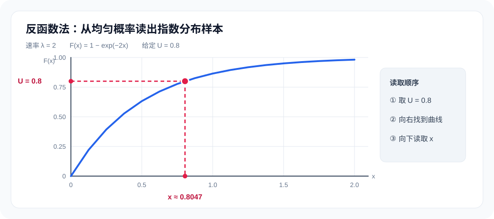
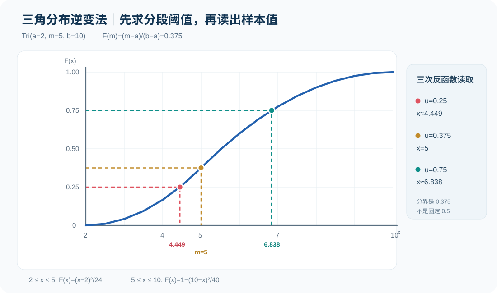
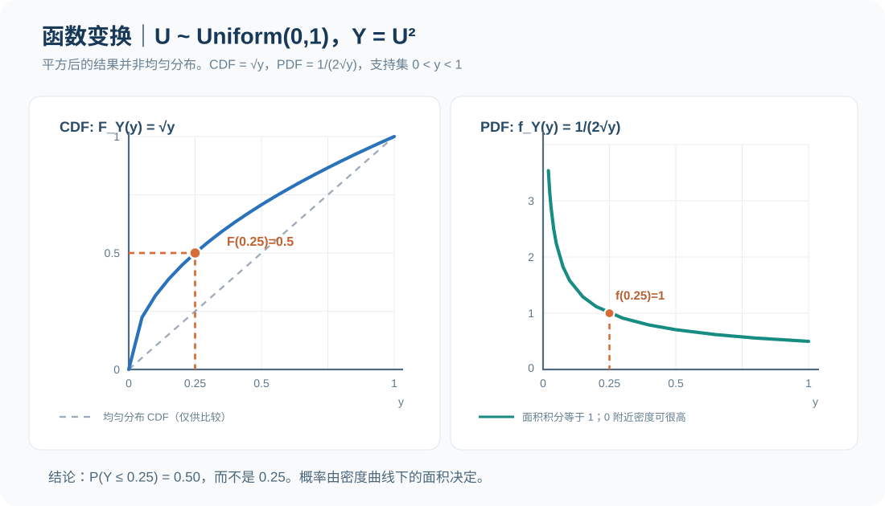
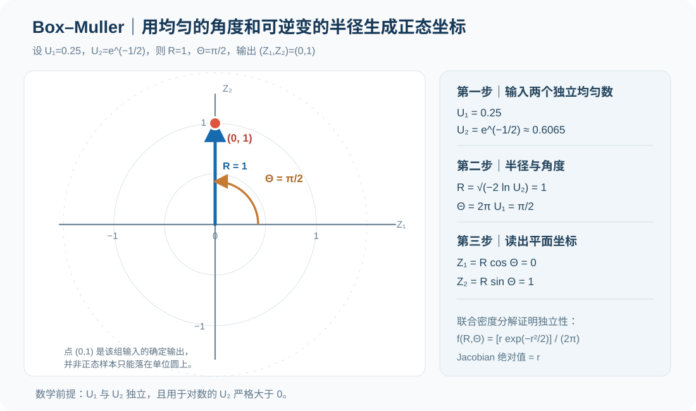

# 随机变量专项练习 05｜逆变法、函数变换与 Box–Muller（图解与证明）

[返回总目录](../README.md) · [上一题：随机数检验图解](2026-randomness-tests-visual.md) · [第四讲原课件笔记](../notes/04-random-variate-generation.md) · [下一题：卷积与取舍法](2026-convolution-rejection-empirical-visual.md) · [期末复习总章](2026-final-review.md)

第三讲解决的是“如何产生一串近似独立、均匀的随机数”；第四讲进一步解决“如何把均匀数变成仿真真正需要的加工时长、到达间隔与误差分布”。从已知分布推出生成公式，与从已知函数推出新分布，是两种方向相反但相关的计算。

本章按第四讲的前半部分组织专项练习，对照原课件中的逆变法、函数变换法、二维变换和正态变量生成。例题数字为独立设置，图中的坐标与结果由给定公式确定；它们是计算训练，不是声称老师板书使用了相同数字。

| 方法 | 已知什么 | 要找什么 | 关键动作 |
| --- | --- | --- | --- |
| 逆变法 | 目标分布函数 `F_X(x)` | 生成目标样本的函数 `X=g(U)` | 令 `u=F_X(x)`，解出 `x` |
| 一维函数变换法 | 原变量密度 `f_X` 和 `Y=g(X)` | 新密度 `f_Y(y)` | 先找值域与反函数，再乘导数绝对值 |
| 非单调函数变换 | 原变量密度与多对一的 `g` | 新密度 `f_Y(y)` | 把所有合法原像的密度贡献相加 |
| 二维函数变换 | 原联合密度和可逆坐标映射 | 新联合密度 | 使用逆变换 Jacobian 的绝对值 |
| Box–Muller | 两个独立 `U(0,1)` 数 | 两个独立标准正态数 | 用半径变换与均匀角度建立极坐标 |

## 一、证明模板：为什么把 `U` 代入反函数就能得到目标分布？

设 `U∼U(0,1)`，给定连续严格递增的目标分布函数 `F_X`。定义：

```math
X=F_X^{-1}(U).
```

为了说明 `X` 确实服从目标分布，不必猜测它的密度。直接固定一个 `x`，计算生成变量落在 `x` 左侧的概率：

```math
\begin{aligned}
P(X\leq x)
&=P(F_X^{-1}(U)\leq x)\\
&=P(U\leq F_X(x))\\
&=F_X(x).
\end{aligned}
```

第二行成立依靠 `F_X` 的单调性；第三行成立是因为标准均匀变量在 `[0,1]` 内满足 `P(U≤u)=u`。因此，新变量的累计分布函数恰好就是目标 `F_X`。

图像上应按“先给定竖轴累计概率 `u`，向右找到累计分布曲线，再向下读出横轴变量 `x`”理解。<strong>`u=0.8` 表示第 80 百分位，不是说生成的原变量数值一定等于 0.8。</strong>

对于有跳跃的离散分布或不严格递增的分布，普通反函数可能不存在，此时改用广义反函数 `F^{-1}(u)=inf{x:F(x)≥u}`。连续严格单调是最方便讲证明的情形，并不是逆变法唯一可用的情形。

## 二、题目 1｜指数分布逆变：从 CDF 推到计算结果

某设备的故障间隔 `X` 服从率参数 `λ=0.5` 的指数分布，时间单位为小时。给定 `u=0.75`，先写出逆变公式，再计算一次故障间隔。说明为什么教材有时写 `−ln(U)/λ`，有时写 `−ln(1−U)/λ`。

<strong>答案。</strong> 使用由 `F_X(x)=1−e^{−0.5x}` 直接反解的形式，`x=−ln(0.25)/0.5≈2.773` 小时。两种写法生成的概率分布相同，但给定同一个 `u` 时通常不会产生同一个数值。

### 逐步求解

指数分布的密度与 CDF 是：

```math
f_X(x)=\lambda e^{-\lambda x},\quad
F_X(x)=1-e^{-\lambda x},\qquad x\geq0.
```

把 `u` 放入目标 CDF，一步步移项：

```math
\begin{aligned}
u&=1-e^{-\lambda x}\\
1-u&=e^{-\lambda x}\\
\ln(1-u)&=-\lambda x\\
x&=-\frac{\ln(1-u)}{\lambda}.
\end{aligned}
```

代入本题 `λ=0.5，u=0.75`：

```math
x=-\frac{\ln(1-0.75)}{0.5}
=-\frac{\ln0.25}{0.5}
\approx2.7726.
```



上图沿用仓库既有的指数分布结果图，其中演示参数是 `λ=2，u=0.8`，与本题数字不同，但读图步骤完全一致。读图时先确定纵轴是累计概率，不能把密度曲线当作 CDF。

再讨论公式的两个版本。因为 `U∼U(0,1)`，所以 `1−U` 也服从 `U(0,1)`。于是：

```math
-\frac{\ln(1-U)}{\lambda}\overset{d}{=}-\frac{\ln U}{\lambda}.
```

这里的等分布符号表示两个随机变量<strong>拥有相同分布</strong>，不是对任意一次输入都有相同值。对于本题给定 `u=0.75`，若用第二个写法得到的是 `−ln0.75/0.5≈0.5754` 小时。手算题应服从题目指定的生成公式；若是在比较两个仿真方案的共同随机数设计中，更不能随意改变输入和输出的对应方式。

端点问题也要留意：`ln0` 不存在，因此实现算法时应按所用公式正确排除导致取对数零的端点。

## 三、题目 2｜三角分布：为什么必须先算分界概率？

某工序时长服从三角分布 `Tri(2,5,10)`，参数依次是最小值 `a=2`、众数 `m=5`、最大值 `b=10`。分别对均匀随机数 `u=0.25`、`u=0.75` 和 `u=0.375` 计算生成时长，要求展示分段反函数的来源。

<strong>答案。</strong> 分界概率 `c=(m−a)/(b−a)=3/8=0.375`。三个生成结果依次为 `2+√6≈4.449`、`10−√10≈6.838` 和 `5`。

### 第一步：写出密度与分段累计概率

在左半部分，三角形的密度从零线性增加；在右半部分，从峰值线性下降。将密度积分：

```math
F_X(x)=
\begin{cases}
0,&x<2,\\
\dfrac{(x-2)^2}{24},&2\leq x<5,\\
1-\dfrac{(10-x)^2}{40},&5\leq x\leq10,\\
1,&x>10.
\end{cases}
```

在 `x=5` 时，两边必须接得上：

```math
F_X(5)=\frac{(5-2)^2}{24}=\frac{9}{24}=0.375
=1-\frac{(10-5)^2}{40}.
```

它是用来判断<strong>应该使用哪一段反函数</strong>的阈值，并不是任何三角分布都固定取 `0.5`。



### 第二步：反解两段的 CDF

一般参数 `a<m<b` 下，设 `c=(m−a)/(b−a)`。当 `u<c`，解左侧平方项；当 `u≥c`，解右侧平方项：

```math
X=F_X^{-1}(U)=
\begin{cases}
a+\sqrt{U(b-a)(m-a)},&0\leq U<c,\\
b-\sqrt{(1-U)(b-a)(b-m)},&c\leq U\leq1.
\end{cases}
```

代入数字：

```math
\begin{aligned}
u=0.25<c:\quad
x&=2+\sqrt{0.25\times8\times3}=2+\sqrt6\approx4.449,\\
u=0.75>c:\quad
x&=10-\sqrt{0.25\times8\times5}=10-\sqrt{10}\approx6.838,\\
u=c=0.375:\quad
x&=5.
\end{aligned}
```

最后一行说明在分界点不论从哪一支计算都应得到众数 `m=5`。如果左右两个式子在 `u=c` 算出不同值，基本可以确定之前积分常数或分段范围写错了。

## 四、题目 3｜已知 `Y=U²`，怎样推出 `Y` 的密度？

令 `U∼U(0,1)`，定义 `Y=U²`。求 `Y` 的支持集、累计分布函数和概率密度函数，计算 `P(Y≤0.25)` 与期望 `E(Y)`。

<strong>答案。</strong> 支持集为 `[0,1]`；`F_Y(y)=√y`（`0≤y≤1`）；密度 `f_Y(y)=1/(2√y)`（`0<y<1`）；`P(Y≤0.25)=0.5`，`E(Y)=1/3`。

### 第一步：先确定 Y 能取哪些值

因为 `0≤U≤1`，平方后仍然在 `[0,1]`。该步不写，后面就容易把根号表达式误当成对整个实数轴都有效的密度。

### 第二步：用 CDF 直接推导

在 `0<y<1` 内，`U` 非负，故：

```math
\begin{aligned}
F_Y(y)&=P(Y\leq y)\\
&=P(U^2\leq y)\\
&=P(U\leq\sqrt y)\\
&=\sqrt y.
\end{aligned}
```

补上区间外的两段，完整 CDF 是：

```math
F_Y(y)=
\begin{cases}
0,&y<0,\\
\sqrt y,&0\leq y\leq1,\\
1,&y>1.
\end{cases}
```

### 第三步：求导得到密度，再用积分核查

```math
f_Y(y)=F_Y'(y)=\frac{1}{2\sqrt y},\qquad 0<y<1.
```

```math
\int_0^1\frac{1}{2\sqrt y}\,dy
=\left[\sqrt y\right]_0^1=1.
```



图中的 CDF 是 `√y`，在靠近零的地方爬升很快，表示较小的 `Y` 值更常见。例如：

```math
P(Y\leq0.25)=F_Y(0.25)=\sqrt{0.25}=0.5.
```

虽然横轴前四分之一的长度只占取值区间的 25%，却包含 50% 的概率质量。密度 `1/(2√y)` 在零附近发散，但它的总面积仍然有限且等于 1；密度的某个点值大于 1 或趋于无穷，并不违反概率公理。

期望可以直接对原变量平方求：

```math
E(Y)=E(U^2)=\int_0^1u^2\,du=\frac{1}{3}.
```

### 第四步：用一维密度变换公式交叉核对

变换 `y=u²` 在 `[0,1]` 上单调递增，反函数 `u=√y`。因此：

```math
f_Y(y)=f_U(\sqrt y)\left|\frac{du}{dy}\right|
=1\times\frac{1}{2\sqrt y}.
```

与 CDF 求导的答案完全一致。<strong>两种证明可以互相检查，但别只记最终公式而省略取值区间与单调性条件。</strong>

## 五、题目 4｜非单调变换为什么需要两支反函数？

现改为 `X∼U(−1,1)`，定义 `Y=X²`，求 `Y` 的密度。请说明为什么直接代入 `x=√y` 会少算一部分概率。

<strong>答案。</strong> 对 `0<y<1`，`f_Y(y)=1/(2√y)`；但它必须由 `x=√y` 与 `x=−√y` 两支的贡献相加得到，而不能只取正根。

对 `X∼U(−1,1)`，原密度在 `(−1,1)` 内是 `1/2`。当 `0<y<1`，方程 `x²=y` 有两个原像：

```math
x_1=\sqrt y,\qquad x_2=-\sqrt y.
```

其导数绝对值都为 `|dx/dy|=1/(2√y)`。于是：

```math
\begin{aligned}
f_Y(y)
&=f_X(\sqrt y)\left|\frac{d\sqrt y}{dy}\right|
+f_X(-\sqrt y)\left|\frac{d(-\sqrt y)}{dy}\right|\\
&=\frac{1}{2}\cdot\frac{1}{2\sqrt y}
+\frac{1}{2}\cdot\frac{1}{2\sqrt y}\\
&=\frac{1}{2\sqrt y},\qquad 0<y<1.
\end{aligned}
```

另一种不用密度变换公式的验证方式是直接看事件 `X²≤y`，它等价于 `−√y≤X≤√y`，因此：

```math
F_Y(y)=P(-\sqrt y\leq X\leq\sqrt y)
=\frac{2\sqrt y}{2}=\sqrt y.
```

如果只计算正支，密度积分会得到 `1/2`，正好漏掉负半轴原本占有的一半概率。通常非单调变换要使用：

```math
f_Y(y)=\sum_{x_i:g(x_i)=y}
\frac{f_X(x_i)}{|g'(x_i)|},
```

并明确 `g'(x_i)≠0` 且各分支局部可逆；临界点可另行通过 CDF 或分段极限处理。

## 六、题目 5｜Box–Muller：两个均匀数怎样变成两个独立正态数？

给定两个相互独立的标准均匀变量 `U₁,U₂`。要求写出 Box–Muller 的完整生成公式，说明为什么两个输出都服从标准正态且相互独立，并对 `u₁=1/4，u₂=e^(−1/2)` 手算输出。

<strong>答案。</strong>

```math
\begin{aligned}
Z_1&=\sqrt{-2\ln U_2}\cos(2\pi U_1),\\
Z_2&=\sqrt{-2\ln U_2}\sin(2\pi U_1).
\end{aligned}
```

指定输入生成 `(z₁,z₂)=(0,1)`。独立性由极坐标下的联合密度分解而来，不是仅凭“两个输出的边缘分布都为正态”推断的。



### 第一步：从二维标准正态的联合密度出发

如果 `Z₁,Z₂` 相互独立且都服从 `N(0,1)`，其目标联合密度应为：

```math
f_{Z_1,Z_2}(z_1,z_2)=\frac{1}{2\pi}
\exp\left(-\frac{z_1^2+z_2^2}{2}\right).
```

将平面坐标写成极坐标：

```math
Z_1=R\cos\Theta,\qquad Z_2=R\sin\Theta.
```

这样 `z₁²+z₂²=R²`，而极坐标到直角坐标的 Jacobian 绝对值为 `R`：

```math
\left|\frac{\partial(z_1,z_2)}{\partial(r,\theta)}\right|
=\left|\begin{matrix}
\cos\theta&-r\sin\theta\\
\sin\theta&r\cos\theta
\end{matrix}\right|=r.
```

因而半径和角度的联合密度变为：

```math
\begin{aligned}
f_{R,\Theta}(r,\theta)
&=\frac{r}{2\pi}e^{-r^2/2}\\
&=\underbrace{re^{-r^2/2}}_{f_R(r)}
\underbrace{\frac{1}{2\pi}}_{f_\Theta(\theta)},
\end{aligned}
```

定义域为 `r>0，0≤θ<2π`。联合密度恰好分解为只含 `r` 和只含 `θ` 的两个因子，且各自积分为 1，所以 `R` 与 `Θ` 独立。

### 第二步：分别生成半径和角度

角度在 `[0,2π)` 均匀分布，所以 `Θ=2πU₁`。半径的密度 `f_R(r)=r e^{−r²/2}`，积分得到 CDF：

```math
F_R(r)=1-e^{-r^2/2},\qquad r\geq0.
```

套用前面证明过的逆变法，`U₂=1−e^{−R²/2}`，解得：

```math
R=\sqrt{-2\ln(1-U_2)}.
```

因为 `1−U₂` 与 `U₂` 同分布，通常把生成式等分布地写为 `R=√(−2ln U₂)`。注意这只是在替换一个均匀输入的表达方式，不能跳过独立性前提：`U₁` 与 `U₂` 必须相互独立。

把 `R`、`Θ` 代入平面坐标就得到题目的 Box–Muller 公式。这给出了完整生成证明：半径 CDF 正确、角度均匀、两者独立，反变换后的联合密度也就正确。

### 第三步：代入能手算的输入

```math
\begin{aligned}
u_1&=\frac{1}{4}, &\Theta&=2\pi\times\frac{1}{4}=\frac{\pi}{2},\\
u_2&=e^{-1/2}, &R&=\sqrt{-2\ln(e^{-1/2})}=1,\\
z_1&=R\cos\Theta=0, &z_2&=R\sin\Theta=1.
\end{aligned}
```

输出 `(0,1)` 只是特定输入下的一个样本点。如果目标是 `N(μ,σ²)`，可进一步做线性变换 `X=μ+σZ`，其中 `σ` 是标准差，不是方差。

## 七、题目 6｜12 个均匀数相加减 6，和 Box–Muller 一样吗？

若 `U₁,…,U₁₂` 相互独立且都服从 `U(0,1)`，令 `Z=ΣUᵢ−6`，问其均值、方差、一次计算值与分布是否“精确标准正态”。给定一次抽样的十二项和为 `6.83`。

<strong>答案。</strong> `E(Z)=0`、`Var(Z)=1`、这次计算为 `z=0.83`；它只是中心极限定理意义下的近似标准正态，绝不是精确的 `N(0,1)`。

每个均匀变量均值 `1/2`、方差 `1/12`，独立时方差可相加，因此：

```math
\begin{aligned}
E(Z)&=12\times\frac{1}{2}-6=0,\\
\operatorname{Var}(Z)&=12\times\frac{1}{12}=1,\\
z&=6.83-6=0.83.
\end{aligned}
```

然而 `0≤Uᵢ≤1`，所以有限样本生成的 `Z` 必须落在 `[-6,6]`；真正的标准正态分布在 `|z|>6` 之外仍有非零概率。两者不可能是完全相同的分布。中心极限定理提供的是近似，Box–Muller 在独立连续均匀输入的数学模型下提供的是精确变换。

## 八、计算题中的操作顺序与易错判断

遇到陌生的函数变换题，先写清楚四个环节：原变量的取值范围；新变量的取值范围；变换是否一一对应；最后选用 CDF 求导、单支导数绝对值或者多支求和。逆变题则先找目标 CDF，解反函数时保留恰当的分支，代入随机数后做一次合理性检查。

<strong>判断 1。</strong> “只要把一个均匀随机数带入某个函数，结果仍然服从均匀分布。”

<strong>答案：错误。</strong> 例如 `Y=U²` 的 CDF 是 `√y`，而不是 `y`。

<strong>判断 2。</strong> “指数分布的 `−ln U/λ` 和 `−ln(1−U)/λ` 对同一输入一定给出相同结果。”

<strong>答案：错误。</strong> 两者是等分布的随机变量，但逐次输出不同，除非取到某些特殊输入。

<strong>判断 3。</strong> “在 `Tri(a,m,b)` 中，使用左反函数的判据是 `u<0.5`。”

<strong>答案：错误。</strong> 分界应为 `c=(m−a)/(b−a)`，由目标分布的累计概率决定。

<strong>判断 4。</strong> “已知 `Y=X²`，直接只取正根代入单调密度变换公式总是正确。”

<strong>答案：错误。</strong> 如果 `X` 可以取负值，应同时计入负根；如果支持集只在非负半轴，则只需正根。

<strong>判断 5。</strong> “两个随机变量都服从 `N(0,1)`，就足以说明它们相互独立。”

<strong>答案：错误。</strong> 边缘分布相同并不能推出独立性；Box–Muller 的独立结论来自变换后的联合分布性质。

<strong>判断 6。</strong> “`Σ₁¹²Uᵢ−6` 和 Box–Muller 生成的标准正态分布完全相同。”

<strong>答案：错误。</strong> 前者有限区间有界，是近似方法；后者是精确的分布变换方法。

后续第四讲还包括卷积法、接受—拒绝法和连续/离散经验分布法。这几种方法解决的是在没有简洁反函数、或者目标变量由多个随机过程组成时怎样抽样，与本章建立的逆变法和密度变换公式衔接。
