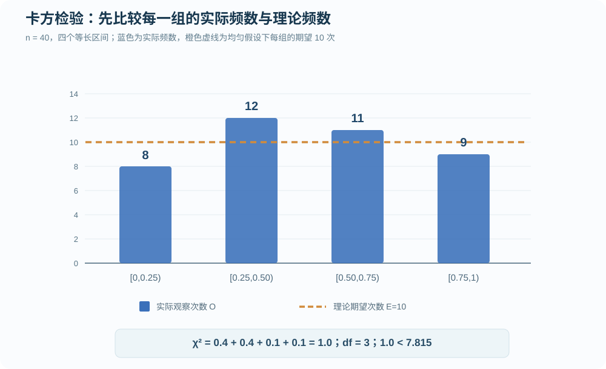
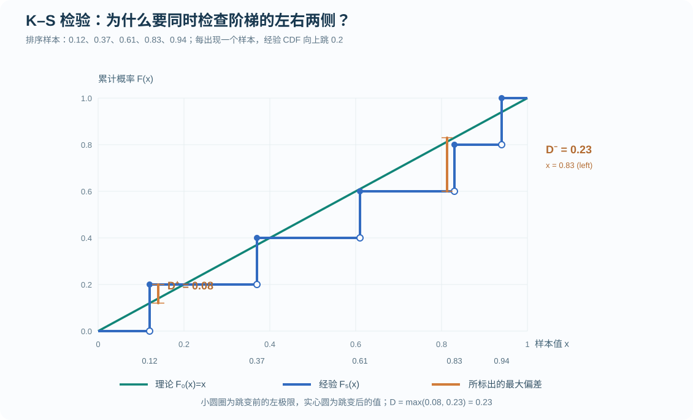
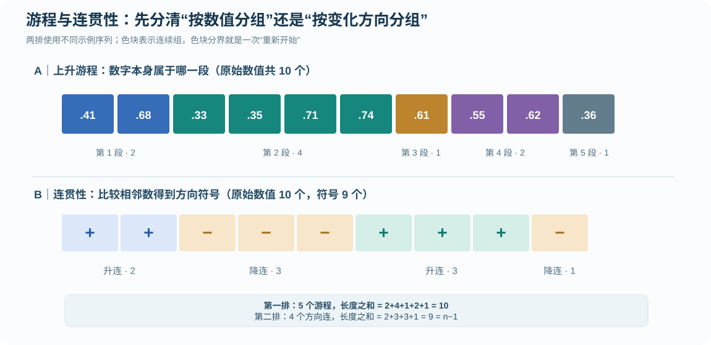

# 随机数专项练习 04｜卡方、K–S、游程与连贯性检验（图解）

[返回总目录](../README.md) · [上一题：LCG 满周期](2026-lcg-full-period-drill.md) · [第三讲原课件笔记](../notes/03-random-number-generation-testing.md) · [计算题集](2026-calculation-workbook.md)

本节把第三讲“随机数检验”的概念和计算连起来。课堂录音二 `07:23—11:21` 明确强调了卡方与 K–S 的区别，以及游程、连贯性中“连的数量和长度”如何识别。录音还提到随机数检验主要关注概念，<strong>下面的数值计算与重绘结果图是配套训练，不代表老师承诺考试会要求完整手算每个检验统计量</strong>。

最先需要分清的是<strong>检验样本取值分布</strong>与<strong>检验原始序列的先后依赖</strong>，这两件事不是一回事。排序和统计频数可以用于分析“数值分布”，但排序会抹掉原本的时间顺序，不能用于研究先后关系。

| 方法 | 输入前怎样处理 | 统计对象 | 本节练习要算什么 |
| --- | --- | --- | --- |
| 卡方均匀性检验 | 按预先指定区间分组 | 实际频数与理论频数 | 期望频数、卡方统计量、自由度 |
| K–S 均匀性检验 | 按数值从小到大排序 | 经验 CDF 与理论 CDF 的距离 | 左右两侧偏差及其最大值 |
| 上升游程检验（课件用法） | 保留原始顺序 | 一段段连续上升的数值 | 每段的长度、六类长度频数 |
| 连贯性检验 | 保留原始顺序，比较相邻项 | 上升与下降的符号连 | `+/-` 分组、连数及各连长度 |
| 扑克检验 | 预先确定数位抽取和分组规则 | 数字的相同/不同模式 | 三种模式的理论概率与频数 |

## 一、卡方检验：频数偏差到底怎样量化

### 题目 1

已生成 `40` 个候选均匀随机数。将 `[0,1)` 等分为四段，观察频数为 `8、12、11、9`。在显著性水平 `α=0.05` 下，检验这组数是否呈现明显的分组均匀性偏差。已知自由度为 3 时的上侧临界值为 `7.815`。

<strong>答案。</strong> 每组期望频数 `10`；卡方统计量 `χ²=1.0`；自由度 `3`；因为 `1.0 < 7.815`，所以在 5% 水平下<strong>不拒绝均匀性原假设</strong>。

### 第一步：先由原假设算出理论频数

如果服从 `U(0,1)`，等长的四个区间各占 `1/4` 的概率。样本量 `n=40`，每组理论期望为：

```math
E_i=n p_i=40\times\frac{1}{4}=10.
```

| 区间 | 观察频数 `Oᵢ` | 理论频数 `Eᵢ` | 差值 `Oᵢ−Eᵢ` | 对统计量的贡献 |
| --- | ---: | ---: | ---: | ---: |
| `[0,0.25)` | 8 | 10 | −2 | `4/10=0.4` |
| `[0.25,0.50)` | 12 | 10 | +2 | `4/10=0.4` |
| `[0.50,0.75)` | 11 | 10 | +1 | `1/10=0.1` |
| `[0.75,1)` | 9 | 10 | −1 | `1/10=0.1` |
| 合计 | 40 | 40 | 0 | `1.0` |

### 第二步：对照频数结果图



这张图里蓝色柱高是实际出现次数，橙色虚线是每组理论应出现的 10 次。卡方检验统计量实际上把每组“柱顶到虚线的偏差”平方，再用该组理论频数作标准化。

```math
\begin{aligned}
\chi^2&=\sum_{i=1}^{4}\frac{(O_i-E_i)^2}{E_i}\\
&=\frac{(8-10)^2+(12-10)^2+(11-10)^2+(9-10)^2}{10}\\
&=\frac{10}{10}=1.0.
\end{aligned}
```

### 第三步：自由度为什么是 3？

四组实际频数的和已经固定为 40。如果前三组已经确定，第四组必须取 `40−前三组之和`，所以只有三个频数可以独立变化。本题没有用这 40 个数据去额外估计均匀分布参数，故自由度为 `4−1=3`。若改成估计其他分布的未知参数再做拟合检验，自由度可能需要进一步调整。

卡方检验并不要求每一组都恰好出现 10 次：随机样本自然会有波动。这里四组的偏差不足以触发给定临界值，因此“不拒绝”，不能写成“已经证明这组数完全均匀且独立”。本题每组期望频数为 10，满足通常使用的卡方近似的基本期望频数要求；实际应用中仍需确认数据产生机制与独立性等前提。

## 二、K–S 检验：最大垂直距离为什么要算两侧

### 题目 2

五个候选均匀随机数已经从小到大排序：

`0.12、0.37、0.61、0.83、0.94`。

理论均匀分布在 `[0,1]` 内满足 `F₀(x)=x`。计算单样本 K–S 的 `D⁺、D⁻、D₅`。本练习给定双侧 5% 临界值 `0.565`。

<strong>答案。</strong> `D⁺=0.08`，出现在第 1 个样本跳跃<strong>之后</strong>；`D⁻=0.23`，出现在第 4 个样本跳跃<strong>之前</strong>；因此 `D₅=0.23 < 0.565`，不拒绝给定的均匀分布原假设。

### 第一步：画理论分布与经验分布

理论 `F₀(x)=x` 是穿过 `(0,0)` 和 `(1,1)` 的直线。经验分布 `F₅(x)` 则表示“样本中有多少比例不大于 x”：在第 1 个样本 `0.12` 处从 `0` 跳到 `1/5=0.2`；第 2 个样本 `0.37` 处跳到 `2/5=0.4`，依次类推。



<strong>图的阅读方法。</strong> 以 `x=0.83` 为例：从左侧趋近这个点时，只有前三个样本计入经验分布，故 `F₅(0.83⁻)=3/5=0.6`；但理论分布已经达到 `F₀(0.83)=0.83`。两条曲线的距离是 `0.83−0.6=0.23`。到了这个样本点，经验分布立即跳到 `4/5=0.8`，距离又变成 `|0.83−0.8|=0.03`。所以只看跳跃后的一侧，会漏掉最大的偏差。

### 第二步：逐项算两侧偏差

对排序样本 `x₍ᵢ₎`，若理论分布已知且连续：

```math
\begin{aligned}
D_n^+&=\max_{1\leq i\leq n}\left(\frac{i}{n}-F_0(x_{(i)})\right),\\
D_n^-&=\max_{1\leq i\leq n}\left(F_0(x_{(i)})-\frac{i-1}{n}\right),\\
D_n&=\max(D_n^+,D_n^-).
\end{aligned}
```

| i | `x₍ᵢ₎` | 跳前 `(i−1)/5` | 跳后 `i/5` | `D⁺` 候选 `i/5−x₍ᵢ₎` | `D⁻` 候选 `x₍ᵢ₎−(i−1)/5` |
| ---: | ---: | ---: | ---: | ---: | ---: |
| 1 | 0.12 | 0.0 | 0.2 | `0.08` | `0.12` |
| 2 | 0.37 | 0.2 | 0.4 | `0.03` | `0.17` |
| 3 | 0.61 | 0.4 | 0.6 | `−0.01` | `0.21` |
| 4 | 0.83 | 0.6 | 0.8 | `−0.03` | <strong>`0.23`</strong> |
| 5 | 0.94 | 0.8 | 1.0 | `0.06` | `0.14` |

取第五列最大值得 `D⁺=0.08`，取第六列最大值得 `D⁻=0.23`。因此：

```math
D_5=\max(0.08,0.23)=0.23.
```

### 第三步：与临界值比较

本题给定临界值 `0.565`，故不拒绝均匀性原假设。<strong>K–S 的临界值依赖样本量和检验设计</strong>，不能拿卡方分布的 `7.815` 来比较；本例是对事先指定、没有从样本估计参数的连续理论分布作单样本比较。即使检验没有拒绝，也不代表样本值在生成顺序上相互独立。

## 三、按课件定义数“上升游程”

### 题目 3

给定以下保留原始顺序的十个数字：

`0.41、0.68、0.33、0.35、0.71、0.74、0.61、0.55、0.62、0.36`。

按第三讲的“遇到下降便结束上一段、下一个数字重新开始一段”的规则，将它划分为连续上升游程，给出各段长度，再统计长度为 `1、2、3、4、5、≥6` 的段数。

<strong>答案。</strong> 共 `5` 个上升游程，长度依次为 `2、4、1、2、1`。六类频数为 `g=(2,2,0,1,0,0)`。



从图的第一排看：`0.41→0.68` 连续上升，构成长度 2 的第一段；`0.68→0.33` 下降，第二段改从 `0.33` 开始，后续 `0.33→0.35→0.71→0.74` 上升，长度 4；接着 `0.74→0.61` 下降，单独得到长度 1 的第三段；`0.55→0.62` 得到长度 2 的第四段；末尾 `0.36` 单独构成长度 1 的第五段。

用竖线表示分界：

```text
0.41, 0.68 | 0.33, 0.35, 0.71, 0.74 | 0.61 | 0.55, 0.62 | 0.36
    2     |             4             |    1   |      2      |   1
```

六类长度的频数不是直接数“有多少个数字”，而是数“有多少个段落落在这一长度”。两个长度 1 的段、两个长度 2 的段、一个长度 4 的段，故 `2+2+0+1+0+0=5` 个游程，而 `2×1+2×2+1×4=10` 个原始数值。两个总数作用不同，不要混淆。

原课件进一步给出基于六类游程频数的二次型卡方统计量，包含课件指定的系数矩阵，并提出 `n>4000` 的大样本前提。因此<strong>这个十数值的小例子用于训练数游程和分类，不应直接套用大样本卡方渐近公式宣布“随机”或“不随机”</strong>。详细公式与系数约定可看[第三讲游程检验](../notes/03-random-number-generation-testing.md)。

## 四、连贯性检验：先变成方向符号，再数“连”

### 题目 4

按第三讲课堂示例，给定：

`0.41、0.68、0.89、0.74、0.55、0.36、0.54、0.72、0.75、0.08`。

比较相邻两项，后一个更大记 `+`，更小记 `−`。求方向符号序列、连续同号“连”的数量及长度。

<strong>答案。</strong> 符号序列 `++---+++-`，共 `4` 个方向连，长度为 `2、3、3、1`。

```text
数值：0.41 0.68 0.89 0.74 0.55 0.36 0.54 0.72 0.75 0.08
方向：      +    +    −    −    −    +    +    +    −
分组：      ++       |    ---     |    +++     |   −
```

上方同一张图的第二排把九个相邻比较结果按连续同号分为四组。<strong>方向符号比原始数字少一个</strong>：十个数只有九个相邻比较。第一个方向连 `++` 的长度按方向比较次数算是 `2`，不是涉及的原始数字数 `3`。

原课件对方向连数 `T` 给出渐近期望与方差：

```math
E(T)=\frac{2n-1}{3},\qquad
\operatorname{Var}(T)=\frac{16n-29}{90}.
```

这里 `n` 是原始数据个数，不是方向符号的个数。本例 `n=10、T=4`，代入得到 `E(T)=19/3≈6.333`、`Var(T)=131/90≈1.456`。如果只是问有几个连，到这里就已经答完；若要求按照课件大样本方法检验，还须核实适用条件、显著性水平与临界值。十个数据过少，不宜将一个渐近标准化结果当成稳健结论。

<strong>“上升游程”和“方向连”为什么数出来不同？</strong> 前者把数字本身归入互不重叠的上升段，长度合计等于原始数值个数；后者把相邻变化的正负号归入连续方向段，长度合计等于比较次数 `n−1`。再加上本节两题的输入序列也不相同，不能把五段的结果和四连的结果互相替代。

## 五、扑克检验：看数位模式，不是做扑克牌游戏

以三位十进制数字为例，按是否有重复数字分成互斥三类。理论样本空间大小为 `10³=1000`：

| 类别 | 例子 | 组合数 | 概率 |
| --- | --- | ---: | ---: |
| 三位全部不同 | `275` | `10×9×8=720` | `0.72` |
| 恰有两位相同 | `277` | `3×10×9=270` | `0.27` |
| 三位全部相同 | `777` | `10` | `0.01` |

这三类比例是计算理论频数的基础。如果抽取 1000 个三位数，理论频数为 `720、270、10`，可用对应的卡方拟合检验检查差异。不过最稀少的第三类期望只有 `0.01n`，样本量小时不能只机械套普通卡方近似。还应规定数位从哪些独立随机数中抽取，以及相邻分组是否重叠。

## 六、考试式辨析：题目下直接给答案

<strong>判断 1。</strong> “卡方和 K–S 都能检验均匀性，因此计算前都必须把数值划成若干等长区间。”

<strong>答案：错误。</strong> 卡方检验依赖预先划分的分组频数；单样本 K–S 直接比较排序后的经验分布与连续理论分布，不要求预先划分直方图区间。

<strong>判断 2。</strong> “为了计算游程或连贯性检验，先把随机数从小到大排序更方便。”

<strong>答案：错误。</strong> 排序改变相邻关系，直接破坏要检验的原始顺序。K–S 的排序和连贯性的保序恰好相反。

<strong>判断 3。</strong> “K–S 的 D 值只要比较理论线与经验阶梯在每个跳跃之后的差距即可。”

<strong>答案：错误。</strong> 最大差距可能发生在跳跃之前。题目 2 的 `D⁻=0.23` 就来自 `x=0.83` 的左极限。

<strong>判断 4。</strong> “一组伪随机数通过了卡方和 K–S 检验，所以其相邻项必然独立。”

<strong>答案：错误。</strong> 两项检验主要考察数值分布是否与均匀分布相符；独立性仍需通过序列相关、游程、连贯性等角度进一步分析，而且任何有限检验都不能证明数学意义上的绝对独立。

<strong>判断 5。</strong> “课件中上升游程的长度，与连贯性中方向连的长度是同一个定义。”

<strong>答案：错误。</strong> 上升游程按纳入该段的原始数值个数计，方向连按连续同号的相邻比较次数计。具体以题目和课件约定为准。

<strong>判断 6。</strong> “某一组检验中不拒绝原假设，就说明理论分布已经被证明为真。”

<strong>答案：错误。</strong> 不拒绝只说明在当前样本量、显著性水平和统计方法下没有足够证据否定原假设；它不是对原假设的数学证明。

本节三张图中，卡方图表达“实际与理论频数的距离”，K–S 图表达“整条累计分布之间的最大垂直距离”，游程图表达“原始相邻顺序形成的段落”。这三种图可分别用于检查频数、CDF 和顺序结构，不能互相取代。
