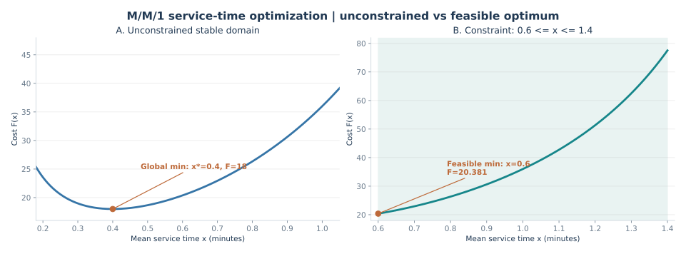
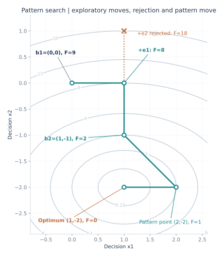
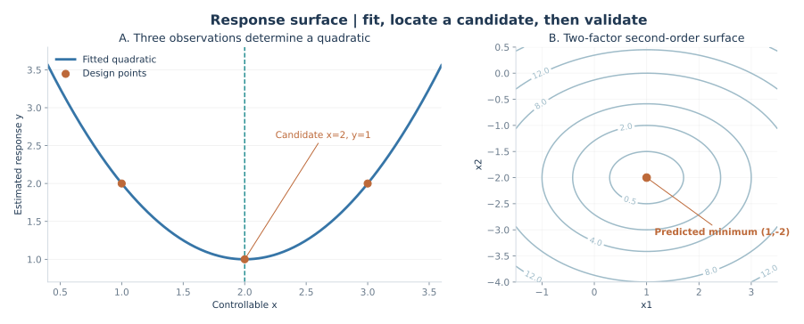
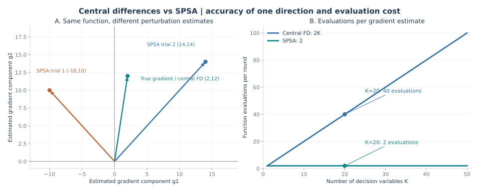

# 第八讲图解专项 10｜仿真优化：从成本函数到梯度估计

[返回总目录](../README.md) · [第八讲完整笔记](../notes/08-simulation-optimization.md) · [期末复习串讲](2026-final-review.md) · [上一专题：模型验证与确认](2026-model-verification-validation-visual.md)

根据 2026 年 11 月 9 日课堂复习串讲，第八讲主要应掌握优化问题的构成、几类搜索思想、响应面以及梯度估计之间的区别；录音没有把这些算法列为本次期末大计算题的明确落点。下面的数值练习用于理解公式、纠正概念混淆，和手工事件调度、输出分析置信区间的考试优先级不同。

四张结果图和十道题均是重新设计的教学练习，不是课堂原题，也不把解析式可得的结果直接当成随机仿真的结论。

## 本讲先抓住一个框架

仿真优化有两层工作。<strong>优化器决定下一次试哪组可控参数，仿真模型在随机输入下评价该方案的表现。</strong> 真正希望比较的通常是目标函数的期望；一次仿真只是该期望的一个有噪声观测。

```math
\begin{aligned}
X^*&=\arg\min_{X\in\mathcal F}F(X),\\
F(X)&=E_\omega[Z(X,\omega)],\\
\widehat F_R(X)&=\frac{1}{R}\sum_{r=1}^RZ(X,\omega_r).
\end{aligned}
```

其中 <code>X</code> 是决策变量，<code>\mathcal F</code> 是可行域，<code>\omega</code> 是不可直接控制的随机输入，<code>Z</code> 是一次仿真得到的成本或绩效，<code>R</code> 是评价某个方案使用的独立重复次数。

## 题 1｜管理问题里的“可控”“随机”“输出”分别是什么？

一家呼叫中心希望在控制人员成本的同时降低等待时间。主管能够安排坐席数量，但顾客到达时刻和每通电话的实际服务时间具有随机性。仿真可以记录排队、放弃等待和资源利用率。

<strong>问题：</strong>分类坐席数量、顾客到达、通话时长、平均等待时间和人员成本；说明为何不能用一次仿真结果作为最终最优方案依据。

### 答案与解析

| 项目 | 身份 | 原因 |
| --- | --- | --- |
| 坐席数量 <code>c</code> | 可控决策变量 | 管理者可以改变，通常还要满足整数、预算和排班约束 |
| 到达时刻与实际通话时长 | 随机输入 | 在运行前不能精确指定其实现值 |
| 平均等待、放弃比例、利用率 | 仿真输出指标 | 由方案和随机输入共同决定 |
| 人员成本 | 目标函数组成部分 | 由坐席配置和相应成本系数决定 |

可以把目标设为“预期顾客等待成本＋人员成本”，并加上最大预算或服务水平约束。比如选择 6 个坐席的一次仿真比选择 7 个坐席的那次更好，未必意味着 6 个坐席的期望成本更低；随机到达和服务时长可能让一次结果产生偶然波动。合理比较需要明确性能指标、重复次数及不确定性。

## 题 2｜把 M/M/1 排队模型写成优化目标

服务系统的到达率为 <code>λ=0.5</code> 人/分钟，以平均服务时间 <code>x</code>（分钟/人）作为可调参数。平均系统逗留的单位时间成本系数为 <code>Cc=16</code>，服务能力投入项为 <code>Cs/x</code>，其中 <code>Cs=4</code>。

<strong>问题：</strong>写出稳定条件、平均系统逗留时间 <code>Y(x)</code> 和总成本 <code>F(x)</code>；说明为何不是简单地令 <code>x=0</code>。

### 答案与解析

M/M/1 的服务率是 <code>μ=1/x</code>，利用率为 <code>ρ=λ/μ=λx</code>。稳定要求 <code>λx&lt;1</code>，即本题的可行稳定区间是 <code>0&lt;x&lt;2</code>。稳态平均系统逗留为：

```math
Y(x)=\frac{1}{\mu-\lambda}=\frac{x}{1-\lambda x}
=\frac{x}{1-0.5x}.
```

因此：

```math
\boxed{F(x)=16\frac{x}{1-0.5x}+\frac{4}{x}},\qquad0<x<2.
```

第一个成本项偏好短服务时间，第二个成本项则在服务变得极快时迅速上升。<code>x→0</code> 时虽然顾客逗留缩短，但 <code>4/x→∞</code>；<code>x→2</code> 时系统接近不稳定，平均逗留趋于无穷。若目标改为<strong>只对排队等待时间</strong>计费，必须把平均系统逗留改成平均排队等待，不得混用。

## 题 3｜求解析最优值，再施加可行域约束

延续题 2 的成本函数，先求无额外约束的最优平均服务时间，再求当技术要求 <code>0.6≤x≤1.4</code> 时的最优可行方案。

### 答案与解析



先求导，不能把平均服务时间与服务率的单位混淆：

```math
\begin{aligned}
F'(x)&=\frac{16}{(1-0.5x)^2}-\frac{4}{x^2},\\
F'(x)=0&\iff\frac{4}{1-0.5x}=\frac{2}{x}\\
&\iff 4x=2-x\\
&\iff\boxed{x^*=0.4}.
\end{aligned}
```

在 <code>0&lt;x&lt;2</code> 内：

```math
F''(x)=\frac{16}{(1-0.5x)^3}+\frac{8}{x^3}>0.
```

因此该驻点是严格最小点。计算成本与服务率：

```math
F(0.4)=16\frac{0.4}{0.8}+\frac{4}{0.4}=18,
\qquad\mu^*=\frac{1}{0.4}=2.5.
```

若增加 <code>0.6≤x≤1.4</code>，解析最优点 <code>0.4</code> 不可行。因为成本函数在 <code>x&gt;0.4</code> 后严格递增，所以受约束时取左端点：

```math
\boxed{x^*_{\mathcal F}=0.6},\qquad
F(0.6)=\frac{9.6}{0.7}+\frac{4}{0.6}\approx20.381.
```

图左强调“求导所得候选最优点”；图右强调“只有可行域内的方案能够提交”。不能把两个最优值都写作 <code>18</code>。

## 题 4｜二维模式搜索：探测、拒绝与模式移动

给定确定型练习函数：

```math
Y(x_1,x_2)=(x_1-1)^2+2(x_2+2)^2.
```

初始基点 <code>b1=(0,0)</code>，两个坐标的搜索步长均为 1。沿坐标正、负方向尝试改善，找到新基点后，采用 <code>t=b2+(b2−b1)</code> 作模式移动。求本轮重要候选点的值。

### 答案与解析



| 本轮步骤 | 候选点 | 函数值 | 判断 |
| --- | --- | ---: | --- |
| 初始基点 | <code>b1=(0,0)</code> | 9 | 当前比较基准 |
| 第一坐标正向 | <code>(1,0)</code> | 8 | 下降，接受 |
| 第二坐标正向 | <code>(1,1)</code> | 18 | 比当前 8 大，拒绝 |
| 第二坐标反向 | <code>b2=(1,-1)</code> | 2 | 下降，接受，完成本轮探测 |
| 模式移动 | <code>t=(2,-2)</code> | 1 | 比新基点 2 小，可作为下一搜索位置 |
| 再作局部探测 | <code>(1,-2)</code> | 0 | 继续下降；本练习函数在此达到理论最小 |

计算模式点时，先求新旧基点的差，再从<strong>新基点</strong>出发移动：

```math
b_2-b_1=(1,-1),\qquad
t=b_2+(b_2-b_1)=(2,-2).
```

一个常见错误是“某方向正向探测失败就宣布局部最优”。正确做法还要检查允许的反向探测；模式移动也应和当时的当前基点比较，而不是永远拿初始点 <code>(0,0)</code> 当基准。

## 题 5｜模式搜索停止时，为什么不能宣布已找到全局最优？

假设采用步长 <code>δ=1</code> 的坐标探测法，在当前点向所有允许的正负坐标方向试探，都没有发现改善。老师让你解释下一步及结果含义。

### 答案与解析

本轮探测的结论只说明“在当前点、当前步长、已试的方向上没有找到更优的方案”。可以将步长缩小，例如从 <code>1</code> 调整至 <code>0.5</code>，继续做局部探测；若模型带约束，非法候选点不得用作改善方案。对于随机仿真目标，函数比较本身也有估计误差，可能需要增加独立重复或对候选方案作统计比较。

若步长缩小到停止阈值，算法可以按预设规则停止，但这并不自动构成全局最优性的数学证明。<strong>停止条件、局部改进和全局最优</strong>属于三个不同概念。

## 题 6｜用三个试验点拟合二次响应面

已知三个设计点的平均响应：<code>(x,y)=(1,2),(2,1),(3,2)</code>。用 <code>ŷ(x)=b0+b1x+b2x²</code> 拟合二次曲线，并求拟合函数的最低点。

### 答案与解析



将三个点代入得到三元一次方程组：

```math
\begin{cases}
b_0+b_1+b_2=2,\\
b_0+2b_1+4b_2=1,\\
b_0+3b_1+9b_2=2.
\end{cases}
```

第二式减第一式得 <code>b1+3b2=−1</code>；第三式减第二式得 <code>b1+5b2=1</code>。两式相减，<code>2b2=2</code>，所以 <code>b2=1</code>、<code>b1=−4</code>、<code>b0=5</code>。于是：

```math
\widehat y(x)=x^2-4x+5=(x-2)^2+1,
\qquad\boxed{x^*_{\rm fitted}=2,\ \widehat y_{\min}=1}.
```

这里的 <code>2</code> 是<strong>拟合曲面的候选最优点</strong>。若三个响应来自随机仿真，这个点仍须用额外的仿真实验进行验证；不应因为曲线能够穿过已有三个样本点，就宣称真实期望目标在 <code>x=2</code> 处必然全局最优。

## 题 7｜二元二次响应面的系数、梯度和 Hessian

一般二元二次响应面写作：

```math
\widehat Y(x_1,x_2)=\beta_0+\beta_1x_1+\beta_2x_2
+\beta_{11}x_1^2+\beta_{22}x_2^2+\beta_{12}x_1x_2.
```

<strong>问题：</strong>需要估计多少个系数？如何检查一个驻点是否为严格局部最小？用题 4 的函数展开作例子。

### 答案与解析

二元二阶完整响应面共有 <code>6</code> 个系数：常数 1 个、一次项 2 个、平方项 2 个、交互项 1 个。一般 K 个变量的完整二次响应面的系数数目是：

```math
1+K+K+\frac{K(K-1)}2=\frac{(K+1)(K+2)}2.
```

梯度和 Hessian 为：

```math
\nabla\widehat Y=
\begin{pmatrix}
\beta_1+2\beta_{11}x_1+\beta_{12}x_2\\
\beta_2+2\beta_{22}x_2+\beta_{12}x_1
\end{pmatrix},\quad
H=\begin{pmatrix}2\beta_{11}&\beta_{12}\\\beta_{12}&2\beta_{22}\end{pmatrix}.
```

题 4 的目标函数展开为 <code>9−2x1+8x2+x1²+2x2²</code>，梯度为 <code>(2x1−2,4x2+8)</code>，令梯度为 0 得 <code>(1,−2)</code>；其 Hessian 为对角矩阵 <code>diag(2,4)</code>，正定，因此该驻点为严格最小点。实际仿真响应面只是局部近似，仍需检查约束和拟合有效区域。

## 题 8｜同一道题比较中心有限差分与 SPSA

给定 <code>Y(x1,x2)=x1²+3x2²</code>，在点 <code>X=(1,2)</code> 估计梯度，扰动幅度 <code>c=0.1</code>。先使用坐标中心有限差分，再使用同步扰动向量 <code>Δ=(1,−1)</code> 的 SPSA；另算 <code>Δ′=(1,1)</code> 的第二轮 SPSA。

### 答案与解析



真实梯度可由解析式求出，便于核对：

```math
\nabla Y(x_1,x_2)=(2x_1,6x_2),\qquad \nabla Y(1,2)=(2,12).
```

<strong>第一种：中心有限差分。</strong> 一次只改动一个坐标。四个评价点是：

| 扰动方向 | 正向评价 | 反向评价 | 对应梯度分量 |
| --- | ---: | ---: | ---: |
| x1 | <code>Y(1.1,2)=13.21</code> | <code>Y(0.9,2)=12.81</code> | <code>(13.21−12.81)/0.2=2</code> |
| x2 | <code>Y(1,2.1)=14.23</code> | <code>Y(1,1.9)=11.83</code> | <code>(14.23−11.83)/0.2=12</code> |

因此估计为 <code>(2,12)</code>，需要四次目标函数评价。这里恰好和真实梯度相同，是因为目标函数为二次函数；不能据此认为所有函数的有限差分都不存在近似偏差。

<strong>第二种：SPSA。</strong> 两个坐标同步变化，<code>Δ=(1,−1)</code>。两次评价分别为：

```math
\begin{aligned}
Y(X+c\Delta)&=Y(1.1,1.9)=12.04,\\
Y(X-c\Delta)&=Y(0.9,2.1)=14.04.
\end{aligned}
```

两次评价差是 <code>−2.00</code>；每个分量的分子相同，但分母要除以各自的扰动符号：

```math
\widehat g_k=\frac{Y(X+c\Delta)-Y(X-c\Delta)}{2c\Delta_k},
\quad\widehat{\nabla Y}^{\rm SPSA}_1=(-10,10).
```

第三种，对 <code>Δ′=(1,1)</code> 做第二轮：

```math
\begin{aligned}
Y(1.1,2.1)&=14.44,\qquad Y(0.9,1.9)=11.64,\\
\widehat{\nabla Y}^{\rm SPSA}_2&=(14,14),\\
\frac{(-10,10)+(14,14)}2&=(2,12).
\end{aligned}
```

本题两轮 SPSA 的均值恰好等于真实梯度，是特意设计的无噪声二次函数结果。<strong>单轮 SPSA 得到的是随机梯度估计，不是精确梯度。</strong> 图左给出三条向量，观察不同扰动方向的偏差；不能把两轮平均恰好正确当作普遍保证。

## 题 9｜维度、独立重复次数与比较误差

某仿真优化问题有 <code>K=20</code> 个可控连续变量。每个待评价的方案都要执行 <code>R=15</code> 次独立重复。问用中心有限差分与单轮 SPSA 各需要多少次仿真运行？为什么更少的运行次数不一定代表更可靠？

### 答案与解析

中心有限差分每个坐标需要正、反各一次评价，一共 <code>2K</code> 个评价点；SPSA 只需要同时正扰动与同时负扰动两个评价点。乘以每点评价重复次数 <code>R</code>，得到：

```math
N_{\rm FD}=2KR=2\times20\times15=600,
\qquad N_{\rm SPSA}=2R=30.
```

二者比较的是<strong>每轮估计梯度所需的仿真评价量</strong>，不是达到目标优化精度所需的总迭代量。SPSA 每轮评价少，但单轮梯度方向可能更不稳定，最终是否更省计算取决于噪声、步长、收敛与重复策略。

如果正、反扰动点使用公共随机数，要比较的是<strong>两点输出之差</strong>的方差：

```math
\mathrm{Var}(Z^+-Z^-)=\mathrm{Var}(Z^+)+\mathrm{Var}(Z^-)
-2\mathrm{Cov}(Z^+,Z^-).
```

当协方差为正时，使用配对的公共随机数有助于降低差值方差；如果相关关系不同，则未必有效。公共随机数属于方差缩减设计，并不会改变“两个方案真实期望差值”的定义。

## 题 10｜十个概念判断与改错

判断每句话是否正确。错误的需要给出可替换的正确表述。

| 说法 | 判断 | 原因或改正 |
| --- | --- | --- |
| ① 优化中的决策变量和随机输入是一回事 | 错 | 决策变量是可调整的方案参数；随机输入的实现结果不能由决策者逐次指定 |
| ② 一次仿真得到的成本等于该方案的理论期望成本 | 错 | 一次成本是随机响应；理论期望通常需经重复运行估计 |
| ③ 在 M/M/1 中，平均服务时间 x 越大，服务率 μ 也越大 | 错 | <code>μ=1/x</code>，二者反向变化 |
| ④ 不在可行域内的无约束最优点可以直接提交 | 错 | 必须在可行域内重新优化，可能最优于边界 |
| ⑤ 模式搜索的正向探测失败后仍可能存在反向改善 | 对 | 需要按规定检查允许的方向 |
| ⑥ 模式搜索达到停止条件就证明了全局最优 | 错 | 算法停止不等于全局最优性的数学证明 |
| ⑦ 完整二元二次响应面包含交互项 x1x2 | 对 | 共 6 个系数，包括一个交互项 |
| ⑧ 拟合响应面的最优点一定是真实仿真系统的最优点 | 错 | 拟合误差与随机评价误差要求进一步验证 |
| ⑨ 中心有限差分估计 K 维梯度需要 2K 个基本评价点 | 对 | 每个坐标在正、反两个扰动点评价 |
| ⑩ SPSA 每轮只需两个评价点，所以必然比有限差分更精确 | 错 | 评价点少与估计精度是两个维度；单轮 SPSA 往往更不稳定 |

## 看图答题的自检顺序

<strong>成本曲线：</strong>先确认可行域，再检查极小值是内部点还是边界点；注意 <code>x</code> 与 <code>μ</code> 的单位。<strong>模式搜索等高线：</strong>沿坐标方向比较、标出拒绝点，再计算两基点差构成的模式移动。<strong>响应曲面：</strong>明确数据点、拟合函数和待验证最优点三者不同。<strong>梯度估计图：</strong>写出扰动点坐标与函数评价值，再计算梯度分量，不要直接背最终向量。

本讲数值题属于理解算法的拓展练习。若按课堂录音安排考前投入，仍应优先完成：[独立重复与规定精度试算](2026-output-analysis-visual.md)、[单机与双机事件调度图解](../manual-event-simulation/README.md)、[线性同余满周期构造](2026-lcg-full-period-drill.md)与[随机变量变换证明](2026-random-variate-transforms-visual.md)。
