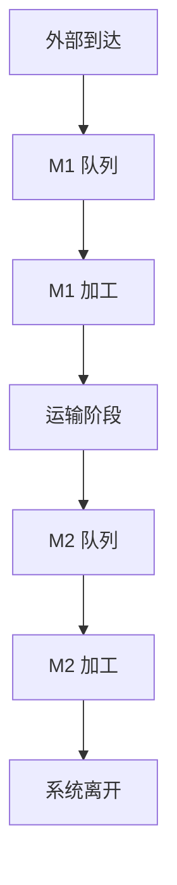
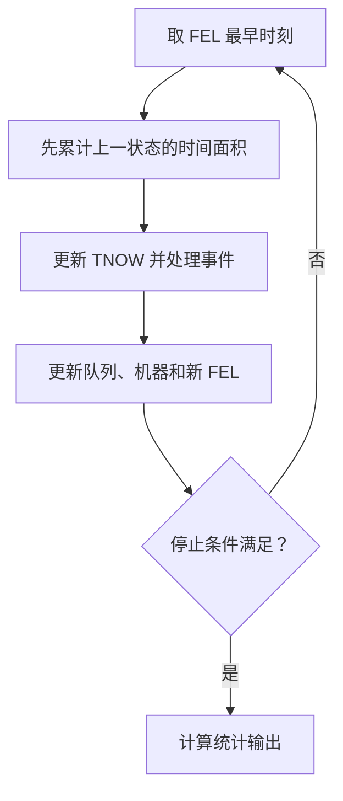

# 零件加工离散事件仿真｜从零理解模型、状态与事件

[专题首页](README.md) · [FEL 逐时刻推演](03-fel-ledger.md) · [统计指标详解](04-statistics-and-variants.md) · [四零件完整例题](01-tandem-four-parts.md)

## 1. 研究的不是“加工总时长”，而是加工系统如何随事件变化

假设四个零件进入车间，每个零件必须先在 M1 加工，然后运输 1 个时间单位，到达 M2 继续加工。两台机器各只能同时加工一个零件；机器忙时，零件按照先到先服务（FCFS）排队。这个系统的核心问题不是把所有加工时长相加，而是：<strong>在什么时刻，哪件零件占据哪台机器，哪件正在等待，下一件事会在什么时候发生？</strong>

离散事件仿真（Discrete-Event Simulation, DES）认为：系统状态只在某些事件时刻发生跳变。在相邻事件之间，如果没有其他连续动力学，机器忙闲和排队人数保持不变，因此可以直接把时钟跳到下一个事件，不需要每隔 0.01 个时间单位检查一次。

从上图可以直接判断：<strong>M1、M2 是串联两道工序，而非可替代的并行服务台</strong>。在 M1 完工的零件只是离开第一道工序；在 M2 完工后才真正离开整个系统。

## 2. 六个基础名词：实体、资源、队列、状态、事件、时钟

| 概念 | 本例的对象 | 容易产生的误解 |
| --- | --- | --- |
| 实体 Entity | 零件 1、2、3、4 | 零件不是资源，而是流经系统的加工对象 |
| 资源 Resource | M1 与 M2，每台容量 1 | 运输时间不等于占用机器的时间 |
| 队列 Queue | M1 前的 Q1、M2 前的 Q2 | 排队长度不包括正在加工的零件 |
| 系统状态 State | 机器忙闲、正在加工的编号、队列顺序、运输中零件 | 只记“当前有几件”不足以决定下一次服务对象 |
| 事件 Event | 到达机器、加工完成、运输到达、结束观察 | “开始加工”可以作为完成事件处理后的即时动作，不必额外安排同刻独立事件 |
| 仿真时钟 TNOW | 当前正在处理事件的时间点 | 它直接跳到下一事件，不要求匀速推进 |

完整状态可写成一个包含必要信息的元组（示意）：

`X(t)=(B₁(t),J₁(t),Q₁(t),B₂(t),J₂(t),Q₂(t),R(t)),`

其中 `B_k(t)` 为机器 `k` 的忙碌指示变量（忙为 1、闲为 0），`J_k(t)` 为正在加工的零件编号，`Q_k(t)` 是<strong>有序队列</strong>，`R(t)` 记录正在运输的零件及其预计到达时刻。若还需输出统计量，则另外维护累计队长面积、机器忙碌面积和每件零件的时间戳。

<strong>状态与统计量是两回事。</strong>“目前队里有 2 件”是当前状态；“从 0 到 10 平均队长为 1.2”是把历次状态按持续时间加权后得到的统计输出。

## 3. 用输入表生成到达事件

| 零件 | 到达间隔 `Δ_i` | 外部到达 M1 时刻 `A_i` | M1 时间 `S_(i1)` | M2 时间 `S_(i2)` |
| --- | ---: | ---: | ---: | ---: |
| 1 | 0 | 0 | 5 | 3 |
| 2 | 3 | 3 | 5 | 4 |
| 3 | 1 | 4 | 3 | 5 |
| 4 | 2 | 6 | 1 | 4 |

先用公式 `A_i=Σ_(j=1)^(i)Δ_j` 把到达间隔转成<strong>绝对时刻</strong>，得到 `0,3,4,6`。题目中的 M1/M2 加工时间是每件零件的服务时长，必须加到该件<strong>实际开始加工时刻</strong>上，才能得到完成事件的时间。

本例输入是固定数值，因此是一条<strong>确定性事件轨迹</strong>。离散事件仿真并不一定要使用随机数；当到达间隔或加工时长改为抽样值时，事件调度框架仍然相同，只是每次运行的轨迹可能不同。

## 4. 区分四类事件与一种即时动作

本例约定以下记号，第二个下标代表机器阶段：

| 事件 | 何时发生 | 发生后通常做什么 |
| --- | --- | --- |
| `A_(i1)` | 零件 `i` 外部到达 M1 | 若 M1 空闲则立刻开始，否则进入 Q1 |
| `D_(i1)` | 零件 `i` 加工完 M1 | 释放 M1；给下一件排队零件开工；安排 `A_(i2)` |
| `A_(i2)` | 零件 `i` 完成运输、到达 M2 | 若 M2 空闲则立刻开始，否则进入 Q2 |
| `D_(i2)` | 零件 `i` 加工完 M2 | 释放 M2；给下一件排队零件开工；计入系统离开 |
| 开始加工（即时动作） | 机器空闲且已有待加工零件 | 记录开工时刻，并安排未来的完工事件 |

运输时长为 `τ=1`，所以

`A_(i2)=D_(i1)+τ.`

<strong>只安排未来已确定的事情。</strong>例如零件 2 还在 M1 队列时，不知道它何时能开始加工，就不应该提前把它的 M1 完工时刻简单写成 `A₂+S_(21)=8`。它实际要等到 `t=5` 才开工，完工时刻是 `5+5=10`。

## 5. 未来事件表 FEL 是“待办清单”，不是历史流水账

FEL（Future Event List）记录<strong>已安排、尚未执行</strong>的事件，并按计划发生时刻排序。每次推进只做五件事：

1. 从 FEL 找到最早时刻 `t_(next)`。
2. 把当前队长和机器忙闲状态乘以 `Δ t=t_(next)-TNOW`，累加到时间面积。
3. 把 TNOW 更新为 `t_(next)`，取出该时刻的全部事件。
4. 执行事件、更新机器和队列；若有零件新开工，安排它的完工事件；若 M1 完工，安排运输后的 M2 到达事件。
5. 查看是否达到观察终止条件；否则继续。

典型例子：当 TNOW 从 4 跳到 5 时，<strong>时刻 4 事件处理之后的状态</strong>在 `[4,5)` 维持 1 个时间单位，应先累计队长面积，再执行时刻 5 的加工完成事件。不能先执行 t=5 的事件，再拿新的队长去乘过去的时间。

## 6. FCFS 规则、同时事件与“先处理谁”

FCFS = First Come, First Served，表示同一队列中<strong>先进入队列者先接受加工</strong>，通常不允许抢占。对本例特别重要的是 `t=15`：零件 3 已在 `t=14` 到达 M2 并等待；零件 2 于 `t=15` 完成 M2，而零件 4 恰好也于 `t=15` 到达 M2。机器释放时必须先加工已经排队的零件 3，零件 4 不能插队。

对于同一时刻的多个事件，实施程序应规定一致的处理顺序。例如本专题采取：<strong>先完成服务、让原有等待队列获得空闲机器，再处理新的到达</strong>。但真正的 FCFS 依据仍是到达和队列先后关系；不能误认为所有“完成事件”都天然具有与问题无关的优先级。

如果题目存在零时长服务、紧急优先级、机器故障、批量到达、多个工序分叉，则需要在模型规则里进一步说明同刻处理、抢占与资源分配机制。本例不包含这些变式。

## 7. 手算快捷递推：什么时候可以不用 FEL？

由于本例是固定顺序、单台机器、各阶段 FCFS、无故障与无超车，四件零件在两个阶段的顺序都为 `1,2,3,4`。因此可用递推公式快速核查：

`B_(i1)=max(A_i,D_(i-1,1)), D_(i1)=B_(i1)+S_(i1),`

`A_(i2)=D_(i1)+τ,`

`B_(i2)=max(A_(i2),D_(i-1,2)), D_(i2)=B_(i2)+S_(i2).`

其中第一件没有前一件，取对应机器初始可用时刻为 0。递推解得：

| 零件 | M1 开始 `B_(i1)` | M1 结束 `D_(i1)` | M2 到达 `A_(i2)` | M2 开始 `B_(i2)` | M2 结束 `D_(i2)` |
| --- | ---: | ---: | ---: | ---: | ---: |
| 1 | 0 | 5 | 6 | 6 | 9 |
| 2 | 5 | 10 | 11 | 11 | 15 |
| 3 | 10 | 13 | 14 | 15 | 20 |
| 4 | 13 | 14 | 15 | 20 | 24 |

这个递推是<strong>核对手算的捷径</strong>，不能替代所有系统中的 FEL：如果零件可能选择不同机器、改变工序顺序、发生设备故障或采用优先级，提前按编号写出上述递推未必正确。应先理解事件推进，再使用递推式核验。

## 8. 下一步学什么

把名词和事件规则弄清楚之后，按顺序阅读：[FEL 每一时刻怎么改](03-fel-ledger.md) → [完整双机加工时间线](01-tandem-four-parts.md) → [指标为什么这样算](04-statistics-and-variants.md) → [专题练习](exercises.md)。
