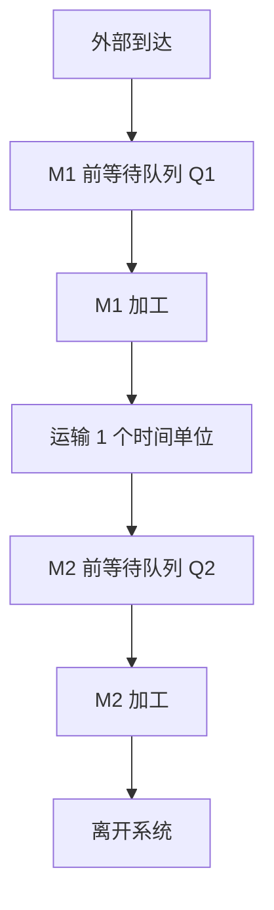
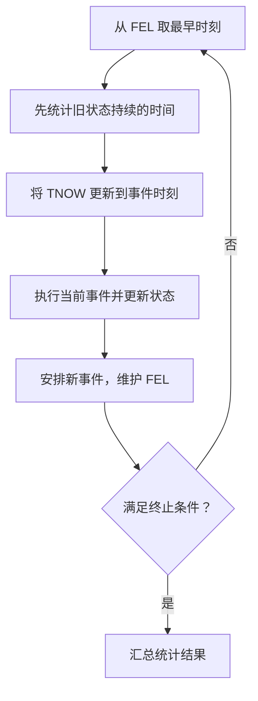
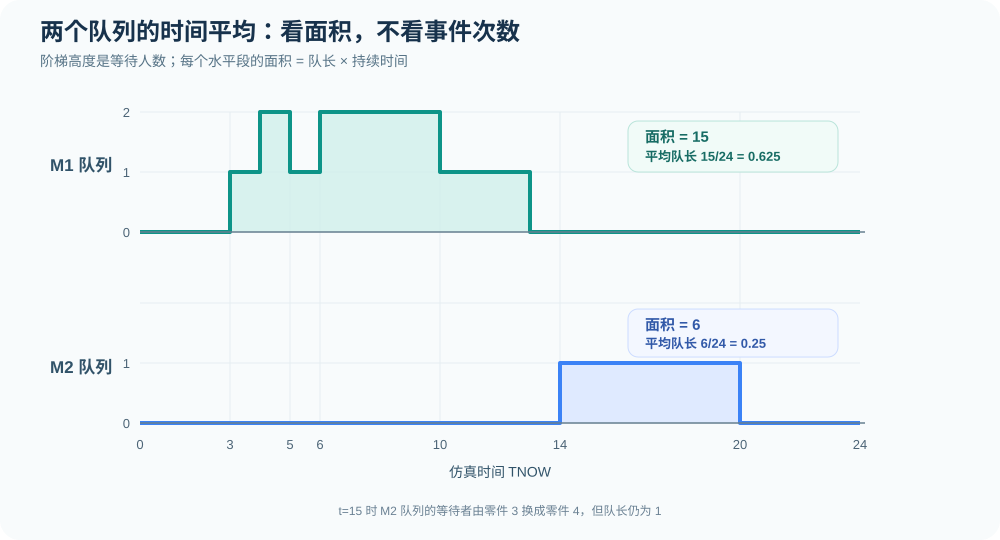
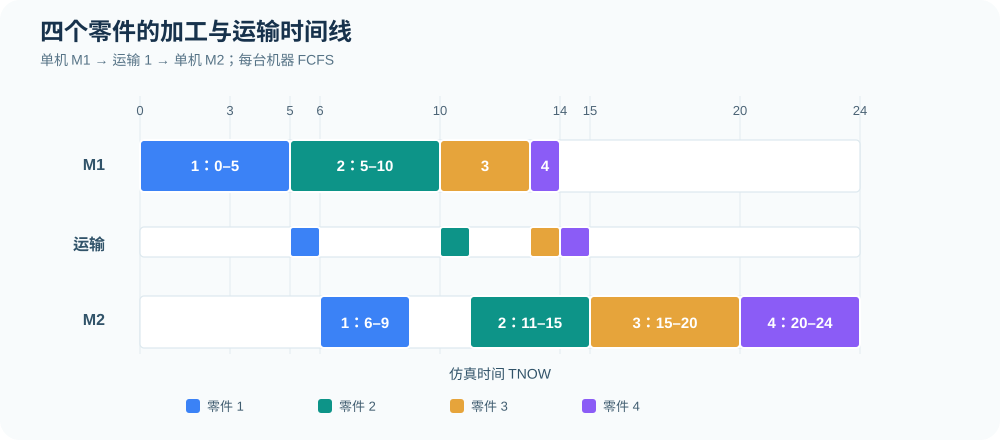

# 第 0 节｜从零件加工理解离散事件仿真

[专题目录](README.md) · [下一节：FEL 逐事件推演](03-fel-ledger.md) · [四零件完整算例](01-tandem-four-parts.md) · [统计量与变式](04-statistics-and-variants.md)

这一节先建立一套可以实际手算的事件调度方法。后面所有零件加工题，无论是单机、双机串联还是双服务台并行，都要回答同一组问题：实体什么时候到达，资源什么时候空闲，谁需要等待，下一次事件发生在什么时候，以及怎样从这一串事件求出系统绩效。

## 1. 为什么不能直接把加工时间相加

考虑四件零件。每件零件先在 M1 加工，经过 1 个时间单位的运输，再到 M2 加工，完成 M2 才离开系统。两台机器都只能同时加工一件零件，每道工序都按先到先服务（FCFS）安排加工。



这里有三个容易混淆的时间。

第一，<strong>加工时间</strong>是机器实际处理一件零件所花的时间。第二，<strong>等待时间</strong>是零件已经到达某台机器，但机器尚未轮到它时所花的时间。第三，<strong>运输时间</strong>发生在两道加工之间，它延迟零件抵达 M2，却不占用 M1 或 M2 的加工能力。

因此，一件零件在系统内停留多久，不能只计算两台机器的加工时间；它可能在两台机器前各排一次队。另一方面，M1 和 M2 可以在同一时刻加工不同零件，因而整个车间完成四件零件的历时，也不能简单等于所有加工时长之和。

离散事件仿真（Discrete-Event Simulation，DES）就是沿着实际发生的事件，逐次还原上述过程。它适合描述状态在特定时刻改变的系统，例如生产线、仓储拣货、医院挂号和计算机任务处理。

## 2. 系统的边界、实体、资源和队列

读题时，先区分哪些对象会流动，哪些对象提供服务。

| 概念 | 在本题中的含义 | 手算时需要记录什么 |
| --- | --- | --- |
| 实体（Entity） | 零件 1 至零件 4 | 编号、到达时间、各阶段开始与完成时间 |
| 资源（Resource） | M1、M2 两台机器 | 忙或闲、正在加工哪件零件 |
| 等待队列（Queue） | Q1、Q2 | 等待零件的编号及先后顺序 |
| 活动（Activity） | 加工、运输 | 起始时刻、持续时间、结束时刻 |
| 事件（Event） | 外部到达、加工完成、运输抵达 | 计划发生时刻、事件类型、零件编号 |
| 系统边界 | 从零件外部到达到 M2 完工离开 | 整个系统的进入与离开时刻 |

在这道串联题中，零件 1 完成 M1 只是<strong>结束第一道工序</strong>，它还没有离开系统。只有完成 M2 时，才能把该零件计入系统的完工数量。

### 2.1 串联和并行不是同一种模型

| 结构 | 零件经过机器的方式 | 典型规则 |
| --- | --- | --- |
| 单机 | 每件零件只经过 M1 | 机器空闲就从队首取件 |
| 双机并行 | 每件零件在 M1、M2 中选择一台 | 可能存在“空闲时 M1 优先”的规则 |
| 双机串联 | 每件零件先 M1，再 M2 | 两道工序缺一不可，可能各有独立队列 |

判断模型结构的依据是零件实际需要经过哪些工序，而不是题目中出现了几台机器。与本节不同，“两台服务台并行、M1 优先”对应另一套资源分配规则，可参见[并行服务台模型](../notes/02-discrete-event-queue.md)。

## 3. 三个容易混淆的概念：状态、事件和活动

### 3.1 状态描述的是“此刻怎么样”

假设在时刻 4，零件 1 正在 M1 上加工，零件 2、3 已到达并排队，M2 尚未收到任何零件。那么此刻的系统状态可以表述为：

| 状态项目 | 时刻 4 的内容 |
| --- | --- |
| M1 | 忙，正在加工零件 1 |
| Q1 | `[2,3]`，2 在队首 |
| 运输中 | 无 |
| M2 | 闲 |
| Q2 | 空 |

只记录“系统里一共有三件零件”，不足以确定下一件应该由谁加工。因为后续调度还依赖队列顺序、机器占用情况以及已经安排的完工时刻。

可将状态写成：

```math
X(t)=\bigl(B_{1}(t),J_{1}(t),Q_{1}(t),R(t),B_{2}(t),J_{2}(t),Q_{2}(t)\bigr)
```

其中，B 表示机器忙闲，忙取 1、闲取 0；J 表示正在加工的零件编号；Q 表示有序等待队列；R 表示运输中零件及其预计抵达时刻。空闲机器的 J 可以记为空值。

上式只是一个方便理解的状态组织方式。程序中的完整可用信息还包括未来事件表，以及每件零件已知的服务时间和记录的时间戳。队长、忙闲和队列顺序属于当前状态；累计等待时间、累计忙碌面积则属于统计量，二者不能混为一谈。

### 3.2 事件描述的是“在什么时候发生了变化”

在时刻 5，零件 1 完成 M1。这是一个事件。处理该事件后，会发生三件事：M1 释放资源，等待队首的零件 2 立刻开始加工，零件 1 进入运输阶段。

“零件 2 开始加工”在本节的事件调度写法中，是<strong>处理完工事件时立即执行的动作</strong>，不另设一个未来事件。开始加工后，才有条件安排零件 2 的未来完工事件。

### 3.3 活动发生在两个事件之间

零件 1 在时刻 0 开始 M1 加工，在时刻 5 完工。加工活动持续整个 `[0,5)` 区间。在这五个时间单位里，机器持续忙碌，但没有必要逐秒触发五次事件。

这就是离散事件仿真的基本特征：<strong>仿真时钟跳转到下一次事件时刻，而机器忙闲等离散状态在相邻事件之间保持不变</strong>。如果模型包含连续变化量，才需要额外描述连续动态，本题不涉及。

## 4. 先把到达间隔变成绝对到达时刻

本题的原始输入如下。所有时间都使用同一单位。

| 零件 i | 到达间隔 Δ | M1 加工时间 | M2 加工时间 |
| ---: | ---: | ---: | ---: |
| 1 | 0 | 5 | 3 |
| 2 | 3 | 5 | 4 |
| 3 | 1 | 3 | 5 |
| 4 | 2 | 1 | 4 |

“到达间隔”指当前零件与上一件零件相隔多久，不是相对零时刻的到达时间。第一件在 0 到达，以后依次累加。

```math
A_{i}=\sum_{j=1}^{i}\Delta_{j}
```

所以四件零件到达 M1 的时刻分别为：

```math
\begin{aligned}
A_{1}&=0 \\
A_{2}&=0+3=3 \\
A_{3}&=3+1=4 \\
A_{4}&=4+2=6
\end{aligned}
```

| 零件 | 到达间隔 | 绝对到达时刻 |
| ---: | ---: | ---: |
| 1 | 0 | 0 |
| 2 | 3 | 3 |
| 3 | 1 | 4 |
| 4 | 2 | 6 |

第 2 件零件在时刻 3 到达，此时 M1 正在加工零件 1，因此它需要等待。第 3 件在时刻 4 到达，也需要等待。加工时间表中的“5”只是第 2 件被 M1 实际加工后需要的时间，不能把它直接加到到达时刻 3 上，误写成时刻 8 完工。

本例所有间隔和服务时间都是给定常数，得到的是一条确定性的事件轨迹。离散事件仿真并不要求每次都随机抽样；如果将这些输入改为随机变量，事件调度规则仍然成立，只是不同重复运行可能产生不同轨迹。

## 5. 四种基本事件，以及每种事件后的动作

采用两个下标的记法：第一个下标表示零件编号，第二个下标表示所在机器阶段。A 表示到达，D 表示加工完成。

| 事件记号 | 含义 | 处理规则 |
| --- | --- | --- |
| `A(i,1)` | 零件 i 从外部到达 M1 | M1 空闲则立刻开工；否则入 Q1 |
| `D(i,1)` | 零件 i 在 M1 加工完成 | 释放 M1，让 Q1 队首开工；为零件 i 安排运输后的 M2 到达 |
| `A(i,2)` | 零件 i 完成运输并到达 M2 | M2 空闲则立刻开工；否则入 Q2 |
| `D(i,2)` | 零件 i 在 M2 加工完成 | 释放 M2，让 Q2 队首开工；记录零件 i 离开整个系统 |

每当某件零件在机器 k 上开始加工，都记录开始时刻，并安排其未来的完工事件：

```math
D_{ik}=B_{ik}+S_{ik}
```

其中 B 为开始加工时刻，S 为对应服务时长，D 为完工时刻。零件完成 M1 之后，尚须经历固定运输时间，因而有：

```math
A_{i2}=D_{i1}+\tau,\qquad \tau=1
```

举例说明：零件 1 于时刻 5 完成 M1。此时应安排 `A(1,2)` 于时刻 6 发生，而不是让它在时刻 5 直接占用 M2。零件 2 于时刻 5 开始 M1，加工时间为 5，所以为它安排 `D(2,1)` 于时刻 10 发生。

## 6. 未来事件表 FEL 到底怎样工作

FEL 是 Future Event List，即未来事件表。它的作用与按时间排序的待办清单相似：只保存<strong>已经确定发生时刻、但尚未执行</strong>的事件。

这里要严格区分两个概念：FEL 是未来计划；已执行过的事件应记录在事件历史或状态表中，不应继续留在 FEL。某件零件尚未开始加工，就不能凭它的到达时刻直接确定完工事件。

### 6.1 两种等价的外部到达安排方式

由于本题的全部到达时刻已知，可以在初始化时把四个外部到达事件全部放进 FEL。也可以只预先放入第一件的到达事件，并在处理每次外部到达时安排下一件到达。只要每个到达事件恰好安排一次，结果相同。

为了理解“事件引出新事件”的过程，这一节采用<strong>逐次生成下一次外部到达</strong>的方式。初始化时：

| TNOW | 尚未处理的 FEL |
| ---: | --- |
| 0，处理前 | `A(1,1) @ 0` |

如果题目要求在时刻 10 截止，还可以预先安排一个 `END @ 10`。END 是观察终止控制事件，不是零件的到达或加工事件；在时刻 10 还有其他事件时，必须事先约定先处理该时刻的业务事件还是先截断。

### 6.2 从时刻 0 推到时刻 6

下面区分事件发生前的计划和事件处理后留下的计划。

| TNOW | 本次执行的事件 | 本次更新 | 处理之后 FEL 中的后续事件 |
| ---: | --- | --- | --- |
| 0 | 零件 1 到达 M1 | M1 开工零件 1；安排零件 2 到达 | `A(2,1) @ 3`，`D(1,1) @ 5` |
| 3 | 零件 2 到达 M1 | M1 忙，零件 2 入 Q1；安排零件 3 到达 | `A(3,1) @ 4`，`D(1,1) @ 5` |
| 4 | 零件 3 到达 M1 | M1 忙，零件 3 入 Q1；安排零件 4 到达 | `D(1,1) @ 5`，`A(4,1) @ 6` |
| 5 | 零件 1 完成 M1 | 零件 2 从 Q1 取出加工；零件 1 进入运输 | `A(4,1) @ 6`，`A(1,2) @ 6`，`D(2,1) @ 10` |
| 6 | 零件 4 到达 M1；零件 1 到达 M2 | 零件 4 入 Q1；M2 开工零件 1 | `D(1,2) @ 9`，`D(2,1) @ 10` |

在时刻 4，虽然已知零件 2 和零件 3 正在等待，但并没有为零件 3 安排 M1 完工事件。因为它实际开始加工的时刻还没出现。直到零件 2 在时刻 10 完工，零件 3 才能从队首开工，此时才能确定零件 3 将于时刻 13 完成 M1。

### 6.3 TNOW 推进时，五个动作按什么顺序做



严格的顺序是：先用此前的状态累计上一个时间区间，再处理新事件。把这两个动作颠倒，就会把新队长误认为它在过去一段时间内一直存在。

例如，在时刻 4 处理完零件 3 的到达事件后，Q1 中有零件 2、3 共两件。下一事件在时刻 5，所以队长 2 持续了一个时间单位，对队长面积贡献为 `2×(5−4)=2`。到时刻 5，零件 1 完工，零件 2 离开队列转入加工，Q1 才减少为 1；不能用新队长 1 去乘 `[4,5)` 的时间。

## 7. 同一时刻发生两个事件，怎样处理

离散事件仿真中允许多个事件具有相同时间戳。本题在时刻 6 和时刻 15 都有这一情况。

时刻 6，零件 4 到达 M1，同时零件 1 完成运输到达 M2。两个事件操作不同机器和不同队列，因此在本题的规则下，先处理哪个都不改变最后的加工时刻。

时刻 15 则不同：零件 2 在 M2 完工，零件 4 恰好到达 M2。此前零件 3 已在时刻 14 到达 M2，并在 Q2 中等待。

| 时刻 15 的对象 | 事件处理之前的情况 | 事件处理之后的情况 |
| --- | --- | --- |
| M2 | 正在加工零件 2 | 零件 2 完工，随即加工零件 3 |
| Q2 | 零件 3 正在等待 | 零件 3 出队，零件 4 入队 |
| 零件 4 | 运输中，预计在 15 抵达 | 到达 M2，因机器忙而排队 |

因此，零件 3 在 M2 的加工区间是 `[15,20)`，零件 4 是 `[20,24)`。零件 4 不能因为“刚好与完工事件同刻到达”而越过已经排队的零件 3。

手算时可以采用以下一致约定：同一时刻先执行完工和资源释放，让已经存在的队列按 FCFS 获得资源，再处理新到达。若一个模型允许同刻批量到达、零时长服务或者特殊优先级，还要进一步明确同刻并列的排序规则。这里的约定服务于本题，并不是所有离散事件模型通用的优先级定理。

## 8. 统计量：一个是“按件平均”，一个是“按时间平均”

这是手工仿真计算题中最需要保持清楚的区别。事件表负责还原发生了什么；统计量负责回答系统运行得怎样。

### 8.1 每件零件的等待时间和系统逗留时间

对零件 i，在机器 k 的等待时间是“开始加工减去到达该机器”的时间：

```math
W_{q,ik}=B_{ik}-A_{ik}
```

整个系统的逗留时间为 M2 完工时刻减去最初到达 M1 的时刻：

```math
W_i=D_{i2}-A_{i1}
```

把一件零件从进入到离开的经历拆开，还可以得到：

```math
W_i=W_{q,i1}+S_{i1}+\tau+W_{q,i2}+S_{i2}
```

这个等式有很强的检查作用。如果左右两边不等，往往是漏记运输、把等待和加工混在一起，或者错用了时间戳。

本题四件零件的完整结果如下。具体逐事件推导见[四零件完整例题](01-tandem-four-parts.md)。

| 零件 | M1 等待 | M1 加工 | 运输 | M2 等待 | M2 加工 | 系统逗留 |
| ---: | ---: | ---: | ---: | ---: | ---: | ---: |
| 1 | 0 | 5 | 1 | 0 | 3 | 9 |
| 2 | 2 | 5 | 1 | 0 | 4 | 12 |
| 3 | 6 | 3 | 1 | 1 | 5 | 16 |
| 4 | 7 | 1 | 1 | 5 | 4 | 18 |

四件都完工之后，平均系统逗留时间是：

```math
\overline{W}=\frac{9+12+16+18}{4}=13.75
```

这个平均值的分母是<strong>参与本次完整统计的四件零件</strong>，不是仿真运行的总时长。

### 8.2 为什么平均队长要计算曲线下面积

队列长度随事件发生而变化，但两次事件之间保持不变。对观察区间 `[0,T]`，时间平均队长定义为：

```math
\overline{Q}_{k}=\frac{1}{T}\int_{0}^{T}Q_{k}(t)\,dt
```

实际手算时，把队长曲线分成若干水平阶梯即可。若某段时间队长为 q、持续了 Δt，那么这一段贡献的面积为 `q×Δt`。

本题在 `[0,10)` 中，M1 队列经历以下变化：

| 时间区间 | Q1 等待零件 | 队长 | 持续时间 | 队长面积 |
| --- | --- | ---: | ---: | ---: |
| `[0,3)` | 无 | 0 | 3 | 0 |
| `[3,4)` | 2 | 1 | 1 | 1 |
| `[4,5)` | 2、3 | 2 | 1 | 2 |
| `[5,6)` | 3 | 1 | 1 | 1 |
| `[6,10)` | 3、4 | 2 | 4 | 8 |
| 合计 | — | — | 10 | 12 |

因此：

```math
\overline{Q}_{1,[0,10]}=\frac{0+1+2+1+8}{10}=1.2
```

这里的 1.2 不是“随机挑一次事件时队伍平均有 1.2 件”，而是“在整个 10 个时间单位内，按持续时间加权的平均等待人数为 1.2”。事件时刻间隔不均匀，所以不能直接把每次事件后的队长相加，再除以事件数量。



若一直运行到时刻 24，所有零件均已离开，则 M1 队长面积为 15，M2 队长面积为 6，故：

```math
\overline{Q}_{1,[0,24]}=\frac{15}{24}=0.625,
\qquad
\overline{Q}_{2,[0,24]}=\frac{6}{24}=0.25
```

### 8.3 机器利用率同样是时间平均

机器利用率的分子是观察窗口内该机器实际忙碌的时间，分母是同一个观察窗口的总时长。用前文定义的忙碌指示变量，可以直接写成时间积分：

```math
\rho_k=\frac{1}{T}\int_{0}^{T}B_k(t)\,dt
```

以完整运行窗口 `[0,24]` 为例，M1 从时刻 0 连续忙至 14，忙碌 14 个时间单位；M2 在 `[6,9)`、`[11,15)`、`[15,20)`、`[20,24)` 忙碌，合计 16 个时间单位。

```math
\rho_1=\frac{14}{24}\approx58.33\%,
\qquad
\rho_2=\frac{16}{24}\approx66.67\%
```

利用率可以分别按 `[0,10]`、`[0,24]` 等窗口计算，但分子必须与选定窗口一致。比如在 `[0,10]` 内，M1 忙碌 10 个时间单位，利用率为 100%；M2 只在 `[6,9)` 忙碌 3 个时间单位，利用率为 30%。

### 8.4 系统内人数的守恒检查

任意时刻，系统中的零件可能位于五类位置：Q1 等待、M1 加工、运输中、Q2 等待、M2 加工。因此系统内零件总数应满足：

```math
N(t)=Q_1(t)+B_1(t)+R_n(t)+Q_2(t)+B_2(t)
```

这里 `R_n(t)` 表示运输中的零件数；因为每台机器容量为 1，忙碌指示变量 B 恰好也等于该台机器正在处理的零件数。

将上式在 `[0,24]` 积分，可以得到五部分面积：

| 位置 | 零件累计停留时间（即时间面积） |
| --- | ---: |
| Q1 等待 | 15 |
| M1 加工 | 14 |
| 运输中 | 4 |
| Q2 等待 | 6 |
| M2 加工 | 16 |
| 合计 | 55 |

四件零件的系统逗留时间之和也恰好是 `9+12+16+18=55`，两种计算方式一致：

```math
\int_0^{24}N(t)\,dt
=15+14+4+6+16
=\sum_{i=1}^{4}W_i
=55
```

这是本题最有用的整体核查之一：若事件表推算的总逗留时间与各位置的累计占用面积不一致，说明至少有一段时间被遗漏或重复计入。

## 9. 为什么有时能用递推公式快速手算

未来事件表是一种通用的仿真组织方式。但这道题还有一个特殊性：每道工序都只有一台机器，所有零件按相同顺序经过两道工序，不会发生故障、超车或抢占。于是可以用递推关系得到各零件的开始与完成时刻，再与 FEL 推演相互核对。

先看 M1。零件 i 只能在自己到达之后，并且上一件零件已经完成 M1 时开始加工，所以开始时刻是这两个时间中的较大者：

```math
B_{i1}=\max\left(A_{i1},D_{i-1,1}\right)
```

再把本件零件的加工时长加上去：

```math
D_{i1}=B_{i1}+S_{i1}
```

零件从 M1 完工后，经过运输抵达 M2；M2 的开始时刻取决于它自身抵达时间和前一件的 M2 完工时间：

```math
\begin{aligned}
A_{i2}&=D_{i1}+\tau \\
B_{i2}&=\max\left(A_{i2},D_{i-1,2}\right) \\
D_{i2}&=B_{i2}+S_{i2}
\end{aligned}
```

对于第一件零件，不存在“上一件”，可令两台机器初始可用时刻均为 0，或者直接单独计算第一件的开始时刻。

以零件 3 为例：它在时刻 4 到达 M1，但零件 2 到时刻 10 才完成 M1，因此零件 3 只能在 10 开始，13 完工；再运输 1 个单位，于 14 到达 M2。而零件 2 要到时刻 15 才完成 M2，所以零件 3 在 15 才能开始 M2，加工 5 个单位，在 20 完工。

```math
\begin{aligned}
B_{31}&=\max(4,10)=10,\quad D_{31}=10+3=13\\
A_{32}&=13+1=14\\
B_{32}&=\max(14,15)=15,\quad D_{32}=15+5=20
\end{aligned}
```

对四件零件计算，可得完整加工时间表：

| 零件 | M1 到达 | M1 开始 | M1 结束 | M2 到达 | M2 开始 | M2 结束 |
| ---: | ---: | ---: | ---: | ---: | ---: | ---: |
| 1 | 0 | 0 | 5 | 6 | 6 | 9 |
| 2 | 3 | 5 | 10 | 11 | 11 | 15 |
| 3 | 4 | 10 | 13 | 14 | 15 | 20 |
| 4 | 6 | 13 | 14 | 15 | 20 | 24 |



递推式适合本例的简单、固定顺序系统，但并不能替代所有 FEL 计算。若零件在 M1 和 M2 中择一加工、具有不同优先级、机器可能故障、或者某个工序允许抢占服务，服务顺序可能由运行中的状态决定，不能直接按编号递推。

## 10. 终止时刻怎么选，决定了题目能算什么

同一道题常会要求“模拟到时刻 10”或者“直到所有零件完成”。这两种任务对应的输出并不相同。

| 观察窗口 | 时刻结束时的情况 | 可以直接给出的结果 |
| --- | --- | --- |
| `[0,10]` | 只有零件 1 完成整个系统；其他仍在系统内 | 当前状态、已完成数、这段时间的平均队长和机器利用率 |
| `[0,24]` | 四件零件全部完成，系统清空 | 每件完整等待和逗留时间、总体平均值、全程队长与利用率 |

例如，时刻 10 处理完零件 2 的 M1 完工事件后，零件 3 刚开始 M1，零件 2 正准备运输，零件 4 仍在 Q1 中。此时不能把零件 2 记作整个系统完成；也不能把尚未观察到的零件 4 的完整等待时间填成 0。

若研究目标是截至时刻 10 的排队表现，统计面积与利用率均除以 10。若研究目标是所有零件完成后的完整逗留表现，则应继续推演到时刻 24。<strong>统一分母比套用任何公式都重要。</strong>

此外，这是一条有限、确定性的加工轨迹。把它的 `4/24` 当作本次运行的实际完成率是可以的；但不能凭这一条轨迹就推断长期稳态吞吐量、稳态平均队长或其置信区间。后者还需要随机输入模型、足够的运行长度和统计分析设计。

## 11. 手算之前，先检查这六件事

| 检查项 | 本题答案 | 如果忽略会怎样 |
| --- | --- | --- |
| 数据是到达间隔还是到达时刻 | 给的是间隔，需累计为 0、3、4、6 | 后续所有事件时刻错位 |
| 两台机器是什么结构 | 串联，先 M1 后 M2 | 把一件零件错误分配到单台机器就离开 |
| 排队规则是什么 | 两道工序各自 FCFS | 时刻 15 可能错误插队 |
| 运输是否占用机器 | 不占用 M1、M2 | 利用率和后续到达时间错误 |
| 下一事件怎么确定 | 从 FEL 中取最早时刻 | 在零件尚未开始加工时提前安排完工 |
| 统计到什么时刻 | 题目指定的截止时刻或最后完工时刻 | 把 10 与 24 的统计分母混用 |

到这里应能独立解释：为什么零件 2 在时刻 3 到达，却在 5 才开始 M1；为什么零件 1 完成 M1 后，M2 的第一道到达事件发生在 6；为什么时刻 15 零件 3 优先于零件 4；以及为什么队长必须按时间积分，而不是按发生事件的次数平均。

下一节进入[逐事件 FEL 记录](03-fel-ledger.md)，将整个过程中的每一次 TNOW 推进、机器状态变化、队列更新和新事件安排全部写成表格。随后再阅读[四零件完整例题](01-tandem-four-parts.md)及[统计量与变式](04-statistics-and-variants.md)。
