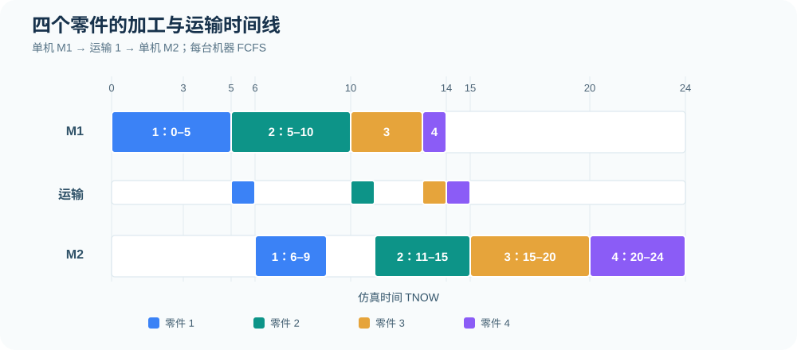
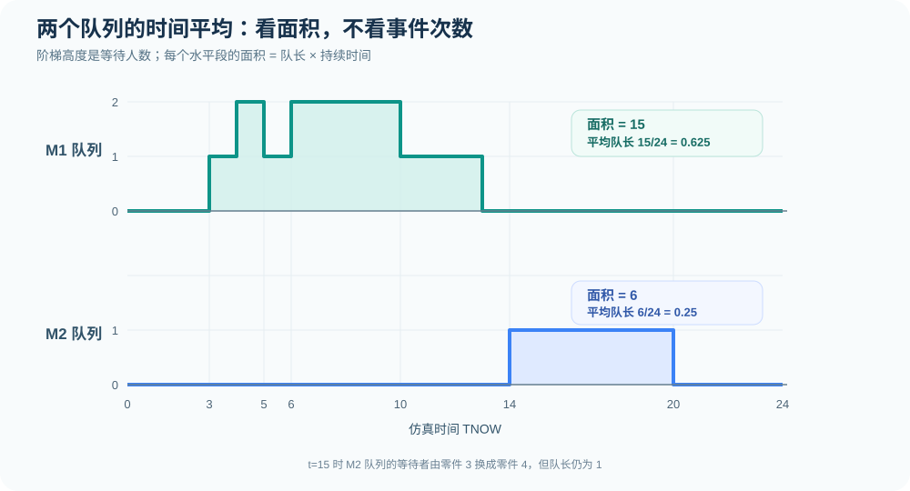

# 例题 A｜四个零件经过 M1、M2 的串联加工：完整事件调度

[专题首页](README.md) · [配套练习](exercises.md) · [单机截尾例题](02-single-machine-five-parts.md) · [运行代码](../examples/tandem_parts_event_simulation.py)

## 1. 题目与规则

四个零件依次到达加工系统，必须先在机器 M1 上加工，随后经过 1 个时间单位的运输，再进入机器 M2 的加工环节。M1、M2 各只有一台机器，各自有独立的 FCFS（先进先出）队列，不允许抢占加工。

| 零件 $i$ | 到达间隔 $\Delta_i$ | 到达时刻 $A_i$ | M1 加工时长 $S_{i1}$ | M2 加工时长 $S_{i2}$ |
| --- | ---: | ---: | ---: | ---: |
| 1 | 0 | 0 | 5 | 3 |
| 2 | 3 | 3 | 5 | 4 |
| 3 | 1 | 4 | 3 | 5 |
| 4 | 2 | 6 | 1 | 4 |

到达时刻通过累计间隔得到：

$$A_1=0,\quad A_2=0+3=3,\quad A_3=3+1=4,\quad A_4=4+2=6.$$

这个模型是**双阶段串联（Tandem Queue）**，而不是双服务台并行。每个零件都必须完成两道加工，运输期间既不占用 M1，也不占用 M2。

## 2. TNOW、FEL 和事件记号

TNOW 是当前仿真时钟；未来事件表（Future Event List, FEL）只保留**已经安排但尚未发生**的事件。

| 记号 | 含义 | 例子 |
| --- | --- | --- |
| $A_{i1}$ | 零件 $i$ 到达 M1 | $A_{21}$：零件 2 于时刻 3 到达 M1 |
| $D_{i1}$ | 零件 $i$ 在 M1 完成加工 | $D_{11}$：零件 1 于时刻 5 完成 M1 |
| $A_{i2}$ | 零件 $i$ 运输结束、到达 M2 | $A_{12}$：零件 1 于时刻 6 到达 M2 |
| $D_{i2}$ | 零件 $i$ 在 M2 完成，离开整个系统 | $D_{12}$：零件 1 于时刻 9 离开 |

运输时间固定为 $\tau=1$，因此

$$\boxed{A_{i2}=D_{i1}+\tau}.$$

如果使用 $t=10$ 作为观察截止时刻，可在 FEL 中另放一个 `END(10)`。本例约定：**同一时刻先处理服务完成和已存在队列，再处理新到达；在 $t=10$ 的事件完成后记录系统状态并结束观察。**若要计算全部四个零件的完整逗留时间，则继续运行，直到最后一个零件离开 M2。

## 3. 先推 M1：零件按 FCFS 排队

M1 的服务区间完全由到达时刻和 FCFS 决定：

| 零件 | 到达 M1 | 开始 M1 | 完成 M1 | M1 等待 |
| --- | ---: | ---: | ---: | ---: |
| 1 | 0 | 0 | 5 | 0 |
| 2 | 3 | 5 | 10 | 2 |
| 3 | 4 | 10 | 13 | 6 |
| 4 | 6 | 13 | 14 | 7 |

对零件 $i$，令 $B_{i1}$ 为开始加工时刻，$D_{i1}$ 为完成时刻，则

$$W_{q1,i}=B_{i1}-A_i,\qquad D_{i1}=B_{i1}+S_{i1}.$$

因此 M1 的等待时间向量是 $(0,2,6,7)$，总等待为 15，平均等待 $15/4=3.75$。

## 4. 再推 M2：必须加上运输时间

每个零件从 M1 完工后经过 1 个单位时间才到达 M2：到达时刻为 $(6,11,14,15)$。

| 零件 | 到达 M2 | 开始 M2 | 完成 M2 | M2 等待 |
| --- | ---: | ---: | ---: | ---: |
| 1 | 6 | 6 | 9 | 0 |
| 2 | 11 | 11 | 15 | 0 |
| 3 | 14 | 15 | 20 | 1 |
| 4 | 15 | 20 | 24 | 5 |

**最关键的同刻事件发生在 $t=15$。**零件 2 在 M2 完工，零件 4 刚到 M2；但零件 3 从 $t=14$ 就已在队列中等待。因此机器先取零件 3，加工到 $t=20$，零件 4 继续等候。这不是“零件 4 在 15 到达就直接占用机器”。

## 5. 逐事件推进总表

这里把同一时刻的事件合并成一行。队列写为事件处理后的等待零件序列，不包括正在加工的零件。

| TNOW | 发生的事件 | M1 的处理与状态 | M1 队列 | M2 的处理与状态 | M2 队列 |
| ---: | --- | --- | --- | --- | --- |
| 0 | $A_{11}$ | 零件 1 加工，完成于 5 | 空 | 空闲 | 空 |
| 3 | $A_{21}$ | 零件 1 继续加工 | 2 | 空闲 | 空 |
| 4 | $A_{31}$ | 零件 1 继续加工 | 2, 3 | 空闲 | 空 |
| 5 | $D_{11}$ | 零件 2 开始加工，完成于 10 | 3 | 空闲；零件 1 在运输 | 空 |
| 6 | $A_{41},A_{12}$ | 零件 2 继续加工 | 3, 4 | 零件 1 开始加工，完成于 9 | 空 |
| 9 | $D_{12}$ | 零件 2 继续加工 | 3, 4 | 空闲；零件 1 离开系统 | 空 |
| 10 | $D_{21}$ | 零件 3 开始加工，完成于 13 | 4 | 空闲；零件 2 在运输 | 空 |
| 11 | $A_{22}$ | 零件 3 继续加工 | 4 | 零件 2 开始加工，完成于 15 | 空 |
| 13 | $D_{31}$ | 零件 4 开始加工，完成于 14 | 空 | 零件 2 继续加工；零件 3 在运输 | 空 |
| 14 | $D_{41},A_{32}$ | M1 空闲；零件 4 在运输 | 空 | 零件 2 继续加工 | 3 |
| 15 | $D_{22},A_{42}$ | 空闲 | 空 | 零件 3 开始加工，完成于 20 | 4 |
| 20 | $D_{32}$ | 空闲 | 空 | 零件 4 开始加工，完成于 24 | 空 |
| 24 | $D_{42}$ | 空闲 | 空 | 空闲；四件全部完工 | 空 |

### 5.1 时刻 5 的未来事件表

零件 1 完成 M1，零件 2 开始 M1，零件 1 进入运输。因此新的未来事件包括：

| 计划时刻 | 事件 |
| ---: | --- |
| 6 | 零件 4 到达 M1（$A_{41}$） |
| 6 | 零件 1 到达 M2（$A_{12}$） |
| 10 | 零件 2 完成 M1（$D_{21}$） |
| 10 | 观察截止（若设 `END(10)`） |

同一时刻的两个到达事件发生在不同机器上，在本题设定下处理顺序不改变后续结果。但编程时仍应定义稳定一致的同刻处理规则。

### 5.2 时刻 10 的截面状态

如果观察窗口只到 $t=10$，在处理 $D_{21}$ 后，零件 1 已于 9 完成整个系统；零件 2 刚完成 M1、正准备运输；零件 3 在 M1 开始加工；零件 4 仍等待 M1。**不能把零件 2 完成 M1 记成整个系统完工。**

## 6. 一张时间线核对整个过程

图中每种颜色对应一个零件；运输时间单独表示。M1 与 M2 在某些时刻可以同时加工**不同零件**，但同一个零件必须按 M1→运输→M2 的顺序通过系统。

## 7. 统计结果：先分清截止时间

### 7.1 只观察 $[0,10]$

在 $[0,10]$ 内，M1 始终忙碌（先加工零件 1，再加工零件 2），故利用率为

$$\rho_{M1}^{[0,10]}=\frac{10}{10}=\boxed{100\%}.$$

M2 仅在 $[6,9)$ 加工零件 1，共忙碌 3 个时间单位：

$$\rho_{M2}^{[0,10]}=\frac3{10}=\boxed{30\%}.$$

M1 队长在区间 $[3,4),[4,5),[5,6),[6,10)$ 分别为 $1,2,1,2$，其时间积分面积为

$$\int_0^{10}Q_1(t)\,dt=1\times1+2\times1+1\times1+2\times4=12.$$

所以

$$\boxed{\overline Q_1^{[0,10]}=\frac{12}{10}=1.2}.$$

该窗口内 M2 没有排队者，所以 $\overline Q_2^{[0,10]}=0$。仅有零件 1 完成整个系统，其他零件尚未全部离开；此时不应直接把“所有零件完整逗留时间”作为已观察输出。

### 7.2 运行至所有零件完成（$T=24$）

| 零件 | 系统到达 | M1 等待 | M1 加工 | 运输 | M2 等待 | M2 加工 | 系统离开 | 系统逗留 |
| --- | ---: | ---: | ---: | ---: | ---: | ---: | ---: | ---: |
| 1 | 0 | 0 | 5 | 1 | 0 | 3 | 9 | 9 |
| 2 | 3 | 2 | 5 | 1 | 0 | 4 | 15 | 12 |
| 3 | 4 | 6 | 3 | 1 | 1 | 5 | 20 | 16 |
| 4 | 6 | 7 | 1 | 1 | 5 | 4 | 24 | 18 |

每个零件的系统逗留时间满足

$$W_i=W_{q1,i}+S_{i1}+\tau+W_{q2,i}+S_{i2}.$$

平均系统逗留时间为

$$\boxed{\overline W=\frac{9+12+16+18}{4}=13.75}.$$

M1、M2 累计忙碌时间分别是 $5+5+3+1=14$ 与 $3+4+5+4=16$，所以

$$\boxed{\rho_{M1}=\frac{14}{24}\approx58.33\%,\qquad\rho_{M2}=\frac{16}{24}\approx66.67\%}.$$

M1 总排队时间 $0+2+6+7=15$，M2 总排队时间 $0+0+1+5=6$。因为初始为空且最后已全部清空，队列曲线下的面积恰好等于相应零件等待时间之和：

$$\boxed{\overline Q_1=\frac{15}{24}=0.625,\qquad\overline Q_2=\frac6{24}=0.25}.$$

### 7.3 用守恒关系检查结果

四个零件的总系统逗留时间为 $9+12+16+18=55$。从 $0$ 到 $24$，系统内实体数量 $N(t)$ 的时间面积也是 55。因此

$$\overline N=\frac{55}{24}\approx2.2917.$$

在这一条**初始为空、最终清空**的完整轨迹上，实际完成率为 $4/24$，所以 $(4/24)\times13.75=55/24$，与上式一致。这是有限观测窗口内的守恒核查，不代表已经估计了稳态平均人数。

## 8. 最容易出错的地方

| 误区 | 正确处理 |
| --- | --- |
| 把到达间隔 $0,3,1,2$ 当成到达时刻 | 先累计，得到 $0,3,4,6$ |
| M1 完工后零件立刻到 M2 | 要再加运输时间 1 |
| M1 完工就计入全系统完成 | 必须在 M2 完成后才离开 |
| 时刻 15 零件 4 抢先上 M2 | 零件 3 已在队列，先加工零件 3 |
| 平均队长按事件次数取平均 | 用 $\int Q(t)dt/T$，按持续时间加权 |
| 将 $t=10$ 指标与 $T=24$ 指标混在一起 | 明确观察窗口和是否清空系统 |
| 认为串联 M1、M2 是两个可替代服务台 | 串联要求每个零件两道工序都完成 |

**练习入口：**[事件调度专项练习与完整答案](exercises.md)。
