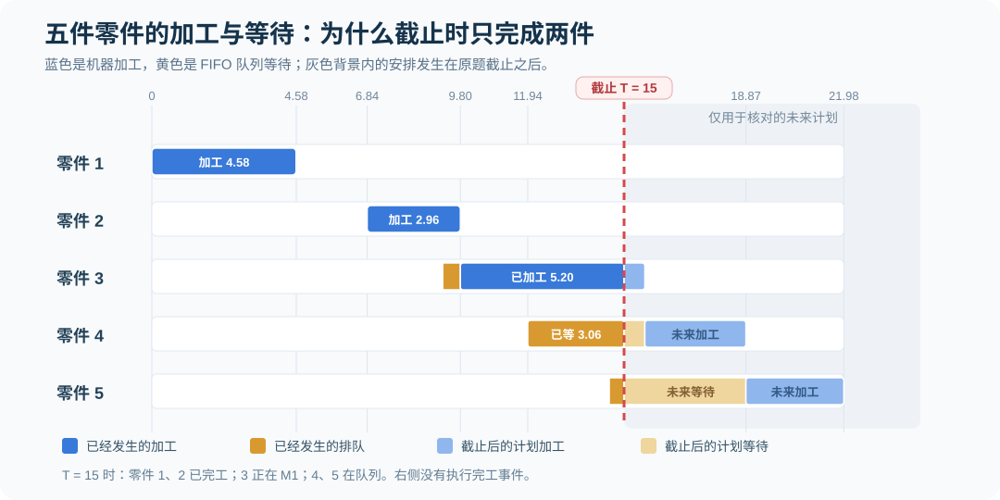
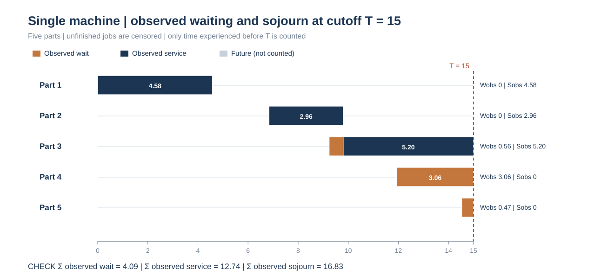
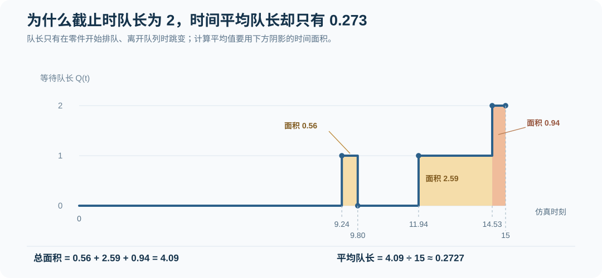
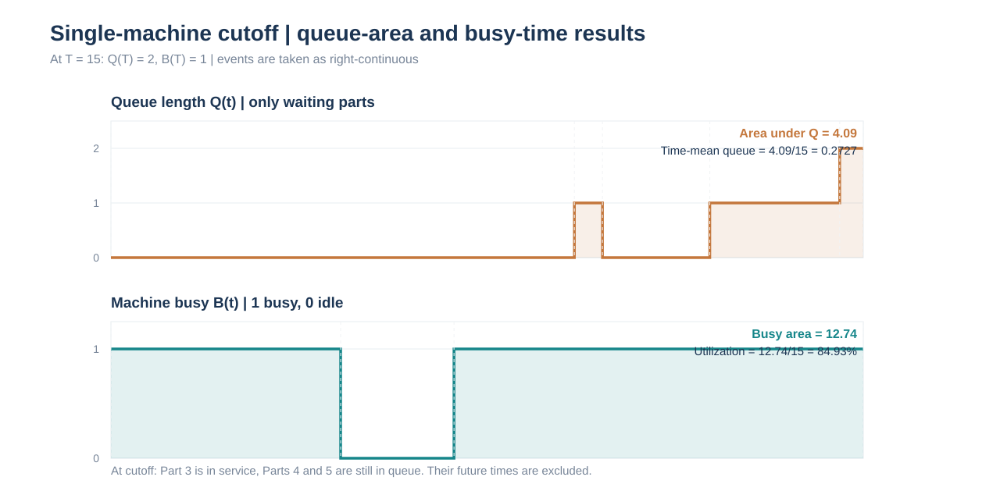

# 第 4 节｜单机五零件 FIFO：截止时还有零件未完工

[专题目录](README.md) · [上一节：统计指标与截尾](04-statistics-and-variants.md) · [事件表的建立方法](03-fel-ledger.md) · [专题练习](exercises.md)

双机串联例题可以一直运行到所有零件离开；这道题规定仿真只进行到时刻 15。届时机器还在加工零件，后面另有两件零件等待。因此，事件推进本身并不复杂，真正需要区分的是：到达、开始服务、完成服务是三种不同的事件，统计它们时不能混用同一个样本集合。

本节先推导 FIFO 加工顺序和未来事件表，再对截止时刻的状态、队长面积、机器利用率及等待时间逐一核算。文末将暂时延长运行至全部完工，作为检查截尾统计的参照。延长部分不属于原题在时刻 15 的计算结果。

> [本题完整 FEL 快照、每段队长面积与机器忙碌面积核算](../exam-review/2026-event-complete-fel-ledger.md)——特别区分截止时刻后仍在 FEL 内的未执行完工事件。

## 1. 系统规则与原始数据

五件零件依次进入只有一台加工机器 M1 的系统。到达时若机器空闲，零件立即开始加工；若机器忙碌，零件进入等待队列。队列遵守先进先出（First In, First Out，FIFO）规则，机器一次只能加工一件，加工开始后不允许中断。零件加工完成就离开系统，无须经过第二台机器。


机器空闲且队列非空时，应立即取队首零件加工，不允许人为插入空闲时间。后到的零件即使加工时间较短，也不能超越先到的零件。原题给出了确定的到达和加工时间，不需要再抽取随机数。

本题终止条件是固定时钟：

```math
T=15
```

这不同于“等五件全部加工完成再停止”。在时刻 15 之后已经排定、但尚未发生的完工事件，不能计入本次仿真的完成件数或机器忙碌时间。

| 零件 | 到达间隔 | 累计到达时刻 | M1 所需加工时间 |
| ---: | ---: | ---: | ---: |
| 1 | 0.00 | 0.00 | 4.58 |
| 2 | 6.84 | 6.84 | 2.96 |
| 3 | 2.40 | 9.24 | 5.86 |
| 4 | 2.70 | 11.94 | 3.21 |
| 5 | 2.59 | 14.53 | 3.11 |

到达间隔是相邻两件零件到达时刻之差，不是绝对仿真时刻。记第 i 件的到达间隔为 Iᵢ、绝对到达时刻为 Aᵢ，则：

```math
A_1=I_1=0,\qquad A_i=A_{i-1}+I_i\quad(i\geq 2)
```

本例依次得到：

```math
\begin{aligned}
A_1&=0\\
A_2&=0+6.84=6.84\\
A_3&=6.84+2.40=9.24\\
A_4&=9.24+2.70=11.94\\
A_5&=11.94+2.59=14.53
\end{aligned}
```

如果将 `0、6.84、2.40、2.70、2.59` 直接当成绝对到达时刻，零件顺序就会改变，后面的等待时间和队长也不再属于原题。

## 2. 加工开始和完成时间怎样推算

对 FIFO 单机、无故障、无抢占的系统，已知到达时刻 Aᵢ 和加工时间 Sᵢ，便可以递推计算开始加工时刻 Bᵢ 和完工时刻 Dᵢ。

```math
\begin{aligned}
B_1&=A_1\\
B_i&=\max(A_i,D_{i-1})\qquad(i\geq2)\\
D_i&=B_i+S_i\\
W_{q,i}&=B_i-A_i\\
W_i&=D_i-A_i
\end{aligned}
```

Bᵢ 取“自己已经到达”和“前一件已经加工完成”两个时刻中较晚的一个。若 Aᵢ 晚于上一件完工，机器必须空闲等待下一件到达；若 Aᵢ 早于上一件完工，零件必须排队。

### 2.1 零件 1：机器从零时刻开始加工

零件 1 在 0 到达，机器起初空闲，因而立即开始加工。加工耗时 4.58，在时刻 4.58 完成。

```math
B_1=0,\qquad D_1=0+4.58=4.58
```

### 2.2 零件 2：到达之前机器已经空闲

机器在 4.58 完成零件 1；零件 2 直到 6.84 才到达，机器在 `[4.58,6.84)` 空闲了 2.26 个时间单位。零件 2 无须排队，加工从 6.84 开始，在 9.80 完工。

```math
\begin{aligned}
B_2&=\max(6.84,4.58)=6.84\\
D_2&=6.84+2.96=9.80
\end{aligned}
```

### 2.3 零件 3：到达时零件 2 仍在加工

零件 3 在 9.24 到达，零件 2 需要加工到 9.80，所以零件 3 等待 `9.80−9.24=0.56`。零件 2 离开后，零件 3 在 9.80 开始加工，预计到 15.66 才能完成。

```math
\begin{aligned}
B_3&=\max(9.24,9.80)=9.80\\
W_{q,3}&=9.80-9.24=0.56\\
D_3&=9.80+5.86=15.66
\end{aligned}
```

因此截止于 15 时，零件 3 已经加工了 `15−9.80=5.20`，还剩 `15.66−15=0.66` 个时间单位未完成。它在截止时正在机器内，而不是已经完工。

### 2.4 零件 4、5：依次进入等待队列

零件 4 于 11.94 到达，零件 5 于 14.53 到达。在这两个时刻，M1 都正在加工零件 3。按照 FIFO，零件 4 排在零件 5 前面。

若机器继续运行、不在 15 停止，则未来的计划时间为：

```math
\begin{aligned}
B_4&=\max(11.94,15.66)=15.66\\
D_4&=15.66+3.21=18.87\\
B_5&=\max(14.53,18.87)=18.87\\
D_5&=18.87+3.11=21.98
\end{aligned}
```

以上是<strong>假设继续运行时的计划</strong>。原题在 15 截止，零件 4 和零件 5 均未开始加工，因而其完整等待时间还不能作为已经结束观察的统计量。



### 截止窗口内每件零件的“实际已发生”时间



橙色只表示截至 `15` 已经发生的排队，深蓝表示截至 `15` 实际占用机器的加工；图中不将截止之后计划发生的时间冒充为观察结果。零件 3 虽未完工，但已等待 `0.56`、已加工 `5.20`，因此当前已观察逗留是 `5.76`；零件 4、5 尚未开工，其已观察逗留分别为 `3.06` 和 `0.47`。

五件零件已观察的排队时间合计为 `0+0+0.56+3.06+0.47=4.09`，已观察加工时间合计为 `4.58+2.96+5.20=12.74`，已观察逗留时间合计为 `16.83`。<strong>这三个数是 `[0,15]` 观察窗口的已发生时间总和，不能混作已完工零件的平均系统逗留。</strong>

## 3. 用未来事件表 FEL 逐事件推进

递推式可以事先核算加工时间；考试如果要求写出仿真过程，还应当体现事件调度：从未来事件表取出最早事件，将 TNOW 推进到它的发生时刻，更新机器和队列状态，再插入新产生的事件。

这里约定：初始化时安排零件 1 的到达事件和截止事件 END；每执行一次到达事件，再安排下一件的到达；加工开始时安排相应完工事件。FEL 始终按绝对发生时刻升序排列。

| TNOW | 刚执行的事件 | M1 事件后状态 | FIFO 队列（事件后） | 事件后的 FEL（时间升序） |
| ---: | --- | --- | --- | --- |
| 0.00 | 零件 1 到达 | 加工 1，预计 4.58 结束 | 空 | `D1@4.58, A2@6.84, END@15` |
| 4.58 | 零件 1 完工并离开 | 空闲 | 空 | `A2@6.84, END@15` |
| 6.84 | 零件 2 到达 | 加工 2，预计 9.80 结束 | 空 | `A3@9.24, D2@9.80, END@15` |
| 9.24 | 零件 3 到达 | 继续加工 2 | `[3]` | `D2@9.80, A4@11.94, END@15` |
| 9.80 | 零件 2 完工；3 从队列开始加工 | 加工 3，预计 15.66 结束 | 空 | `A4@11.94, END@15, D3@15.66` |
| 11.94 | 零件 4 到达 | 继续加工 3 | `[4]` | `A5@14.53, END@15, D3@15.66` |
| 14.53 | 零件 5 到达 | 继续加工 3 | `[4,5]` | `END@15, D3@15.66` |
| 15.00 | 仿真截止 END | 加工 3 尚未完成 | `[4,5]` | `D3@15.66` 尚未执行 |

在 9.24，零件 3 到达，但零件 2 仍在加工，不能让零件 3 直接开工。在 9.80 执行零件 2 的完工事件后，才能开始加工零件 3，并将 D3@15.66 加入 FEL。

在 14.53 的 FEL 中，END@15 排在 D3@15.66 前面。因此下一事件是 END，而不是零件 3 完工。未来事件表中存在某项计划，不代表对应的事件已经执行。

### 3.1 如果完工与截止恰好同刻

原题的完工时刻 15.66 晚于 15，不存在同刻冲突。其他题目可能规定“执行截止时刻的业务事件后再记录状态”，此时恰好在 15 完成的零件应计入完工；若明确要求在 15 时刻之前终止、完全不执行 15 事件，结论会不同。此类边界规则几乎不影响持续时间面积，却会影响截止时的完工计数与状态快照。

## 4. 截止于 15 的系统状态

下表把已经发生的加工、等待与未来计划分开。零件 4、5 的未来完工时刻用于说明加工顺序，不属于 T=15 时已经完成的事件。

| 零件 | 外部到达 | 开始加工 | 完工时刻 | 截止时状态 | 已发生的排队等待 | 已发生的加工时间 |
| ---: | ---: | ---: | ---: | --- | ---: | ---: |
| 1 | 0.00 | 0.00 | 4.58 | 已离开 | 0 | 4.58 |
| 2 | 6.84 | 6.84 | 9.80 | 已离开 | 0 | 2.96 |
| 3 | 9.24 | 9.80 | 15.66（未来） | 正在 M1 加工 | 0.56 | 5.20 |
| 4 | 11.94 | 尚未开始 | 18.87（未来） | 正在排队 | 3.06 | 0 |
| 5 | 14.53 | 尚未开始 | 21.98（未来） | 正在排队 | 0.47 | 0 |

| 截止时的统计口径 | 件数 | 包含的零件 |
| --- | ---: | --- |
| 已到达 | 5 | 1、2、3、4、5 |
| 已开始加工 | 3 | 1、2、3 |
| 已完成加工并离开 | 2 | 1、2 |
| 正在加工 | 1 | 3 |
| 正在排队 | 2 | 4、5 |
| 仍在系统内 | 3 | 3、4、5 |

因此截至时刻 15，已完工件数为 2，截止时队长为 2，系统内零件数为 3，机器状态为忙碌。截止时队长为 2 是某一时刻的截面值，并不等于观察期的时间平均队长。

## 5. 时间平均队长：计算阶梯图下的面积

设 Q(t) 是时刻 t 正在队列中等待的零件数，不包括正在 M1 加工的零件。时间平均队长的定义为：

```math
\overline Q_{[0,15]}=\frac{1}{15}\int_0^{15}Q(t)\,dt
```

### 5.1 按队长发生变化的时刻切区间

| 时间区间 | 正在等待的零件 | 队长 Q | 持续时间 | 队长面积贡献 |
| --- | --- | ---: | ---: | ---: |
| `[0,9.24)` | 无 | 0 | 9.24 | 0 |
| `[9.24,9.80)` | 3 | 1 | 0.56 | 0.56 |
| `[9.80,11.94)` | 无 | 0 | 2.14 | 0 |
| `[11.94,14.53)` | 4 | 1 | 2.59 | 2.59 |
| `[14.53,15)` | 4、5 | 2 | 0.47 | 0.94 |
| 合计 | — | — | 15.00 | 4.09 |

第一行可以合并为 `[0,9.24)`，因为虽然其间发生机器开工、零件 1 完工及零件 2 到达等事件，队长一直是 0。计算队长面积时，只需要按队长变化时刻切分。

最后一行容易漏算：时刻 14.53 之后队列里同时有零件 4、5，队长为 2，因此面积是 `2×(15−14.53)=0.94`，不能只记成 0.47。





上图把两个分母完全一致、统计对象不同的指标放在一起核查：上方 <code>Q(t)</code> 的阶梯面积为 `4.09`，故 `[0,15]` 的时间平均队长是 `4.09/15≈0.2727`；下方机器忙闲函数 <code>B(t)</code> 的面积是 `12.74`，故机器利用率为 `12.74/15≈84.93%`。排队人数不含正在加工的零件，故截止时 `Q(15)=2` 而 `B(15)=1`；两条曲线不能混为系统内总人数。


由此：

```math
\begin{aligned}
\int_0^{15}Q(t)\,dt
&=1\times(9.80-9.24)\\
&\quad+1\times(14.53-11.94)\\
&\quad+2\times(15-14.53)\\
&=0.56+2.59+0.94=4.09
\end{aligned}
```

```math
\overline Q_{[0,15]}=\frac{4.09}{15}\approx0.2727
```

时间平均队长可以小于 1，即使截止时队列里有 2 件零件。它的含义是“在整个 15 个时间单位内，按时间加权平均有约 0.273 件零件在排队”，并不表示某个时刻存在分数件零件。

### 5.2 用逐件已经发生的等待重新核对

另一种算法沿着零件而不是沿着时间横轴计算：零件 3 已等待 0.56，零件 4 从 11.94 到 15 已等待 3.06，零件 5 从 14.53 到 15 已等待 0.47。

```math
0.56+3.06+0.47=4.09
```

两种算法完全相等：一边按时间区间叠加排队人数，一边将相同的等待面积分配给具体零件。这是这条有限轨迹的面积恒等式，不需要额外假设系统达到稳态。

零件 4、5 的 3.06 和 0.47 是截至时刻 15 已经发生的等待；由于它们仍在排队，不能将其解释为完整等待时间，也不能因为尚未开工便记为 0。

## 6. 机器利用率：未完工零件也已经占用了机器

单机利用率在固定观察窗口内，等于机器忙碌时间占观察时长的比例。机器在 `[0,4.58)` 加工零件 1，在 `[4.58,6.84)` 空闲，从 6.84 到 15 一直忙碌，其中包括零件 2 的全部加工，以及零件 3 截止前已经发生的加工。

| 时间区间 | 机器状态 | 时长 | 忙碌贡献 |
| --- | --- | ---: | ---: |
| `[0,4.58)` | 加工零件 1 | 4.58 | 4.58 |
| `[4.58,6.84)` | 空闲 | 2.26 | 0 |
| `[6.84,9.80)` | 加工零件 2 | 2.96 | 2.96 |
| `[9.80,15)` | 加工零件 3 | 5.20 | 5.20 |
| 合计 | — | 15.00 | 12.74 |

```math
\begin{aligned}
T_{\mathrm{busy}}&=4.58+2.96+5.20=12.74\\
T_{\mathrm{idle}}&=6.84-4.58=2.26\\
\rho_{[0,15]}&=\frac{12.74}{15}\approx84.93\%
\end{aligned}
```

可用 `12.74+2.26=15` 检查忙碌与空闲时长是否完整。若只计算已经完工的零件 1、2，会误得 `7.54/15≈50.27%`，漏掉零件 3 截止前实际占用机器的 5.20 个时间单位。

## 7. 把队长面积和利用率写在一张统计寄存器表里

实际做事件调度时，每次 TNOW 从上一事件推进到下一事件之前，可以先用“上一事件执行后的状态 × 两事件之间的时长”累计统计量，然后再执行新事件。

记 C_Q 为累计队长面积，C_B 为累计机器忙碌时间。下表中 Q 和 B 均为整段内的固定状态；B=1 表示机器忙碌。

| 时间区间 | Q | B | Δt | 本段 Q×Δt | 本段 B×Δt | 累计 C_Q | 累计 C_B |
| --- | ---: | ---: | ---: | ---: | ---: | ---: | ---: |
| `[0,4.58)` | 0 | 1 | 4.58 | 0 | 4.58 | 0 | 4.58 |
| `[4.58,6.84)` | 0 | 0 | 2.26 | 0 | 0 | 0 | 4.58 |
| `[6.84,9.24)` | 0 | 1 | 2.40 | 0 | 2.40 | 0 | 6.98 |
| `[9.24,9.80)` | 1 | 1 | 0.56 | 0.56 | 0.56 | 0.56 | 7.54 |
| `[9.80,11.94)` | 0 | 1 | 2.14 | 0 | 2.14 | 0.56 | 9.68 |
| `[11.94,14.53)` | 1 | 1 | 2.59 | 2.59 | 2.59 | 3.15 | 12.27 |
| `[14.53,15)` | 2 | 1 | 0.47 | 0.94 | 0.47 | 4.09 | 12.74 |

最终得到 `C_Q=4.09` 和 `C_B=12.74`，分别除以 15 就是时间平均队长和利用率。机器上是否有零件、队列里是否有零件，都可以在同一张表中跟踪，但不能把加工中的零件也放进等待队长 Q。

## 8. 系统内人数与“平均等待”的统计分母

这道题的系统只含一条等待队列与一台机器，因此任意时刻的系统内零件数为：

```math
N(t)=Q(t)+B(t)
```

系统人数面积等于两类状态面积之和：

```math
\begin{aligned}
\int_0^{15}N(t)\,dt&=4.09+12.74=16.83\\
\overline N_{[0,15]}&=\frac{16.83}{15}=1.122
\end{aligned}
```

也可以对每件已经到达的零件，计算“从到达到本次观察结束或实际离开为止”的已观测系统逗留。

| 零件 | 系统进入时刻 | 本窗口观察结束的有效时刻 | 已观测逗留时间 |
| ---: | ---: | ---: | ---: |
| 1 | 0.00 | 4.58 | 4.58 |
| 2 | 6.84 | 9.80 | 2.96 |
| 3 | 9.24 | 15.00 | 5.76 |
| 4 | 11.94 | 15.00 | 3.06 |
| 5 | 14.53 | 15.00 | 0.47 |
| 合计 | — | — | 16.83 |

于是 `4.58+2.96+5.76+3.06+0.47=16.83`，与 `4.09+12.74` 相等。零件 3、4、5 的已观测逗留不是未来完整逗留；它们尚未离开系统。

### 8.1 同一题可以有三种不同的平均等待口径

若只统计截止时已经完工的零件，零件 1、2 的完整排队等待均为 0，所以“已完工零件的平均排队等待”是 0。

若统计截止时已经开始加工的零件，零件 1、2、3 的完整排队等待分别为 `0、0、0.56`，所以：

```math
\overline W_{q,\mathrm{started}}=\frac{0+0+0.56}{3}\approx0.1867
```

如果把五件已到达零件截至 15 的已发生等待相加再除以 5，则得到 `4.09/5=0.818`。它描述的是“每件已到达零件平均已经累计了多少等待”，不是五件零件的平均完整等待时间，因为零件 4、5 的等待尚未结束。

三个数字各有清楚的样本定义，不能不注明样本集合就统一写成“平均等待时间”。

### 8.2 截止时已完工零件的平均系统逗留

只有零件 1、2 在截止前完成加工，因此按已完工零件计算的平均系统逗留为：

```math
\overline W_{\mathrm{completed}}=\frac{4.58+2.96}{2}=3.77
```

不能把五件零件的已观测逗留直接当成完整逗留。若题目不明确“平均逗留”的样本范围，必须区分已完成样本平均、截至时已观测时间，还是运行至全部完成的完整平均。

### 8.3 到达与离开的流量守恒

截止时已到达 5 件、离开 2 件，因此仍有 3 件在系统内：零件 3 正在加工，零件 4、5 在队列。计数核对为：

```math
N(15)=N(0^-)+A_{[0,15]}-D_{[0,15]}=0+5-2=3
```

这里 N(0⁻) 指时刻 0 的第一件零件到达之前，系统起初为空。窗口内实际完工率为 `2/15≈0.1333 件/时间单位`，外部到达计数率为 `5/15≈0.3333 件/时间单位`。二者不同是正常现象，因为截止时系统还没有清空，不能直接把有限窗口的两个比率当成稳态到达率与吞吐率。

## 9. 如果取消截止，继续运行至全部完工

这一节只为核对 FIFO 和截尾面积，不是原题 T=15 的结果。

| 时刻 | 假设继续运行后的事件 | 事件后机器 | 事件后队列 |
| ---: | --- | --- | --- |
| 15.00 | 原题截止点；假设不停止 | 加工 3 | `[4,5]` |
| 15.66 | 零件 3 完工，零件 4 开始 | 加工 4 | `[5]` |
| 18.87 | 零件 4 完工，零件 5 开始 | 加工 5 | 空 |
| 21.98 | 零件 5 完工 | 空闲 | 空 |

完整时间表为：

| 零件 | 到达 A | 开始 B | 完工 D | 完整等待 B−A | 完整逗留 D−A |
| ---: | ---: | ---: | ---: | ---: | ---: |
| 1 | 0.00 | 0.00 | 4.58 | 0 | 4.58 |
| 2 | 6.84 | 6.84 | 9.80 | 0 | 2.96 |
| 3 | 9.24 | 9.80 | 15.66 | 0.56 | 6.42 |
| 4 | 11.94 | 15.66 | 18.87 | 3.72 | 6.93 |
| 5 | 14.53 | 18.87 | 21.98 | 4.34 | 7.45 |
| 合计 | — | — | — | 8.62 | 28.34 |

原题截止于 15 时，队长面积为 4.09；若继续运行，零件 4 还要等待 0.66，零件 5 还要等待 3.87。新增面积是 `0.66+3.87=4.53`，故完整队长面积为 `4.09+4.53=8.62`。

机器在 15 后还需要加工 `0.66+3.21+3.11=6.98` 个时间单位，完整运行忙碌时间为 `12.74+6.98=19.72`。由此得到另一套观察终点下的指标：

```math
\begin{aligned}
\overline W_{\mathrm{full}}&=\frac{28.34}{5}=5.668\\
\overline Q_{[0,21.98]}&=\frac{8.62}{21.98}\approx0.3922\\
\rho_{[0,21.98]}&=\frac{19.72}{21.98}\approx89.72\%\\
\overline N_{[0,21.98]}&=\frac{28.34}{21.98}\approx1.2894
\end{aligned}
```

这组完整运行指标与 T=15 的 `完工 2 件、平均队长约 0.2727、利用率约 84.93%` 对应的是不同的观察终止条件，不能混写在同一栏答案里。

## 10. 三种变式的处理方法

### 10.1 截止时刻改为 9.80

时刻 9.80 恰好发生零件 2 完工。若约定先执行当时刻业务事件、再记录状态，则零件 2 已离开，零件 3 已开始加工。完工件数为 2，截面队长为 0，但队长面积不是 0：零件 3 在 `[9.24,9.80)` 已经等待了 0.56。

```math
\begin{aligned}
\overline Q_{[0,9.80]}&=\frac{0.56}{9.80}\approx0.0571\\
\rho_{[0,9.80]}&=\frac{4.58+2.96}{9.80}\approx76.94\%
\end{aligned}
```

因此截止时队列为空，不代表观察期内没有任何等待。

### 10.2 截止时刻改为 15.66

继续仿真到 15.66，先执行零件 3 完工事件：零件 3 已离开，零件 4 从队列开始加工，队列中只剩零件 5。此时完工 3 件，截止队长为 1。

在 `[15,15.66)`，机器一直忙碌，队长一直为 2，故：

```math
\begin{aligned}
C_Q(15.66)&=4.09+2\times0.66=5.41\\
C_B(15.66)&=12.74+0.66=13.40\\
\overline Q_{[0,15.66]}&=\frac{5.41}{15.66}\approx0.3455\\
\rho_{[0,15.66]}&=\frac{13.40}{15.66}\approx85.57\%
\end{aligned}
```

时刻 15.66 的完工及下一件开工是瞬时状态变化，不会凭空产生额外的队长或忙碌时间面积。

### 10.3 零件 3 的加工时间由 5.86 增至 6.86

只改变零件 3 的加工时间，零件 3 仍在 9.80 开工，预计完工由 15.66 推迟到 16.66。由于原题固定在 T=15 截止，从 9.80 到 15 的机器占用并未变化，零件 4、5 截止时仍然在队列中，因此队长面积仍为 4.09，忙碌时间仍为 12.74。

计划加工时间延长，并不意味着固定截止时刻之前已经发生的忙碌时间必然增加。只有把观察时间延长至相关事件发生以后，影响才会逐步传递到后续零件的开工与完工时刻。

## 11. 六道练习与逐题解析

### 题 1：到达间隔与绝对时刻

题目：零件 2、3、4、5 的到达间隔依次为 `6.84、2.40、2.70、2.59`。写出对应的绝对到达时刻。

标准答案：`6.84、9.24、11.94、14.53`。

解析：到达间隔要累计。第 3 件时刻是 `6.84+2.40=9.24`，第 4 件是 `9.24+2.70=11.94`，第 5 件是 `11.94+2.59=14.53`。FEL 采用绝对仿真时刻，不能写成 `A3@2.40`。

### 题 2：零件 3 何时开始与完成

题目：零件 3 在 9.24 到达、零件 2 在 9.80 完工、零件 3 加工耗时 5.86。求零件 3 的开工、等待、计划完工时刻，以及截止前是否完成。

标准答案：开工 9.80，等待 0.56，计划完工 15.66，截止 15 时尚未完工。

解析：FIFO 下必须等上一件完成才能轮到零件 3，加工从 9.80 开始，等待 `9.80−9.24=0.56`，完工计划 `9.80+5.86=15.66>15`。

### 题 3：原题三个主要统计结果

题目：截止 T=15，求已完工件数、时间平均队长和机器利用率。

标准答案：完工 2 件；时间平均队长 `4.09/15≈0.2727`；利用率 `12.74/15≈84.93%`。

解析：只有零件 1、2 完工。队长面积 `0.56+2.59+0.94=4.09`；机器忙碌时间为 `4.58+2.96+5.20=12.74`，其中 5.20 是零件 3 截止前已发生的加工。

### 题 4：为什么排队中的零件不能记为等待 0

题目：零件 4、5 截止时尚未开始加工。若计算观察窗内队长面积，两件零件应贡献多少等待？

标准答案：零件 4 为 3.06；零件 5 为 0.47。

解析：两件从各自到达一直排队到 15，已经发生的等待分别为 `15−11.94=3.06` 和 `15−14.53=0.47`。完整等待还没有结束，但观察窗内已发生的部分必须计入面积。

### 题 5：系统在制品数如何交叉检查

题目：截止时到达 5 件、完工 2 件；队长面积 4.09、机器忙碌面积 12.74。求截止系统人数及时间平均系统人数。

标准答案：截止系统内 3 件；时间平均系统人数 `16.83/15=1.122`。

解析：流量守恒给出 `5−2=3`。系统内只有排队和加工两种占用状态，人数面积为 `4.09+12.74=16.83`，再除以窗口长度 15。

### 题 6：改变截止时刻

题目：截止时刻延长到 15.66，并约定先执行完工再记录状态。求已完工件数、截止队长、时间平均队长。

标准答案：完工 3 件；截止队长 1；时间平均队长 `5.41/15.66≈0.3455`。

解析：零件 3 在 15.66 完工，零件 4 开工，零件 5 继续排队。从 15 到 15.66 队长保持 2，新增队长面积 `2×0.66=1.32`，累计面积 `4.09+1.32=5.41`。

---

本题的确定性加工顺序与截尾统计也可通过[单机 FIFO 复核程序](../examples/single_machine_five_parts_event_simulation.py)独立重算。程序同时输出固定截止 T=15 与运行到全部完工两种情况，便于逐项核查事件表、状态面积及统计分母。
