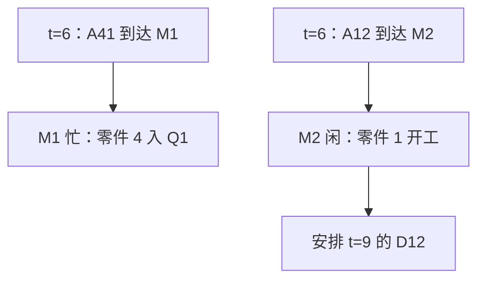

# 四零件串联题：TNOW 与未来事件表 FEL 的每一步

[专题首页](README.md) · [先看基本概念](00-concepts-and-rules.md) · [完整结果](01-tandem-four-parts.md) · [统计量计算](04-statistics-and-variants.md)

这份笔记只解决一个问题：<strong>已经有一张到达及加工时间表，下一张事件表到底如何写？</strong>阅读时建议拿纸遮住最右列，独立推算后再对照。

## 1. 先固定约定，保证两个人会算出同一张表

四件零件到达 M1 的时间为 `(0,3,4,6)`；M1 加工时长 `(5,5,3,1)`；M2 加工时长 `(3,4,5,4)`；运输恒为 1；两台机器分别使用 FCFS 队列。记号：

- `A11`：零件 1 到达 M1，公式写作 `A_(11)`；`D11`：零件 1 完成 M1。
- `A12`：零件 1 完成运输到达 M2；`D12`：零件 1 完成 M2，离开系统。
- 其余 `A21`、`D21`、`A22`、`D22` 等按相同规则命名。

队列 `[2,3]` 表示零件 2 在前、零件 3 在后；不包含正在加工的零件。机器状态 `1→5` 表示加工零件 1，预计在 5 完成。

<strong>本页 FEL 使用“时刻所有事件处理完后的剩余待办表”。</strong>外部四次到达在初始化时已经全部放入 FEL。读者也可以采用“仅提前生成下一次外部到达”的实现方式；只要事件发生时刻和规则一致，结果相同。

## 2. 一张完整的 FEL 演化表

每一行都是处理完该时刻<strong>全部同刻事件</strong>后的状态；FEL 列已排除当前时刻发生过的事件。表内省略下标花括号以方便看表。

| TNOW | 执行事件 | M1 正加工 / Q1 | M2 正加工 / Q2 | <strong>处理后 FEL：未来时刻 → 事件</strong> |
| ---: | --- | --- | --- | --- |
| 初始化 | 无 | 空闲 / `[]` | 空闲 / `[]` | `0:A11, 3:A21, 4:A31, 6:A41` |
| <strong>0</strong> | `A11` | `1→5` / `[]` | 空闲 / `[]` | `3:A21, 4:A31, 5:D11, 6:A41` |
| <strong>3</strong> | `A21` | `1→5` / `[2]` | 空闲 / `[]` | `4:A31, 5:D11, 6:A41` |
| <strong>4</strong> | `A31` | `1→5` / `[2,3]` | 空闲 / `[]` | `5:D11, 6:A41` |
| <strong>5</strong> | `D11` | `2→10` / `[3]` | 空闲 / `[]` | `6:A41, 6:A12, 10:D21` |
| <strong>6</strong> | `A41,A12` | `2→10` / `[3,4]` | `1→9` / `[]` | `9:D12, 10:D21` |
| <strong>9</strong> | `D12` | `2→10` / `[3,4]` | 空闲 / `[]` | `10:D21` |
| <strong>10</strong> | `D21` | `3→13` / `[4]` | 空闲 / `[]` | `11:A22, 13:D31` |
| <strong>11</strong> | `A22` | `3→13` / `[4]` | `2→15` / `[]` | `13:D31, 15:D22` |
| <strong>13</strong> | `D31` | `4→14` / `[]` | `2→15` / `[]` | `14:D41, 14:A32, 15:D22` |
| <strong>14</strong> | `D41,A32` | 空闲 / `[]` | `2→15` / `[3]` | `15:D22, 15:A42` |
| <strong>15</strong> | `D22,A42` | 空闲 / `[]` | `3→20` / `[4]` | `20:D32` |
| <strong>20</strong> | `D32` | 空闲 / `[]` | `4→24` / `[]` | `24:D42` |
| <strong>24</strong> | `D42` | 空闲 / `[]` | 空闲 / `[]` | 空表：全部离开 |

> 如果题目要求只算到 `t=10`，还可加入 `10:END`。本例约定先处理 `t=10` 的加工完成事件并形成<strong>事件后截面</strong>，再停止记录。若另一个题目规定“截止时刻的事件不执行”，必须按其要求调整边界解释。

## 3. 拆开看四个关键跳转

### 3.1 为什么 `t=5` 是第一次容易出错的时刻？

在 `t=4` 之后，M1 正在加工零件 1，Q1 为 `[2,3]`。最早待办是 `5:D11`。到 5，零件 1 完成 M1，产生两件后续动作：

<strong>动作一：运输。</strong>零件 1 从 5 开始运输，固定耗时 1，于是把 `6:A12` 插入 FEL。

<strong>动作二：立即补位。</strong>M1 空出后从 Q1 取走零件 2，使它在 5 开工；其加工时长是 5，因此插入 `10:D21`。Q1 从 `[2,3]` 变成 `[3]`。

此时原本已经安排的 `6:A41`（零件 4 的外部到达）依然保留。最终 FEL 是 `6:A41, 6:A12, 10:D21`，而不是“把 D11 留在 FEL 里”。

### 3.2 为什么 `t=6` 同时出现两个 A 事件？

这时零件 4 到达 M1，而零件 1 刚运输结束到达 M2。它们发生在不同工序；M1 忙、M2 闲，因此零件 4 进入 Q1，零件 1 在 M2 直接开工并安排 `9:D12`。

### 3.3 为什么 `t=10` 的零件 2 还没有离开系统？

在 t=10 执行 `D21`，它只表示零件 2 <strong>第一道工序完成</strong>。该件此后需运输 1，故插入 `11:A22`。与此同时 Q1 的零件 3 补位开始 M1，于 13 完成，插入 `13:D31`。

时刻 10 的事件后快照应为：M1 加工零件 3、Q1 为 `[4]`；M2 空闲；零件 2 处于运输阶段；<strong>只有零件 1 已离开整个系统</strong>。

### 3.4 为什么 `t=15` 应先加工零件 3 而不是 4？

零件 3 在 t=14 到达 M2，此时 M2 的零件 2 尚未结束，于是零件 3 进入 Q2。t=15 有 `D22` 和 `A42` 同时发生。零件 2 完工后，队列里已有等候 1 个时间单位的零件 3，因此它开始 M2 加工，完成于 20。零件 4 在 t=15 加入 Q2，只能等到 t=20。

<strong>记住先后关系：</strong>零件 3 的 M2 到达是 14，零件 4 是 15；`D22` 与 `A42` 同刻并不改变零件 3 的 FCFS 优先权。

## 4. “先面积、后事件”的增量统计表

把每两个相邻事件时刻之间的状态固定下来，就能计算真正的时间平均。表内 `b₁,b₂` 是机器忙碌指示变量；队列长度 `q₁,q₂` 不包括加工中的零件。

| 事件间隔 | `Δ t` | `q₁` | `q₂` | `b₁` | `b₂` | 这一段的特殊说明 |
| --- | ---: | ---: | ---: | ---: | ---: | --- |
| `[0,3)` | 3 | 0 | 0 | 1 | 0 | 零件 1 在 M1 |
| `[3,4)` | 1 | 1 | 0 | 1 | 0 | 零件 2 等 M1 |
| `[4,5)` | 1 | 2 | 0 | 1 | 0 | 零件 2、3 等 M1 |
| `[5,6)` | 1 | 1 | 0 | 1 | 0 | 零件 1 在运输 |
| `[6,9)` | 3 | 2 | 0 | 1 | 1 | 两机器并行加工不同零件 |
| `[9,10)` | 1 | 2 | 0 | 1 | 0 | M2 暂时闲置 |
| `[10,11)` | 1 | 1 | 0 | 1 | 0 | 零件 2 在运输 |
| `[11,13)` | 2 | 1 | 0 | 1 | 1 | M1 加工 3，M2 加工 2 |
| `[13,14)` | 1 | 0 | 0 | 1 | 1 | M1 加工 4，零件 3 在运输 |
| `[14,15)` | 1 | 0 | 1 | 0 | 1 | 零件 3 排队等 M2 |
| `[15,20)` | 5 | 0 | 1 | 0 | 1 | 零件 4 排队等 M2 |
| `[20,24)` | 4 | 0 | 0 | 0 | 1 | 零件 4 在 M2 |

每个指标都按相同模板累计：

`Area(Q₁)=Σ_k q_(1,k)Δ t_k=15, Area(Q₂)=Σ_k q_(2,k)Δ t_k=6,`

`Busy(M1)=Σ_k b_(1,k)Δ t_k=14, Busy(M2)=Σ_k b_(2,k)Δ t_k=16.`

所以在完整 `T=24` 的窗口内，平均队长分别为 `15/24=0.625`、`6/24=0.25`；两机利用率分别为 `14/24≈58.33%`、`16/24≈66.67%`。

## 5. 手工推演时的核对顺序

建议每完成一行事件表，快速检查四件事：<strong>当前事件是否已从 FEL 删除；空闲机器是否立即服务了队首零件；有没有因开工或运输而产生新事件；上一段持续时间的统计面积是否已经累计。</strong>如果全部完成后 FEL 为空、四个零件的 M2 离开事件各出现且只出现一次，才可以继续算完整系统指标。

可使用 [Python 参考实现](../examples/tandem_parts_event_simulation.py) 交叉核对，但写题时仍应独立给出事件与状态转移依据。
