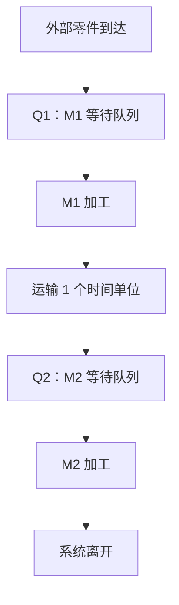
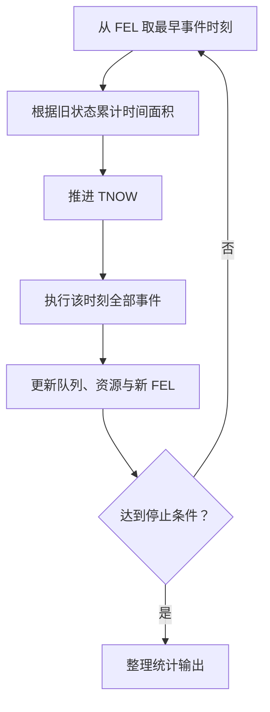
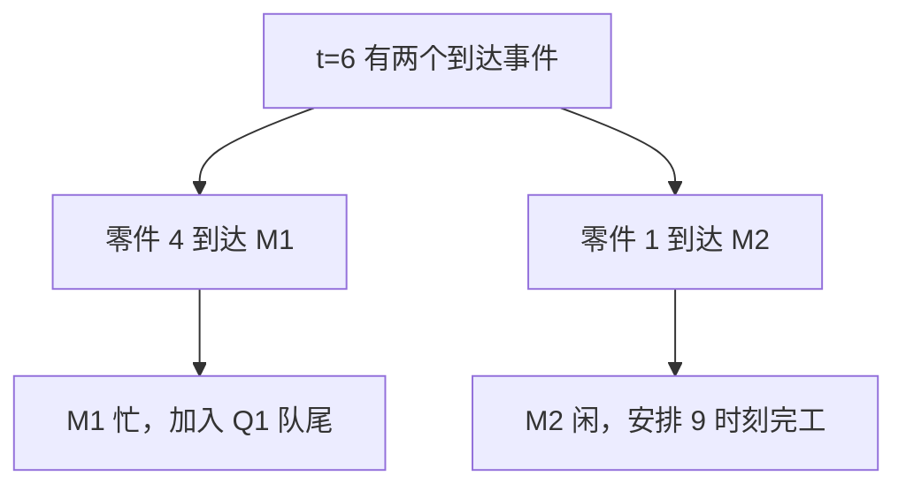
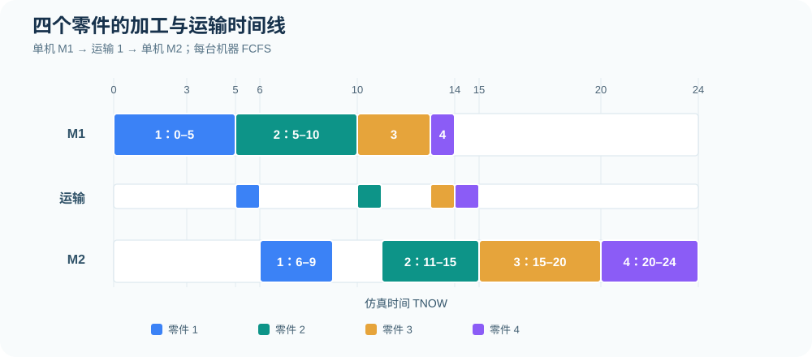
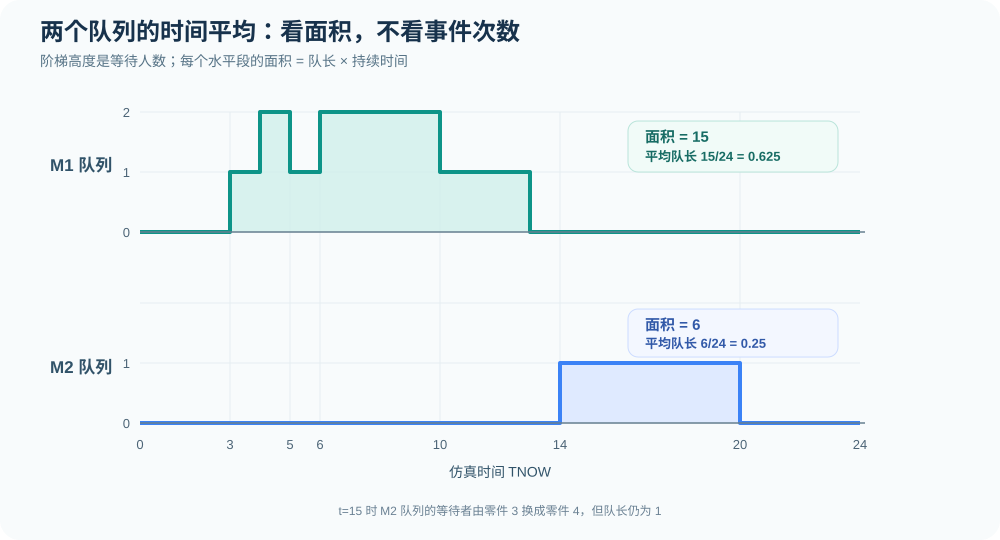

# 第 1 节｜FEL 逐事件推演：四零件双机串联的完整手算

[专题目录](README.md) · [上一节：模型、状态与事件](00-concepts-and-rules.md) · [下一节：完整结果与时间线](01-tandem-four-parts.md) · [统计指标](04-statistics-and-variants.md)

这一节专门讨论事件调度法的手工计算过程。输入数据已知时，计算的难点不是求和，而是每一步都正确维护三个对象：当前状态、未来事件表以及随时间累积的统计量。下面从初始状态开始，推到四件零件全部离开系统的时刻 24。

## 1. 先把题目写成可执行的规则

四件零件先进入 M1，加工完成后运输 1 个时间单位，再进入 M2。M1、M2 每次只能加工一件零件，分别设置一条先进先出队列（FCFS）。零件完成 M2 加工后才离开整个系统，机器服务不允许被中途抢占。

| 零件 | 外部到达间隔 | 到达 M1 时刻 | M1 加工时间 | M2 加工时间 |
| ---: | ---: | ---: | ---: | ---: |
| 1 | 0 | 0 | 5 | 3 |
| 2 | 3 | 3 | 5 | 4 |
| 3 | 1 | 4 | 3 | 5 |
| 4 | 2 | 6 | 1 | 4 |

其中，到达时刻 `0、3、4、6` 是对到达间隔 `0、3、1、2` 累加得到的。运输时间固定为 1；运输过程不占用 M1 或 M2。



### 1.1 本节使用的事件记号

为了让表格紧凑，事件写成 `类型(零件编号,机器编号)`。

| 记号 | 具体含义 | 发生时刻的例子 |
| --- | --- | --- |
| `A(1,1)` | 零件 1 从外部到达 M1 | 0 |
| `D(1,1)` | 零件 1 完成 M1 加工 | 5 |
| `A(1,2)` | 零件 1 运输结束，到达 M2 | 6 |
| `D(1,2)` | 零件 1 完成 M2 加工，离开系统 | 9 |

其余零件的事件写法相同，例如 `D(2,1)` 表示零件 2 在 M1 完工，`A(4,2)` 表示零件 4 到达 M2。这里的字母 D 表示某一道工序的完成，不一定意味着零件已经离开整个系统。

### 1.2 状态记录方式

后面的表格使用以下缩写：

| 记号 | 含义 | 示例 |
| --- | --- | --- |
| `M1: 2→10` | M1 正在加工零件 2，预计时刻 10 完成 | 正在加工，不在 Q1 中 |
| `Q1: [3,4]` | M1 前依次等待零件 3、4 | 左侧是队首 |
| `R: 1→6` | 零件 1 正在运输，预计时刻 6 到达 M2 | 不占用机器 |
| `M2: 空闲` | M2 当前没有加工零件 | 若 Q2 非空，应检查是否漏掉即时开工 |
| `FEL: 9:D(1,2)` | 未来事件表中有一个计划在 9 发生的事件 | 执行之前保留；执行之后删除 |

本节约定一张 FEL 只放尚未发生的事件，不放已经执行过的历史事件。表中机器状态、队列和 FEL 都表示<strong>该时刻全部事件处理完成之后</strong>的内容。

## 2. 初始化：TNOW、机器、队列与第一张 FEL

TNOW（Time Now）是仿真时钟，表示当前正在处理的时刻。初始设置 `TNOW=0`，两台机器空闲、两个队列为空、运输中没有零件、完成件数为 0。此时任何零件都尚未开始加工，也就不能提前安排任何机器完工事件。

本节采用“预先安排全部外部到达”的写法，因为四个到达时刻都已知。它与上一节介绍的“每次到达时才安排下一次外部到达”属于两种不同的 FEL 生成方式，但得到的运行轨迹完全相同。<strong>同一次手算应选择一种方式，不要重复插入外部到达事件。</strong>

初始 FEL 如下：

| 计划时刻 | 待执行事件 |
| ---: | --- |
| 0 | `A(1,1)` |
| 3 | `A(2,1)` |
| 4 | `A(3,1)` |
| 6 | `A(4,1)` |

现在可以从 FEL 中取出最早事件 `A(1,1)`，执行后将其删除。零件 1 到达时 M1 空闲，于时刻 0 开工、加工 5 个时间单位，所以新增 `D(1,1) @ 5`。这就是第一步事件调度。

## 3. 每个事件时刻都遵循同一操作顺序

从上一个事件时刻跳向下一个事件时，先计算时间经过了多少，再执行新事件。



在时间区间内，队长和机器忙闲保持不变。设上次处理事件之后的时刻为 t，下一事件时刻为 t′，则当前状态会持续 `Δt=t′−t` 个时间单位。对机器忙碌面积及队长面积的增量为：

```math
\begin{aligned}
\Delta A_{Q_k}&=Q_k(t)(t'-t)\\
\Delta A_{B_k}&=B_k(t)(t'-t)
\end{aligned}
```

其中，Q 为等待队列长度，B 为机器忙碌指示变量（忙为 1、闲为 0）。上式中的状态必须取自<strong>上次事件处理之后</strong>，而不是下一次事件处理之后。

举例：时刻 4 到时刻 5 之间，Q1 有零件 2、3，共两件，所以队长面积增加 `2×1=2`。到时刻 5，零件 2 才从队列中离开、开始加工。如果先修改队长再算面积，就会把这段时间错误记成 1 件等待。

## 4. 全程 FEL 与机器状态总表

先展示所有事件时刻的计算结果，再拆解其中需要推理的步骤。每行的 FEL 都是执行完该时刻事件后剩余的未来事件；同刻事件合并处理，且排列次序不表示额外的业务优先级。

| TNOW | 执行事件 | M1 状态 / Q1 | 运输 R | M2 状态 / Q2 | 处理后 FEL |
| ---: | --- | --- | --- | --- | --- |
| 初始化 | — | 空闲 / `[]` | `[]` | 空闲 / `[]` | `0:A(1,1); 3:A(2,1); 4:A(3,1); 6:A(4,1)` |
| 0 | `A(1,1)` | `1→5` / `[]` | `[]` | 空闲 / `[]` | `3:A(2,1); 4:A(3,1); 5:D(1,1); 6:A(4,1)` |
| 3 | `A(2,1)` | `1→5` / `[2]` | `[]` | 空闲 / `[]` | `4:A(3,1); 5:D(1,1); 6:A(4,1)` |
| 4 | `A(3,1)` | `1→5` / `[2,3]` | `[]` | 空闲 / `[]` | `5:D(1,1); 6:A(4,1)` |
| 5 | `D(1,1)` | `2→10` / `[3]` | `1→6` | 空闲 / `[]` | `6:A(4,1); 6:A(1,2); 10:D(2,1)` |
| 6 | `A(4,1), A(1,2)` | `2→10` / `[3,4]` | `[]` | `1→9` / `[]` | `9:D(1,2); 10:D(2,1)` |
| 9 | `D(1,2)` | `2→10` / `[3,4]` | `[]` | 空闲 / `[]` | `10:D(2,1)` |
| 10 | `D(2,1)` | `3→13` / `[4]` | `2→11` | 空闲 / `[]` | `11:A(2,2); 13:D(3,1)` |
| 11 | `A(2,2)` | `3→13` / `[4]` | `[]` | `2→15` / `[]` | `13:D(3,1); 15:D(2,2)` |
| 13 | `D(3,1)` | `4→14` / `[]` | `3→14` | `2→15` / `[]` | `14:D(4,1); 14:A(3,2); 15:D(2,2)` |
| 14 | `D(4,1), A(3,2)` | 空闲 / `[]` | `4→15` | `2→15` / `[3]` | `15:D(2,2); 15:A(4,2)` |
| 15 | `D(2,2), A(4,2)` | 空闲 / `[]` | `[]` | `3→20` / `[4]` | `20:D(3,2)` |
| 20 | `D(3,2)` | 空闲 / `[]` | `[]` | `4→24` / `[]` | `24:D(4,2)` |
| 24 | `D(4,2)` | 空闲 / `[]` | `[]` | 空闲 / `[]` | 空表，全部完工 |

这张表的作用是核对每个事件时刻的最终状态。实际手算时，最好在草稿纸上多写一列“本次删除了什么、又新增了什么”，以免把已经执行过的事件留在 FEL 中。下面按时间顺序补全这个推理过程。

## 5. 从时刻 0 到 6：M1 开工、两个零件排队

### 5.1 时刻 0：零件 1 到达

执行前，M1、M2 都空闲。FEL 中最早事件为 `A(1,1) @ 0`。执行后，零件 1 直接占用 M1，加工时间为 5，因此安排 `D(1,1) @ 5`。Q1 依然为空，M2 仍空闲。

这一时刻的变动是：

| 项目 | 变动 |
| --- | --- |
| 从 FEL 删除 | `A(1,1) @ 0` |
| 新增到 FEL | `D(1,1) @ 5` |
| M1 状态 | 空闲 → 加工零件 1，预计 5 完成 |
| Q1 | `[]` 不变 |
| 时间面积 | 上一个时间间隔为 0，不增加 |

### 5.2 时刻 3：零件 2 到达

时钟由 0 推进到 3。M1 在 `[0,3)` 始终加工零件 1，因此忙碌面积先增加 3，Q1 面积增加 0。然后执行 `A(2,1)`。由于 M1 尚未在时刻 5 完工，零件 2 加入 Q1。

FEL 只删除 `A(2,1) @ 3`，暂时不生成零件 2 的完工事件。因为零件 2 还没有开始加工，其实际完工时刻不能简单写成 `3+5=8`。

### 5.3 时刻 4：零件 3 到达

在 `[3,4)` 内，M1 忙且 Q1 长度为 1，因此累计 M1 忙碌面积增加 1、Q1 面积增加 1。时刻 4 执行 `A(3,1)`，零件 3 排在零件 2 后面，Q1 变为 `[2,3]`。FEL 剩下 `D(1,1) @ 5` 和 `A(4,1) @ 6`。

### 5.4 时刻 5：零件 1 完成 M1

这是第一处需要同时更新机器、队列和另一工序的时刻。执行事件之前，M1 加工零件 1，Q1 为 `[2,3]`。在 `[4,5)` 内，Q1 长度为 2，因此先向 Q1 面积累加 2。

执行 `D(1,1)` 时，有两组后续动作：

先处理 M1。零件 1 完工释放机器，立即从 Q1 取走队首零件 2，使零件 2 在时刻 5 开始 M1。它需要加工 5 个单位，因此安排 `D(2,1) @ 10`。Q1 留下零件 3。

再处理运输。零件 1 离开 M1，却尚未抵达 M2。运输时间为 1，故安排 `A(1,2) @ 6`，在途状态记为 `1→6`。

| 项目 | 时刻 5 之前 | 时刻 5 之后 |
| --- | --- | --- |
| M1 | 零件 1 在加工 | 零件 2 在加工，预计 10 完成 |
| Q1 | `[2,3]` | `[3]` |
| 运输中 | 无 | 零件 1，预计 6 到达 M2 |
| FEL | `5:D(1,1); 6:A(4,1)` | `6:A(4,1); 6:A(1,2); 10:D(2,1)` |

要注意，新的 FEL 里没有 `D(1,1)`：它已在时刻 5 执行完毕。机器开始加工的时刻可以当场记录，不必另外安排一个未来“开工事件”。

### 5.5 时刻 6：两个到达事件同时发生

时刻 6，FEL 中同时有 `A(4,1)` 和 `A(1,2)`。二者分别作用于 M1 和 M2。

零件 4 到达 M1 时，M1 还在加工零件 2，因此零件 4 排到零件 3 后面，使 Q1 变成 `[3,4]`。零件 1 则在此时完成运输，M2 空闲，于是直接开始 M2 加工，需时 3，安排 `D(1,2) @ 9`。



处理结束后，两台机器可以同时加工不同零件：M1 加工零件 2，M2 加工零件 1。在本题中，这两个到达事件的先后处理顺序不改变结果；但在共享队列、资源竞争或零时长服务的其他模型中，同刻处理规则可能影响结果。

## 6. 从时刻 9 到 13：零件 1 离开，M1 继续排队加工

### 6.1 时刻 9：零件 1 完成 M2

时刻 9 执行 `D(1,2)`，表示零件 1 完成第二道工序，真正离开整个系统。M2 此时没有等待零件，因此转为空闲。未来事件表只剩 `D(2,1) @ 10`。

零件 1 的完整系统逗留时间此时可以确定：它在时刻 0 到达，时刻 9 离开，逗留 9 个时间单位。不能在时刻 5 完成 M1 时提前计入“系统完工件数”。

### 6.2 时刻 10：零件 2 完成 M1，同时零件 3 补位

从时刻 9 到 10，M1 始终在加工零件 2，Q1 有 `[3,4]` 两件零件，M2 为空闲。先累计 `[9,10)` 的队长与机器面积，再执行 `D(2,1)`。

零件 2 完成 M1 后进入运输，于 11 到达 M2，因此新增 `A(2,2) @ 11`。M1 释放后取 Q1 队首的零件 3，在时刻 10 开工，服务时间为 3，于是新增 `D(3,1) @ 13`。零件 4 仍在 Q1 等待。

| 状态项目 | 处理 `D(2,1)` 之前 | 处理之后 |
| --- | --- | --- |
| M1 | 加工零件 2，完工时刻为 10 | 加工零件 3，预计 13 完成 |
| Q1 | `[3,4]` | `[4]` |
| 运输中 | 无 | 零件 2，预计 11 抵达 M2 |
| M2 | 空闲 | 空闲 |
| 系统已完成件数 | 1 | 1 |
| FEL | `10:D(2,1)` | `11:A(2,2); 13:D(3,1)` |

若题目只要求“仿真到 TNOW=10”，需要明确时刻 10 的事件是否执行。本专题采用<strong>先执行该时刻业务事件，再记录时刻 10 的事件后状态</strong>的规则，所以记录的是上表最右列。

### 6.3 时刻 11：零件 2 抵达 M2

零件 2 在 `[10,11)` 运输，时刻 11 执行 `A(2,2)`。M2 自时刻 9 起处于空闲状态，因此零件 2 立即在 M2 开工，加工时间为 4，预计在 15 完工，新增 `D(2,2) @ 15`。FEL 此时还有原先安排的 `D(3,1) @ 13`。

### 6.4 时刻 13：零件 3 完成 M1

时刻 13 执行 `D(3,1)`。零件 3 完成 M1 后运输 1 个单位，于时刻 14 到达 M2，新增 `A(3,2) @ 14`。零件 4 从 Q1 队首进入 M1，在时刻 13 开工，加工时间为 1，预计时刻 14 完成，新增 `D(4,1) @ 14`。

此时 FEL 中原有的 `D(2,2) @ 15` 必须保留。因此处理后 FEL 恰好包含：

| 计划时刻 | 待执行事件 | 来源 |
| ---: | --- | --- |
| 14 | `D(4,1)` | 零件 4 从时刻 13 开始 M1，加工 1 |
| 14 | `A(3,2)` | 零件 3 在时刻 13 完成 M1，运输 1 |
| 15 | `D(2,2)` | 零件 2 从时刻 11 开始 M2，加工 4 |

注意这三个事件里，有两个都发生在时刻 14，分别表示两件不同零件的不同活动结束。

## 7. 从时刻 14 到 24：M2 形成排队并清空系统

### 7.1 时刻 14：零件 3 到达 M2，零件 4 完成 M1

时刻 14，零件 4 完成 M1，零件 3 正好运输结束到达 M2。此时 M1 没有等待零件，故零件 4 完工后 M1 空闲；它还需要运输 1 个时间单位，故新增 `A(4,2) @ 15`。

与此同时，M2 正在加工零件 2，要到时刻 15 才完成，所以零件 3 无法立即开始加工，而是进入 Q2。处理完两件同刻事件后：M1 空闲，运输中有零件 4，M2 加工零件 2，Q2 是 `[3]`，FEL 是 `15:D(2,2); 15:A(4,2)`。

### 7.2 时刻 15：为什么一定是零件 3 先加工

此时有两件同刻事件：`D(2,2)` 与 `A(4,2)`。真正需要比较的是零件 3 和 4 的 M2 到达先后。

| 零件 | 到达 M2 的时刻 | 时刻 15 之前的情况 | M2 实际开工 |
| ---: | ---: | --- | ---: |
| 3 | 14 | 已在 Q2 等待 1 个时间单位 | 15 |
| 4 | 15 | 正在运输，尚未进入 Q2 | 20 |

本专题采用“先处理完成事件，让原有等待队列补位，再处理新到达”的同刻规则。零件 2 在 M2 完工后离开系统，M2 随即从 Q2 取出零件 3，使其从 15 加工到 20。零件 4 于 15 到达 M2，此时机器已被零件 3 占用，所以加入 Q2。

```math
D_{32}=15+5=20,
\qquad
D_{42}=20+4=24
```

这一步必须保留 FCFS 的时间顺序。不能把零件 4 的“到达 M2”误读成“立即开始 M2”，也不能仅仅因为到达事件和完成事件都在 15 发生，就把零件 3 的先到优势抹去。

### 7.3 时刻 20：零件 3 完成 M2

在 `[15,20)` 内，零件 3 一直在 M2 加工，零件 4 一直在 Q2 等待，队长为 1。时刻 20 执行 `D(3,2)` 后，零件 3 离开系统，零件 4 立即进入 M2 加工，预计 24 完成。此时 Q2 为空，FEL 仅剩 `D(4,2) @ 24`。

### 7.4 时刻 24：全部加工完成

时刻 24 执行 `D(4,2)`。零件 4 离开系统，M2 转为空闲。此时两台机器均空闲、两条队列均为空、没有运输中的零件，FEL 也为空。四个零件各经历了一次 M1 完工和一次 M2 完工，整个仿真自然结束。

## 8. 把事件历史转为零件时间戳表

FEL 是面向时间的记录；下面这张表是把事件历史按零件重新整理。事件发生后就从 FEL 删除，但其实际发生时刻仍需保存在历史或零件属性中，才能用于最后的统计。

| 零件 | M1 到达 | M1 开始 | M1 完成 | M2 到达 | M2 开始 | M2 完成 |
| ---: | ---: | ---: | ---: | ---: | ---: | ---: |
| 1 | 0 | 0 | 5 | 6 | 6 | 9 |
| 2 | 3 | 5 | 10 | 11 | 11 | 15 |
| 3 | 4 | 10 | 13 | 14 | 15 | 20 |
| 4 | 6 | 13 | 14 | 15 | 20 | 24 |

从这张表可直接确定每件零件的两段排队等待：

```math
\begin{aligned}
W_{q,i1}&=B_{i1}-A_{i1}\\
W_{q,i2}&=B_{i2}-A_{i2}
\end{aligned}
```

| 零件 | M1 等待 | M2 等待 | 系统进入 | 系统离开 | 系统逗留 |
| ---: | ---: | ---: | ---: | ---: | ---: |
| 1 | 0 | 0 | 0 | 9 | 9 |
| 2 | 2 | 0 | 3 | 15 | 12 |
| 3 | 6 | 1 | 4 | 20 | 16 |
| 4 | 7 | 5 | 6 | 24 | 18 |

这里每件零件的逗留都包括 M1 等待、M1 加工、运输、M2 等待和 M2 加工。四件零件的完整平均系统逗留时间为：

```math
\overline{W}=\frac{9+12+16+18}{4}=13.75
```



## 9. 事件之间没有新事件，却不能忘记累计面积

仿真时钟不逐秒运行，但统计时仍要计入两事件之间的全部持续时间。下表以每段区间的左端事件<strong>处理后状态</strong>为依据，统计区间内的队长、机器忙闲和运输中零件数。

| 时间区间 | 持续时间 | Q1 | M1 忙闲 | 运输中 | Q2 | M2 忙闲 | 系统内零件数 |
| --- | ---: | ---: | ---: | ---: | ---: | ---: | ---: |
| `[0,3)` | 3 | 0 | 1 | 0 | 0 | 0 | 1 |
| `[3,4)` | 1 | 1 | 1 | 0 | 0 | 0 | 2 |
| `[4,5)` | 1 | 2 | 1 | 0 | 0 | 0 | 3 |
| `[5,6)` | 1 | 1 | 1 | 1 | 0 | 0 | 3 |
| `[6,9)` | 3 | 2 | 1 | 0 | 0 | 1 | 4 |
| `[9,10)` | 1 | 2 | 1 | 0 | 0 | 0 | 3 |
| `[10,11)` | 1 | 1 | 1 | 1 | 0 | 0 | 3 |
| `[11,13)` | 2 | 1 | 1 | 0 | 0 | 1 | 3 |
| `[13,14)` | 1 | 0 | 1 | 1 | 0 | 1 | 3 |
| `[14,15)` | 1 | 0 | 0 | 1 | 1 | 1 | 3 |
| `[15,20)` | 5 | 0 | 0 | 0 | 1 | 1 | 2 |
| `[20,24)` | 4 | 0 | 0 | 0 | 0 | 1 | 1 |

对每一列，将“状态值 × 持续时间”相加，得到完整窗口 `[0,24]` 的面积：

| 统计对象 | 时间面积 | 计算含义 |
| --- | ---: | --- |
| Q1 | 15 | 在 M1 前等待的零件数面积 |
| M1 忙闲 | 14 | M1 累计忙碌时间 |
| 运输中 | 4 | 零件在途数量面积 |
| Q2 | 6 | 在 M2 前等待的零件数面积 |
| M2 忙闲 | 16 | M2 累计忙碌时间 |
| 系统内零件数 | 55 | 系统在制品数量面积 |

其中系统内零件数的面积既可逐区间求和，也可将上面五类状态面积相加。两种计算必须一致：

```math
\int_0^{24}N(t)\,dt=15+14+4+6+16=55
```

再与按零件计算的总系统逗留时间核对：

```math
\sum_{i=1}^{4}W_i=9+12+16+18=55
```

二者相等。这一守恒关系用于发现事件漏排、运输漏算、队列与加工状态重叠计数等错误。



## 10. 题目若要求 TNOW=10 截止，应在哪里停

黑板上的手工题有时只要求推到 `TNOW=10`，未必要求等到所有零件加工完毕。在这种情况下，可以在 FEL 中另外安排 `END @ 10`。本节采用在时刻 10 先处理该时刻已有的 `D(2,1)`，再输出截面并停止的规则。

时刻 10 事件处理之后：

| 项目 | 结果 |
| --- | --- |
| M1 | 正加工零件 3，预计 13 完成 |
| Q1 | `[4]` |
| 运输中 | 零件 2，预计 11 到达 M2 |
| M2、Q2 | M2 空闲，Q2 为空 |
| 已完成整个系统 | 只有零件 1，在时刻 9 离开 |
| 若继续仿真，FEL | `11:A(2,2); 13:D(3,1)` |

截止时刻的统计分母是 10，而不是完整轨迹的 24。此窗口的队长面积、忙碌面积和在途面积分别为：

| 时间面积 | Q1 | M1 忙碌 | 运输中 | Q2 | M2 忙碌 | 系统内零件数 |
| --- | ---: | ---: | ---: | ---: | ---: | ---: |
| `[0,10]` | 12 | 10 | 1 | 0 | 3 | 26 |

其中，Q1 的时间面积为 `1×1+2×1+1×1+2×4=12`；M2 只有 `[6,9)` 忙碌，共 3 个时间单位。因此：

```math
\begin{aligned}
\overline{Q}_{1,[0,10]}&=\frac{12}{10}=1.2\\
\rho_{M1,[0,10]}&=\frac{10}{10}=100\%\\
\rho_{M2,[0,10]}&=\frac{3}{10}=30\%\\
\overline{N}_{[0,10]}&=\frac{26}{10}=2.6
\end{aligned}
```

截至时刻 10，另外三件零件尚未离开系统，因此不能把它们的未来完整逗留时间当作已经观察到的结果；也不能把它们的未完成加工时间提前计入机器忙碌面积。

## 11. 从事件表推导计算结果时，常见的四类错误

| 错误 | 错在何处 | 在本题中的正确处理 |
| --- | --- | --- |
| 零件刚到就预定完工 | 没考虑机器可能正在忙 | 零件 2 在 3 到达，但直到 5 才开工，因此 10 才完成 M1 |
| 完成 M1 就当作系统离开 | 混淆工序完成与系统完成 | 零件 1 在 5 完成 M1，但 9 才完成 M2 |
| FEL 保存已发生的事件 | 未从待办表删除当前事件 | 在 5 执行 `D(1,1)` 后，只留下未来事件 |
| 用事件后队长统计上一段 | 把新状态错误应用于过去的时间 | `[4,5)` 的 Q1 长度为 2，贡献队长面积 2 |

此外，以下细节需要事先说明：队列是否包括正在加工的实体；同刻事件如何排序；运输是否占用独立运输资源；观察截止时刻的业务事件是否执行。没有明确规则的系统，即使输入表相同，也可能产生不同的状态轨迹。

## 12. 两道检验题

### 检验 1：不看总表，写出时刻 14 的状态和 FEL

题目：已执行完时刻 14 的全部事件，写出 M1、M2、Q1、Q2、运输中零件，以及 FEL。

参考答案：M1 空闲，Q1 为空；M2 正加工零件 2，预计 15 完成；Q2 为 `[3]`；零件 4 正运输，预计 15 到达 M2。FEL 为 `15:D(2,2); 15:A(4,2)`。

解析：这一时刻同时发生零件 4 在 M1 完工和零件 3 到达 M2。零件 4 的下一事件是运输结束；零件 3 因 M2 仍忙而入队。不能提前写 `D(3,2) @ 19`，因为零件 3 此时尚未开工。

### 检验 2：时刻 15 之后，下一件真正离开系统的是谁

题目：时刻 15 同时发生零件 2 完成 M2、零件 4 到达 M2。问下一次 M2 完工是什么事件，时刻是多少？

参考答案：`D(3,2) @ 20`。

解析：零件 3 自时刻 14 起就在 Q2 等待；M2 于 15 释放资源后先加工零件 3，服务时长 5，因此在 20 完工。零件 4 排在它之后，直到 20 才开始 M2 加工。

下一节[四零件串联完整算例](01-tandem-four-parts.md)会把这里的事件历史进一步转为每件零件的服务时间、等待时间及全程绩效；需要集中复习统计量时，可直接阅读[观察窗口与统计变式](04-statistics-and-variants.md)。
