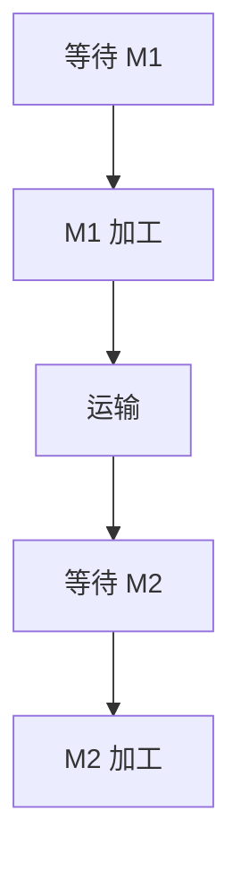

# 零件加工仿真：统计指标、观察窗口和易错变式

[专题首页](README.md) · [概念与模型规则](00-concepts-and-rules.md) · [FEL 逐事件表](03-fel-ledger.md) · [专题练习](exercises.md)

离散事件仿真计算题的后半部分，通常不再难于“什么时候发生什么事件”，而是难于<strong>统计口径</strong>：有的指标按零件取平均，有的指标必须对时间积分；有的只统计已经完成的实体，有的要计入尚未完工但已占用资源的时间。

本讲默认四零件通过 M1→运输 1→M2 的串联系统，全部完成于 24。到达时刻为 0、3、4、6；在 M2 完工并离开系统的时刻为 9、15、20、24。

## 1. 先把一件零件的时间拆成五段

一件零件的总系统逗留时间，由下列五个<strong>互不重叠</strong>的阶段组成：

用无特殊排版依赖的表达式写作：

`系统逗留时间 = M1 排队 + M1 加工 + 运输 + M2 排队 + M2 加工`

| 零件 | M1 等待 | M1 加工 | 运输 | M2 等待 | M2 加工 | <strong>总逗留</strong> |
| --- | ---: | ---: | ---: | ---: | ---: | ---: |
| 1 | 0 | 5 | 1 | 0 | 3 | <strong>9</strong> |
| 2 | 2 | 5 | 1 | 0 | 4 | <strong>12</strong> |
| 3 | 6 | 3 | 1 | 1 | 5 | <strong>16</strong> |
| 4 | 7 | 1 | 1 | 5 | 4 | <strong>18</strong> |
| <strong>合计</strong> | <strong>15</strong> | <strong>14</strong> | <strong>4</strong> | <strong>6</strong> | <strong>16</strong> | <strong>55</strong> |

从上表直接得到四项客户（零件）平均值：

| 按零件求平均的指标 | 算法 | 结果 |
| --- | --- | ---: |
| 平均 M1 等待 | (0+2+6+7)/4 | 3.75 |
| 平均 M2 等待 | (0+0+1+5)/4 | 1.50 |
| 平均总等待 | (15+6)/4 | 5.25 |
| 平均系统逗留 | (9+12+16+18)/4 | <strong>13.75</strong> |

注意：完成 M1 只是中间工序事件。完整系统逗留时间必须由<strong>离开 M2 的时刻减去进入 M1 的时刻</strong>计算。

## 2. 平均队长为什么要用“高度 × 宽度”？

队列长度 Q(t) 是一条随事件跳变的阶梯曲线。平均队长不是把事件时刻的队长相加后除以事件个数，因为每一个队长状态持续的时间并不相同。

`时间平均队长 = 队长阶梯图面积 / 观察时间 T`

在本题完整观察窗口 0–24 内：

- M1 等待队列面积为 15，时间平均队长为 `15/24 = 0.625`。
- M2 等待队列面积为 6，时间平均队长为 `6/24 = 0.25`。

<strong>为什么总队列面积等于总等待时间？</strong>每件零件排队 1 个时间单位，就给“队长×时间”贡献 1 个单位面积。比如零件 3 在 M1 等待 6、在 M2 等待 1；无论我们按阶梯图积分，还是按零件等待时长相加，结果应一致。此关系也适用于截止时仍未结束的等待，但那时只能计入截至截止时刻<strong>已经发生的部分等待</strong>。

## 3. 机器利用率怎么算？为什么未完工也要计算占用？

对每台机器，忙碌指示函数在忙时为 1、闲时为 0；对观察窗口积分就是忙碌时长。

`利用率 = 观察窗口内累计忙碌时长 / 观察窗口长度`

在全部完成的窗口 0–24 中，M1 加工 5+5+3+1=14，M2 加工 3+4+5+4=16。因此：

| 机器 | 忙碌时长 | 观察长度 | 利用率 |
| --- | ---: | ---: | ---: |
| M1 | 14 | 24 | <strong>58.33%</strong> |
| M2 | 16 | 24 | <strong>66.67%</strong> |

如果某件零件在截止时仍未加工完，截止之前实际占用的时间仍然应计入利用率。反过来，不能把尚未发生的计划加工时间提前算进忙碌面积。

## 4. 特别重要：t=10 截面和 t=24 全程不能混算

两个窗口的系统轨迹是相同的，<strong>统计时间范围不同</strong>，于是结论不同：

| 指标 | 只观察 0–10 | 全部完成 0–24 |
| --- | ---: | ---: |
| 到达系统 | 4 件 | 4 件 |
| 完成整个系统 | <strong>1 件</strong> | <strong>4 件</strong> |
| 截面时正在 M1 加工 | 零件 3 | 无 |
| 截面时在运输 | 零件 2 | 无 |
| 截面时 M1 等待队列 | `[4]` | 空 |
| M1 利用率 | <strong>100%</strong> | <strong>58.33%</strong> |
| M2 利用率 | <strong>30%</strong> | <strong>66.67%</strong> |
| M1 时间平均队长 | <strong>1.2</strong> | <strong>0.625</strong> |
| M2 时间平均队长 | <strong>0</strong> | <strong>0.25</strong> |

对于窗口 0–10，M1 队长的面积来自：

`1×(4−3) + 2×(5−4) + 1×(6−5) + 2×(10−6) = 12`

因此平均队长为 `12/10 = 1.2`。M2 只有零件 1 在 6–9 加工，故 M2 利用率是 `3/10 = 30%`。零件 2 虽在 t=10 完成 M1，但尚未运输到 M2，不能列为系统完工。

## 5. 按时间平均与按零件平均不是同一个分母

| 统计量 | 分子 | 分母 | 解释 |
| --- | --- | --- | --- |
| 平均排队等待 | 选定样本内零件的完整等待时间之和 | 同一样本的零件个数 | <strong>实体平均</strong> |
| 平均系统逗留 | 选定样本内零件的完整逗留时间之和 | 同一样本的零件个数 | <strong>实体平均</strong> |
| 时间平均排队长度 | 队长曲线面积 | 观察窗口长度 | <strong>时间平均</strong> |
| 资源利用率 | 机器忙碌时间 | 观察窗口长度 | <strong>时间平均</strong> |
| 完工件数 | M2 完工事件次数 | 不需取平均 | <strong>累计计数</strong> |

特别是在单机五零件、t=15 截尾例题里，虽然 5 件全部到达，但只有 2 件加工完成，3 件开始加工，2 件还在队列。平均逗留时间、平均等待时间与利用率如果使用不同样本或不同窗口，必须明确写出分母，不可随意混用。参见 [单机截尾例题](02-single-machine-five-parts.md)。

## 6. 用“时间面积守恒”一次检查五种统计量

四零件从系统到达至离开共停留 `9+12+16+18=55` 个“零件×时间”单位。它们在这段过程中始终处于五种状态之一：排队 M1、加工 M1、运输、排队 M2、加工 M2。因此：

`总系统占用面积 = Q1 面积 + M1 忙碌面积 + 运输在途面积 + Q2 面积 + M2 忙碌面积`

把数值代入：

`55 = 15 + 14 + 4 + 6 + 16`

本题每件运输 1，共 4 件，所以运输在途面积为 4。在本例中，每台机器容量 1，故其忙碌面积与正在该台机器上加工的实体数量面积相同。

这条关系非常适合发现以下错误：忘记运输 1 个单位、把加工中的零件算进队长、漏记某段 M2 排队，或把完工事件记错。五类面积加起来如果不等于 55，事件表或统计表一定有一处不一致。

对完整窗口，系统内时间平均零件数是 `55/24 ≈ 2.2917`。实际完成吞吐率是 `4/24 = 1/6` 件/时间单位，与四件零件平均逗留 `13.75` 相乘得到 `55/24`，和面积计算吻合。

<strong>这是一条从空系统出发、最终清空的有限样本守恒核查，并不等于已经估计了长期稳态指标。</strong>

## 7. 如果截止在 t=10，如何处理未完工零件？

不能只把完成的零件 1 的逗留时间 9 算出来，再乘以“到达量/时间”去代表整个系统的时间平均人数；因为时刻 10 仍有三件在系统内。

在 0–10 观察窗口，各件已发生的系统逗留时间分别是：

| 零件 | 到达 | 观察结束时的状态 | 在 0–10 内已停留时长 |
| --- | ---: | --- | ---: |
| 1 | 0 | t=9 已离开 | 9 |
| 2 | 3 | 正在运输 | 7 |
| 3 | 4 | 正在 M1 加工 | 6 |
| 4 | 6 | 等待 M1 | 4 |
| 合计 | | | <strong>26</strong> |

所以 `0–10` 内系统人数阶梯图总面积为 `26`，时间平均系统在制品数是 `26/10 = 2.6`。用五状态拆解又可核验：

`26 = Q1面积12 + M1忙10 + 在途1 + Q2面积0 + M2忙3`

这解释了为什么<strong>终止型仿真</strong>中特别需要区分“完整已离开实体”和“在观察期内贡献了状态面积的未完成实体”。

## 8. 两道变式看系统规律

### 变式 A：零件 4 的 M2 加工由 4 增加到 6

前面三件的完成时间不变，零件 4 仍然在 t=20 开始 M2，加工时间变为 6，于 t=26 离开。于是四件系统逗留变为 `(9,12,16,20)`，平均逗留为 `(9+12+16+20)/4 = 14.25`；M2 忙碌总时间为 18，完整窗口 26，利用率为 `18/26 ≈ 69.23%`。

容易出错的是只改机器忙碌分子，而不把<strong>完整观察窗口</strong>从 24 改为 26。

### 变式 B：运输时间从 1 降为 0

M1 结束时刻仍为 `(5,10,13,14)`；M2 到达也变为 `(5,10,13,14)`。按 FCFS 重新推导，M2 服务区间变成 `5–8、10–14、14–19、19–23`，全系统完成时刻变为 `(8,14,19,23)`，平均逗留为 `(8+11+15+17)/4 = 12.75`。

本例每件恰好比原方案提前 1 个时间单位离开，但<strong>这不是普适结论</strong>：当瓶颈、排队顺序或运输资源约束改变时，减少运输时间不一定让每件都等量提前。

## 9. 最后检查清单

提交一次完整手算前，依次核查：到达间隔是否累计；M1/M2 是否被当作串联；运输延迟是否增加；FEL 是否只保留未来事件；同刻事件是否遵守 FCFS；队列是否排除加工中零件；窗口是否写清；等待是否按零件平均、队长是否按时间平均；完成件数是否以 M2 完工为准；面积守恒是否成立。
