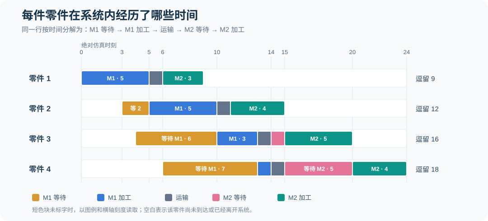
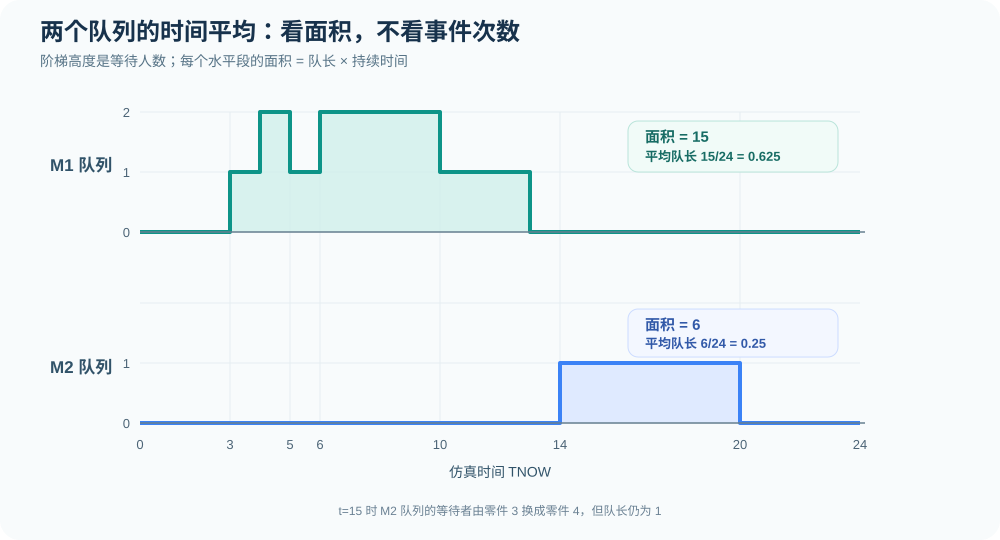
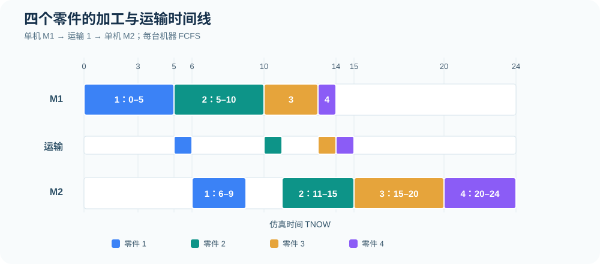
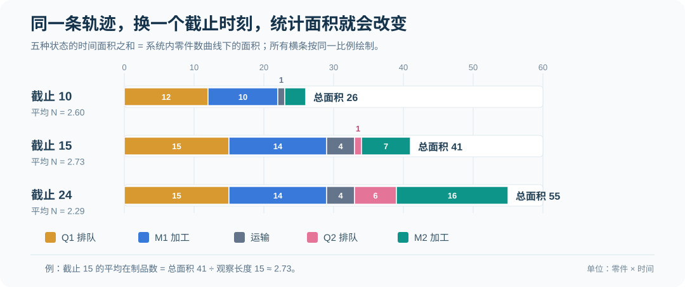

# 第 3 节｜离散事件仿真的统计指标、截尾处理与参数变式

[专题目录](README.md) · [上一节：四零件完整算例](01-tandem-four-parts.md) · [FEL 事件表](03-fel-ledger.md) · [下一节：单机截尾算例](02-single-machine-five-parts.md) · [专题练习](exercises.md)

事件表给出了机器何时开始和结束加工，以及零件在各时刻处于什么位置。统计分析要在这条轨迹上回答另外一些问题：每件零件平均等了多久、某个时间段里平均有多少件在排队、机器有多大比例的时间在工作，以及观察结束时仍未完工的零件应当怎样处理。

本节继续使用四零件双机串联算例。外部到达时刻为 `0、3、4、6`，M1 完工时刻为 `5、10、13、14`，M2 完工（系统离开）时刻为 `9、15、20、24`；每件零件在两台机器之间运输 1 个时间单位。原始数据与逐件推导见[第 2 节](01-tandem-four-parts.md)。

## 1. 先区分三种统计口径

做完事件推进后，不能看到“平均”两个字就直接将某列数字相加除以 4。观察对象可能是零件，也可能是时间，甚至可能只是某个事件出现的次数。

| 统计类别 | 常见指标 | 分子 | 分母 |
| --- | --- | --- | --- |
| 按实体统计 | 平均等待时间、平均系统逗留时间 | 选定零件集合的等待或逗留时间之和 | 同一集合的零件数 |
| 按时间统计 | 时间平均队长、时间平均在制品数 | 对观察窗口内的数量曲线求时间面积 | 观察窗口长度 |
| 按时间统计 | 机器利用率 | 观察窗口内机器累计忙碌时间 | 观察窗口长度 |
| 按事件计数 | 到达件数、完工件数 | 对指定事件计数 | 不需要除以人数或时间 |
| 按时间计算的速率 | 窗口内实际完工率 | 窗口内系统完工件数 | 观察窗口长度 |

例如，四件零件的平均 M1 排队等待是 `15/4=3.75`，分母为四件零件；完整窗口 `[0,24]` 的 M1 时间平均队长是 `15/24=0.625`，分母为 24 个时间单位。两者的分子恰好同为 15，是由这条完整轨迹中的面积关系决定的；它们不是同一个统计指标。

## 2. 每件零件的系统逗留时间由五段组成

本例的零件进入系统后，依次经历等待 M1、M1 加工、运输、等待 M2、M2 加工。五段时间相加，就是该零件从外部到达到最后离开的系统逗留时间。

```math
W_i=W_{q,i1}+S_{i1}+\tau+W_{q,i2}+S_{i2}
```

| 零件 | M1 等待 | M1 加工 | 运输 | M2 等待 | M2 加工 | 系统逗留 |
| ---: | ---: | ---: | ---: | ---: | ---: | ---: |
| 1 | 0 | 5 | 1 | 0 | 3 | 9 |
| 2 | 2 | 5 | 1 | 0 | 4 | 12 |
| 3 | 6 | 3 | 1 | 1 | 5 | 16 |
| 4 | 7 | 1 | 1 | 5 | 4 | 18 |
| 合计 | 15 | 14 | 4 | 6 | 16 | 55 |



从上表得到按零件计算的四个平均值：

```math
\begin{aligned}
\overline{W}_{q1}&=\frac{0+2+6+7}{4}=3.75\\
\overline{W}_{q2}&=\frac{0+0+1+5}{4}=1.50\\
\overline{W}_{q,\mathrm{total}}&=\frac{15+6}{4}=5.25\\
\overline{W}&=\frac{9+12+16+18}{4}=13.75
\end{aligned}
```

完整系统的离开事件是 M2 完工，而不是 M1 完工。零件 2 在时刻 10 完成 M1，但它的完整系统逗留时间直到时刻 15 完成 M2 时才能确定。

## 3. 时间平均队长：为什么一定要计算面积

队长是一条阶梯曲线：在到达、开始服务等事件发生时改变，在相邻事件之间保持不变。设 Q(t) 是时刻 t 正在等待的零件数，观察窗口为 `[0,T]`，则时间平均队长的定义是：

```math
\overline{Q}_{[0,T]}=\frac{1}{T}\int_0^T Q(t)\,dt
```

在手算题中不必真的做连续函数积分；按事件时刻把横轴切成若干区间，在每一段计算“队长 × 持续时间”，再求和即可。

### 3.1 M1 队列的完整计算

| 时间区间 | Q1 等待的零件 | 队长 | 持续时间 | 面积贡献 |
| --- | --- | ---: | ---: | ---: |
| `[0,3)` | 无 | 0 | 3 | 0 |
| `[3,4)` | 2 | 1 | 1 | 1 |
| `[4,5)` | 2、3 | 2 | 1 | 2 |
| `[5,6)` | 3 | 1 | 1 | 1 |
| `[6,10)` | 3、4 | 2 | 4 | 8 |
| `[10,13)` | 4 | 1 | 3 | 3 |
| `[13,24)` | 无 | 0 | 11 | 0 |
| 合计 | — | — | 24 | 15 |

因此：

```math
\overline{Q}_{1,[0,24]}
=\frac{1+2+1+8+3}{24}
=\frac{15}{24}=0.625
```

### 3.2 M2 队列的完整计算

M2 在零件 1 和零件 2 加工期间尚未形成等待队列。零件 3 于时刻 14 到达 M2，而零件 2 加工到时刻 15，所以零件 3 在 `[14,15)` 等待；零件 4 于时刻 15 到达后，在 `[15,20)` 等待零件 3 完工。

| 时间区间 | Q2 等待的零件 | 队长 | 持续时间 | 面积贡献 |
| --- | --- | ---: | ---: | ---: |
| `[0,14)` | 无 | 0 | 14 | 0 |
| `[14,15)` | 3 | 1 | 1 | 1 |
| `[15,20)` | 4 | 1 | 5 | 5 |
| `[20,24)` | 无 | 0 | 4 | 0 |
| 合计 | — | — | 24 | 6 |

```math
\overline{Q}_{2,[0,24]}=\frac{1+5}{24}=0.25
```



直接对事件表每一行出现的队长求算术平均会出错。例如，队长为 2 的 `[6,10)` 持续了 4 个时间单位，而队长为 2 的 `[4,5)` 只持续 1 个时间单位，二者在时间平均中不能获得相同权重。

### 3.3 为什么队长面积等于各件零件的累计等待

以 Q1 为例：零件 2 等待 2，零件 3 等待 6，零件 4 等待 7，零件 1 不等待，合计为 15。从另一个角度看，队列里有一件零件等待 1 个时间单位，就给队长曲线下的面积贡献 1 个“零件×时间”单位；将所有零件的这些贡献加起来，便得到相同的队长面积。

在本例初始队列为空、所有等待最终结束的完整窗口中：

```math
\int_0^{24}Q_1(t)\,dt=\sum_{i=1}^{4}W_{q,i1}=15
```

```math
\int_0^{24}Q_2(t)\,dt=\sum_{i=1}^{4}W_{q,i2}=6
```

这不是统计上的近似，而是同一条有限轨迹的时间面积恒等式。对于截尾窗口，它仍然成立，但右侧必须改成“截至截止时刻已经发生的等待”，不能将尚未发生的未来等待提前加入。

## 4. 机器利用率：分子只计已经发生的加工时间

若每台机器的忙碌指示变量 B(t) 在工作时为 1，空闲时为 0，则指定窗口内的机器利用率是：

```math
\rho_{M_k,[0,T]}=\frac{1}{T}\int_0^T B_k(t)\,dt
```

这里机器容量都为 1，所以忙碌面积就是该机器累计加工时间。注意利用率衡量的是<strong>观察时间中有多少比例处于忙碌状态</strong>，不是已经完成零件的加工时间占全部计划加工时间的比例。



| 机器 | 忙碌区间 | 累计忙碌 | `[0,24]` 利用率 |
| --- | --- | ---: | ---: |
| M1 | `[0,5)`、`[5,10)`、`[10,13)`、`[13,14)` | 14 | 14/24≈58.33% |
| M2 | `[6,9)`、`[11,15)`、`[15,20)`、`[20,24)` | 16 | 16/24≈66.67% |

M1 在时刻 14 加工完最后一件零件，但系统直到时刻 24 才全部清空，所以当研究完整系统运行 `[0,24]` 时，M1 的分母仍然是 24。不能为了让利用率看起来较高而将 M1 的分母改成 14。

## 5. 观察窗口改变，统计数值为什么会改变

同一条事件轨迹可以在不同时间截断。时刻 10、15、24 的队列状态和机器占用不同；即使已经发生的历史没有变化，统计窗口的长度、累计面积和完工件数也会变化。

| 指标 | 截止 10 | 截止 15 | 截止 24 |
| --- | ---: | ---: | ---: |
| 累计到达零件数 | 4 | 4 | 4 |
| 完成整个系统的零件数 | 1 | 2 | 4 |
| 截面 M1 | 加工零件 3 | 空闲 | 空闲 |
| 截面 Q1 | `[4]` | 空 | 空 |
| 截面运输中 | 零件 2 | 无 | 无 |
| 截面 M2 | 空闲 | 加工零件 3 | 空闲 |
| 截面 Q2 | 空 | `[4]` | 空 |
| Q1 面积 | 12 | 15 | 15 |
| M1 忙碌面积 | 10 | 14 | 14 |
| 运输中数量面积 | 1 | 4 | 4 |
| Q2 面积 | 0 | 1 | 6 |
| M2 忙碌面积 | 3 | 7 | 16 |
| 系统内数量面积 | 26 | 41 | 55 |

上表中时刻 10、15 的截面均采用“先执行该时刻的业务事件，再输出事件后状态”的约定。例如时刻 15 已执行零件 2 的 M2 完工事件，零件 3 开始 M2，零件 4 刚到达并排队。

从面积表可得三个观察窗口的统计结果：

| 指标 | `[0,10]` | `[0,15]` | `[0,24]` |
| --- | ---: | ---: | ---: |
| M1 时间平均队长 | 1.2000 | 1.0000 | 0.6250 |
| M2 时间平均队长 | 0 | 0.0667 | 0.2500 |
| M1 利用率 | 100% | 93.33% | 58.33% |
| M2 利用率 | 30% | 46.67% | 66.67% |
| 时间平均系统在制品数 | 2.6000 | 2.7333 | 2.2917 |

例如时刻 15 的 Q2 面积只有 `[14,15)` 内零件 3 的 1 个等待时间单位，所以 M2 平均队长为 `1/15≈0.0667`。零件 4 从 15 开始的未来等待不能被提前计入 `[0,15]`。

### 5.1 用一张图比较三个窗口的系统占用面积



图中的每条横条表示“零件×时间”的总面积，而不是单个时刻的零件数量。横条由 Q1、M1、运输、Q2、M2 五类相互排斥的状态面积相加。窗口越长，累计面积一般不会减少，但除以窗口长度得到的时间平均数量可能上升，也可能下降。

## 6. 截尾时，未完工零件的等待与逗留怎样计算

这是终止型仿真中最容易出现统计口径错误的地方。假设观察截止时刻为 T，某件零件已经到达系统，但还没有完成 M2。我们可以统计它<strong>截至 T 已经经历的系统逗留</strong>，却不能把它未来才会发生的完整逗留当作已观测值。

设零件 i 的外部到达时刻为 A、最终离开时刻为 D。对于本题所有到达都发生在观察窗口内的情况，已观测逗留长度是：

```math
W_i^{\mathrm{obs}}(T)=\min(D_{i2},T)-A_{i1}
```

若有零件在 T 之后才到达，应将其排除在窗口内已到达的零件集合之外，不能让上式产生负的“逗留时间”。

### 6.1 截止到时刻 10 的四件零件

| 零件 | 到达时刻 | 最终离开时刻 | 截止时刻 10 的状态 | 已观测逗留 |
| ---: | ---: | ---: | --- | ---: |
| 1 | 0 | 9 | 已经离开 | 9 |
| 2 | 3 | 15 | 正在运输 | 7 |
| 3 | 4 | 20 | 正在 M1 加工 | 6 |
| 4 | 6 | 24 | 正在 Q1 排队 | 4 |
| 合计 | — | — | — | 26 |

这里的 7、6、4 是截至 T=10 已经经历的时间，并不是零件 2、3、4 的完整系统逗留。完整逗留最终分别为 12、16、18，但在仿真只运行到 10 的情形下尚不可观测。

零件 4 自时刻 6 进入 Q1，一直排到观察截止 10；它已经发生的 Q1 等待为 4，未来 `[10,13)` 还会继续等待 3。如果将它的完整等待 7 提前计入截止时刻 10 的队长面积，就会多算 3。

### 6.2 为什么“仅统计已完工者”的平均值容易误导

若只对截止时已完工的零件取平均，三个窗口的已完工样本分别为：

| 截止时刻 | 已完工零件 | 已完工样本的平均完整逗留 |
| ---: | --- | ---: |
| 10 | 1 | 9.00 |
| 15 | 1、2 | (9+12)/2=10.50 |
| 24 | 1、2、3、4 | (9+12+16+18)/4=13.75 |

从 9.00 到 13.75 的变化不表示系统性能突然变差。较早完工的样本更可能具有较短逗留时间，尚未完成的零件没有进入“已完工样本”，因此在截尾时可能出现选择偏差。若题目只问“截止时已完工零件的平均逗留”，可以明确样本后计算；若题目问“全部零件的平均完整逗留”，则必须继续运行或采用其他明确的截尾分析方法。

### 6.3 截尾时的队长面积仍然可以准确计算

假设某零件在机器 k 的等待从到达 A 开始，真正开始服务的时刻为 B。其在窗口 `[0,T]` 内已经发生的等待为：

```math
W_{q,ik}^{\mathrm{obs}}(T)
=\max\left(0,\min(B_{ik},T)-A_{ik}\right)
```

这个表达式将未来等待截断在 T，而不是强行把未完工零件的等待记为 0。于是，当所有零件的时间戳均从 0 开始计量时，仍有下面的逐轨迹恒等式：

```math
\int_0^T Q_k(t)\,dt
=\sum_i W_{q,ik}^{\mathrm{obs}}(T)
```

该式的求和涵盖所有可能进入该队列的零件；未到达者的已观测等待为 0。对截止到时刻 10 的 Q1，零件 2、3、4 已经发生的等待分别是 2、6、4，所以队长面积是 `2+6+4=12`，与阶梯图计算完全相同。

## 7. 系统内零件数与五类时间面积的守恒

对本例，系统内的零件只能处于五类位置：等待 M1、加工 M1、运输中、等待 M2、加工 M2。用 N(t) 表示系统内零件数、Q1/Q2 表示两个等待队列长度、B1/B2 表示机器忙闲（取 0 或 1）、R(t) 表示运输中零件数，则：

```math
N(t)=Q_1(t)+B_1(t)+R(t)+Q_2(t)+B_2(t)
```

在完整窗口中积分，得到：

```math
\int_0^{24}N(t)\,dt=15+14+4+6+16=55
```

另一种算法是按零件计算完整系统逗留时间之和：

```math
\sum_{i=1}^{4}W_i=9+12+16+18=55
```

两者恰好相等，是因为从最初到达到最后离开，每件零件在系统中每停留一个时间单位，都会给 N(t) 曲线贡献一个单位面积。

对截尾窗口也可以做同样的核查，只是右侧变成已观测逗留时间：

```math
\int_0^T N(t)\,dt
=\sum_{i:A_{i1}\leq T}W_i^{\mathrm{obs}}(T)
```

本例的三个窗口分别为：

```math
\begin{aligned}
T=10:&\quad 9+7+6+4=26\\
T=15:&\quad 9+12+11+9=41\\
T=24:&\quad 9+12+16+18=55
\end{aligned}
```

这里在 T=15 时，零件 3 已在系统中停留 `15−4=11`，零件 4 已停留 `15−6=9`。即使它们还没有离开，也必须计入系统在制品数的时间面积。

### 7.1 与 Little 公式的关系

Little 公式在稳态排队分析中通常写为：

```math
L=\lambda W
```

本例从空系统开始、运行至四件零件全部离开，在完整窗口里可以作一条有限样本的算术核查：

```math
\overline{N}_{[0,24]}
=\frac{55}{24}
=\frac{4}{24}\times\frac{55}{4}
\approx2.2917
```

但这里的 `4/24` 是这次完整运行的实际完成率，而不是通过长期随机仿真估计出的稳态到达率。如果系统在观察结束时仍有未完成零件，直接用“完成件数/窗口长度 × 已完工零件平均逗留”通常无法还原真实的系统人数面积，因为它漏掉了未完工零件在观察期内的占用时间。

## 8. 变式 A：零件 4 的 M2 加工时间从 4 增至 6

只修改零件 4 的 M2 加工时间，其他外部到达、M1 加工、运输以及前面零件的 M2 加工时间均不变。由于零件 4 仍在时刻 20 开始 M2，延长的 2 个时间单位全部发生在最后一段加工过程中。

| 项目 | 原方案 | 变式 A |
| --- | ---: | ---: |
| 零件 4 开始 M2 | 20 | 20 |
| 零件 4 完成 M2 | 24 | 26 |
| 零件 4 系统逗留 | 18 | 20 |
| 全部完工时刻 T | 24 | 26 |
| 四件平均系统逗留 | 13.75 | 14.25 |
| M2 累计忙碌 | 16 | 18 |
| M2 利用率 | 16/24≈66.67% | 18/26≈69.23% |

因为每件零件到达两个队列的时刻和开工时刻都没有变化，Q1 面积仍为 15，Q2 面积仍为 6，运输面积仍为 4，M1 忙碌面积仍为 14。只有 M2 忙碌面积由 16 增至 18，完整观察窗口由 24 延长至 26。

```math
\begin{aligned}
\overline{W}_{A}&=\frac{9+12+16+20}{4}=14.25\\
\rho_{M2,A}&=\frac{18}{26}\approx69.23\%\\
\overline{N}_{A}&=\frac{15+14+4+6+18}{26}=\frac{57}{26}\approx2.1923
\end{aligned}
```

可以注意到：零件平均逗留从 13.75 增至 14.25，但这次完整窗口内的时间平均系统人数反而由约 2.2917 降到约 2.1923。原因是观察终点从 24 延长到了 26，新增时段里只有零件 4 仍在系统中。这并不矛盾，因为两个平均量使用不同的分母。

## 9. 变式 B：运输时间从 1 降为 0

保持四件零件的 M1 开工、完工时间不变，只将两台机器之间的运输时间设为 0。这样一来，M2 的到达时刻由 `6、11、14、15` 变成 `5、10、13、14`。必须按新到达时刻重新计算 M2 的加工过程。

| 零件 | 新的 M2 到达 | M2 开始 | M2 完成 | M2 等待 | 系统逗留 |
| ---: | ---: | ---: | ---: | ---: | ---: |
| 1 | 5 | 5 | 8 | 0 | 8 |
| 2 | 10 | 10 | 14 | 0 | 11 |
| 3 | 13 | 14 | 19 | 1 | 15 |
| 4 | 14 | 19 | 23 | 5 | 17 |

此时全部完工时间提前到 23，四件系统逗留总和是 `8+11+15+17=51`，平均逗留为 `51/4=12.75`。M1 忙碌时间仍为 14，M2 忙碌时间仍为 16，Q1 面积仍为 15，Q2 面积仍为 6，运输面积从 4 变成 0。

```math
\begin{aligned}
\overline{W}_{B}&=\frac{51}{4}=12.75\\
\rho_{M1,B}&=\frac{14}{23}\approx60.87\%\\
\rho_{M2,B}&=\frac{16}{23}\approx69.57\%\\
\overline{N}_{B}&=\frac{15+14+0+6+16}{23}=\frac{51}{23}\approx2.2174
\end{aligned}
```

本例的四个零件恰好都提前 1 个时间单位离开，M2 排队等待时间也刚好保持不变。但这不是运输时间改变时普遍成立的规律。若某个零件更早到达时 M2 仍被其他零件占用，运输时间的减少可能部分转化为更长的 M2 排队，而不是等量减少系统逗留时间。

## 10. 变式 C：加工参数不变，只把观察时间截到 15

与前两个变式不同，变式 C 完全不改变实际运行轨迹，只将观察截止时刻改为 15。此时零件 1、2 已完成，零件 3 已开始 M2，加工到时刻 20 才能结束；零件 4 刚到达 M2，正在 Q2 中等待。

截至 15 的 Q1 面积是 15、M1 忙碌面积是 14、运输面积是 4、Q2 面积是 1、M2 忙碌面积是 7，因而：

```math
\begin{aligned}
\overline{Q}_{1,[0,15]}&=\frac{15}{15}=1\\
\overline{Q}_{2,[0,15]}&=\frac{1}{15}\approx0.0667\\
\rho_{M1,[0,15]}&=\frac{14}{15}\approx93.33\%\\
\rho_{M2,[0,15]}&=\frac{7}{15}\approx46.67\%\\
\overline{N}_{[0,15]}&=\frac{41}{15}\approx2.7333
\end{aligned}
```

特别要区分：零件 4 在时刻 15 进入 Q2，但它在 `[15,20)` 的未来 5 个时间单位等待并不计入截至 15 的 Q2 面积；零件 3 从 15 开始 M2 加工，但其未来 5 个时间单位加工也没有计入截至 15 的 M2 忙碌面积。

## 11. 三道综合检验题

### 题 1：队列面积为什么可以从零件等待时间相加得到

题目：若观察截止于时刻 10，Q1 中有零件 4 尚未结束等待，求 Q1 的时间面积。

标准答案：12。

解析：零件 2 已完成 Q1 等待 2，零件 3 已完成 Q1 等待 6，零件 4 从时刻 6 到截止时刻 10 已等待 4，合计 `2+6+4=12`。不能使用零件 4 未来完整等待 7，因为其中有 3 个时间单位发生在观察窗外。

### 题 2：加工变慢后，为什么某个时间平均指标会下降

题目：零件 4 在 M2 的加工时间从 4 增加到 6 后，系统平均逗留时间增加，但完整窗口内的时间平均系统人数反而下降。求这两个新结果并解释。

标准答案：平均系统逗留 14.25；时间平均系统人数约 2.1923。

解析：完整运行终点从 24 延到 26，总逗留面积从 55 增到 57；平均逗留按四件零件计算，是 `57/4=14.25`，时间平均系统人数则是 `57/26≈2.1923`。二者分母不同，且新增的 `[24,26)` 只有一件零件在系统内。

### 题 3：截止时刻 15，完工件数与 M2 利用率分别是多少

题目：按照先处理时刻 15 业务事件、再记录截止状态的约定，求完工件数和 M2 利用率。

标准答案：完工 2 件；M2 利用率 `7/15≈46.67%`。

解析：M2 在 `[6,9)` 加工零件 1，在 `[11,15)` 加工零件 2，共忙 3+4=7 个时间单位。零件 2 恰在 15 完成，因此计入已完工件数；零件 3 于 15 开始加工，但其后续加工时间不能提前计入。

后续[单机五零件截尾例题](02-single-machine-five-parts.md)会将同样的统计逻辑应用于另一种更典型的终止状态：截止时机器仍在加工、队列中还有未开始服务的零件，且输入时间包含小数。
