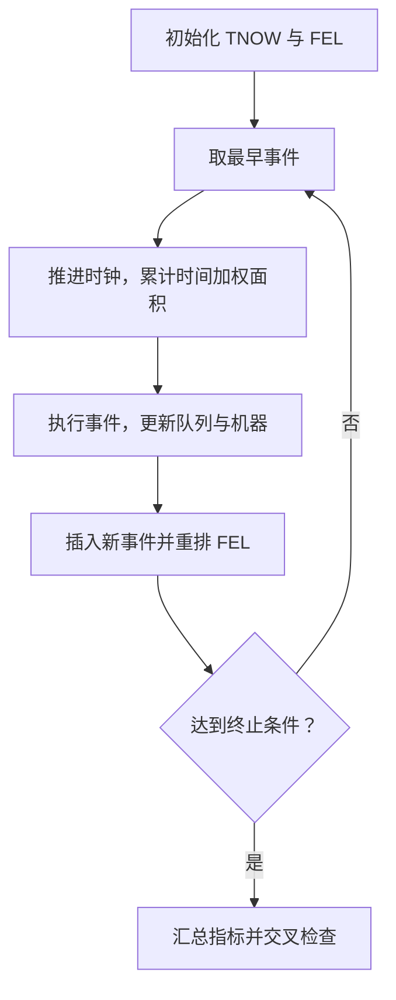

# 手工离散事件仿真｜事件调度与零件加工专题

[返回总目录](../README.md) · [串联双机完整例题](01-tandem-four-parts.md) · [单机有限时长例题](02-single-machine-five-parts.md) · [专题练习与解析](exercises.md)

本专题专门训练离散事件仿真中的**手工事件推进（Event Scheduling）**：给定到达时间、加工时间、运输时间和队列规则，逐步更新仿真时钟（TNOW）、未来事件表（FEL）、排队人数与机器状态，最终计算等待时间、逗留时间、队列长度和利用率。

## 两道核心例题

| 例题 | 系统结构 | 主要考点 | 入口 |
| --- | --- | --- | --- |
| A：四个零件、两机串联 | M1 → 运输 → M2，各阶段 FCFS | 事件表、同刻事件、运输延迟、双队列、$t=10$ 与全程统计 | [完整逐事件推演](01-tandem-four-parts.md) |
| B：五个零件、单机加工 | 单台机器、FIFO，有限终止时间 | 截尾统计、未完成零件、平均值分母、时间平均队长 | [完整逐事件推演](02-single-machine-five-parts.md) |

## 一眼区分三种机器模型

三种模型虽然都能出现“排队”“到达”“离开”，但事件和资源分配规则不同。特别要注意：**串联的 M1、M2 是两个先后工序，不是两个可互相替代的服务台**。

## 手算必备的四张表

1. **输入表**：零件编号、到达间隔、累计到达时刻、各工序加工时长。
2. **未来事件表 FEL**：尚未发生的事件及各自计划时刻，按时间升序排列。
3. **系统状态表**：当前时刻、每台机器忙闲、正在加工的零件、每条队列中的零件顺序。
4. **输出统计表**：开始与完成时间、等待时间、系统逗留时间，以及按时间积分的队长和忙碌时间。

## 手工推进算法

这里最常见的失误是只更新队列人数，却忘记记录**队列持续了多少时间**；或者把零件离开 M1 误当成离开整个串联系统。

## 资料与复现

- [四零件串联流程与甘特时间线](../assets/tandem-parts-timeline.svg)
- [双队列长度随时间变化图](../assets/tandem-queue-length.svg)
- [Python 事件调度校验程序](../examples/tandem_parts_event_simulation.py)
- [10 道专题题目与完整答案](exercises.md)

所有图表均按事件规则独立绘制，关键指标可通过手工推演和程序相互复核。
