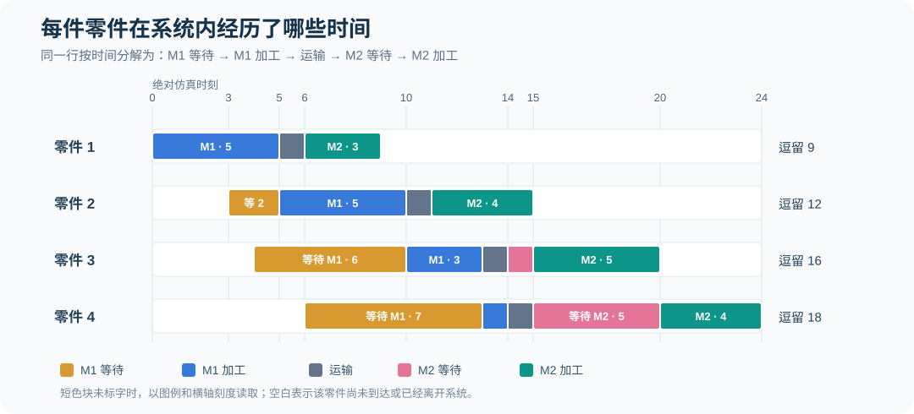

# 手工事件调度｜10 道核心题与 4 道提高题（完整解析）

[专题目录](README.md) · [基础规则](00-concepts-and-rules.md) · [FEL 事件表](03-fel-ledger.md) · [双机串联完整算例](01-tandem-four-parts.md) · [统计指标与截尾](04-statistics-and-variants.md) · [单机 FIFO 截尾算例](02-single-machine-five-parts.md)

本组题围绕课堂上的两套加工数据展开。前十题从系统结构、到达时刻、工序时序、未来事件表和统计指标逐步推进；后四题改变观察窗口或加工条件，训练在没有现成事件表时独立推导的能力。

各题先给出题目和标准答案，再列出计算步骤与判断依据。手算时可以先遮住答案，用纸画出机器的加工区间和排队区间；核对时重点检查每一个事件的发生时刻、统计窗口是否一致，以及已完工与未完工零件是否混在同一分母内。

## 题目所用的两套基础数据

### 数据 A：四个零件、M1 和 M2 串联

四件零件必须依次完成 M1 加工、1 个时间单位的运输和 M2 加工，才算离开系统。两个机器各只有一个加工位置，每条队列采用 FCFS（先来先服务）。

| 零件 | 外部到达间隔 | M1 加工时长 | M2 加工时长 |
| ---: | ---: | ---: | ---: |
| 1 | 0 | 5 | 3 |
| 2 | 3 | 5 | 4 |
| 3 | 1 | 3 | 5 |
| 4 | 2 | 1 | 4 |

### 数据 B：五个零件、单机 FIFO，固定截止时刻 15

| 零件 | 外部到达间隔 | 机器加工时长 |
| ---: | ---: | ---: |
| 1 | 0.00 | 4.58 |
| 2 | 6.84 | 2.96 |
| 3 | 2.40 | 5.86 |
| 4 | 2.70 | 3.21 |
| 5 | 2.59 | 3.11 |

数据 A 用于题 1—9、11—12；数据 B 用于题 10、13—14。数据仅在题目明确说明时改变，不应自行增加运输时间、机器故障或其他服务规则。

---

## 题 1｜从零件的加工路径判断系统结构

### 题目

数据 A 中，每个零件都先经过 M1，加工结束后运输 1 个时间单位，再到 M2 加工，最后离开系统。两台机器是并行服务台，还是串联工序？如果图上把 M1、M2 画成并排的两个方框，判断会改变吗？

### 标准答案

两台机器构成<strong>串联工序（Tandem Queue）</strong>。方框怎样摆放，不改变零件必须按 M1→M2 顺序接受两次加工的业务事实。

### 解析

判断排队系统的结构，应当跟随同一件零件的运动路径。数据 A 的零件 1 不可能在完成 M1 后直接离开，也不能跳过 M1 只去 M2。它需要先后占用两个不同资源，因此模型应当具有两道服务阶段。


并行服务台的定义不同：一个零件抵达后，从 M1、M2 中选择一台完成同一道服务。并行模型里，机器之间可以互相替代；串联模型里，两台机器各自完成不可替代的工序。

这里还要区分“运输 1 个时间单位”和“M2 的等待 1 个时间单位”。运输是离开 M1 后到达 M2 前必经的阶段；到达 M2 时是否还要排队，取决于 M2 当时是否忙碌。这两段不能合并成固定的 M2 等待。

## 题 2｜把到达间隔转成绝对仿真时刻

### 题目

数据 A 的四件零件到达间隔为 `(0,3,1,2)`。求四件零件的外部到达时刻，并写出在未来事件表 FEL 中应安排的到达事件时刻。

### 标准答案

绝对到达时刻依次为 `(0,3,4,6)`；对应事件为 `A11@0、A21@3、A31@4、A41@6`。这里 `A_i1` 表示零件 i 到达 M1。

### 解析

到达间隔描述两次相邻到达之间经过了多长时间，FEL 却要求填写各事件在仿真时钟上的绝对时刻。设 Iᵢ 是到达间隔、Aᵢ 是到达时刻：

```math
A_1=I_1,\qquad A_i=A_{i-1}+I_i\quad(i\geq 2)
```

逐件累计：

| 零件 | 到达间隔 | 累计计算 | 绝对到达时刻 |
| ---: | ---: | --- | ---: |
| 1 | 0 | `0` | 0 |
| 2 | 3 | `0+3` | 3 |
| 3 | 1 | `3+1` | 4 |
| 4 | 2 | `4+2` | 6 |

例如 `A31@4` 才表示“零件 3 在仿真时刻 4 到达 M1”。若误将到达间隔 1 填为 `A31@1`，就改变了零件 3 的到达顺序，之后的排队时长也必然错误。

题目若规定“每执行一次到达事件才安排下一次到达”，FEL 不会在初始化时同时列出全部四个到达事件；但是每个事件的最终发生时刻仍必须是 `0、3、4、6`。

## 题 3｜求 M1 的开工、完工与排队等待

### 题目

数据 A 的 M1 加工时间按零件编号为 `(5,5,3,1)`，到达时刻为 `(0,3,4,6)`。M1 是一台不能抢占的 FCFS 机器。求每件零件的开始加工时刻、完成加工时刻和在 Q1 的等待时间。

### 标准答案

开始加工 `(0,5,10,13)`；M1 完工 `(5,10,13,14)`；Q1 等待 `(0,2,6,7)`。

### 解析

用 Bᵢ 表示 M1 开始加工时刻，Dᵢ 表示 M1 完工时刻，Sᵢ 表示加工时长。对没有抢占的单机 FCFS 队列，递推关系为：

```math
B_i=\max(A_i,D_{i-1}),\qquad D_i=B_i+S_i,\qquad W_{q,i}=B_i-A_i
```

首件零件没有上一件完工限制，可以在 0 直接开始。逐件计算如下。

| 零件 | 到达 A | 加工时长 S | 开始 B | 完工 D | 等待 B−A |
| ---: | ---: | ---: | ---: | ---: | ---: |
| 1 | 0 | 5 | 0 | 5 | 0 |
| 2 | 3 | 5 | 5 | 10 | 2 |
| 3 | 4 | 3 | 10 | 13 | 6 |
| 4 | 6 | 1 | 13 | 14 | 7 |

零件 2 在时刻 3 到达，但零件 1 直到 5 才完工，所以它的开工只能是 5，等待为 2。零件 3 虽然服务仅需 3 个时间单位，但它在 4 到达时，零件 2 已经排在前面，因此必须等零件 2 在 10 完工。零件 4 的加工最快，却最后开工，这正是 FCFS 队列顺序的结果。

可将 M1 的加工区间写成：

| 加工区间 | 机器正在加工 |
| --- | --- |
| `[0,5)` | 零件 1 |
| `[5,10)` | 零件 2 |
| `[10,13)` | 零件 3 |
| `[13,14)` | 零件 4 |

两个核对值分别是累计 M1 忙碌时间 `5+5+3+1=14`，以及四件累计 Q1 等待时间 `0+2+6+7=15`。注意平均排队等待是 `15/4=3.75`，不是时间平均队长；后者还要除以具体观察窗口的长度。

## 题 4｜写出时刻 5 之后的未来事件表

### 题目

数据 A 中，零件 1 于时刻 5 完成 M1，之后需运输 1 个时间单位到达 M2。零件 2 随即开始 M1，加工时间为 5；零件 4 计划在时刻 6 到达 M1。假设设置了仿真终止事件 `END@10`。写出完整执行时刻 5 事件之后的 FEL，要求注明发生时刻并按时间升序排列。

### 标准答案

```text
时刻 6：A41、A12
时刻 10：D21、END
```

其中 `A41` 是零件 4 到达 M1，`A12` 是零件 1 到达 M2，`D21` 是零件 2 在 M1 完工。`D11@5` 已执行，应从 FEL 删除。

### 解析

首先执行时刻 5 的 M1 完工事件。它产生两个后果：零件 1 离开 M1，经过 1 个时间单位运输，将在时刻 `5+1=6` 到达 M2；等待在 M1 队列中的零件 2 立即开工，并在 `5+5=10` 完成加工。

把这些新安排与尚未发生的原有事件合并：

| 事件 | 发生时刻 | 时间从何而来 | 是否保留在 FEL |
| --- | ---: | --- | --- |
| 零件 1 在 M1 完工（D11） | 5 | 当前已执行事件 | 否 |
| 零件 4 到达 M1（A41） | 6 | 已安排的外部到达 | 是 |
| 零件 1 到达 M2（A12） | 6 | `M1 完工 5+运输 1` | 是 |
| 零件 2 在 M1 完工（D21） | 10 | `M1 开工 5+加工 5` | 是 |
| 终止（END） | 10 | 给定截止条件 | 是 |

这个问题只要求时刻 5 后的事件表快照，不要求真的推进到 6 或 10。FEL 可以同时有多个发生时刻相同的事件，并不等于这些事件在表中必须具有不同的时间。

还需要明确同刻处理规则。时刻 6 的 `A41` 与 `A12` 分别影响 M1 和 M2，顺序在本例不改变业务结果；但 `D21@10` 与 `END@10` 如果都需要执行，必须规定同刻先处理业务事件还是先执行终止。这可能影响“截止 10 时已完成 M1 加工几件”的计数，不能只依靠 FEL 的排序自行猜测。

## 题 5｜M2 的加工顺序与时刻 15 的同刻事件

### 题目

数据 A 的零件到达 M2 时刻依次为 `(6,11,14,15)`，M2 加工时间为 `(3,4,5,4)`，按照 FCFS、无抢占规则加工。求每件零件的 M2 开始时刻、M2 完工时刻、M2 等待时间，并说明时刻 15 零件 3、4 的先后顺序。

### 标准答案

M2 开始 `(6,11,15,20)`；M2 完工 `(9,15,20,24)`；Q2 等待 `(0,0,1,5)`。时刻 15 应由零件 3 先开始 M2，零件 4 排在后面。

### 解析

零件 1 于 6 到达 M2，机器空闲，所以在 `[6,9)` 加工。零件 2 于 11 到达，上一件在 9 已经离开，因此可以在 `[11,15)` 加工。这就留下一个 M2 空闲区间 `[9,11)`。

零件 3 于 14 到达，此时 M2 正在加工零件 2，只能进入 Q2 排队。时刻 15，零件 2 加工完成，零件 4 也恰好抵达 M2。零件 3 已经在队列里等待 1 个时间单位，它的到达时间早于零件 4，因此应当先获得机器。

| 零件 | M2 到达 | M2 开始 | M2 完工 | Q2 等待 | 加工区间 |
| ---: | ---: | ---: | ---: | ---: | --- |
| 1 | 6 | 6 | 9 | 0 | `[6,9)` |
| 2 | 11 | 11 | 15 | 0 | `[11,15)` |
| 3 | 14 | 15 | 20 | 1 | `[15,20)` |
| 4 | 15 | 20 | 24 | 5 | `[20,24)` |

到时刻 15，在同一时刻可能同时处理“零件 2 在 M2 完工”“零件 4 到达 M2”“队列中零件 3 开始加工”。只要遵守 FCFS，不能为了简化事件表而让刚到达的零件 4 插队。

这个表还可直接检查两个面积：四件零件在 Q2 的累计等待为 `0+0+1+5=6`，M2 的累计忙碌时长为 `3+4+5+4=16`。它们将分别用于平均队长和利用率的计算。

## 题 6｜整个系统的逗留时间不能用 M1 完工代替

### 题目

数据 A 的四件零件分别在 `(0,3,4,6)` 进入整个系统，于 `(9,15,20,24)` 完成 M2 并离开系统。求各件完整系统逗留时间、平均逗留时间，并用两个机器的加工与等待时间核对总和。

### 标准答案

四件完整逗留为 `(9,12,16,18)`，平均系统逗留为 `13.75`。

### 解析

记外部到达为 Aᵢ、最终完成 M2 离开为 Dᵢ，完整系统逗留定义为：

```math
W_i=D_i-A_i
```

| 零件 | 外部到达 | 系统离开 | 完整系统逗留 |
| ---: | ---: | ---: | ---: |
| 1 | 0 | 9 | 9 |
| 2 | 3 | 15 | 12 |
| 3 | 4 | 20 | 16 |
| 4 | 6 | 24 | 18 |
| 合计 | — | — | 55 |

```math
\overline W=\frac{9+12+16+18}{4}=\frac{55}{4}=13.75
```

对于这个串联模型，每件零件的系统逗留还可以拆成 Q1 等待、M1 加工、运输、Q2 等待和 M2 加工五段。

| 零件 | 等 M1 | M1 加工 | 运输 | 等 M2 | M2 加工 | 合计 |
| ---: | ---: | ---: | ---: | ---: | ---: | ---: |
| 1 | 0 | 5 | 1 | 0 | 3 | 9 |
| 2 | 2 | 5 | 1 | 0 | 4 | 12 |
| 3 | 6 | 3 | 1 | 1 | 5 | 16 |
| 4 | 7 | 1 | 1 | 5 | 4 | 18 |
| 合计 | 15 | 14 | 4 | 6 | 16 | 55 |

两种核对得到相同的 55：一边是四件零件各自的完整逗留之和，另一边是五类互不重叠的状态时间之和。M1 在时刻 `(5,10,13,14)` 完工，但这四个时刻只是第一道工序结束，不能直接用于完整系统逗留计算。



## 题 7｜观察到时刻 10，如何计算时间平均队长

### 题目

数据 A 的 M1 等待队列，在区间 `[3,4)`、`[4,5)`、`[5,6)`、`[6,10)` 的队长分别为 `1、2、1、2`，其他时刻至 10 的队长为 0。求 `[0,10]` 的 M1 时间平均队长，并比较“按四个非零区间直接取算术平均”的结果。

### 标准答案

M1 队长面积为 12，时间平均队长为 `12/10=1.2`。将四个队长直接平均得到 `(1+2+1+2)/4=1.5`，不是本题要求的时间平均队长。

### 解析

时间平均队长按“某个队长持续多长时间”加权。将完整窗口分段后：

| 时间区间 | Q1 | 持续时长 | 面积 Q1×时长 |
| --- | ---: | ---: | ---: |
| `[0,3)` | 0 | 3 | 0 |
| `[3,4)` | 1 | 1 | 1 |
| `[4,5)` | 2 | 1 | 2 |
| `[5,6)` | 1 | 1 | 1 |
| `[6,10)` | 2 | 4 | 8 |
| 合计 | — | 10 | 12 |

```math
\begin{aligned}
\int_0^{10}Q_1(t)\,dt&=1+2+1+8=12\\
\overline Q_{1,[0,10]}&=\frac{12}{10}=1.2
\end{aligned}
```

最后一个区间队长为 2，持续了 4 个时间单位，贡献面积 8；前面的 `[4,5)` 虽也有两件零件在等待，却只持续 1 个单位，贡献面积 2。把它们赋予相同权重，就会丢掉时间长短的信息。

用零件视角也能验证：零件 2 的 Q1 等待已经完成 2，零件 3 已经完成等待 6；零件 4 从时刻 6 排到截止时刻 10，已经等了 4，合计 `2+6+4=12`。零件 4 后来实际还会等到 13，但未来的 3 个时间单位不能计入 `[0,10]` 的面积。

## 题 8｜短窗口和完整窗口的机器利用率

### 题目

数据 A 从空系统开始，假设观察窗口只到时刻 10。M1 在 `[0,10)` 一直忙碌，M2 在 `[6,9)` 忙碌，其余时间空闲。求两台机器的利用率。若继续运行到时刻 24，已知 M1 累计加工 14、M2 累计加工 16，再求完整窗口的利用率。

### 标准答案

短窗口 `[0,10]`：M1 为 `100%`，M2 为 `30%`。完整窗口 `[0,24]`：M1 为约 `58.33%`，M2 为约 `66.67%`。

### 解析

利用率分子必须是<strong>同一窗口中已经发生的机器忙碌时间</strong>，分母为该窗口长度。不能把未来忙碌时间提前加入短窗口，也不能让不同机器使用不同的观察长度。

| 观察窗口 | 机器 | 窗口内忙碌时长 | 窗口长度 | 利用率 |
| --- | --- | ---: | ---: | ---: |
| `[0,10]` | M1 | 10 | 10 | 100% |
| `[0,10]` | M2 | 3 | 10 | 30% |
| `[0,24]` | M1 | 14 | 24 | 58.33% |
| `[0,24]` | M2 | 16 | 24 | 66.67% |

```math
\begin{aligned}
\rho_{M1,[0,10]}&=\frac{10}{10}=100\%\\
\rho_{M2,[0,10]}&=\frac{9-6}{10}=30\%\\
\rho_{M1,[0,24]}&=\frac{14}{24}\approx58.33\%\\
\rho_{M2,[0,24]}&=\frac{16}{24}\approx66.67\%
\end{aligned}
```

M1 在时刻 14 加工完最后一个零件，但系统直到 24 才全部清空。因此研究完整系统运行时，M1 的利用率仍应使用 24 作分母。若用 14 作分母，会得到 100%，描述的却是另一个只观察到机器 1 最后完工的时间窗口。

时刻 10 恰逢零件 2 的 M1 完工，零件 3 随即开工。虽然发生了事件切换，但加工区间在时间上连续，M1 在 `[0,10)` 没有空闲间隔。

## 题 9｜改变零件 4 的 M2 加工时间

### 题目

数据 A 的其他输入不变，只将零件 4 的 M2 加工时长从 4 增加到 6。求新的全部完工时刻、四件零件的平均系统逗留，以及 M2 在完整运行窗口中的利用率。进一步判断时间平均系统内零件数如何变化。

### 标准答案

最后完工时刻为 26；平均系统逗留为 `14.25`；M2 利用率为 `18/26≈69.23%`；完整窗口内的时间平均系统人数为 `57/26≈2.1923`。

### 解析

零件 4 仍于 15 到达 M2、20 开始加工。前面三个零件的 M2 加工时刻没有变化，因此仅延长最后一段加工即可。

| 项目 | 原方案 | 新方案 |
| --- | ---: | ---: |
| 零件 4 开始 M2 | 20 | 20 |
| 零件 4 完成 M2 | 24 | 26 |
| 其余零件完成 M2 | 9、15、20 | 9、15、20 |
| 四件系统逗留 | 9、12、16、18 | 9、12、16、20 |
| M2 累计忙碌时长 | 16 | 18 |
| 完整观察窗口长度 | 24 | 26 |

```math
\begin{aligned}
D_{4,2}'&=20+6=26\\
\overline W'&=\frac{9+12+16+20}{4}=14.25\\
\rho_{M2}'&=\frac{3+4+5+6}{26}=\frac{18}{26}\approx69.23\%
\end{aligned}
```

变动的是最后一件零件的 M2 加工时间，所以 Q1 面积仍为 15，M1 忙碌面积仍为 14，运输时间面积仍为 4，Q2 面积仍为 6；M2 忙碌面积则由 16 增至 18。系统人数的时间面积为：

```math
\begin{aligned}
C_N'&=15+14+4+6+18=57\\
\overline N'&=\frac{57}{26}\approx2.1923
\end{aligned}
```

系统逗留平均从 13.75 上升到 14.25，但时间平均系统人数从 `55/24≈2.2917` 降至 `57/26≈2.1923`。二者并不矛盾：前者按四件零件平均，后者按完整观察时长平均；延长的 `[24,26)` 只有零件 4 仍在系统内。

## 题 10｜单机 FIFO 截尾时谁算完工

### 题目

数据 B 的五件零件依次按 FIFO 进入一台机器，固定仿真截止时刻为 15。求已经完成的零件数、正在加工的零件、截止时队长、时间平均队长，以及机器利用率。要求完整写出机器开工与完工过程，并说明尚未完工零件是否计入统计。

### 标准答案

完工 2 件（零件 1、2）；零件 3 正在加工；截止时 Q=2（零件 4、5）；时间平均队长为 `4.09/15≈0.2727`；机器利用率为 `12.74/15≈84.93%`。

### 解析

先将五个到达间隔累计，得到到达时刻 `0、6.84、9.24、11.94、14.53`。FIFO 机器满足“下一件开工不能早于上一件完工”的规则，逐件计算结果为：

| 零件 | 到达 | 开始加工 | 计划完工 | 截止时的状态 |
| ---: | ---: | ---: | ---: | --- |
| 1 | 0.00 | 0.00 | 4.58 | 已完工 |
| 2 | 6.84 | 6.84 | 9.80 | 已完工 |
| 3 | 9.24 | 9.80 | 15.66 | 正在加工 |
| 4 | 11.94 | 15.66（未来） | 18.87（未来） | 排队 |
| 5 | 14.53 | 18.87（未来） | 21.98（未来） | 排队 |

时刻 15，零件 3 从 9.80 开始已加工了 5.20 个时间单位，但预计 15.66 才完成。完整加工时间不能提前算作机器已忙碌时间；也不能因为零件 3 没完工，就把已经发生的 5.20 漏掉。

队长随时间变化：

| 时间区间 | 排队零件 | 队长 | 区间面积 |
| --- | --- | ---: | ---: |
| `[0,9.24)` | 无 | 0 | 0 |
| `[9.24,9.80)` | 3 | 1 | 0.56 |
| `[9.80,11.94)` | 无 | 0 | 0 |
| `[11.94,14.53)` | 4 | 1 | 2.59 |
| `[14.53,15)` | 4、5 | 2 | 0.94 |

```math
\overline Q_{[0,15]}=\frac{0.56+2.59+0.94}{15}=\frac{4.09}{15}\approx0.2727
```

机器忙碌区间为 `[0,4.58)` 与 `[6.84,15)`。因此：

```math
\rho_{[0,15]}=\frac{4.58+(15-6.84)}{15}=\frac{12.74}{15}\approx84.93\%
```

可以用另一条路径核对队长面积：零件 3 已完整等待 0.56，零件 4 已等待 `15−11.94=3.06`，零件 5 已等待 `15−14.53=0.47`；合计仍为 `0.56+3.06+0.47=4.09`。后两件等待尚未结束，因此这两个数字是“截至截止时已发生的等待”，而非完整等待。

最后检查流量守恒：5 件已到达，2 件已离开，系统内应剩 3 件；实际为零件 3 正在加工、零件 4、5 正在排队，与事件表一致。

---

## 提高题 11｜双机串联在时刻 15 截尾，哪些面积能计算

### 题目

数据 A 的所有参数保持不变，但观察只到时刻 15。在该时刻执行已到期的完工、到达及后续开工事件，再记录系统状态。求已完成整个系统的件数，M1/M2 的时间平均队长、利用率，以及平均系统在制品数。

### 标准答案

整个系统已完工 2 件。M1 时间平均队长 `15/15=1`；M2 时间平均队长 `1/15≈0.0667`；M1 利用率 `14/15≈93.33%`；M2 利用率 `7/15≈46.67%`；时间平均系统人数 `41/15≈2.7333`。

### 解析

零件 2 恰好在时刻 15 完成 M2 并离开。此前从时刻 14 已经在 Q2 等待的零件 3 立即开始 M2；零件 4 在时刻 15 运输结束，到达 M2 后排队。M1 则早在时刻 14 加工完全部零件，已经空闲。

按固定窗口 `[0,15]` 统计各状态的时间面积：

| 状态 | 截止前累计面积 | 计算依据 |
| --- | ---: | --- |
| Q1 等待 | 15 | 零件 2、3、4 分别等待 2、6、7 |
| M1 加工 | 14 | 四件加工时长 5、5、3、1 |
| 运输中 | 4 | 四件各运输 1 |
| Q2 等待 | 1 | 零件 3 在 `[14,15)` 等待 |
| M2 加工 | 7 | 零件 1 加工 3、零件 2 加工 4 |
| 系统内人数面积 | 41 | 五类面积相加 |

```math
\begin{aligned}
\overline Q_{1,[0,15]}&=\frac{15}{15}=1\\
\overline Q_{2,[0,15]}&=\frac{1}{15}\approx0.0667\\
\rho_{M1,[0,15]}&=\frac{14}{15}\approx93.33\%\\
\rho_{M2,[0,15]}&=\frac{7}{15}\approx46.67\%\\
\overline N_{[0,15]}&=\frac{41}{15}\approx2.7333
\end{aligned}
```

零件 4 在时刻 15 刚到达 Q2，它之后将等待到 20，但这 5 个未来时间单位不能计入截止 15 的队长面积。同样，零件 3 刚开始 M2，不可把它未来的 5 个加工时间单位加入截止前的 M2 忙碌面积。

## 提高题 12｜将两台机器之间的运输时间改为 0

### 题目

数据 A 的两台机器加工时间和零件外部到达不变，只将 M1 到 M2 的运输时间由 1 变为 0。求 M2 新的到达、开始与完成时刻，四件完整系统逗留的平均值，以及新完整观察窗口内的 M2 利用率。

### 标准答案

M2 到达 `(5,10,13,14)`；开始 `(5,10,14,19)`；完工 `(8,14,19,23)`；平均系统逗留 `12.75`；M2 利用率 `16/23≈69.57%`。

### 解析

运输变为 0 后，每件零件完成 M1 就立即到达 M2。因此 M2 到达时刻等于 M1 完工时刻 `5、10、13、14`。但更早到达不意味着一定立刻开工：机器仍须按 FCFS 处理前一件零件。

| 零件 | 新 M2 到达 | M2 开始 | M2 完工 | M2 等待 | 系统逗留 |
| ---: | ---: | ---: | ---: | ---: | ---: |
| 1 | 5 | 5 | 8 | 0 | 8 |
| 2 | 10 | 10 | 14 | 0 | 11 |
| 3 | 13 | 14 | 19 | 1 | 15 |
| 4 | 14 | 19 | 23 | 5 | 17 |

零件 3 在 13 到达 M2，零件 2 加工到 14，所以要等待 1；零件 4 于 14 到达，虽然此刻零件 2 完工，但零件 3 已在等待，故零件 4 仍要等到 19。

```math
\begin{aligned}
\overline W&=\frac{8+11+15+17}{4}=12.75\\
\rho_{M2}&=\frac{3+4+5+4}{23}=\frac{16}{23}\approx69.57\%
\end{aligned}
```

本题恰好使每件零件都提前 1 个时间单位离开，且 Q2 的等待向量没有改变。但这是由这组时刻的具体相对位置决定的，不是“运输缩短多少，系统逗留必然缩短多少”的一般定理。改变运输时间后，必须重新检查下游机器的排队与开工。

## 提高题 13｜把单机截尾时刻从 15 提前到 10

### 题目

数据 B 的加工顺序不变，但仿真只观察到时刻 10。求到达件数、完工件数、截止时机器与队列状态、时间平均队长、机器利用率和时间平均系统人数。

### 标准答案

到达 3 件、完工 2 件；截止时零件 3 正在加工，队列为空；平均队长 `0.56/10=0.056`；机器利用率 `7.74/10=77.4%`；平均系统人数 `8.30/10=0.83`。

### 解析

零件 1 在 4.58 完工；零件 2 在 6.84 到达并于 9.80 完工；零件 3 在 9.24 到达，等待到 9.80 后开始加工。零件 4 要到 11.94 才到达，因而不属于截止 10 时已经到达的实体。

截至 10，只有零件 3 在 `[9.24,9.80)` 等待过 0.56，故队长面积为 0.56。机器在 `[0,4.58)` 和 `[6.84,10)` 忙碌，合计为 `4.58+3.16=7.74`。

```math
\begin{aligned}
\overline Q_{[0,10]}&=\frac{0.56}{10}=0.056\\
\rho_{[0,10]}&=\frac{7.74}{10}=77.4\%\\
\overline N_{[0,10]}&=\frac{0.56+7.74}{10}=0.83
\end{aligned}
```

虽然时刻 10 的队列为空，但零件 3 此前确实排过队；“截止队长为 0”与“时间平均队长为 0”是两个不同命题。此处 `8.30` 还可由三个已到达零件的已观测逗留 `4.58+2.96+(10−9.24)=8.30` 交叉核对。

## 提高题 14｜为什么不能用完工样本硬套 Little 公式

### 题目

数据 B 截止于 15，已完成加工的两件零件平均系统逗留为 3.77，实际完成率为 `2/15`。若直接相乘，会得到什么值？它是否等于观察窗口内真实的时间平均系统人数？解释差异来自哪里。

### 标准答案

直接相乘得到约 `0.5027`，不等于真实的时间平均系统人数 `16.83/15=1.122`。差异来自尚未完工的零件 3、4、5 在截止前已经产生、却没有进入“已完工样本”的系统占用时间。

### 解析

错误的有限窗口直接套用是：

```math
\frac{2}{15}\times3.77=\frac{7.54}{15}\approx0.5027
```

这里的 7.54 只包含已经离开的零件 1、2 的完整逗留之和；但窗口内还有零件 3、4、5，必须把它们截至 15 已经占用系统的时间计入系统人数面积。

| 零件 | 截止时是否完工 | 截止前系统占用时间 |
| ---: | --- | ---: |
| 1 | 是 | 4.58 |
| 2 | 是 | 2.96 |
| 3 | 否，正在加工 | 5.76 |
| 4 | 否，正在排队 | 3.06 |
| 5 | 否，正在排队 | 0.47 |
| 合计 | — | 16.83 |

未完工三件的已观测系统占用为 `5.76+3.06+0.47=9.29`，正好解释了两个面积分子之差 `16.83−7.54=9.29`。

```math
\overline N_{[0,15]}=\frac{7.54+9.29}{15}=1.122
```

Little 公式描述的是满足相应条件的长期平均排队关系。像本题这样从空系统启动、观察窗口较短、截止时还有在制品的有限样本，直接使用“实际完成率 × 已完工样本平均逗留”会漏计截尾零件，不能拿它替代系统人数曲线下的真实面积。

---

## 综合核验表：哪些统计量应该彼此相等

在上述两套算例中，有几组数值可以从独立路径计算，适合作为考试完成后的快速检查。

| 检查对象 | 第一条路径 | 第二条路径 | 结果 |
| --- | --- | --- | ---: |
| 数据 A 的完整系统人数面积 | 四件系统逗留 `9+12+16+18` | `Q1 15+M1 14+运输 4+Q2 6+M2 16` | 55 |
| 数据 A 截止 10 的 Q1 面积 | 分段阶梯面积 `1+2+1+8` | 已发生等待 `2+6+4` | 12 |
| 数据 A 截止 15 的系统人数面积 | 已观测逗留 `9+12+11+9` | `Q1 15+M1 14+运输 4+Q2 1+M2 7` | 41 |
| 数据 B 截止 15 的队长面积 | 区间面积 `0.56+2.59+0.94` | 已发生等待 `0.56+3.06+0.47` | 4.09 |
| 数据 B 截止 15 的系统人数面积 | 已观测逗留 `4.58+2.96+5.76+3.06+0.47` | `队列 4.09+机器忙碌 12.74` | 16.83 |
| 数据 B 截止 15 的系统内件数 | 已到达 5−已完工 2 | 排队 2+加工中 1 | 3 |

如果一组面积核对不一致，通常应当先检查事件时间、队列与机器的定义有没有重叠，以及截止时未完工的零件有没有被漏算。核查时不需要重做全部事件表，只需定位到出现差异的时间区间或零件。

完整事件推进方法见[FEL 逐事件表](03-fel-ledger.md)，两个核心样本的原始计算见[四零件双机串联](01-tandem-four-parts.md)和[五零件单机截尾](02-single-machine-five-parts.md)。
