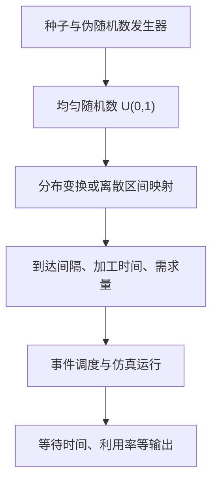
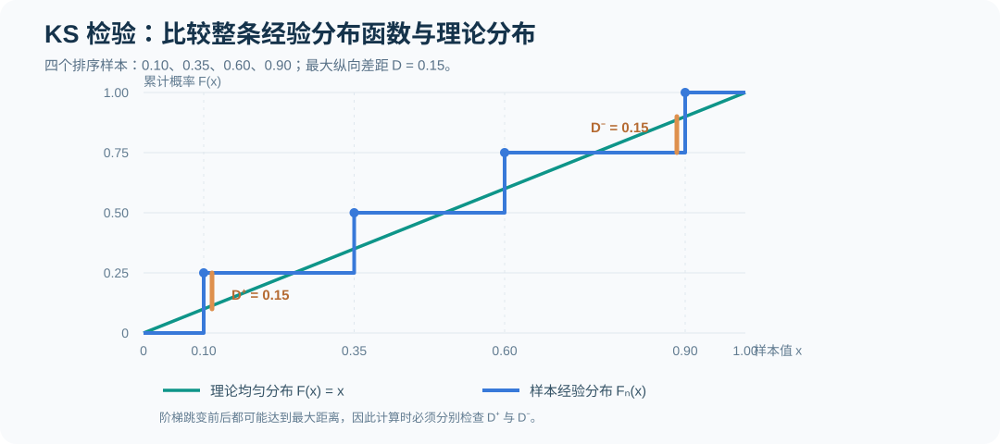
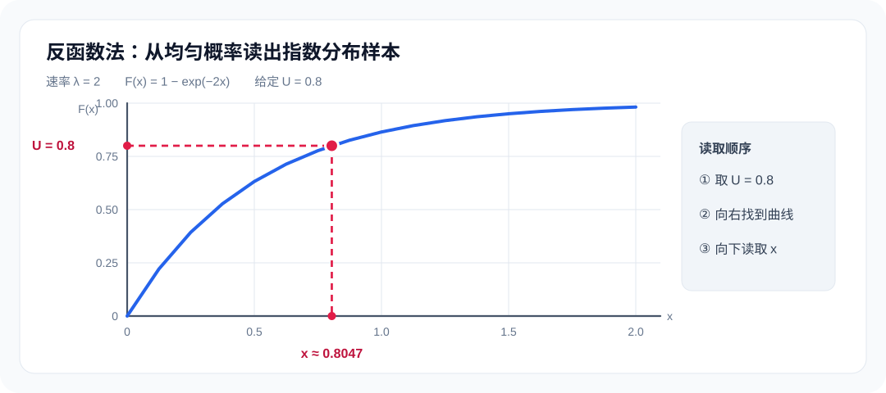

# 01｜从系统仿真到随机数：概念、检验与分布变换

[返回课程目录](../README.md) · [核心练习及解析](../exercises/01-core-exercises.md) · [下一讲：离散事件与服务台](02-discrete-event-queue.md) · [输入分布建模](05-input-modeling.md)

这一章有两个需要连起来理解的问题。第一个是：我们在电脑里构建的“系统”到底是什么，它靠什么机制随时间发生变化？第二个是：真实系统有随机到达、随机服务时间和随机需求，计算机又怎样给模型提供这些不确定的输入？

先把系统、状态和事件的区别说明白，再理解均匀伪随机数的来源、随机性检验的原假设，最后学习用分布变换把均匀数转成实际需要的随机变量。后续的排队系统、Arena 和蒙特卡洛仿真都依赖这条链条。

## 1. 系统、模型与仿真究竟是什么关系

系统（System）是由相互作用的对象、资源和运行规则构成的整体。医院挂号、生产线、仓储订单处理、机场安检都可以作为研究系统。系统有自己的边界：例如只研究医院挂号窗口，病人离开挂号区就算离开当前模型，即使在现实中还需要继续就诊。

模型（Model）是对真实系统的有目的简化。建模者保留会影响研究目标的机制，暂时忽略与当前问题关系较小的细节。若研究的是挂号等待时间，需要描述到达、排队、服务时长和窗口数量；未必需要模拟医院走廊里每个人的步行轨迹。

仿真（Simulation）则是在计算机或手工计算中让模型运行，观察其行为与输出。建立模型和运行模型不是同一件事：模型描述“系统按什么规则变化”，一次仿真运行给出“在这些输入下，系统实际出现了什么轨迹”。

| 层次 | 要回答的问题 | 单机加工例子 |
| --- | --- | --- |
| 研究对象 | 现实中希望改进什么 | 缩短零件排队等待 |
| 系统边界 | 哪些环节纳入分析 | 外部到达 → M1 → 离开 |
| 模型规则 | 系统如何运行 | 单机、FCFS、不可抢占 |
| 输入 | 什么推动模型运行 | 到达间隔、加工时间 |
| 状态 | 任一时刻系统处于什么情况 | 机器忙闲、排队零件数 |
| 输出 | 用哪些指标评价 | 平均等待、队长、利用率 |

如果只有一次确定性输入和明确的服务规则，可以用手工事件表算出整条轨迹；若到达与加工时间服从随机分布，则需要不断生成输入并通常进行多次独立运行，才能估计平均性能及其不确定性。

### 1.1 实体、资源、状态、事件和活动不能混用

| 术语 | 准确定义 | 挂号窗口中的例子 |
| --- | --- | --- |
| 实体 Entity | 在系统内流动、接受处理的对象 | 病人 |
| 资源 Resource | 容量受限、被实体占用的服务能力 | 挂号窗口工作人员 |
| 队列 Queue | 等待满足某项服务条件的实体集合 | 排队等候的病人 |
| 状态 State | 给定时刻用于描述系统现状的变量 | 队长为 3，窗口忙碌 |
| 事件 Event | 在某个时刻引起系统状态变化的动作 | 病人到达、服务完成 |
| 活动 Activity | 占用一段时间的过程 | 某人办理挂号持续 4 分钟 |
| 仿真时钟 Clock | 模型内部记录当前时刻的变量 | TNOW 从 2 跳至 5 |

事件可以是瞬时的，活动却有持续时间。例如某人在时刻 2 开始服务、时刻 6 完成服务，开始与完成是两个事件，加工活动持续 4 个时间单位。仿真并不需要在 2、3、4、5、6 每一分钟都更新一次机器状态：如果中途没有事件，机器一直处于忙碌状态。

### 1.2 连续时间、离散事件与离散时间是不同概念

离散事件仿真（Discrete-Event Simulation，DES）的状态只在事件时刻发生跳变。两个事件之间，系统的离散状态（如队长、机器忙闲）通常保持不变，但连续时间仍在流逝。因此“事件离散”并不等于“时间只能取整数”。

连续系统模型关注状态随时间连续变化，例如水箱液位、温度或流速，常以微分方程刻画。离散时间模型则按固定时间步长更新，例如每天更新一次库存。它们按照不同维度分类，不能只凭某个模型里出现小数时刻就判断它是连续系统模型。

在排队系统中，两个顾客到达的间隔为 2.7 分钟完全合理。未来事件表可以直接把 TNOW 从 3.1 推进到 5.8，而无须固定每 0.1 分钟轮询一次。

### 1.3 确定性、随机性与终止条件

如果所有到达时间和加工时间都已经给定，单次仿真轨迹在固定规则下是确定的。若输入由概率分布产生，即使系统运行规则没有改变，不同随机数流也可能得到不同队长和完成时刻，这才需要通过重复仿真评估输出分布。

另外还要区分终止型与稳态型实验。终止型实验有明确的观察截止点，例如一个工作日或加工完指定订单；稳态型实验关注长时间运行后的典型表现，通常需要处理初始空系统引入的偏差。两者的统计分析将在[输出分析一章](04-output-analysis.md)详细讨论。

## 2. 为什么通常先生成 U(0,1) 均匀随机数

随机输入可能是“下一位顾客何时到达”“某项加工要持续多久”“今天会收到多少订单”。这些变量各自服从不同的分布，直接为每一种分布单独设计随机数发生器并不方便。通常的做法是：先获得足够可靠的均匀随机数，再通过数学变换生成目标分布的样本。



理想的 `U(0,1)` 随机变量满足两点：取值在 0 到 1 之间，每个等长区间具有与长度相等的概率；如果需要连续独立抽样，不同位置的随机变量还应相互独立。

```math
U\sim\operatorname{Uniform}(0,1),\qquad
P(a\leq U<b)=b-a\quad(0\leq a<b\leq1)
```

计算机中的实际序列通常是<strong>伪随机序列</strong>：给定算法与种子后，每一项由前面的状态确定，因而可以完全复现。它在统计检验上可能非常接近独立均匀抽样，但不能仅凭“表面上看不出规律”就认为它具有真正的数学独立性。

复现性在仿真实验中反而很重要：使用相同生成器、参数、种子以及相同的随机数调用顺序，才能复现同一组输入。改变了随机数被模型消耗的顺序，即使种子没变，顾客和机器得到的具体数值也可能不同。

## 3. 线性同余法 LCG 的递推与周期

线性同余法（Linear Congruential Generator，LCG）利用整数取模生成序列。最常见的混合同余法写作：

```math
X_{n+1}=(aX_n+c)\bmod m
```

```math
U_{n+1}=\frac{X_{n+1}}{m}
```

其中 m 是正整数模数，a 是乘数，c 是增量，X₀ 是种子。通常取 `0≤X₀<m`，于是所有后续 X 都在 `0,…,m−1` 之间。映射后生成的 U 属于 `[0,1)`，只能取有限个格点，不是真正连续的随机数。

“取模”就是计算整数除法的余数，例如 `31 mod 16=15`，`16 mod 16=0`。教材手算一般先计算整数 X，再除以 m 得 U；不要在每一步把 U 代回整数递推式。

### 3.1 从种子开始逐项手算

取以下参数：

```math
m=16,\qquad a=5,\qquad c=1,\qquad X_0=3
```

逐项计算：

```math
\begin{aligned}
X_1&=(5\times3+1)\bmod16=0\\
X_2&=(5\times0+1)\bmod16=1\\
X_3&=(5\times1+1)\bmod16=6\\
X_4&=(5\times6+1)\bmod16=15\\
X_5&=(5\times15+1)\bmod16=12
\end{aligned}
```

| 输出编号 | 运算 | X | U=X/16 |
| ---: | --- | ---: | ---: |
| 1 | `(5×3+1) mod 16` | 0 | 0.0000 |
| 2 | `(5×0+1) mod 16` | 1 | 0.0625 |
| 3 | `(5×1+1) mod 16` | 6 | 0.3750 |
| 4 | `(5×6+1) mod 16` | 15 | 0.9375 |
| 5 | `(5×15+1) mod 16` | 12 | 0.7500 |
| 6 | `(5×12+1) mod 16` | 13 | 0.8125 |
| 7 | `(5×13+1) mod 16` | 2 | 0.1250 |
| 8 | `(5×2+1) mod 16` | 11 | 0.6875 |

题目若要求“产生 5 个随机数”，一般指从 X₁ 到 X₅ 的 5 项，而不是把种子 X₀=3 当作第一项输出。题目如果明确要求包含初始状态，应以题设为准。

### 3.2 周期是什么，为什么不超过模数

发生器最多只有 m 个不同状态。只要状态重复，因为下一步完全由当前状态决定，后续输出也会按同样顺序重复。因此一条有限状态确定性序列最终必定进入循环，循环长度不可能超过 m。

周期（Period）指循环中不同状态的数量。达到满周期 m，表示一个循环能遍历所有 `0,…,m−1` 状态；这并不等于序列在任意相邻位置上都相互独立。

### 3.3 Hull–Dobell 定理：混合同余法何时满周期

当 c 不为 0 时，混合同余 LCG 取得满周期 m 的充要条件为：

1. c 与 m 互素，即最大公因数为 1。
2. m 的每个不同素因子都能整除 `a−1`。
3. 如果 m 是 4 的倍数，`a−1` 还必须能被 4 整除。

以本题 `m=16,a=5,c=1` 为例，`gcd(1,16)=1`；16 的唯一不同素因子为 2，`a−1=4` 能被 2 整除；16 又是 4 的倍数，4 也能整除 `a−1`。所以该 LCG 满周期 16。

完整的状态循环可以写为：

```text
3 → 0 → 1 → 6 → 15 → 12 → 13 → 2
  → 11 → 8 → 9 → 14 → 7 → 4 → 5 → 10 → 3
```

从种子 3 出发，经过 16 次递推第一次回到 3，中间的 16 个状态各不相同。

若增量 c=0，就变成乘同余法（multiplicative LCG）。它有不同的周期条件，不能直接照搬上面针对混合同余法的满周期定理。例如 c=0 且 X₀=0 时，序列永远停留在 0。

### 3.4 满周期为什么仍不足以证明“好随机”

模数为 16 的序列即使遍历了所有 16 个格点，也只有 16 种 U 值，完全不适合大规模高精度模拟。某些 LCG 虽然周期很长，但相邻数对或更高维的数点可能呈现明显格点与条纹，这叫随机数的结构性缺陷。

因此需要分开看三个层面：周期是否足够长、单个数的边际分布是否接近均匀、数与数之间是否存在不合理依赖。它们不是同一个问题。LCG 适合学习递推和检验原理，但严肃仿真应采用经过充分验证的现代伪随机数发生器；对安全用途，普通仿真发生器也不能自动视为密码学安全发生器。

## 4. 随机数检验在检验什么

一组 `U` 看起来分布在 0 到 1 之间，不能直接说明可以用来仿真。最基本的检验分为两类：均匀性检验与独立性或序列结构检验。

| 检验 | 主要针对的问题 | 常见统计量或方法 |
| --- | --- | --- |
| 卡方适合度 | 各子区间出现次数是否合理 | 频数偏差的加权平方和 |
| KS | 经验分布与理论分布最大差多少 | 经验 CDF 与理论 CDF 的最大距离 |
| 游程 | 高低值是否出现过多聚集或交替 | 游程数 R |
| 序列相关 | 相隔一定滞后期的值是否关联 | 样本自相关系数 |
| 扑克检验 | 数字模式重复次数是否合理 | 类别概率与观测频数的卡方比较 |

统计检验的结论需要准确表述：拒绝原假设，说明样本对该假设提供了反对证据；未拒绝原假设，只能说在当前样本量和检验方法下，没有足够证据否定它。一次或多次“不拒绝”都不能证明生成器真正独立均匀。

## 5. 卡方均匀性检验：先分组，再算频数差异

设共有 n 个均匀数，将 `[0,1)` 事先分为 k 个等宽区间。若原假设 H₀ 为均匀分布，每个区间理论概率为 `1/k`，因此期望频数相同。

```math
H_0:\ U\sim\operatorname{Uniform}(0,1)
```

```math
E_j=\frac{n}{k},\qquad
\chi^2=\sum_{j=1}^{k}\frac{(O_j-E_j)^2}{E_j}
```

这里 Oⱼ 是第 j 个区间实际落入的样本数，Eⱼ 是原假设下的期望样本数。平方使正负偏差都增加统计量；除以期望频数，是为了考虑不同类别期望规模的差异。

### 5.1 完整例题：100 个样本、5 个区间

取 n=100、k=5，观测频数为 `(13,17,18,25,27)`。五个等宽区间的理论概率均为 0.2，故每一组的期望频数为 20。

| 区间 | 实际频数 O | 期望频数 E | O−E | 统计量贡献 |
| --- | ---: | ---: | ---: | ---: |
| `[0,0.2)` | 13 | 20 | −7 | 49/20=2.45 |
| `[0.2,0.4)` | 17 | 20 | −3 | 9/20=0.45 |
| `[0.4,0.6)` | 18 | 20 | −2 | 4/20=0.20 |
| `[0.6,0.8)` | 25 | 20 | 5 | 25/20=1.25 |
| `[0.8,1)` | 27 | 20 | 7 | 49/20=2.45 |
| 合计 | 100 | 100 | 0 | 6.80 |

```math
\chi^2=\frac{49+9+4+25+49}{20}=6.8
```

如果没有利用样本估计额外分布参数，自由度通常为 `k−1=4`。给定显著性水平 α=0.05，对应临界值约为 9.488。因为 `6.8<9.488`，所以不拒绝均匀分布的原假设。

这不表示五组频数必须一样：即使样本真正独立均匀，有限样本也会随机波动。卡方检验关注的是频数差异是否大到不太符合该模型。

### 5.2 卡方检验的条件与自由度

各个类别应互不重叠、合起来覆盖全部样本，并在计算之前确定分类。经典卡方近似要求类别期望频数不能过小，常用经验标准是每类 E 至少约为 5。若期望频数太小，应按有依据的规则合并类别，或改用其他适合小样本的方法。

上述 `k−1` 自由度对应的是完全指定的类别概率且未估计额外参数的情况；若先从同一批样本估计了某些分布参数，自由度和检验方法需要相应调整，不能机械使用 `k−1`。

## 6. KS 检验：检验的是整个分布函数的最大偏差

Kolmogorov–Smirnov（KS）检验不要求先把样本分组。它将经验累积分布函数 Fₙ 与理论分布函数 F₀ 在整个横轴上比较，统计最大绝对距离。

对均匀分布，理论 CDF 为：

```math
F_0(x)=\begin{cases}
0,&x<0\\
x,&0\leq x<1\\
1,&x\geq1
\end{cases}
```

首先将 n 个样本按从小到大排序，记为 U₍₁₎、U₍₂₎、…、U₍ₙ₎。在每一个样本点，经验 CDF 有一个大小为 `1/n` 的向上跳变，因此需要分别考虑跳变前后与理论 CDF 的偏差。

```math
\begin{aligned}
D^+&=\max_{1\leq i\leq n}\left(\frac{i}{n}-U_{(i)}\right)\\
D^-&=\max_{1\leq i\leq n}\left(U_{(i)}-\frac{i-1}{n}\right)\\
D&=\max(D^+,D^-)
\end{aligned}
```

### 6.1 完整例题：四个均匀数

样本已排序为 `0.10、0.35、0.60、0.90`，n=4。逐项计算：

| i | 排序值 U₍ᵢ₎ | i/4 | (i−1)/4 | i/4−U₍ᵢ₎ | U₍ᵢ₎−(i−1)/4 |
| ---: | ---: | ---: | ---: | ---: | ---: |
| 1 | 0.10 | 0.25 | 0.00 | 0.15 | 0.10 |
| 2 | 0.35 | 0.50 | 0.25 | 0.15 | 0.10 |
| 3 | 0.60 | 0.75 | 0.50 | 0.15 | 0.10 |
| 4 | 0.90 | 1.00 | 0.75 | 0.10 | 0.15 |

所以：

```math
D^+=0.15,\qquad D^-=0.15,\qquad D=0.15
```



图里的阶梯线代表经验 CDF，斜线代表理论均匀分布。KS 统计量衡量二者在纵轴方向上的最大间距，而不是各个样本值与某个均值之间的距离。

这个例题只要求统计量，没有给显著性水平与临界值，因此不能凭 D=0.15 直接作显著性判断。若用于真实检验，必须按样本量、显著性水平以及理论分布是否完全指定，选用正确的临界值或 p 值计算方法。

特别注意：在同一批数据中估计正态分布的均值和方差后，再用普通、参数完全已知的单样本 KS 临界值做检验，一般不再有效；需要调整检验程序。

## 7. 游程检验：序列高低值是否有异常聚集

均匀性只检查数字分布在什么位置，并不直接检查数字出现的次序。比如一条序列前半段全是较小值，后半段全是较大值，它仍可能拥有看似均匀的整体直方图，却具有明显的时间结构。

游程检验（Runs Test）先按固定规则将样本分为 H 与 L 两类，例如 `U≥0.5` 为 H，`U<0.5` 为 L。连续相同符号形成一个游程；只有符号改变时，游程数才增加 1。

### 7.1 完整例题：如何数游程

观察以下六个符号：

```text
L | H H | L L | H
```

共 4 段，故游程数 R=4。高值 H 有 3 个、低值 L 有 3 个，记为 n₁=n₂=3，样本总数 n=6。

在两类元素的顺序随机排列、且条件固定两类数量的原假设下：

```math
E(R)=1+\frac{2n_1n_2}{n_1+n_2}
```

```math
\operatorname{Var}(R)=
\frac{2n_1n_2(2n_1n_2-n_1-n_2)}
{(n_1+n_2)^2(n_1+n_2-1)}
```

代入本例：

```math
\begin{aligned}
E(R)&=1+\frac{2\times3\times3}{6}=4\\
\operatorname{Var}(R)&=\frac{2\times3\times3\times(18-6)}{6^2\times5}=1.2
\end{aligned}
```

本例实际 R=4，恰好等于理论期望。由于样本仅 6 个，不应机械套用大样本正态近似作严肃显著性判断。对于足够大的样本，可考虑以 `Z=(R−E(R))/√Var(R)` 为近似统计量。

游程过少常表现为高值或低值连续聚集；游程过多常表现为 H、L 频繁交替。这里没有“游程越多越随机”的单调规律，过多或过少都值得怀疑。

## 8. 序列相关性检验：相邻随机数是否存在系统关系

即便每个数边际上都近似均匀，也不能自动推断它们相互独立。序列相关性检验关注 Uᵢ 与 Uᵢ₊ₖ 之间的关联，k 称为滞后阶数。例如 k=1 看相邻两项，k=2 看相隔一项的两项。

在长度为 n 的样本里，常见的滞后 k 样本自相关形式为：

```math
r_k=\frac{\sum_{i=1}^{n-k}(U_i-\overline U)(U_{i+k}-\overline U)}
{\sum_{i=1}^{n}(U_i-\overline U)^2}
```

一个接近 1 的相关系数可能意味着正向线性关联，接近 −1 可能意味着反向线性关联。接近 0 只说明在当前样本下没有观察到明显的线性相关，不等于证明非线性依赖不存在。

可以辅助画出点对 `(Uᵢ,Uᵢ₊₁)` 的散点图。理想情况下点应大体填满单位正方形而无明显条纹；某些质量较差的同余发生器在多维空间中会显示规则格点结构。

若课件使用不同的样本相关公式、采用环绕下标或改用固定理论均值 0.5，应按相应定义计算，不能在一份检验里混用不同分母与边界处理。

## 9. 扑克检验：从模式重复次数判断序列结构

扑克检验（Poker Test）先将随机数映射为数字，再将固定数量的数字分成一组。与直接检查数值大小不同，它关注一组数字内部的重复模式，例如“全部不同”“恰好一对相同”“三张相同”等。

这里采用一个完整明确的版本：每个独立均匀数 U 映射为数字 `d=⌊10U⌋`，因此每个数字等概率取 `0,…,9`；每 5 个连续数字组成一个<strong>不重叠</strong>的组。理论概率以这 5 个数字相互独立为前提。

### 9.1 五位数字共有多少种排列

有放回地从 10 个数字中选 5 次，全部可能的有序结果数为：

```math
10^5=100000
```

“全不同”意味着第一位有 10 种选择，第二位剩 9 种，依次为 8、7、6 种，因此：

```math
P(\text{all distinct})=\frac{10\times9\times8\times7\times6}{10^5}=0.3024
```

“恰好一对”先选择重复的数字（10 种），再选两个位置放这一对（组合数 C(5,2)=10），剩余三位必须从另外 9 个数字中有序选出 3 个不同数字，因此：

```math
P(\text{one pair})=
\frac{10\binom{5}{2}(9\times8\times7)}{10^5}=0.504
```

按照同样的计数方法可以得到全部常见模式：

| 五位数字的重复结构 | 类别说明 | 理论概率 |
| --- | --- | ---: |
| 五个全不同 | `1+1+1+1+1` | 0.3024 |
| 恰好一对 | `2+1+1+1` | 0.5040 |
| 恰好两对 | `2+2+1` | 0.1080 |
| 恰好三个相同 | `3+1+1` | 0.0720 |
| 葫芦 | `3+2` | 0.0090 |
| 四个相同 | `4+1` | 0.0045 |
| 五个相同 | `5` | 0.0001 |
| 合计 | 全部可能结果 | 1.0000 |

类别之间互不重叠：有三张相同且另外两张相同的组是“葫芦”，不能再计入“恰好三个相同”。

### 9.2 1000 个均匀随机数能得到多少组扑克样本

每 5 个均匀数组成一组，1000 个原始 U 只能形成 200 个不重叠的五位组，不是 1000 个扑克组。若直接对七个原始类别做卡方检验，稀有类别的期望频数会小于 5，例如“五个相同”的期望仅 `200×0.0001=0.02`。

一个符合基础卡方近似要求的处理方式，是把“恰好三个相同”“葫芦”“四个相同”“五个相同”合并为一个类别，得到四组：

| 合并后的模式类别 | 理论概率 | 200 组时的期望频数 |
| --- | ---: | ---: |
| 全不同 | 0.3024 | 60.48 |
| 恰好一对 | 0.5040 | 100.80 |
| 恰好两对 | 0.1080 | 21.60 |
| 三个相同或更高重复结构 | 0.0856 | 17.12 |
| 合计 | 1.0000 | 200.00 |

然后把实际观察到的四类频数与上表期望频数代入卡方统计量。四个类别的概率事先确定、没有估计额外参数时，自由度为 `4−1=3`。

如果课程使用的是三位扑克、四位扑克或直接读取 U 小数中的数字，其类别概率会改变。必须先按题目给出的组长、数字空间及分组规则推导概率，不能照搬本例的表。

## 10. 从 U 生成任意分布：反函数法的原理

上述方法得到的 U 接近均匀分布，但模型实际需要的可能是指数、正态或离散分布。反函数法（Inverse Transform）背后使用的是累计分布函数 F 的定义：

```math
F(x)=P(X\leq x)
```

对连续且严格单调的 F，可令：

```math
X=F^{-1}(U)
```

为什么可行？因为对任意 x，事件 `F⁻¹(U)≤x` 等价于 `U≤F(x)`。均匀变量落在 `[0,F(x)]` 的概率恰好为 F(x)，所以生成的 X 就有目标分布 F。

```math
P(F^{-1}(U)\leq x)=P(U\leq F(x))=F(x)
```

对于离散分布或 CDF 有平坦区间的分布，使用广义逆（分位数函数）：

```math
F^{-1}(u)=\inf\{x:F(x)\geq u\}
```

实际计算中不必为每个分布求解析反函数；可以用查表、数值分位数或接受—拒绝等方法生成样本。但本章最常见、最值得掌握的是可以直接手算的指数与离散分布。

### 10.1 均匀分布的线性变换

若希望得到区间 `[a,b]` 上的均匀变量，只需缩放并平移 U：

```math
X=a+(b-a)U
```

例如从 U=0.6 得到 `[10,20]` 上的均匀数，结果是 `10+10×0.6=16`。区间长度决定缩放倍数，左端点决定平移量。

### 10.2 指数分布：从 CDF 一步步解出随机变量

若 X 服从速率为 λ 的指数分布，λ 为单位时间内的平均发生速率，其 CDF 为：

```math
F(x)=1-e^{-\lambda x},\qquad x\geq0
```

令 U=F(X)，即：

```math
U=1-e^{-\lambda X}
```

移项并取自然对数：

```math
\begin{aligned}
e^{-\lambda X}&=1-U\\
-\lambda X&=\ln(1-U)\\
X&=-\frac{\ln(1-U)}{\lambda}
\end{aligned}
```

给定 `λ=2`、`U=0.8`，生成的指数间隔是：

```math
X=-\frac{\ln(0.2)}{2}\approx0.8047
```

若 λ 的单位为“每分钟发生 2 次”，X 的单位就是分钟，平均间隔为 `1/λ=0.5` 分钟。某一次生成值 0.8047 大于平均值 0.5 并不反常，指数分布本来就有右侧长尾。

还有一种等分布写法：

```math
X=-\frac{\ln U}{\lambda}
```

这是因为理想的 U 与 `1−U` 都服从均匀分布，但用同一个具体 U=0.8 代入两种表达式时，得到的数字并不相同。它们表示“生成结果的分布相同”，不是“对每一个种子输出逐项相等”。

实现时还需处理端点：如果 U=0，`ln U` 不存在；若 U=1，`ln(1−U)` 不存在。使用实际发生器时应明确其取值范围，保证传入对数的数为正。



### 10.3 离散需求：累计概率区间映射

某件产品每日需求 D 可能为 0、1、2 件，对应概率为 `0.2、0.5、0.3`。先做累计概率：

| 需求 D | 单点概率 | 累计概率 F(D) | 对应 U 的区间 |
| ---: | ---: | ---: | --- |
| 0 | 0.2 | 0.2 | `[0,0.2)` |
| 1 | 0.5 | 0.7 | `[0.2,0.7)` |
| 2 | 0.3 | 1.0 | `[0.7,1)` |

当 U=0.68 时，因 `0.2≤0.68<0.7`，生成 D=1；当 U=0.85 时，生成 D=2。由于随机数取到某个内部端点的概率在理想连续分布中为零，各区间闭合端的约定并不改变理论概率；程序里则应写明一致的边界规则。

### 10.4 另一个常见分布：三角分布

只有最小值 a、最可能值 m、最大值 b 的估计时，模型里经常使用三角分布。它的分位数变换可写成分段形式：

```math
X=\begin{cases}
a+\sqrt{U(b-a)(m-a)},&U\leq\frac{m-a}{b-a}\\
b-\sqrt{(1-U)(b-a)(b-m)},&U>\frac{m-a}{b-a}
\end{cases}
```

例如 a=1、m=2、b=5，分界概率为 `(2−1)/(5−1)=0.25`。若 U=0.75，应使用第二段，得到 `5−√((1−0.75)×4×3)=5−√3≈3.268`。它与指数分布不同，有固定的取值上下界。其他输入分布选择方法将在[输入建模一章](05-input-modeling.md)继续讨论。

## 11. Box–Muller：从两个均匀数得到两个标准正态数

正态分布的 CDF 没有初等函数表达的反函数，Box–Muller 变换提供了一种直接生成标准正态随机变量的方法。

取相互独立的两个均匀随机变量 U₁、U₂，其中 U₁ 严格大于 0。先构造一个半径和角度：

```math
R=\sqrt{-2\ln U_1},\qquad\Theta=2\pi U_2
```

再转为平面坐标：

```math
\begin{aligned}
Z_1&=R\cos\Theta=\sqrt{-2\ln U_1}\cos(2\pi U_2)\\
Z_2&=R\sin\Theta=\sqrt{-2\ln U_1}\sin(2\pi U_2)
\end{aligned}
```

若输入 U₁、U₂ 真正相互独立且服从连续均匀分布，则输出 Z₁、Z₂ 相互独立且各自服从标准正态分布 `N(0,1)`。这里的平方根和对数控制离原点的距离，正弦与余弦决定在平面上的方向。

### 11.1 代入数字完成一次变换

给定 `U₁=0.5`、`U₂=0.25`，半径和角度分别为：

```math
\begin{aligned}
R&=\sqrt{-2\ln(0.5)}=\sqrt{2\ln2}\approx1.1774\\
\Theta&=2\pi\times0.25=\frac{\pi}{2}
\end{aligned}
```

因为 `cos(π/2)=0`、`sin(π/2)=1`，所以：

```math
Z_1=0,\qquad Z_2=\sqrt{2\ln2}\approx1.1774
```

这道题检验的是变换公式能否正确代入。单个输出恰好是 0，并不能据此评价生成器好坏。需要大量样本才能检验变换后的分布形状与独立性。

### 11.2 生成任意均值和方差的正态变量

若 Z 服从标准正态分布，则：

```math
X=\mu+\sigma Z\sim N(\mu,\sigma^2)
```

注意目标分布写作 `N(μ,σ²)`，括号里的第二个参数是方差。若题目给 `N(10,4)`，标准差为 2，变换应写成 `X=10+2Z`，而不是 `10+4Z`。

### 11.3 1000 个 U 能生成多少个 Z

按照上面的双输出 Box–Muller 公式，每 2 个独立均匀输入能产生 2 个标准正态输出。因此 1000 个可用 U 分成 500 对，可以生成 1000 个标准正态值。如果只保留每对中的 Z₁，才只能得到 500 个正态样本。

在有限精度发生器中，若 U₁ 恰好为 0，需要按预先规定的方式处理端点，例如重新抽取一个有效值；不能直接计算 `ln0` 并把无穷大当成正常输出。特别是上一节 `m=16` 的简化 LCG 确实会输出 0，说明数值边界处理不是纯理论问题。

## 12. 如何检查变换后的 N(0,1) 样本

如果作业要求先生成 1000 个均匀数，再转成标准正态样本并检验，就应把“输入随机数的质量”和“变换结果是否近似正态”分成两个问题，而不是只画出一张直方图就得出全部结论。

建议按以下顺序分析：

| 观察内容 | 理论基准 | 能发现的问题 |
| --- | --- | --- |
| 样本均值 | 标准正态均值为 0 | 是否存在明显位置偏移 |
| 样本方差 | 标准正态方差为 1 | 是否过度集中或离散 |
| 直方图与理论密度 | 关于 0 对称、近似钟形 | 是否有偏斜或异常尾部 |
| Q–Q 图 | 分位数点大致沿参考线 | 尾部和整体分布偏差 |
| 合适的正态性检验 | 原假设为指定正态分布 | 偏差是否超出抽样波动 |
| 序列相关或游程检查 | 不应有明显时序规律 | 变换后是否存在依赖 |

对于标准正态变量，落在 `[-1.96,1.96]` 内的理论概率约为 0.95。如果抽取 1000 个相互独立的标准正态样本，这个区间内的数量期望约为 950，但并不要求每次恰好等于 950。按二项分布近似，其标准差为：

```math
\sqrt{1000\times0.95\times0.05}\approx6.89
```

这说明有限样本中的直方图高度和分位数出现偏差是正常的。真正应检查的是偏差是否在合理抽样波动之内，而不是机械要求样本均值必须等于 0、方差必须等于 1。

同样地，输出序列的自相关不能因为边际分布呈正态就忽略。原始均匀数如果存在依赖，单纯进行 Box–Muller 数学变换并不能保证实现中得到一组完全独立的正态样本。

## 13. 将随机数接到离散事件仿真上

掌握均匀数和分布变换后，才真正具备构造随机排队模型的输入。例如顾客到达间隔服从参数 λ=2 的指数分布，一次生成 U=0.8，对应间隔约 0.8047 分钟。若前一位顾客在时刻 3.00 到达，下一位顾客的到达事件就可以安排在：

```math
A_{i+1}=3.00+0.8047=3.8047
```

如果服务时间也具有随机性，则再从相应随机数流生成服务时间。当顾客真正开始服务时，以“当前仿真时刻 + 服务时长”安排其完成事件。到达间隔和服务时间可以服从不同的分布，不应仅因为二者都来自 U 就强行使用同一个数值。

仿真输出是所有事件与资源约束共同作用后的结果。输入间隔即使相互独立，系统等待时间往往仍存在序列相关性，因为前一个顾客占用资源会影响后一个顾客的等待。因此“输入随机”与“输出独立”也不是一回事。

## 14. 用于复习的四道小题

### 题 1：LCG 递推与参数判断

题目：`m=16,a=5,c=1,X₀=3`，求前三个 U，并判断是否满足混合同余满周期条件。

标准答案：`U₁=0、U₂=0.0625、U₃=0.375`；满足满周期条件，周期为 16。

解析：先算 `X₁=0、X₂=1、X₃=6`，除以 16；再检验 `gcd(1,16)=1`，`a−1=4` 可被 2 和 4 整除。满周期的判定与这些 U 看起来均不均匀是两个不同的问题。

### 题 2：卡方统计量与显著性结论

题目：100 个均匀数落入 5 个等宽区间，频数为 `(13,17,18,25,27)`，给定 α=0.05 对应临界值 9.488。求检验结论。

标准答案：统计量 6.8，自由度 4，不拒绝均匀分布原假设。

解析：期望频数均为 20，平方偏差和 136，统计量 `136/20=6.8`，小于 9.488。结论只能是不拒绝，不能写为“证明完全均匀且独立”。

### 题 3：反函数生成指数样本

题目：指数分布速率 λ=2，取 U=0.8。求生成值，并写出该分布的理论平均间隔。

标准答案：生成值约 0.8047，理论平均间隔为 0.5 个时间单位。

解析：`X=−ln(1−0.8)/2≈0.8047`；速率的倒数 `1/λ=0.5` 才是期望间隔，二者不要混淆。

### 题 4：Box–Muller 的双输出

题目：给定独立均匀数 `U₁=0.5、U₂=0.25`，求两项 Box–Muller 输出。

标准答案：`Z₁=0、Z₂≈1.1774`。

解析：`R=√(2ln2)`，角度为 `π/2`，所以余弦项为 0、正弦项为 1。两个输出是在理想独立均匀输入假设下得到的标准正态变量。

## 15. 考试中容易出现的概念混淆

| 易混的两个概念 | 需要记住的区别 |
| --- | --- |
| 模型与仿真运行 | 模型给出规则，一次运行给出特定输入下的轨迹 |
| 连续时间与离散事件 | 连续时间轴上仍可只在离散时刻发生事件 |
| 伪随机与不可复现 | 合格伪随机序列通常可以通过固定种子精确复现 |
| LCG 满周期与独立性 | 周期是状态循环性质，独立性还需检查时序结构 |
| 卡方与 KS | 卡方对分类频数比较，KS 对经验 CDF 与理论 CDF 比较 |
| 均匀性与独立性 | 边际上均匀，不保证相邻抽样无关联 |
| 游程多与随机性好 | 游程过少和过多都可能偏离随机排列的预期 |
| 到达速率与平均间隔 | 指数分布的平均间隔为速率的倒数 |
| 分布相同与逐次值相同 | 两个公式等分布，不代表同一个 U 输入得到同一数值 |
| 标准差与方差 | `N(μ,σ²)` 的第二参数是方差，变换系数为 σ |
| 已通过检验与证明随机 | 不拒绝统计假设，不等于证明生成器完美 |

后续[离散事件与并行服务台](02-discrete-event-queue.md)将把本章生成的到达与服务输入接到完整事件表；[输入分布建模](05-input-modeling.md)则继续研究怎样根据真实数据确定分布参数。随机数生成和统计检验的核心练习见[第一组习题](../exercises/01-core-exercises.md)。
