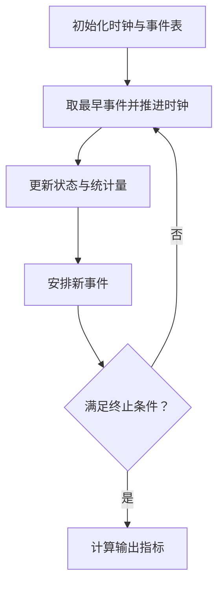

# 02｜离散事件仿真、并行服务台与输出分析

[返回板块目录](../README.md) · [上一讲：随机数与变换](01-random-numbers.md) · [标准练习与解析](../exercises/01-core-exercises.md)

> **模型辨析：**本讲的双服务台是“并行服务”，零件只需选择其中一台。如果每个零件必须先通过 M1，再运输到 M2 继续加工，则属于“串联加工”。参见 [零件加工与手工事件调度专题](../manual-event-simulation/README.md)，其中有完整的 TNOW/FEL 推演、时间线与习题。

## 1. 离散事件仿真的基本机制

离散事件仿真（Discrete-Event Simulation, DES）只在某个**事件发生时**改变状态，并把仿真时钟推进到下一次事件的时间，而非按固定的每秒步长重复计算。

以排队系统为例：实体是顾客；资源是机器；状态包括队列长度和各机器忙闲；事件是“到达”“服务完成”；随机输入通常是到达间隔与服务时间。

### 1.1 未来事件表（Future Event List）

未来事件表记录已经安排、尚未发生的事件及其发生时间。每次循环：

1. 取出时间最早的事件，将时钟跳到该时刻；
2. 按事件规则更新机器、队列和统计量；
3. 如果引发新的完成事件或新到达，安排进未来事件表；
4. 重复直到满足终止条件。

同一时刻可能有多个事件。**先完成服务还是先处理新到达**必须预先制定一致的规则；不同规则在精确相同时间发生时可能改变路由和等待结果。

## 2. 两个并行服务台：M1 优先

下面建立一个可手算的模型。假设存在两台相同服务能力的机器 M1、M2，且共享**一个先进先出队列（FCFS）**。

- 若 M1 空闲，进入服务的顾客优先使用 M1；否则若 M2 空闲，使用 M2。
- 若两台都忙，顾客进入共享队列，并按照先到先服务的顺序等待。
- 机器完成服务后，立即从等待队列取队首顾客；当两台同时空闲且有等待者时，先分配给 M1。
- **本例约定**同一时刻先处理服务完成与既有队列分配，再处理新到达；到达与离开时间相同可以零等待接续。

注意：这里“M1 优先”指**可用机器的选择顺序**，不意味着 M1 处理的顾客拥有更高的排队优先级，也不意味着 M2 必须等 M1 处理完所有任务才能工作。

### 2.1 事件规则

**顾客到达：**记录到达时刻；若有空闲机器，按照 M1→M2 顺序立即开始服务并安排完成事件；否则排队。随后安排下一位顾客到达（如模型继续运行）。

**服务完成：**记录完成时刻，释放机器；若队列非空，取队首顾客并立即开始服务，安排新的完成事件。若同一时刻两台机器完成，则先统一释放，再按 M1、M2 顺序给队列中的顾客分配资源。

对于服务时间为 $S_i$、到达时刻为 $A_i$、开始服务时刻为 $B_i$、离开时刻为 $D_i$ 的顾客，

$$W_{q,i}=B_i-A_i,\qquad D_i=B_i+S_i,\qquad W_i=D_i-A_i=W_{q,i}+S_i.$$

其中 $W_q$ 是**排队等待时间**，$W$ 是**系统逗留时间**，不要混淆。

## 3. 手工推进一张完整事件表

假定 6 位顾客的到达时刻依次为 $0,1,2,3,4,5$，所需服务时间分别为 $4,3,2,1,3,2$（单位：分钟）。这些数字在本题中是给定输入，不需额外抽样。

| 顾客 | 到达 $A_i$ | 服务 $S_i$ | 分配机器 | 开始 $B_i$ | 离开 $D_i$ | 等待 $W_{q,i}$ | 逗留 $W_i$ |
| --- | ---: | ---: | --- | ---: | ---: | ---: | ---: |
| 1 | 0 | 4 | M1 | 0 | 4 | 0 | 4 |
| 2 | 1 | 3 | M2 | 1 | 4 | 0 | 3 |
| 3 | 2 | 2 | M1 | 4 | 6 | 2 | 4 |
| 4 | 3 | 1 | M2 | 4 | 5 | 1 | 2 |
| 5 | 4 | 3 | M2 | 5 | 8 | 1 | 4 |
| 6 | 5 | 2 | M1 | 6 | 8 | 1 | 3 |

### 3.1 为什么第 3、4 位顾客都在时刻 4 开始？

时刻 4，M1、M2 同时完成顾客 1、2 的服务；共享队列中已有顾客 3、4。按照规则，先由 M1 取顾客 3（4–6），再由 M2 取顾客 4（4–5），随后新到达的顾客 5 才进入队列。

时刻 5，M2 完成顾客 4 的服务，先接顾客 5（5–8）；随后顾客 6 到达并排队。时刻 6，M1 完成顾客 3 的服务，接顾客 6（6–8）。

因此平均等待与平均逗留时间分别为

$$\overline W_q=\frac{0+0+2+1+1+1}{6}=\boxed{\frac56\text{ 分钟}},$$

$$\overline W=\frac{4+3+4+2+4+3}{6}=\boxed{\frac{10}{3}\text{ 分钟}}.$$

### 3.2 时间平均队长与机器利用率

队列长度在各区间保持不变：$[2,3)$ 为 1，$[3,4)$ 为 2，$[4,5)$ 为 1，$[5,6)$ 为 1，其余时间为 0。因此观察区间 $[0,8]$ 内，

$$\overline L_q=\frac{\int_0^8L_q(t)\,dt}{8}=\frac{1+2+1+1}{8}=\boxed{0.625}.$$

同一区间内 M1 忙碌 $4+2+2=8$ 分钟，M2 忙碌 $3+1+3=7$ 分钟，所以

$$\rho_{M1}=\frac88=100\%,\qquad\rho_{M2}=\frac78=87.5\%.$$

**关键区别：**平均等待时间按顾客人数取平均；平均队列长度按时间加权；机器利用率按该机器的忙碌时间除以观察时间。三种统计量不能混用分母。

此例在时刻 8 已全部离开，且初始为空，故可核对 $\overline L_q=(6/8)\overline W_q=0.625$。这只是该完整观察区间内守恒关系的数值核查，不能据此把短样本当作稳态估计。

## 4. 与排队论解析模型的关系

经典 $M/M/1$ 表示到达过程为泊松过程（到达间隔指数分布）、服务时间指数分布、单服务台。在稳定条件 $\lambda<\mu$ 下，

$$\rho=\frac\lambda\mu,\qquad W=\frac1{\mu-\lambda},\qquad W_q=\frac\lambda{\mu(\mu-\lambda)},$$

$$L=\lambda W,\qquad L_q=\lambda W_q.$$

这些公式是**单服务台、特定分布、稳态**模型的解析结果，不能直接套给本讲的两个并行服务台手算例子。若到达分布、服务分布或优先规则复杂，仿真更容易纳入具体业务限制。

## 5. Arena 中如何实现

Arena 是离散事件仿真软件，常用基础模块包括：

| 模块 | 作用 | 双服务台模型中的对应 |
| --- | --- | --- |
| Create | 生成实体、指定到达机制 | 顾客到达 |
| Process | 请求资源、延迟处理、释放资源 | 机器服务（Seize–Delay–Release） |
| Decide | 根据条件分支 | 按机器可用状态作路由判断 |
| Assign | 给实体赋属性或变量 | 记录到达时间、选择的机器 |
| Record | 统计指定指标 | 等待、逗留时间等 |
| Dispose | 实体离开系统 | 服务完成后离开 |

**容易出错的建模细节：**如果两个机器共享一个队列，不能只在顾客到达时用一个 Decide 把顾客永久分给 M1 或 M2。因为两台都忙时，未来哪台先空闲尚不确定；固定分流可能生成**两条独立队列**，与本题的“共用队列 + 空闲机器接下一位”不同。应检查资源请求与释放逻辑是否真正实现共享 FCFS 队列，并用本页的 6 顾客确定性样例核对结果。

若模型另规定“各自排队”或“M1 忙时一律分配 M2 队列”，则是**另一种系统模型**，结果可能不同，须先写明规则。

## 6. 终止型仿真与稳态仿真

**终止型（terminating）仿真**有明确的自然起止点，例如一家银行每天营业 8 小时，或者一天全部订单处理完毕。分析对象是该期间的绩效，可把营业开始时的空系统视为真实初始条件。

**稳态（steady-state）仿真**希望研究长时间运行后的典型性能，例如不间断生产系统的长期平均队长。若模型从空系统开始，早期排队少，直接纳入全程可能造成**初始化偏差**，因此经常需要预热期（warm-up）并丢弃预热期统计量。

| 问题 | 终止型 | 稳态型 |
| --- | --- | --- |
| 统计目标 | 一个完整运营周期的绩效 | 长期运行后的性能 |
| 初始状态 | 常是研究对象的一部分 | 可能引入偏差 |
| 运行长度 | 通常由业务周期决定 | 需要足够长以接近稳态 |
| 主要方法 | 多次独立重复、置信区间 | 预热期、长运行、独立重复或批均值法 |

### 6.1 独立重复与置信区间

假设做 $r$ 次相互独立的仿真重复，每次得到一个统计量 $Y_j$。样本均值和样本标准差为

$$\overline Y=\frac1r\sum_{j=1}^rY_j,\qquad s^2=\frac1{r-1}\sum_{j=1}^r(Y_j-\overline Y)^2.$$

若各次重复独立、条件适当，均值的近似 $(1-\alpha)$ 置信区间是

$$\boxed{\overline Y\pm t_{1-\alpha/2,r-1}\frac{s}{\sqrt r}}.$$

统计单位是**一次重复得到的一个结果**，不是把同一条长仿真轨迹中相邻顾客的等待时间直接当成大量独立重复。后者存在相关性，可能低估标准误。

## 7. 输出相关性与方差缩减

同一条仿真轨迹里，前一位顾客等待过久往往意味着后一位也更容易等待，因此逐顾客的观察值常具有**序列相关性**。即使每次输入随机数独立，输出也未必独立。

**批均值法（batch means）**把稳定运行阶段的长轨迹分成若干较长的批次，以每批的平均值做统计分析。批太短时，批均值仍可能高度相关；需要检查批间相关性与批长。

常见方差缩减方法：

- **共同随机数（Common Random Numbers, CRN）**：比较方案 A/B 时，尽量让对应的顾客到达、服务需求使用同一组随机输入，分析每次配对的差 $D_j=Y_{A,j}-Y_{B,j}$。当两个方案输出正相关时，差值方差可下降：$\operatorname{Var}(A-B)=\operatorname{Var}(A)+\operatorname{Var}(B)-2\operatorname{Cov}(A,B)$。
- **对偶变量（Antithetic Variates）**：通过 $U$ 与 $1-U$ 构造负相关的成对结果，在适合的模型中减小平均值方差。
- **控制变量（Control Variates）**：利用与目标输出相关且期望已知的辅助变量进行修正。

注意：共同随机数不保证总能缩小方差，关键是对应输出的协方差符号和大小；更不能仅因为使用同一随机种子就认为两个方案的各类随机事件自动一一对应。

## 8. 计算与建模自检

做服务台题前先写出：到达时刻还是到达间隔；服务时间属于哪个顾客；是否共用队列；M1 优先具体指什么；同时事件怎样处理；仿真何时结束。做输出分析题前再核对：结果是按顾客平均还是按时间平均；样本单位是顾客还是独立重复；研究的是一个有限周期还是稳态。

**配套练习：**[01｜核心练习与逐题解析](../exercises/01-core-exercises.md)。
