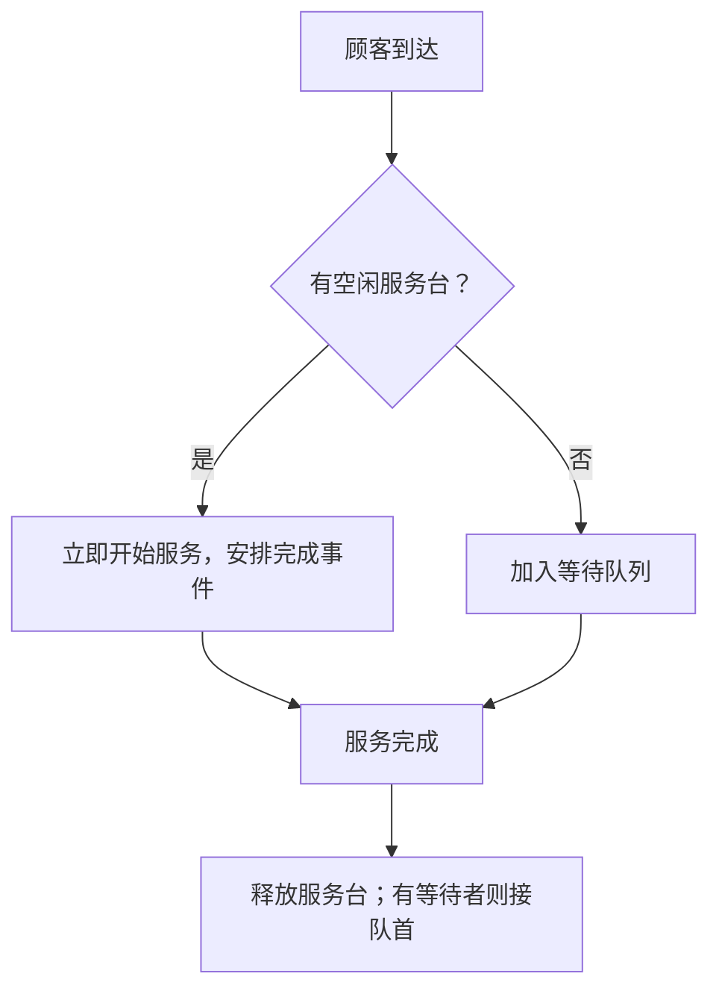
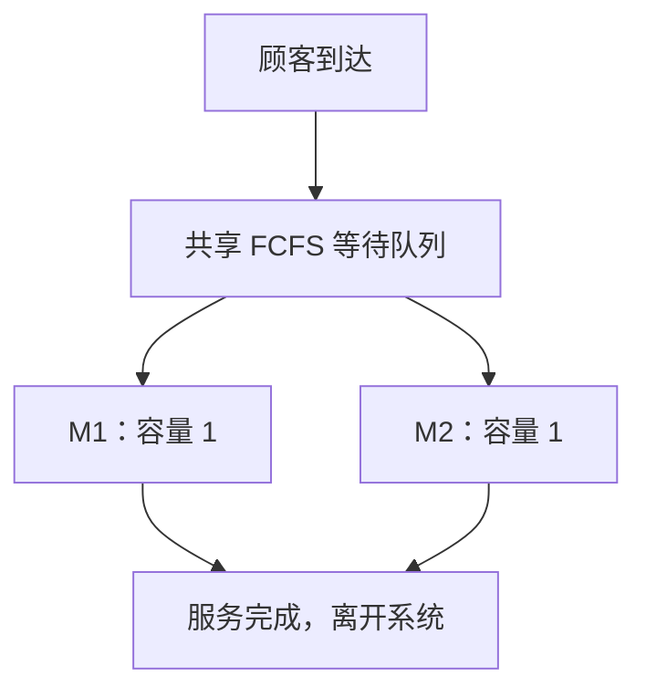
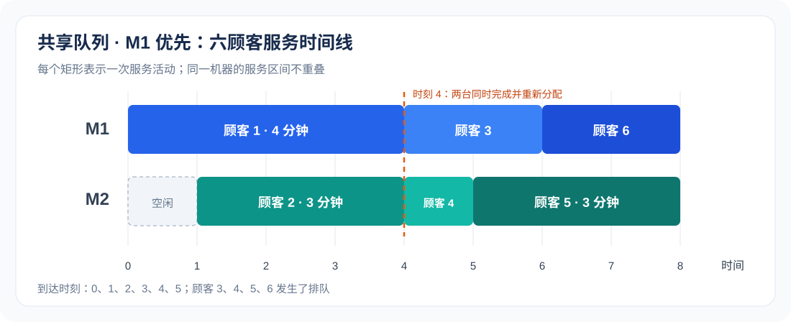
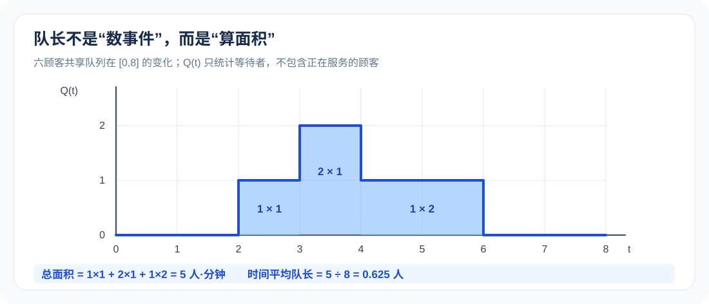

# 02｜离散事件仿真与排队系统：从事件表到统计结果

[返回课程目录](../README.md) · [上一讲：随机数与分布变换](01-random-numbers.md) · [手工事件仿真专题](../manual-event-simulation/README.md) · [核心习题](../exercises/01-core-exercises.md) · [下一讲：项目工序与 Arena](03-arena-project-process.md)

这一章研究的是计算机怎样让一个服务系统“动起来”。顾客按某种顺序到达，机器有时忙、有时闲，等候中的顾客必须遵守队列规则。我们既要算清楚每个人什么时候开始服务、什么时候离开，也要解释平均等待、平均队长和利用率为什么采用不同的计算方法。

先从一台机器建立事件推进规则，再扩展到两台并行服务台。双服务台采用课堂上常见的“M1 优先”约定，并给出完整的事件记录、时间面积和截尾结果。末尾讨论 M/M/1、M/M/2 解析公式、Arena 建模以及程序验证。若零件必须依次经过 M1、M2 两道工序，则是<strong>串联</strong>系统，不属于这里的并行服务结构；串联问题在[手工事件调度专题](../manual-event-simulation/01-tandem-four-parts.md)中单独推导。

## 1. 为什么离散事件模型可以跳过没有事件的时间

考虑一家只有一个窗口的服务站。当前窗口正在服务顾客 1，预计在 8:10 结束；下一位顾客预计在 8:06 到达。如果从 8:00 开始每秒检查一次窗口状态，可以模拟系统，但会做大量没有实际意义的计算。在 8:00 到 8:06 之间，没有新顾客到达、服务也没有完成，队长和窗口忙闲不会改变。

离散事件仿真（Discrete-Event Simulation，DES）利用这一特点：状态只在特定事件时刻发生跳变，仿真时钟直接推进到下一事件时刻。因此 8:05:30 完全可能是一个事件时刻；“离散事件”并不表示时间只能取整数。

一条典型事件链如下：



这里的箭头描述的是逻辑关系，不代表每次到达后必然立即发生服务完成。真正的事件发生时刻由到达间隔和服务持续时间决定。

### 1.1 四类对象：状态、事件、活动、统计量

| 对象 | 它回答的问题 | 双服务台中的例子 |
| --- | --- | --- |
| 状态 State | 当前系统是什么情况 | M1 忙、M2 闲、队列中有 2 人 |
| 事件 Event | 什么动作使状态改变 | 顾客 5 到达；M1 完成顾客 3 |
| 活动 Activity | 两个事件之间持续发生什么 | M1 从时刻 4 到 6 服务顾客 3 |
| 统计量 Statistic | 到目前为止累计了多少绩效 | 队长面积 5 人·分钟、M1 忙碌 8 分钟 |

状态中的“队长为 2”是时刻值，统计量中的“队长面积为 5”是截至某时刻的累计值。手算时必须把这两类变量分开记录。事件表负责还原轨迹，统计量则从轨迹中计算出来。

### 1.2 边界、服务规则和终止时刻决定题目的含义

同一道“两台机器加工六件零件”的题，至少可能对应三类不同模型：

| 模型结构 | 零件怎样使用 M1、M2 | 队列形式 |
| --- | --- | --- |
| 单服务台 | 所有零件只使用 M1 | 一条队列 |
| 双服务台并行 | 每件零件在 M1、M2 中选一台，服务一次即离开 | 可能共用队列，也可能各自排队 |
| 双机器串联 | 每件零件先通过 M1，再通过 M2 | 通常两道工序各有队列 |

并行系统能同时处理两位不同的顾客；串联系统也可能两台机器同时忙碌，但它们在处理<strong>同一流程的不同工序</strong>，必须记录两次服务。判断模型不能只看机器数量，必须看每件零件走过的路径。

还要确认观察终止条件：固定观察到 T=15，与“直到所有顾客服务完成”为止，并非同一件事。前者可能留下未完工顾客，后者则会延长观察时间，改变平均队长与利用率的分母。

## 2. 先统一记号，再谈计算

设有 n 位按到达顺序编号的顾客，第 i 位顾客的到达时刻为 Aᵢ，服务需要 Sᵢ 个时间单位，实际开始服务的时刻为 Bᵢ，完成服务并离开时刻为 Dᵢ。

| 记号 | 定义 | 单位 |
| --- | --- | --- |
| Aᵢ | 顾客 i 到达系统的绝对时刻 | 分钟 |
| Δᵢ | 顾客 i 相对上一位的到达间隔 | 分钟 |
| Sᵢ | 顾客 i 实际需要的服务时间 | 分钟 |
| Bᵢ | 顾客 i 开始占用服务台的时刻 | 分钟 |
| Dᵢ | 顾客 i 完成服务并离开的时刻 | 分钟 |
| Wq,ᵢ | 顾客 i 在队列中的等待时间 | 分钟 |
| Wᵢ | 顾客 i 从到达到离开的系统逗留时间 | 分钟 |
| Q(t) | 时刻 t 正在等待、尚未接受服务的人数 | 人 |
| N(t) | 时刻 t 已到达但尚未离开的人数 | 人 |
| I₁(t)、I₂(t) | M1、M2 是否忙碌，忙为 1、闲为 0 | 无量纲 |

对每位最终完成服务的顾客，下列关系始终成立：

```math
\begin{aligned}
W_{q,i}&=B_i-A_i\\
D_i&=B_i+S_i\\
W_i&=D_i-A_i=W_{q,i}+S_i
\end{aligned}
```

顾客到达以后，如果机器空闲，可以有 Bᵢ=Aᵢ，等待时间为 0；如果需要排队，则 Bᵢ>Aᵢ。这里的服务规则不允许插队，也不允许中途抢占正在进行的服务，因此不会出现负等待时间。

### 2.1 到达间隔不能直接当作绝对时刻

如果到达间隔依次为 0、2、1、3，那么绝对到达时刻是 0、2、3、6，而不是 0、2、1、3。第 i 位顾客的绝对时刻需要逐个累加：

```math
A_1=\Delta_1,\qquad
A_i=A_{i-1}+\Delta_i=\sum_{j=1}^{i}\Delta_j
```

有些题给出的是实际到达时刻，便无须重复累加。手算前先检查表头写的是 Interarrival Time 还是 Arrival Time。

## 3. 未来事件表 FEL 怎样推进

FEL 是 Future Event List，记录<strong>已经知道将在什么时间发生、但尚未执行</strong>的事件。对本章排队模型，主要有“顾客到达 A(i)”和“顾客 i 在机器 k 上服务完成 D(i,k)”两类事件。

正在排队的人不能立刻安排完成事件：他什么时候开始服务尚未确定。只有顾客真正获得某台机器时，才能根据当前时刻与服务时间安排未来完成事件。

### 3.1 每次推进的固定顺序

一个稳妥的手工计算或程序实现过程如下：

1. 读取 FEL 中最早的事件时刻 t，先计算旧状态从上一时刻 TNOW 持续到 t 的统计面积。
2. 将 TNOW 更新为 t，取出这个时刻的事件。
3. 按事先写明的同刻事件规则，处理顾客到达、服务完成、资源释放和队列分配。
4. 顾客开始服务时，立即将其新的完成事件放入 FEL；若需要，安排下一位顾客到达。
5. 不断重复，直到到达观察终点或者系统按题设清空。

队长面积与资源忙碌面积的累计公式是：

```math
\begin{aligned}
C_Q&\leftarrow C_Q+Q_{\mathrm{old}}(t-\mathrm{TNOW})\\
C_1&\leftarrow C_1+I_{1,\mathrm{old}}(t-\mathrm{TNOW})\\
C_2&\leftarrow C_2+I_{2,\mathrm{old}}(t-\mathrm{TNOW})
\end{aligned}
```

这里的 old 强调：必须使用上一事件处理完毕之后、在本区间实际持续的状态。若先把队长改成新值，再乘以刚过去的时间间隔，就会把新状态错误地当成旧状态。

另一种形式是事件调度伪代码：

```text
初始化 TNOW、资源、队列、统计量、FEL
while 尚未达到终止条件:
    t = FEL 中最早的事件时刻
    根据旧状态累加 [TNOW,t) 的队长与忙碌面积
    TNOW = t
    处理所有时间为 t 的事件，并遵守同刻排序约定
    发生新服务时，安排相应的未来完成事件
汇总顾客级与时间级统计量
```

### 3.2 为什么同一时刻多个事件需要统一约定

例如顾客 1 正好在时刻 4 离开，顾客 3 也在时刻 4 到达。如果系统没有已有等待者，先离开后到达意味着顾客 3 可以在 4 开始服务。如果原来已有排队中的顾客 2，则顾客 2 必须先获得机器，顾客 3 不能仅凭到达与完成同刻就越过队首。

为使下文算例唯一，本章使用以下规则：同一时刻先处理所有已安排的服务完成，释放资源；再让原有队列按 FCFS 获得空闲机器；最后处理该时刻的新到达。若同一时刻有多个原有等待者、两台机器同时空闲，优先将队首分配给 M1，再将下一位分配给 M2。

这是一种明确的<strong>模型约定</strong>，不是所有仿真软件的统一默认行为。题目若另有优先级或同时事件规则，应以题设为准。

## 4. 单服务台：先把最基本的递推彻底弄清楚

对一台不允许抢占、遵守 FCFS 的服务台，只要知道前一位顾客的完成时刻，就能求下一位的开始时刻。第 i 位顾客不能早于自己到达时刻开始，也不能早于前一位顾客完成时刻开始，因此：

```math
B_1=A_1,\qquad
B_i=\max(A_i,D_{i-1})\quad(i\geq2)
```

```math
\begin{aligned}
D_i&=B_i+S_i\\
W_{q,i}&=\max(0,D_{i-1}-A_i)
\end{aligned}
```

第一位顾客之前没有服务对象，且这里假设机器初始空闲。若机器在观察开始时已有工作，第一位顾客的公式需要改写。

### 4.1 四顾客逐行计算

给定到达时刻 A=(0,1,3,5)，服务时间 S=(3,2,4,1)。

顾客 1 在 0 到达，机器空闲，从 0 服务到 3。顾客 2 在 1 到达，机器仍在忙，所以只能在 3 开始，服务到 5。顾客 3 在 3 到达，前面的顾客要到 5 才离开，所以他在 5 开始，服务到 9。顾客 4 在 5 到达，轮到他已经是时刻 9，服务到 10。

| 顾客 | 到达 A | 服务 S | 开始 B | 完成 D | 等待 Wq=B−A | 逗留 W=D−A |
| ---: | ---: | ---: | ---: | ---: | ---: | ---: |
| 1 | 0 | 3 | 0 | 3 | 0 | 3 |
| 2 | 1 | 2 | 3 | 5 | 2 | 4 |
| 3 | 3 | 4 | 5 | 9 | 2 | 6 |
| 4 | 5 | 1 | 9 | 10 | 4 | 5 |
| 合计 | — | 10 | — | — | 8 | 18 |

所以顾客级平均等待为 8/4=2 分钟，平均逗留为 18/4=4.5 分钟。观察窗口为 [0,10] 时，机器始终忙碌，利用率为 100%；顾客的服务时间总计 10，与观察窗口恰好相等。

### 4.2 Lindley 递推：把等待时间直接与到达间隔联系起来

有时题目只给相邻到达间隔 Δᵢ₊₁，而不希望先全部计算绝对到达时刻。把 Dᵢ=Bᵢ+Sᵢ、Bᵢ=Aᵢ+Wq,ᵢ 代入下一位的等待公式：

```math
\begin{aligned}
W_{q,i+1}
&=\max(0,D_i-A_{i+1})\\
&=\max(0,A_i+W_{q,i}+S_i-A_{i+1})\\
&=\max(0,W_{q,i}+S_i-\Delta_{i+1})
\end{aligned}
```

这就是单机 FCFS 排队系统最常用的 Lindley 等待时间递推式。如果本次等待为 2 分钟、服务用了 4 分钟、下一人相隔 3 分钟到达，那么下一人的等待为 max(0,2+4−3)=3 分钟。

注意递推式里是<strong>前一位顾客的服务时间 Sᵢ</strong>，不是下一位的 Sᵢ₊₁。原因是下一位要等待的，是前一位尚未完成的工作。

### 4.3 单机的队长面积核算

同一个算例，队列长度随时间变化：

| 时间段 | 等待中的顾客 | 队长 | 长度 | 面积 |
| --- | --- | ---: | ---: | ---: |
| [0,1) | 无 | 0 | 1 | 0 |
| [1,3) | 2 | 1 | 2 | 2 |
| [3,5) | 3 | 1 | 2 | 2 |
| [5,9) | 4 | 1 | 4 | 4 |
| [9,10) | 无 | 0 | 1 | 0 |
| 合计 | — | — | 10 | 8 |

队长面积 8 人·分钟恰好等于四位顾客等待时间之和 8 分钟。时间平均队长为 8/10=0.8 人，和按顾客平均等待 2 分钟不是同一个指标。

## 5. 两台并行服务台：共用 FCFS 队列，空闲时 M1 优先

本节建立一个完全明确的模型：有两台容量均为 1 的机器 M1、M2；每位顾客只需接受一次服务；所有等待者共用一条 FCFS 队列；已开始服务的顾客不能被抢占；当两台都空闲时优先使用 M1。



“M1 优先”仅仅规定<strong>选择空闲机器的顺序</strong>。它不表示 M1 的顾客可以插队，也不表示 M2 必须等 M1 完成以后才开始。两台机器可以在同一时间处理不同顾客。

### 5.1 六顾客的原始输入

设到达与服务时长已经确定，单位为分钟。此题只需执行事件调度，不需要从概率分布抽样。

| 顾客 | 绝对到达时刻 A | 服务时间 S |
| ---: | ---: | ---: |
| 1 | 0 | 4 |
| 2 | 1 | 3 |
| 3 | 2 | 2 |
| 4 | 3 | 1 |
| 5 | 4 | 3 |
| 6 | 5 | 2 |

初始时两台机器空闲，等待队列为空。所有顾客到达和服务都发生在 [0,8]，最终在时刻 8 系统清空。

### 5.2 不跳步的事件推进过程

时刻 0：顾客 1 到达，M1、M2 都空闲，按优先顺序分配 M1。顾客 1 在 [0,4) 服务；未来完成事件 D(1,M1) 安排在 4。

时刻 1：顾客 2 到达，M1 忙、M2 空闲，因此顾客 2 在 M2 服务 [1,4)，安排 D(2,M2) 于时刻 4。

时刻 2：顾客 3 到达，两台机器都忙，进入共享队列。队列变成 [3]。

时刻 3：顾客 4 到达，两台机器仍忙，排在顾客 3 后面。队列变成 [3,4]。

时刻 4：M1、M2 同时完成顾客 1、2。先让原队列中的顾客 3 获得 M1、顾客 4 获得 M2。顾客 3 的加工区间为 [4,6)，顾客 4 的加工区间为 [4,5)。随后顾客 5 在同刻到达，此时两台机器都已忙碌，顾客 5 进入队列 [5]。

时刻 5：M2 完成顾客 4，立即从队列取出顾客 5，在 M2 服务 [5,8)。随后顾客 6 到达，进入共享队列 [6]。

时刻 6：M1 完成顾客 3，从队列取顾客 6，在 M1 服务 [6,8)。此时等待队列已空。

时刻 8：M1、M2 同时完成顾客 6、5。所有人已离开，系统清空，运行结束。

完整记录如下。表内机器状态是<strong>该行所有同刻事件处理完毕之后</strong>的状态。

| TNOW | 本时刻处理的事件 | M1 状态与预计完成 | M2 状态与预计完成 | 事件后等待队列 |
| ---: | --- | --- | --- | --- |
| 0 | 顾客 1 到达 | 顾客 1，完成于 4 | 空闲 | [] |
| 1 | 顾客 2 到达 | 顾客 1，完成于 4 | 顾客 2，完成于 4 | [] |
| 2 | 顾客 3 到达 | 顾客 1，完成于 4 | 顾客 2，完成于 4 | [3] |
| 3 | 顾客 4 到达 | 顾客 1，完成于 4 | 顾客 2，完成于 4 | [3,4] |
| 4 | 顾客 1、2 完成；分配 3、4；顾客 5 到达 | 顾客 3，完成于 6 | 顾客 4，完成于 5 | [5] |
| 5 | 顾客 4 完成；分配 5；顾客 6 到达 | 顾客 3，完成于 6 | 顾客 5，完成于 8 | [6] |
| 6 | 顾客 3 完成；分配 6 | 顾客 6，完成于 8 | 顾客 5，完成于 8 | [] |
| 8 | 顾客 5、6 完成 | 空闲 | 空闲 | [] |

### 5.3 事件执行后，FEL 实际留下哪些安排

在顾客尚未开始服务之前，FEL 里绝不能提前写入他的完成时刻。把到达事件逐次安排的写法用于本例，可以得到下面的快照：

| TNOW，事件处理后 | FEL 中尚未发生的事件 |
| ---: | --- |
| 0 | A(2)@1；D(1,M1)@4 |
| 1 | A(3)@2；D(1,M1)@4；D(2,M2)@4 |
| 2 | A(4)@3；D(1,M1)@4；D(2,M2)@4 |
| 3 | A(5)@4；D(1,M1)@4；D(2,M2)@4 |
| 4 | A(6)@5；D(4,M2)@5；D(3,M1)@6 |
| 5 | D(3,M1)@6；D(5,M2)@8 |
| 6 | D(5,M2)@8；D(6,M1)@8 |
| 8 | 空 |

这里 A(3)@2 的意思是“顾客 3 将在时刻 2 到达”，D(3,M1)@6 的意思是“顾客 3 将在时刻 6 完成 M1 服务”。FEL 中已经执行的事件会被移除；排队但未开工的顾客只有其队列记录，没有确定的完成事件。

### 5.4 每位顾客的完整计算结果

| 顾客 | A | S | 机器 | 开始 B | 离开 D | 等待 B−A | 逗留 D−A |
| ---: | ---: | ---: | --- | ---: | ---: | ---: | ---: |
| 1 | 0 | 4 | M1 | 0 | 4 | 0 | 4 |
| 2 | 1 | 3 | M2 | 1 | 4 | 0 | 3 |
| 3 | 2 | 2 | M1 | 4 | 6 | 2 | 4 |
| 4 | 3 | 1 | M2 | 4 | 5 | 1 | 2 |
| 5 | 4 | 3 | M2 | 5 | 8 | 1 | 4 |
| 6 | 5 | 2 | M1 | 6 | 8 | 1 | 3 |
| 合计 | — | 15 | — | — | — | 5 | 20 |

```math
\begin{aligned}
\overline W_q&=\frac{0+0+2+1+1+1}{6}
=\frac{5}{6}\approx0.8333\ \mathrm{min}\\
\overline W&=\frac{4+3+4+2+4+3}{6}
=\frac{10}{3}\approx3.3333\ \mathrm{min}
\end{aligned}
```

服务时间总和为 15，等待时间总和为 5，逗留时间总和为 20。可以直接核对 15+5=20，这也是逐位关系 Wᵢ=Wq,ᵢ+Sᵢ 求和后的结果。



## 6. 三个最重要的输出：平均等待、时间平均队长、利用率

这三个指标都可以从第 5 节的事件表获得，但分母不同。平均等待时间按顾客人数统计；时间平均队长按观察区间的长度统计；机器利用率按该机器在观察区间内的忙碌时间统计。

### 6.1 平均等待与平均逗留：一位顾客算一份

如果研究的是所有 n 位已完成服务顾客的完整经历，定义为：

```math
\overline W_q=\frac{1}{n}\sum_{i=1}^n(B_i-A_i),\qquad
\overline W=\frac{1}{n}\sum_{i=1}^n(D_i-A_i)
```

本例六人平均排队等待 5/6 分钟，平均系统逗留 10/3 分钟。服务台有两台不会使等待时间的分母变成 12；每位顾客只在其中一台接受一次服务。

同样，系统中的平均服务时长为 15/6=2.5 分钟，因此可以核对：

```math
\overline W=\overline W_q+\overline S
=\frac{5}{6}+\frac{15}{6}
=\frac{10}{3}
```

### 6.2 时间平均队长：要用面积，不能平均事件表的队长

Q(t) 表示时刻 t 正在等待的顾客数，不包括已开始服务、正在占用 M1 或 M2 的顾客。观察区间 [0,T] 的时间平均队长定义为：

```math
\overline L_{q,[0,T]}=\frac{1}{T}\int_0^T Q(t)\,dt
```

队长曲线是一条阶梯线，可以直接在每个相邻事件区间内计算“队长 × 持续时间”，累加后除以总时长。六顾客例子的完整统计表为：

| 时间区间 | 长度 Δt | 等待队列 | Q(t) | M1 忙碌 | M2 忙碌 | 队长面积 Q×Δt |
| --- | ---: | --- | ---: | ---: | ---: | ---: |
| [0,1) | 1 | [] | 0 | 1 | 0 | 0 |
| [1,2) | 1 | [] | 0 | 1 | 1 | 0 |
| [2,3) | 1 | [3] | 1 | 1 | 1 | 1 |
| [3,4) | 1 | [3,4] | 2 | 1 | 1 | 2 |
| [4,5) | 1 | [5] | 1 | 1 | 1 | 1 |
| [5,6) | 1 | [6] | 1 | 1 | 1 | 1 |
| [6,8) | 2 | [] | 0 | 1 | 1 | 0 |
| 合计 | 8 | — | — | — | — | 5 |

```math
\int_0^8 Q(t)\,dt=1+2+1+1=5
```

```math
\overline L_q=\frac{5}{8}=0.625
```



在时刻 3，队长是 2，但这个状态只持续一个时间单位；在时刻 6 到 8 之间队长始终为 0，却持续了两个单位。若直接把事件表八行的队长相加除以 8，会把“一个事件”误当成“相同长度的一段时间”，没有正确的统计含义。

### 6.3 机器利用率：分别计算两台机器的忙碌区间

定义机器 k 的忙碌指示变量 Iₖ(t)，忙为 1、闲为 0。对于容量为 1 的机器：

```math
\rho_{k,[0,T]}=\frac{\int_0^T I_k(t)\,dt}{T}
```

本例 M1 依次服务顾客 1、3、6，忙碌区间为 [0,4)、[4,6)、[6,8)，累计忙碌 4+2+2=8 分钟。

M2 依次服务顾客 2、4、5，忙碌区间为 [1,4)、[4,5)、[5,8)，累计忙碌 3+1+3=7 分钟。

```math
\begin{aligned}
\rho_{M1}&=\frac{8}{8}=100\%\\
\rho_{M2}&=\frac{7}{8}=87.5\%\\
\rho_{\mathrm{overall}}&=\frac{8+7}{2\times8}=93.75\%
\end{aligned}
```

总体利用率的分母是“总服务能力 × 观察时间”，本例为 2×8=16 个机器·分钟；它不是把两台机器忙碌时间相加后仍除以 8。后者会得到大于 100% 的无意义结果。

### 6.4 系统内人数与总逗留时间的对应

系统内人数 N(t) 包括正在等待和正在服务的人，因此：

```math
N(t)=Q(t)+I_1(t)+I_2(t)
```

完整区间的总面积也可以拆成三块：

```math
\int_0^8 N(t)\,dt
=5+8+7=20
```

所以时间平均系统内人数为：

```math
\overline L=\frac{20}{8}=2.5
```

这与六位顾客的系统逗留时间之和 20 恰好一致。因为每位顾客只要仍在系统里，就对 N(t) 的面积贡献一个“人 × 时间”单位。总面积与逐人逗留时间只是同一段轨迹的两种计数方法。

### 6.5 Little 定律应当怎样理解

在满足稳定性与适当长期平均条件的系统中，Little 定律写作：

```math
L=\lambda_{\mathrm{eff}}W,\qquad
L_q=\lambda_{\mathrm{eff}}W_q
```

这里 λeff 是系统实际完成流动的长期平均吞吐率，W 是顾客平均系统逗留，L 是系统内平均人数。稳定且没有损失的排队系统里，长期到达率和长期离开率相等，常都记为 λ。

本例不是稳态随机实验，而是一段从空系统开始又回到空系统的完整确定性轨迹。由于六位顾客都在 [0,8] 内到达并离开，可以用 6/8=0.75 人/分钟作为这段完整轨迹的平均流动速率，并精确核对：

```math
\begin{aligned}
\overline L_q&=\frac{6}{8}\times\frac{5}{6}=\frac{5}{8}=0.625\\
\overline L&=\frac{6}{8}\times\frac{10}{3}=2.5
\end{aligned}
```

这次相等可直接由“总等待时间 = 队列面积”“总逗留时间 = 系统人数面积”推出。它验证本次事件记录的内部一致性，不意味着用六个顾客就已经估计出某个排队系统的稳态平均值。

## 7. 固定截止时刻与全部完工：统计结果为什么不同

刚才的完整运行在时刻 8 结束。如果题目改成“只观察到时刻 T=5”，就不能把时刻 5 之后才发生的等待或加工算进观察区间。

按照本章先处理完工、再分配旧队列、最后处理到达的约定，时刻 5 的业务事件处理完毕之后：顾客 1、2、4 已离开；顾客 3 在 M1 加工、预计时刻 6 离开；顾客 5 在 M2 加工、预计时刻 8 离开；顾客 6 刚到达、在队列中等待。

因此时刻 5 的截面状态是：累计到达 6 人、累计离开 3 人、系统内剩余 3 人。其基本守恒关系是：

```math
N(T)=N(0^{-})+N_{\mathrm{arrivals}}[0,T]
-N_{\mathrm{departures}}[0,T]
```

这里的 N(0⁻) 表示时刻 0 的首次到达事件发生之前系统为空，因此 N(0⁻)=0。公式中的到达和离开都统计 [0,T] 内的事件，故截至时刻 5 的数量为 6−3=3。若另选初始状态或统计端点，需要同步调整计数区间，但“初始人数 + 到达 − 离开 = 当前人数”始终成立。

### 7.1 截止到 5 的时间平均队长和利用率

只有 [2,3)、[3,4)、[4,5) 三段出现了等待，队长面积为 1+2+1=4 人·分钟。

```math
\overline L_{q,[0,5]}=\frac{4}{5}=0.8
```

M1 在整个 [0,5] 都忙，所以利用率为 5/5=100%；M2 从时刻 1 才开始工作，在 [1,5) 累计忙碌 4 分钟，所以利用率为 4/5=80%。

系统内人数面积也可以拆成三部分：

```math
\int_0^5N(t)\,dt
=4+5+4=13
```

所以这个截止窗口内，系统时间平均人数为 13/5=2.6 人。它与完整运行 [0,8] 的平均 2.5 人不同，因为分子和分母都发生了变化。

### 7.2 未完成顾客不能提前计入完整等待和逗留

对已经到达、但可能还未离开的顾客 i，其截至时刻 T 的已观测系统逗留可以定义为：

```math
W_i^{\mathrm{obs}}(T)=\min(D_i,T)-A_i,\quad A_i\leq T
```

对同样已到达的顾客，队列中已发生的等待为：

```math
W_{q,i}^{\mathrm{obs}}(T)
=\max\bigl(0,\min(B_i,T)-A_i\bigr),\quad A_i\leq T
```

这两式只统计到 T 为止已经经历的时间，不会把 T 后面的等待或加工提前算进来。

| 顾客 | A | 完整离开 D | 截止 5 的状态 | 已观测逗留 | 已发生排队等待 |
| ---: | ---: | ---: | --- | ---: | ---: |
| 1 | 0 | 4 | 已离开 | 4 | 0 |
| 2 | 1 | 4 | 已离开 | 3 | 0 |
| 3 | 2 | 6 | M1 加工 | 3 | 2 |
| 4 | 3 | 5 | 已离开 | 2 | 1 |
| 5 | 4 | 8 | M2 加工 | 1 | 1 |
| 6 | 5 | 8 | 排队中 | 0 | 0 |
| 合计 | — | — | — | 13 | 4 |

表中已观测逗留合计为 13，与系统内人数面积一致；已发生排队等待合计为 4，与队长面积一致。

如果只要求“截至时刻 5 已完工的顾客的平均系统逗留”，可以对顾客 1、2、4 取均值 (4+3+2)/3=3 分钟。但这不是六位顾客的平均完整逗留，也不是对所有到达顾客进行无偏估计的保证。排队较久、加工较久的顾客更可能还没完成，因此只看已完工者时可能出现选择性偏差。

### 7.3 截尾运行经常会出现的三种不同“完成数”

应区分到达人数、开始服务人数与已离开人数。在时刻 5 事件处理完毕后，本例三者分别为 6、5、3。顾客 6 虽然已到达，但尚未开始服务；顾客 3 和 5 虽已开始服务，却还未离开。

如果题目问“完成加工的数量”，只数 D 事件；若问“截至时刻进入系统的人数”，只数 A 事件。把已开始服务误当作已完成加工，会高估产出。

## 8. 与排队论解析模型有什么关系

手工 DES 计算描述某一组具体输入下发生了什么，解析排队模型则试图直接给出随机过程的长期平均指标。两者可以互相核对，但条件不同，不能无条件把某个解析公式套入任何一张手工事件表。

### 8.1 Kendall 记号：M/M/1 与 M/M/2 中的字母和数字

排队系统常用 A/S/c 的简化记号。第一个字母描述到达间隔分布，第二个字母描述服务时间分布，c 表示并行服务台的数量。

M 表示 Markovian，通常意味着相应间隔服从指数分布；D 表示确定性时长；G 表示一般分布。例如：

| 模型 | 到达间隔 | 服务时间 | 并行服务台数量 |
| --- | --- | --- | ---: |
| M/M/1 | 指数分布 | 指数分布 | 1 |
| M/M/2 | 指数分布 | 指数分布 | 2 |
| M/D/1 | 指数分布 | 固定服务时间 | 1 |
| G/G/1 | 一般分布 | 一般分布 | 1 |

标准 M/M/c 模型还隐含一些重要条件：到达为泊松过程、服务时间独立同分布且服从指数分布、各服务台服务率相同、通常采用无限容量队列、没有客户放弃或拒绝、按 FCFS 服务。若实际系统有休息停机、有限容量、优先权或顾客放弃，这些公式可能不再适用。

### 8.2 M/M/1 稳态公式从哪里来

设顾客平均到达率为 λ，每台机器的服务率为 μ，且 λ 小于 μ。定义交通强度：

```math
\rho=\frac{\lambda}{\mu}<1
```

对 M/M/1，处于 n 人状态时的稳态概率为几何形式：

```math
p_n=(1-\rho)\rho^n,\qquad n=0,1,2,\ldots
```

其来源是相邻状态的稳态流量平衡：从 n 到 n+1 的平均流量为 λpₙ，从 n+1 回到 n 的平均流量为 μpₙ₊₁，因此 pₙ₊₁=ρpₙ；所有概率相加等于 1，推出 p₀=1−ρ。

据此，平均系统人数是：

```math
L=\sum_{n=0}^{\infty}np_n
=\frac{\rho}{1-\rho}
=\frac{\lambda}{\mu-\lambda}
```

利用 Little 定律得到系统平均逗留时间，再减去平均服务时间 1/μ：

```math
\begin{aligned}
W&=\frac{L}{\lambda}=\frac{1}{\mu-\lambda}\\
W_q&=W-\frac{1}{\mu}
=\frac{\lambda}{\mu(\mu-\lambda)}\\
L_q&=\lambda W_q
=\frac{\lambda^2}{\mu(\mu-\lambda)}
\end{aligned}
```

例如 λ=2 人/分钟、μ=3 人/分钟，则：

```math
\rho=\frac{2}{3},\quad
W=1,\quad
W_q=\frac{2}{3},\quad
L=2,\quad
L_q=\frac{4}{3}
```

这里 W、Wq 的单位是分钟。平均服务时长为 1/3 分钟，平均等待为 2/3 分钟，平均逗留为 1 分钟，满足“等待 + 服务 = 逗留”。如果 λ 越来越接近 μ，分母 μ−λ 越来越小，理论平均等待会明显增大；当 λ≥μ 时，标准无限队列 M/M/1 不存在有限的稳态平均队长。

### 8.3 M/M/2 怎样计算：两台机器不能直接使用 M/M/1 公式

M/M/2 有两台相同的并行服务台，各自服务率为 μ，合计最大服务能力为 2μ。令 a=λ/μ、ρ=λ/(2μ)。稳定要求 ρ 小于 1。

把空系统概率记为 p₀，则：

```math
p_0=\left[
1+a+\frac{a^2}{2!(1-\rho)}
\right]^{-1}
```

到达顾客需要排队的稳态概率称为 Erlang C 等待概率：

```math
P_{\mathrm{wait}}
=\frac{a^2}{2!(1-\rho)}p_0
```

对于标准 M/M/2：

```math
\begin{aligned}
L_q&=P_{\mathrm{wait}}\frac{\rho}{1-\rho}\\
W_q&=\frac{L_q}{\lambda}\\
W&=W_q+\frac{1}{\mu}\\
L&=\lambda W
\end{aligned}
```

以 λ=3 人/分钟、每台机器 μ=2 人/分钟为例：

```math
a=\frac{3}{2}=1.5,\qquad
\rho=\frac{3}{2\times2}=0.75
```

```math
\begin{aligned}
p_0&=\left[1+1.5+\frac{1.5^2}{2(1-0.75)}\right]^{-1}
=\frac{1}{7}\\
P_{\mathrm{wait}}&=\frac{1.5^2}{2(1-0.75)}\times\frac{1}{7}
=\frac{9}{14}\approx0.6429\\
L_q&=\frac{9}{14}\times\frac{0.75}{0.25}
=\frac{27}{14}\approx1.9286\\
W_q&=\frac{27/14}{3}
=\frac{9}{14}\approx0.6429\\
W&=\frac{9}{14}+\frac{1}{2}
=\frac{8}{7}\approx1.1429
\end{aligned}
```

这里 W、Wq 的单位是分钟。两台机器的总体利用率为 75%，意味着长期平均占用的机器数是 1.5 台，而不是说两台机器各自在任何 10 分钟内都恰好忙碌 7.5 分钟。

这个例子使用指数输入与稳态假设；第 5 节的六顾客事件表使用给定的确定性到达和服务时间，不符合 M/M/2 的随机输入条件，不能把本小节的答案代回那张表。

### 8.4 解析法与仿真各适合回答什么

如果系统具有明确的泊松到达、指数服务、同质服务台和无限队列等条件，解析公式求平均值很方便。如果有非指数服务、机器停机、不同顾客优先级、班次变化、复杂资源共享或者多个加工工序，解析模型往往很难保持简单，事件仿真可以更直接地保留业务规则。

但“复杂所以用仿真”并不表示任何仿真输出都可信。输入分布、事件逻辑、终止条件和独立重复次数仍需要明确，否则复杂模型也会产生带有偏差的数字。

## 9. 将事件规则转为 Arena 或 Python 模型

软件实现不是把一张图画得像真实流程就算完成；模型应能在确定性输入下复现本章的逐顾客时间表。只有通过这一步，再加入随机分布讨论长期绩效才更有依据。

### 9.1 Arena 常见模块与实际用途

| 模块 | 对应动作 | 需要设置或检查的内容 |
| --- | --- | --- |
| Create | 顾客进入系统 | 到达间隔或固定到达计划 |
| Assign | 保存顾客数据 | 到达时刻、类型、属性 |
| Process | 占用资源并服务 | Seize–Delay–Release、服务时间 |
| Decide | 满足条件时分支 | 注意分支是否改变排队结构 |
| Record | 记录统计量 | 顾客等待、逗留等 |
| Dispose | 顾客离开 | 完成一次服务后才离开 |

要实现共用 FCFS 队列，必须保证顾客排在同一条等待队列，空闲的 M1 或 M2 从该队列中按顺序取人，并在两台均空闲时遵守 M1 优先规则。概念上可以使用“资源集合 + 空闲资源选择顺序”来实现，具体配置则取决于所用 Arena 版本与模块设置。

常见错误是在到达时就通过 Decide 把每位顾客永久分配到 M1 的独立队列或 M2 的独立队列。如果两台机器都忙，那么新顾客应该等待哪台机器先空闲；预先决定其专属机器，通常会把本章的共享队列模型错误改成两个独立队列。

另一处常见错误是只检查机器忙闲，却忘记已有排队者。在 FCFS 共用队列下，新到达者不能越过旧队列，直接取得某台刚空闲的机器。

更完整的 Arena 项目工序、资源与验证步骤见[第三章](03-arena-project-process.md)，本章先把事件调度的数学和状态逻辑固定下来。

### 9.2 用 Python 示例复核六顾客结果

仓库中提供了一个只使用 Python 标准库的[双服务台事件仿真程序](../examples/m1_priority_queue.py)。程序用按时间排序的事件堆实现 FEL，用共享先进先出队列保存等待顾客；相同时间的完成事件先执行，再向原队列分配资源。

运行方式：

```bash
python examples/m1_priority_queue.py
```

其关键输出应该与本章一致：顾客开始时刻为 (0,1,4,4,5,6)，离开时刻为 (4,4,6,5,8,8)，平均等待为 5/6，平均队长为 5/8，M1 与 M2 利用率分别为 100% 和 87.5%。程序末尾也包含对这些结果的断言检查。

如果手算、Arena 与 Python 三套结果不一致，应先回到时刻 4 和 5 检查相同时间戳的事件排序，再检查队列究竟共用还是独立。

### 9.3 为什么真实随机仿真不能只运行一次

本章六顾客例子中的输入全部给定，因此只会得到一条确定的事件轨迹。真实排队仿真通常从概率分布中生成到达间隔、服务时间。即使模型参数相同，更换随机种子也可能出现不同的平均等待和队列长度。单次运行的输出是一个随机实现，不等同于系统真实的期望绩效。

如果研究目标是“每天开门到关门”的平均表现，通常属于终止型仿真：按照相同的初始条件重复模拟许多独立运营日，分别计算每天的平均等待，再估计这些日均结果的期望。

如果研究目标是“连续运转很久以后”的长期平均表现，则属于稳态型仿真。系统从空队列开始的前一段时间可能比长期正常运行时更不拥挤，形成初始化偏差，因此常考虑预热期（warm-up）；预热期的状态仍推动后续模型运行，但其观测数据不计入最终稳态统计。

| 对比维度 | 终止型仿真 | 稳态型仿真 |
| --- | --- | --- |
| 研究对象 | 一个自然结束的完整运营周期 | 长期连续运行的典型状态 |
| 初始空系统 | 往往是真实运营条件 | 可能带来初始化偏差 |
| 运行长度 | 由营业日、任务结束等决定 | 需要判断是否足够长 |
| 常见统计方案 | 多次独立重复 | 预热后独立重复或批均值 |

### 9.4 独立重复的均值、方差与置信区间

假设完成 r 次独立运行，每次得到一个指标 Yⱼ，例如“该次运行的日均等待时间”。应当把每次运行的结果作为一个统计观测，而不是把同一次运行中相关的逐顾客等待直接当作 r 个独立重复。

```math
\begin{aligned}
\overline Y&=\frac{1}{r}\sum_{j=1}^{r}Y_j\\
s^2&=\frac{1}{r-1}\sum_{j=1}^{r}(Y_j-\overline Y)^2\\
SE(\overline Y)&=\frac{s}{\sqrt r}
\end{aligned}
```

在独立重复、适当的正态近似等条件下，均值的双侧近似置信区间可写成：

```math
\overline Y\pm t_{1-\alpha/2,r-1}\frac{s}{\sqrt r}
```

其中 t 是 Student t 分布临界值。例如 r=10 次独立运行，日均等待的样本均值为 4.2 分钟、样本标准差为 1.5 分钟，取 95% 置信水平且 t 的临界值约为 2.262：

```math
4.2\pm2.262\times\frac{1.5}{\sqrt{10}}
\approx4.2\pm1.073
```

所以区间约为 [3.127,5.273] 分钟。此处演示的是计算方法，不能把区间理解为“未来 95% 的顾客等待都在其中”；它估计的是平均绩效，而不是个体等待时间的分布区间。

### 9.5 输出相关性与方差缩减

即使输入到达间隔和服务时长相互独立，排队输出仍可能有关联。例如前一位顾客占用机器很久，可能使接下来几位顾客都等待较长。因此同一条轨迹中相邻顾客的等待时间常具有序列相关性，不能机械地以“顾客数”为独立样本量估计标准误。

在稳态长运行中，批均值法（batch means）把预热后的轨迹分成若干足够长的相邻批次，以各批的平均结果开展统计分析。若批次太短，批均值可能仍高度相关，因此需要检查批长与相关性。

若目标是比较两个排队方案 A 与 B，还可以采用共同随机数（Common Random Numbers，CRN）：使两个方案尽量使用相互对应的到达和服务随机输入，再逐次比较差值 Dⱼ=Y_A,j−Y_B,j。差值的方差为：

```math
\operatorname{Var}(Y_A-Y_B)
=\operatorname{Var}(Y_A)+\operatorname{Var}(Y_B)
-2\operatorname{Cov}(Y_A,Y_B)
```

当输出协方差为正时，配对差值的方差可能低于独立模拟两套方案所得差值的方差。但 CRN 并非必然有效：若协方差为负，反而可能增大差值方差；而且两个方案分支结构不同时，固定相同的随机种子未必就保证对应的顾客使用了同一组输入。

另两种常见方法是对偶变量（用 U 和 1−U 构造可能负相关的成对输出）和控制变量（利用期望已知、与目标输出相关的辅助变量修正估计）。它们都依赖相应的相关结构，不保证适用于任何模型。相关性检验、批均值和方差缩减将在[输出分析章节](04-output-analysis.md)进一步推导。

## 10. 计算前后的模型验证与常见错误

模型验证首先检查程序有没有正确执行写定的规则（verification），其次才是模型假设与数据能否合理反映现实服务系统（validation）。两者不能互相替代：一个正确执行错误业务规则的程序，依然可能得到没有现实意义的结果。

### 10.1 五项不依赖统计检验的硬核查

| 核查项目 | 具体条件 | 能发现的错误 |
| --- | --- | --- |
| 时间次序 | 对每人 Aᵢ≤Bᵢ≤Dᵢ | 负等待、时间戳错置 |
| 服务时长 | Dᵢ−Bᵢ=Sᵢ | 服务结束时间加错 |
| 资源容量 | 同一机器的服务区间不能重叠 | 两人同时占用容量 1 的机器 |
| 队列规则 | 开始服务的人必须符合当时 FCFS 顺序 | 插队、队列重复出队 |
| 人数守恒 | 当前人数=初始人数+到达−离开 | 遗漏到达、重复完工 |

### 10.2 三条面积守恒关系

当观察区间起点系统为空、终点也为空，且所有研究顾客的完整等待与逗留均落在该区间内：

```math
\begin{aligned}
\int_0^TQ(t)\,dt&=\sum_iW_{q,i}\\
\int_0^TN(t)\,dt&=\sum_iW_i\\
\int_0^TI_k(t)\,dt&=\sum_{i:\,\mathrm{served\ by}\ k}S_i
\end{aligned}
```

这三条不是“三种不同的估计方法”，而是同一条事件轨迹的精确面积恒等式。遇到截尾观察时，只能在右侧计入截至 T 已经发生的服务、等待和逗留；不能直接把 T 以后才实现的完整时间提前放进统计量。

### 10.3 双服务台题最容易错在哪一步

| 错误做法 | 为什么错 | 正确处理 |
| --- | --- | --- |
| 把到达间隔直接当作到达时刻 | 漏掉累计时间 | 先累加成绝对时刻 |
| 顾客到达就安排完成事件 | 尚未确定开始时刻 | 获得机器后才安排完成 |
| 有两台机器便设两条队列 | 改变了题目给定的 FCFS 结构 | 确认是否真正共用队列 |
| M1 优先理解为“M1 永远先加工完” | 混淆机器选择与完成时间 | 两台并行运行，各自有完成时刻 |
| 先改队长再乘过去的时间 | 面积被新状态错误代替 | 先积分旧状态，再更新状态 |
| 平均队长直接平均事件表行值 | 事件间隔长短不同 | 按区间长度加权 |
| 忙碌时间总和除以单机观察时长 | 忽略总机器容量 | 总体利用率除以 2T |
| 截尾时只看已完工顾客 | 未完工者更可能逗留较久 | 写明统计对象与截尾口径 |
| 用 M/M/1 公式算两台机器 | 服务台数量与条件不符 | 先判断 Kendall 模型条件 |

## 11. 自测：用完整过程检查是否真正掌握

### 题 1｜单机递推

一台机器 FCFS、初始空闲，顾客到达时刻为 (0,2,4)，服务时间为 (5,1,2)。求每人的开始、完成、等待时刻，并计算平均等待。

答案与过程：

顾客 1 在 0 开始、5 完成、等待 0。顾客 2 到达 2 时机器忙，必须等到 5 开始，服务到 6，等待 5−2=3。顾客 3 在 4 到达，前一位到 6 才完成，因此在 6 开始、8 完成、等待 6−4=2。故：

```math
\begin{aligned}
B&=(0,5,6)\\
D&=(5,6,8)\\
W_q&=(0,3,2)\\
\overline W_q&=\frac{0+3+2}{3}=\frac{5}{3}
\end{aligned}
```

### 题 2｜未来事件表能否提前写入完成

时刻 2，M1 忙至时刻 5，M2 忙至时刻 7，顾客 3 刚到达并进入共享队列，其服务时间为 4。能否立即把 D(3)@6 写入 FEL？

答案：不能。顾客 3 尚未获得任何机器，实际开始服务时刻未知。若没有其他已等待顾客，顾客 3 将在 M1 于 5 空闲时开始服务，完成时刻才确定为 5+4=9。若前面还有等待者，顾客 3 的开始时刻还可能更晚。到达时刻 2 加服务时间 4 仅得到 6，不是它的完成时刻。

### 题 3｜用队长面积求时间平均

队列在 [0,2) 长度为 0，[2,5) 长度为 2，[5,8) 长度为 1，其余时刻为 0。观察窗口为 [0,10]。求队长面积和时间平均队长。

答案与过程：队长面积为 0×2+2×3+1×3+0×2=9 人·时间单位，时间平均队长为 9/10=0.9 人。不能将 (0+2+1+0)/4=0.75 当作答案，因为四个区间的持续时间并不相等。

### 题 4｜比较“完成”和“到达”

六顾客双服务台算例在时刻 5 的业务事件都处理完毕后，累计到达多少人？已经离开多少人？还有多少人在系统内？

答案：到达 6 人，离开 3 人（顾客 1、2、4），系统内 3 人（顾客 3、5、6）。顾客 3、5 仍在服务，顾客 6 等待，因此“开始服务人数 5”不是“完工人数 3”。

### 题 5｜M/M/1 的稳定性判断

到达率 λ=4 人/小时，服务率 μ=5 人/小时，假设符合标准 M/M/1。求利用率、平均排队等待和平均逗留。若 λ 增加到 6，而 μ 不变，原来的稳态公式还能否使用？

答案与过程：

```math
\begin{aligned}
\rho&=\frac{4}{5}=0.8\\
W&=\frac{1}{5-4}=1\\
W_q&=\frac{4}{5(5-4)}=0.8
\end{aligned}
```

上式 W、Wq 单位为小时。尽管平均服务只需 1/5 小时，平均等待可以达到 0.8 小时。若 λ=6 大于 μ=5，标准无限容量 M/M/1 不满足稳态稳定条件，不能仍代入公式得到负的“平均等待”。

### 题 6｜M1 优先能否理解成机器处理优先级

某一时刻 M1 忙、M2 空闲，队列为空，顾客 X 到达。是否应因为“M1 优先”而让 X 等待 M1？

答案：不应该。本章的优先规则是“存在多个空闲机器时先选 M1”，不是“顾客必须优先排 M1”。此时 M2 空闲，顾客 X 应立即进入 M2 服务，等待时间为 0。只有两台都忙时，顾客才进入共用队列。

## 12. 与后续章节怎样衔接

第一章生成的到达间隔、服务时间等随机输入，可以直接替换本章例题中预先给定的时间数据，而事件调度规则不必改变。第三章继续研究项目工序的并行、汇合与资源约束，并说明怎样在 Arena 中落地；第四章专门研究多次独立仿真、终止型与稳态输出、置信区间和方差缩减。

本章的并行服务只要求顾客经过其中一台机器。若题目规定每件零件先经过 M1、运输后再经过 M2，必须转向[串联加工的完整事件表](../manual-event-simulation/03-fel-ledger.md)，分别记录两个工序的到达、等待、加工和完成时间。

