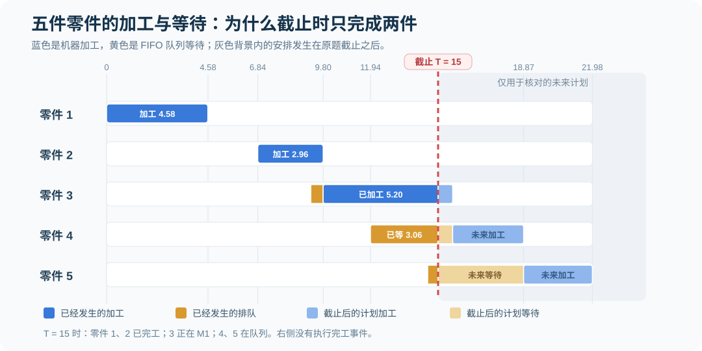

# 第二讲｜仿真原理

[返回学习目录](../README.md) · [上一讲：仿真概述](01-simulation-overview.md) · [下一讲：随机数的生成与检验](03-random-number-generation-testing.md) · [专题：单机五零件手工仿真](../manual-event-simulation/02-single-machine-five-parts.md)

本讲依据课程课件 `simulation2_v3.pdf`（73 页），对应 2.1 蒙特卡洛方法、2.2 离散系统仿真，以及 2.2.3 面向事件与面向过程的仿真。课件使用 Buffon 投针实验说明随机抽样的基本原理，再通过一台机器、五个零件、仿真截止时刻为 15 的例题讲解未来事件表、事件调度和统计输出。

## 2.1 Monte Carlo 方法（课件第 3—19 页）

### 2.1.1 基本思想：用独立重复实验估计概率

Monte Carlo（蒙特卡洛）方法的出发点是重复进行随机实验。当实验次数足够多时，某一事件在全部实验中出现的频率，可以用来估计该事件发生的概率。

若事件的真实发生概率为 `p`，总共进行 `N` 次独立重复实验，其中发生 `ν` 次，那么课件第 3 页使用的近似式为：

```math
\widehat p=\frac{\nu}{N}\approx p
```

这里的“足够多”不是保证有限样本频率恰好等于概率。即使两组实验都使用相同的概率模型，得到的 `ν` 也可能不同。实验次数越多，随机波动对频率估计的影响通常越小，但精度仍然需要用统计方法评价。

课件强调，Monte Carlo 不只是估计事件概率，还可以估计积分、系统性能等无法方便地直接计算的量。因此它是一种以随机实验代替某些直接求解过程的方法。

### 2.1.2 用随机投点估计定积分

课件第 4—6 页提出一个看似矛盾的问题：能否用离散、随机的投点实验，估计一个连续、确定性的积分？

考虑非负函数 `f(x)` 在区间 `[a,b]` 上的曲线面积，假设有一个高度为 `c` 的矩形完整覆盖这片区域，即在研究区间内满足 `0≤f(x)≤c`。矩形宽度为 `b−a`，面积为 `c(b−a)`。

每次在这个矩形中均匀随机取一个点 `(X,Y)`。如果点位于曲线下方，即 `Y≤f(X)`，就记作命中一次。共投点 `N` 次，命中 `n` 次。由于落在曲线下方的概率等于目标面积占矩形面积的比例，可以得到：

```math
\begin{aligned}
p&=\frac{\displaystyle\int_a^b f(x)\,dx}{c(b-a)}\\
\widehat p&=\frac{n}{N}\\
\therefore\quad\int_a^b f(x)\,dx&\approx c(b-a)\frac{n}{N}
\end{aligned}
```

这就是课件第 6 页的面积估计公式。操作时不能省略矩形总面积 `c(b−a)`：`n/N` 只表示面积比例，并不一定等于积分本身。

例如，令 `f(x)=x²`，区间为 `[0,1]`，矩形高度取 `c=1`。若随机投出 10000 个点，假设其中有 3320 个落在曲线下方，那么模拟估计为 `0.332`；其真实积分是 `1/3≈0.3333`。这组命中数只是为了说明计算过程的演示数据，不是课件给出的实际实验记录。

```math
\int_0^1 x^2\,dx=\frac{1}{3}
\qquad
\widehat I=1\times(1-0)\times\frac{3320}{10000}=0.332
```

此例展示了蒙特卡洛方法与解析计算的区别：解析方法根据函数求出精确值；随机投点方法根据独立重复实验获得估计值，估计结果通常含有随机误差。

### 2.1.3 Buffon 投针实验：用几何概率估计圆周率

课件第 7—14 页介绍 Buffon 投针实验。先在平面上画若干间距相同的平行线，再随机投下一根针，观察针是否跨越其中一条线。只要能求出“相交”的理论概率，就可以利用反复投针的命中频率反推 `π`。

课件采用如下符号：相邻平行线的间距为 `2a`；针长为 `2l`，并规定 `a≥l`；`y` 表示针的中点到最近一条平行线的距离；`φ` 表示针与平行线的夹角。课件将两个随机量设为相互独立：

```math
Y\sim U(0,a),\qquad \Phi\sim U(0,\pi)
```

为什么要有 `l≤a` 的条件？因为针长不超过线间距时，相交事件可以按针中点到最近平行线的距离及针的投影来判断，不必处理一根针跨过多条平行线的情形。

<strong>相交的几何条件。</strong> 针长的一半为 `l`，沿垂直于平行线方向的半投影长度是 `l sinφ`。当针中点距最近平行线的距离不大于该投影时，针与平行线相交：

```math
Y\leq l\sin\Phi
```

<strong>计算理论概率。</strong> 固定一个角度 `φ` 时，`Y` 在 `[0,a]` 上均匀分布，命中概率为 `l sinφ/a`。再对所有可能的角度求平均：

```math
\begin{aligned}
p&=\frac{1}{\pi}\int_0^\pi\frac{l\sin\varphi}{a}\,d\varphi\\
&=\frac{l}{\pi a}\big[-\cos\varphi\big]_0^\pi\\
&=\frac{2l}{\pi a}
\end{aligned}
```

<strong>用投针次数反推圆周率。</strong> 如果投针 `N` 次，其中 `ν` 次与平行线相交，便以 `ν/N` 估计 `p`，并将上式变形：

```math
\widehat\pi=\frac{2lN}{a\nu}
```

特别地，当 `l=a` 时，理论命中概率为 `2/π≈0.6366`。如果针长等于平行线间距、投针 10000 次，假设命中 6350 次，那么估计值约为 `20000/6350≈3.150`。这同样是说明公式用法的假设数据；课件第 19 页展示的是另外一些历史投针实验结果。

实际记录中若 `ν=0`，不能直接计算上述比值。随着投针次数增加，频率估计更稳定，但对于有限样本，反推得到的 `π` 仍可能偏离真实值。

### 2.1.4 多少次实验才够：样本量与置信精度

课件第 15—18 页提出样本量问题：希望估计误差足够小，到底需要多少次随机实验？这时要把“随机性可以通过重复降低”转化成可计算的精度要求。

每次投针是否命中只有两种结果，可定义命中指示变量 `X_i`，命中为 1，否则为 0。此时每次实验的期望是 `p`，方差为 `p(1−p)`；如果 `N` 次投针相互独立，那么命中比例的方差为：

```math
\widehat p=\frac{1}{N}\sum_{i=1}^{N}X_i,
\qquad
\operatorname{Var}(\widehat p)=\frac{p(1-p)}N
```

对于足够大的 `N`，可用正态近似写出置信水平为 `1−α` 的近似误差界：

```math
P\left(\left|\widehat p-p\right|\leq z_{1-\alpha/2}\sqrt{\frac{p(1-p)}{N}}\right)\approx1-\alpha
```

如果要求误差半宽不超过 `ε`，则可由上式推得样本量条件：

```math
N\geq\frac{z_{1-\alpha/2}^{\,2}p(1-p)}{\varepsilon^2}
```

课件设定置信度为 95%，概率估计精度为 `0.001`，并取 `l=a`。因此 `z=1.96`，`p=2/π≈0.6366`，代入可得：

```math
N\gtrsim\frac{1.96^2\times0.6366\times(1-0.6366)}{0.001^2}
\approx8.89\times10^5
```

即需要约 88.8 万次投针。这里控制的是<strong>命中概率估计</strong>的近似误差半宽，并非直接保证圆周率估计值的绝对误差也小于 0.001。将命中概率变换为 `π` 后，误差需要相应传播；两种精度不能直接混用。

课件第 19 页列举了多位实验者的投针次数和估计误差。一些实验次数不多的结果也可能偶然很接近 `π`，但这不等于其统计精度更有保证。评估 Monte Carlo 方法，应关心重复实验的误差分布和置信水平，而不能只凭某一次估计值碰巧接近真值来判断方法好坏。

## 2.2 离散系统仿真（课件第 20—67 页）

本节的中心是一个单机器加工系统。零件依次到达，若机器空闲立即加工；若机器正在加工，零件进入 FIFO（先进先出）队列。加工完成后，零件离开系统。仿真从 `t=0` 开始，在 `t=15` 截止。

与上一节随机投点不同，这里不能只数“发生了多少次”。还必须保存系统状态，按照事件发生时间推进，记录队列、机器忙闲及零件在系统中的经历。

### 2.2.1 引例的研究目标与性能指标（课件第 20—25 页）

课件要求估计完工零件数、零件在队列中的等待时间、在整个系统中的逗留时间、平均和最大队长，以及机器利用率。这里有两种不同的平均方式：按零件取平均，与按运行时间取平均。

设零件 `i` 到达系统的时刻为 `A_i`，开始加工时刻为 `B_i`，离开系统时刻为 `D_i`。排队等待时间及系统逗留时间分别为：

```math
W_{q,i}=B_i-A_i,
\qquad
W_i=D_i-A_i
```

设 `P` 为截止时已完工的零件数，`N_q` 为截止时已经结束排队、开始加工的零件数。则按零件统计的平均值为：

```math
\overline W_q=\frac{1}{N_q}\sum_{i\in\mathcal S}W_{q,i},
\qquad
\overline W=\frac{1}{P}\sum_{i\in\mathcal C}W_i
```

这里 `S` 表示已经结束排队的零件集合，`C` 表示已经完工离开系统的零件集合。原课件使用 `N` 表示已通过队列的零件数，为免与 Monte Carlo 实验次数混淆，本笔记记为 `N_q`。注意两个分母可能不同：已经开始加工但尚未完工的零件，其等待时间已知，完整逗留时间却仍未知。

设 `Q(t)` 为等待队列中的零件数量，不包含正在机器上加工的零件；`B(t)` 是机器忙闲状态，忙为 1，闲为 0。运行截止时间 `T=15` 时，课件对时间平均队长和设备利用率的定义是：

```math
\overline Q=\frac{1}{15}\int_0^{15}Q(t)\,dt,
\qquad
U=\frac{1}{15}\int_0^{15}B(t)\,dt
```

上面两个指标都必须通过“状态持续的时间面积”来计算；不能仅对每次事件记录的队长或忙闲状态做简单算术平均，因为相邻事件之间的时间长度并不相等。

课件给出了以下输入数据：

| 零件编号 | 到达时间间隔 | 加工时间 |
| ---: | ---: | ---: |
| 1 | 0.00 | 4.58 |
| 2 | 6.84 | 2.96 |
| 3 | 2.40 | 5.86 |
| 4 | 2.70 | 3.21 |
| 5 | 2.59 | 3.11 |

到达时间间隔不等于绝对到达时刻。累加后五件零件的到达时刻是 `0、6.84、9.24、11.94、14.53`。若错误地把 `2.40` 当作零件 3 的到达时刻，后续的加工顺序与全部统计结果都不再属于这道课件题。

课件第 25 页用样本平均到达间隔约 `3.63` 和平均加工时间约 `3.94` 作初步判断，并提到解析排队论可解决高度简化的模型（如 M/M/1）。这两个均值来自当前给定样本，不能代替后面介绍的输入分布参数。更不能仅凭两者的比值就得到这段时间的实际队长、等待时间或完工数量；这些指标还依赖到达与完工事件的具体先后顺序。

### 2.2.2 仿真模型的基本组成（课件第 26—32 页）

课件按“实体、属性、变量、资源、队列、统计累加器”解释离散事件模型的组成。这些概念在单机加工题中可以逐一对应。

| 组成部分 | 含义 | 单机五零件中的例子 |
| --- | --- | --- |
| 实体（Entity） | 在系统内移动、接受处理并可能触发事件的对象 | 五个零件 |
| 属性（Attribute） | 附着于某一个实体的局部信息 | 编号、到达时刻、加工时间、优先级 |
| 变量（Variable） | 描述系统总体或当前状态的信息 | `TNOW`、队长、机器忙闲状态 |
| 资源（Resource） | 向实体提供服务、容量有限的设施或人员 | 唯一的加工机器 |
| 队列（Queue） | 实体在资源不可立即使用时等待的结构 | 机器前的 FIFO 等待队列 |
| 统计累加器（Accumulator） | 随事件和时间推进积累可用于输出分析的信息 | 完工件数、累计等待时间、累计忙碌时间 |

属性与变量的区别需要特别明确。每个零件拥有自己的到达时刻，这是实体属性；系统当前只有一个时钟 `TNOW`，它属于系统变量。零件 3 的到达时刻不会因为零件 4 到达而改变，但全局时钟会随着事件不断向前推进。

资源通常一次只能为有限数量的实体提供服务；有的模型可能允许抢占服务，或要求多个资源同时到位。当前例题采用一台机器、一次加工一个零件、FIFO 且不抢占的简化规则。使用其他服务纪律会改变结果，因此不能未经说明就替换模型规则。

### 离散事件与活动（课件第 33—35 页）

事件是发生在特定时刻、并可能改变系统状态或实体属性的事情；活动则是需要持续一段时间的处理过程。两次相邻事件之间，当前例题的队长和机器忙闲状态保持不变。

本例有三类事件：

| 事件 | 发生时做什么 | 是否可能安排新事件 |
| --- | --- | --- |
| 零件到达 `A_i` | 记录到达时间；机器空闲则立即开工，否则入队 | 安排下一次到达；若立即开工，还安排本件完工 |
| 零件离开 `D_i` | 统计完工及逗留；若队列非空，取队首开工 | 队列非空时安排下一件完工 |
| 仿真终止 `END` | 停止事件推进，汇总输出指标 | 不再继续安排正常加工事件 |

“零件加工”是活动，因为它占据一段时间；“加工完成并离开”是事件，因为它发生于确定的完工时刻。课件第 35 页再次使用公共汽车的到站事件、站间行驶活动和车上乘客数状态说明三者之间的关系。

### 仿真时钟 TNOW 与未来事件表 FEL（课件第 36—41 页）

仿真时钟 `TNOW` 表示当前已经推进到的模拟时间。课件区分两种推进思路：按下一事件时刻跳跃的面向事件时钟，以及按较小固定时间步长推进的面向时间间隔时钟。对于本例这种离散事件系统，事件驱动的方法更直接。

未来事件表（Future Event List，FEL，也称 Event Calendar）记录已经安排、但尚未发生的未来事件，并按发生时刻从早到晚排列。其基本格式为：

| 实体 | 将发生的事件 | 绝对发生时刻 |
| --- | --- | --- |
| 零件 2 | 到达 | 6.84 |
| 零件 1 | 加工完成并离开 | 4.58 |
| 全局 | 仿真终止 | 15.00 |

真正存入 FEL 时应按 `4.58、6.84、15.00` 的顺序排列。事件表保存的是“未来计划”，而非已经发生的事件记录。一个计划排在表中，不代表它已经改变了系统状态。

一次标准事件调度循环包含以下动作：从 FEL 取出时刻最早的事件；把 `TNOW` 设置为该事件时刻；累计上一个事件到当前事件之间的队长面积和机器忙碌面积；执行事件的状态更新；将新确定了发生时间的事件插回 FEL；重复直到触发终止条件。

其中最容易漏掉的是“先累计经过的时间面积，再按当前事件更新状态”。例如在队列从 1 增至 2 的时刻，前一个时间区间应使用旧队长 1；新的队长 2 要从当前事件时刻之后才开始计入面积。

课件列出两种终止控制：达到预先规定的最大运行时刻 `TE`；或者某个指定的终止事件发生。后者的发生时间可能本身就是随机的。本例采用固定终止时刻 `TE=15`，并在初始化时把 `END@15` 放入 FEL。

若发生时间相同的多个事件需要同时处理，模型还应明确同刻事件顺序。课件这组数据中没有与 `END@15` 同刻发生的加工完成事件，因此不影响下面的数值。

### 到达、离开、终止事件的处理逻辑（课件第 42—47 页）

<strong>到达事件。</strong> 零件进入系统后，先把当前时间记录为该零件的到达属性。如果机器空闲，则直接开始加工，记录其排队等待为 0，机器状态改为忙，安排本件的完工事件；如果机器忙，则将零件加入 FIFO 队列，队长增加 1。随后统计相关信息，并按照已知到达间隔安排下一件零件的到达事件。

<strong>离开事件。</strong> 一件零件加工完成后，完工计数器加 1，并以“当前时钟减该零件的到达属性”计算系统逗留时间。如果队列非空，则从队首取出一件零件，计算它已经发生的排队等待，立即安排加工和未来完工事件；如果队列为空，机器状态改为空闲。

<strong>终止事件。</strong> 仿真到达截止时刻时，先把最后一段运行区间的队长面积与忙碌面积累计完整，再汇总输出。尚未发生的未来完工事件不能提前计入当期完工数量。

课件对统计时点作了两个规定：等待时间在零件离开队列、开始加工时记入累计排队时间；逗留时间在零件真正离开整个系统时记入累计逗留时间。因此，等待时间和逗留时间不一定涉及同样数量的零件。

本例需要的主要统计累加器包括：已完工件数 `P`、累计等待时间 `ΣTQ`、已结束排队件数 `N_q`、最大等待时间、累计系统逗留时间 `ΣTS`、最大逗留时间、累计队长面积、最大队长及累计机器忙碌时间。相应指标分别在状态变化或时间推进时更新。

## 2.2.2 完整算例：逐事件推进到 t=15（课件第 48—58 页）

### 一、先计算绝对到达与加工顺序

当已知本次实验的所有到达和加工时间后，可用单机 FIFO 关系检查事件顺序。记加工开始时刻为 `B_i`，加工完成时刻为 `D_i`，加工时间为 `S_i`：

```math
\begin{aligned}
A_i&=A_{i-1}+I_i\quad(i\geq2)\\
B_1&=A_1\\
B_i&=\max(A_i,D_{i-1})\quad(i\geq2)\\
D_i&=B_i+S_i
\end{aligned}
```

由给定数据可得到：

| 零件 | 到达 `A_i` | 开工 `B_i` | 完工 `D_i` | 完整排队等待 `B_i−A_i` | 完整系统逗留 `D_i−A_i` |
| ---: | ---: | ---: | ---: | ---: | ---: |
| 1 | 0.00 | 0.00 | 4.58 | 0 | 4.58 |
| 2 | 6.84 | 6.84 | 9.80 | 0 | 2.96 |
| 3 | 9.24 | 9.80 | 15.66 | 0.56 | 6.42 |
| 4 | 11.94 | 15.66 | 18.87 | 3.72 | 6.93 |
| 5 | 14.53 | 18.87 | 21.98 | 4.34 | 7.45 |

这张表的后半部分用于检查“如果一直运行到全部加工完成”会发生什么。原题在 `t=15` 已停止，零件 3—5 的完工时刻尚未真正发生，不能把它们的完整逗留时间计入截止时的统计量。

### 二、Future Event List 的八轮迭代

下面将课件第 49—57 页分散展示的事件表合并成一张完整的状态推进表。表中 `A` 为到达事件，`D` 为离开事件；队列写的是本次事件处理结束后的内容。

| 轮次 | TNOW 与执行事件 | 本轮关键动作 | 事件后机器状态 | 事件后等待队列 | 事件后的 FEL（时间升序） |
| ---: | --- | --- | --- | --- | --- |
| 初始化 | `TNOW=0` 前 | 安排零件 1 到达及终止事件 | 空闲 | 空 | `A1@0, END@15` |
| 1 | `0.00, A1` | 零件 1 立即加工；安排 `D1`、`A2` | 忙：1 | 空 | `D1@4.58, A2@6.84, END@15` |
| 2 | `4.58, D1` | 零件 1 完工；机器空闲 | 空闲 | 空 | `A2@6.84, END@15` |
| 3 | `6.84, A2` | 零件 2 立即加工；安排 `A3`、`D2` | 忙：2 | 空 | `A3@9.24, D2@9.80, END@15` |
| 4 | `9.24, A3` | 机器忙；零件 3 入队；安排 `A4` | 忙：2 | `[3]` | `D2@9.80, A4@11.94, END@15` |
| 5 | `9.80, D2` | 零件 2 完工；零件 3 出队并开工；安排 `D3` | 忙：3 | 空 | `A4@11.94, END@15, D3@15.66` |
| 6 | `11.94, A4` | 零件 4 入队；安排 `A5` | 忙：3 | `[4]` | `A5@14.53, END@15, D3@15.66` |
| 7 | `14.53, A5` | 零件 5 入队 | 忙：3 | `[4,5]` | `END@15, D3@15.66` |
| 8 | `15.00, END` | 累计最后区间面积，汇总并终止 | 忙：3，未完工 | `[4,5]` | `D3@15.66` 尚未执行 |

这一过程的判断标准是：每轮只执行当前最早的事件，处理完之后才重新排列未来事件表。`D3@15.66` 虽然在事件表内，但由于先遇到 `END@15`，该完工事件从未执行。



### 三、截止时的状态与统计样本集合

到 `t=15`，一共已有五件零件到达；零件 1、2 已完成并离开；零件 3 正在机器上加工；零件 4、5 仍在等待队列里。因而截止时的状态是：

| 统计对象 | 截止时的结果 | 对应零件 |
| --- | ---: | --- |
| 已到达件数 | 5 | 1—5 |
| 已结束排队、开始加工件数 `N_q` | 3 | 1、2、3 |
| 已完工件数 `P` | 2 | 1、2 |
| 正在加工 | 1 | 3 |
| 正在队列内等待 | 2 | 4、5 |
| 仍在系统内 | 3 | 3、4、5 |

因此，用于截止时平均等待时间的集合是零件 1、2、3；用于截止时平均逗留时间的集合仅为已完工的零件 1、2。零件 4、5 虽然已经等待了一段时间，但还没有离开队列，不能将尚未结束的完整等待时间混入课件规定的等待样本中。

### 四、按零件取平均：等待时间和逗留时间

零件 1、2 的等待时间为 0；零件 3 在 `9.24` 入队、`9.80` 开始加工，所以等待 `0.56`。因此：

```math
\begin{aligned}
N_q&=3\\
\Sigma TQ&=0+0+0.56=0.56\\
\overline W_q&=\frac{0.56}{3}\approx0.19\\
W_{q,\max}&=0.56
\end{aligned}
```

系统逗留时间只统计已离开的两个零件：零件 1 从 `0` 到 `4.58`，逗留 `4.58`；零件 2 从 `6.84` 到 `9.80`，逗留 `2.96`。因此：

```math
\begin{aligned}
P&=2\\
\Sigma TS&=4.58+2.96=7.54\\
\overline W&=\frac{7.54}{2}=3.77\\
W_{\max}&=4.58
\end{aligned}
```

两个平均值的分母分别为 3 和 2，并不是笔误，而是因为“结束排队”和“离开系统”的发生时点不同。这是本题最容易误算的地方之一。

### 五、按时间取平均：队长面积

队长 `Q(t)` 只在零件进入队列或离开队列时改变。根据事件记录，有以下五段：

| 时间区间 | 队长 | 持续时间 | 面积贡献 |
| --- | ---: | ---: | ---: |
| `[0,9.24)` | 0 | 9.24 | 0 |
| `[9.24,9.80)` | 1 | 0.56 | 0.56 |
| `[9.80,11.94)` | 0 | 2.14 | 0 |
| `[11.94,14.53)` | 1 | 2.59 | 2.59 |
| `[14.53,15)` | 2 | 0.47 | 0.94 |

因此，队长曲线下的累计面积为 `0.56+2.59+0.94=4.09`，时间平均队长为：

```math
\int_0^{15}Q(t)\,dt=4.09,
\qquad
\overline Q=\frac{4.09}{15}\approx0.27
```

最大队长为 2，发生于 `[14.53,15)`。注意“截止时队长为 2”“最大队长为 2”“平均队长约为 0.27”是三个不同的统计概念，它们恰好都涉及同一个队列，但数值并不必然相同。

### 六、按时间取平均：机器利用率

机器在 `[0,4.58)` 加工零件 1，在 `[4.58,6.84)` 空闲，在 `[6.84,15)` 持续加工零件 2 和零件 3。因此，截至终止时刻的机器忙碌面积为：

```math
\begin{aligned}
\int_0^{15}B(t)\,dt&=4.58+(15-6.84)=12.74\\
U&=\frac{12.74}{15}\approx0.8493\approx0.85
\end{aligned}
```

零件 3 虽未在 15 前完工，但从 `9.80` 到 `15` 确实占用了机器，所以这段时间必须计入忙碌时间。设备利用率关心“机器什么时候在忙”，不是“已经完成的零件贡献了多少完整加工时间”。

### 七、与课件第 58 页逐项核对

| 性能指标 | 计算结果 | 课件数值 |
| --- | ---: | ---: |
| 完工零件数 | 2 | 2 |
| 平均逗留时间 | 3.77 | 3.77 |
| 最大逗留时间 | 4.58 | 4.58 |
| 平均等待时间 | 0.19 | 0.19 |
| 最大等待时间 | 0.56 | 0.56 |
| 平均队长 | 0.27 | 0.27 |
| 最大队长 | 2 | 2 |
| 机器利用率 | 0.85 | 0.85 |

上表所有数值均与课件一致。更完整的时间线、分步 FEL 及延长到全部完工后的对照计算，保留在[单机五零件专题](../manual-event-simulation/02-single-machine-five-parts.md)中。

## 2.2.2 进一步分析：独立重复与方案比较（课件第 59—67 页）

### 为什么一次仿真不能代表一般运行情况？

课件第 59—60 页提出，一组给定的到达间隔和加工时间只可能对应某一个具体时段。真正关心的往往不是“这一天恰好完成了几件”，而是当同一套机器、规则和统计规律反复出现时，系统通常会表现怎样。

因此，需要在相同输入分布和相同系统规则下生成不同的随机样本，分别独立运行仿真，再用多次运行的输出分析总体性能。每次运行仍然得到一个完工数量、一个平均等待时间和一个机器利用率；重复统计分析处理的是<strong>各次运行的输出指标</strong>，而不是把所有运行中的每个事件混在一张表里算平均。

课件第 61 页给出了前面算例的输入数据来源：零件到达间隔服从均值为 5 的指数分布；加工时间服从最小值 1、众数 4、最大值 8 的三角分布。前面五件零件的到达间隔与加工时间，是从这些分布中取得的一组特定样本。

这里还要区分两组数字：课件第 25 页的 `3.63` 与 `3.94` 是样本均值；均值 5 的指数分布和参数 `(1,4,8)` 的三角分布才是课件第 61 页指定的输入分布。样本均值不一定等于其总体分布的均值。

### 五次独立重复仿真结果

课件第 62 页给出五组独立重复结果。为了与课件核对，以下保留其统计数据。

| 性能指标 | 第 1 次 | 第 2 次 | 第 3 次 | 第 4 次 | 第 5 次 | 样本均值 | 样本标准差 |
| --- | ---: | ---: | ---: | ---: | ---: | ---: | ---: |
| 完工零件数 | 2 | 3 | 3 | 1 | 1 | 2.00 | 1.00 |
| 平均等待时间 | 0.19 | 1.12 | 3.72 | 0.00 | 0.00 | 1.01 | 1.59 |
| 最大等待时间 | 0.56 | 2.73 | 7.43 | 0.00 | 0.00 | 2.14 | 3.16 |
| 平均逗留时间 | 3.77 | 4.90 | 6.82 | 4.77 | 3.31 | 4.71 | 1.35 |
| 最大逗留时间 | 4.58 | 5.84 | 8.43 | 4.77 | 3.31 | 5.39 | 1.92 |
| 平均队长 | 0.27 | 0.30 | 0.99 | 0.00 | 0.00 | 0.31 | 0.41 |
| 最大队长 | 2 | 1 | 2 | 0 | 0 | 1.00 | 1.00 |
| 机器利用率 | 0.85 | 0.91 | 1.00 | 0.32 | 0.37 | 0.69 | 0.32 |

同样的系统设计、相同的分布参数，五次完工零件数却分别为 `2、3、3、1、1`；机器利用率也从 `0.32` 到 `1.00` 不等。因此，一次运行表现很好或很差，都不应直接当成方案的一般表现。

### 用置信区间估计总体性能

若把某个性能指标在各次独立重复中的输出记为 `X_1,…,X_n`，且这些输出可视为独立同分布，则可用样本均值 `X̄` 和样本标准差 `s`，构造期望性能的近似 t 置信区间：

```math
\left(
\overline X-t_{1-\alpha/2,n-1}\frac{s}{\sqrt n},
\quad
\overline X+t_{1-\alpha/2,n-1}\frac{s}{\sqrt n}
\right)
```

课件第 64 页使用“完工零件数”作为计算例子：`n=5`，样本均值 `2.00`，样本标准差 `1.00`，置信度为 95%，自由度为 `n−1=4`，对应临界值约为 `2.776`。

```math
\begin{aligned}
\overline X&=2.00,\quad s=1.00,\quad n=5\\
h&=2.776\times\frac{1.00}{\sqrt5}\approx1.24\\
CI_{95\%}&=(2.00-1.24,\;2.00+1.24)\\
&\approx(0.76,\;3.24)
\end{aligned}
```

置信区间估计的是<strong>平均完工数量这一总体期望</strong>，不是声称某次运行可以完成 0.76 个零件。虽然单次完工数量必须为整数，重复运行的期望可以不是整数，因而区间端点为小数完全正常。

这一计算依赖独立重复、适当的抽样条件以及 t 区间的近似合理性。课件第 63 页也提醒，这些假设并非不经处理就必然成立。尤其当前只有五次重复，区间比较宽，反映出少量样本对总体均值的判断仍然不精确。

### 比较方案：到达率加倍后会怎样？

课件第 65—67 页提出一个改变输入条件的方案比较：将零件到达率加倍，其他系统机制不变，两种情景各做五次独立重复。图中用圆圈和三角形分别代表原情景与加倍到达率的情景，实心与空心区分第一次和后续运行。

“到达率加倍”意味着单位时间预期到达更多零件。如果仍采用指数到达间隔这一输入假设，对应的平均到达间隔由 5 缩短为 2.5。它不等于把已观测到的五件零件简单复制一遍，而是改变输入分布参数后重新生成实验样本。

课件的图示强调两件事：只根据第一次仿真结果比较方案，可能产生很大偏差；即使画出多次运行结果，也不能仅凭散点位置断定两种方案的总体表现有显著差异，应进一步进行统计比较。课件未提供这组比较的原始数值表，因此本笔记不虚构具体差值或显著性结论。

## 2.2.3 面向事件与面向过程的仿真（课件第 68—73 页）

课件最后比较两种建模思路。两者的核心区别是：建模者站在“整个系统的事件调度”角度，还是站在“一类实体完整经过系统的流程”角度来描述模型。

### 面向事件（Event-oriented）

面向事件仿真直接围绕到达、离开和终止等事件组织程序。建模者显式管理 `TNOW`、未来事件表、系统状态更新及事件触发关系。例如执行 `D2@9.80` 后，必须亲自检查队列中是否有零件 3，再决定是否创建 `D3@15.66`。

这种方式的优点是灵活，对任意时刻的内部状态及事件顺序都有清楚的控制；一般编程语言也可直接实现。缺点是建模逻辑比较繁琐，要正确处理事件调度、状态更新和统计量积累，需要较强的模型与程序组织能力。

### 面向过程（Process-oriented）

面向过程仿真把一个零件从进入到离开的自然经历写成流程：进入车间并记录到达时间；需要时排队；轮到自己则记录开始加工时刻；占用机器加工一段时间；完成后释放机器，登记完工数量与逗留时间；最后离开系统。

对建模者来说，这一描述更贴合业务流程，无须手动书写每一步仿真时钟跳转与 FEL 的插入、删除细节。课件提到 SIMAN 等仿真语言通常采用这一思路。优点是直观、容易组织业务流程，缺点是依赖专门语言或软件提供流程与调度支持，在某些复杂事件控制问题上可能不如直接编写事件逻辑灵活。

| 对比维度 | 面向事件 | 面向过程 |
| --- | --- | --- |
| 主要视角 | 下一件将发生什么事件 | 一个零件怎样依次完成各环节 |
| 建模重点 | 事件表、状态更新、时钟推进 | 实体流动、等待、占用资源与释放 |
| 时间推进 | 通常显式管理 | 通常由仿真环境后台管理 |
| 优势 | 灵活、可检查内部事件细节 | 建模较自然、业务流程较直观 |
| 局限 | 编写和调试逻辑复杂 | 需要相应仿真工具支持，低层事件控制较间接 |

课件第 73 页特别强调：多数面向过程的仿真语言，底层实际执行的仍然是事件调度，只是将时钟推进与事件表管理隐藏在软件内部。因此，“面向过程”并不意味着系统不再有事件，也不意味着不需要遵循离散事件仿真的基本原理。

## 本讲的计算口径与常见混淆

| 问题 | 正确理解 |
| --- | --- |
| Monte Carlo 中 `ν/N` 是什么？ | 命中频率，是对事件概率的估计，有限次数下不必等于真概率 |
| 面积投点为什么乘 `c(b−a)`？ | `n/N` 是矩形中目标区域的占比，须乘矩形面积才能得到积分估计 |
| 投针实验的 `0.001` 精度指什么？ | 课件样本量计算所控制的是概率估计误差半宽，不是直接保证 `π` 的误差 |
| 到达间隔与到达时刻是否相同？ | 不同；到达时刻需要累计间隔 |
| FEL 中存在完工事件是否意味着已经完工？ | 不意味着；只有时钟推进并执行该事件后，才能更新完工数 |
| 截止时机器正在加工的零件，其加工时间算不算利用率？ | 要算截至截止时刻实际忙碌的部分，但完整逗留时间不算已完工样本 |
| 为什么平均等待的分母是 3、平均逗留的分母是 2？ | 前者统计已结束排队并开工的零件，后者统计已真正离开系统的零件 |
| 平均队长为何不是几个事件后队长的算术平均？ | 平均队长按各状态持续时间加权，等于队长曲线面积除以观察长度 |
| 一次仿真输出能否代表长期平均水平？ | 不能直接代表；随机输入需要独立重复和统计分析 |
| 面向过程是否取消了事件调度？ | 没有；多数相关软件在后台执行事件调度 |

课件第 2 页提出的“数据从哪来、模型是否真实、结果能否用于决策”等问题，到本讲已经能够给出部分回答：Monte Carlo 解释随机实验怎样生成估计值，离散事件调度解释系统行为怎样计算，独立重复和置信区间解释为什么不能凭一次运行决定方案；而输入数据如何选取、模型如何验证与确认，还需要后续相应章节继续展开。
