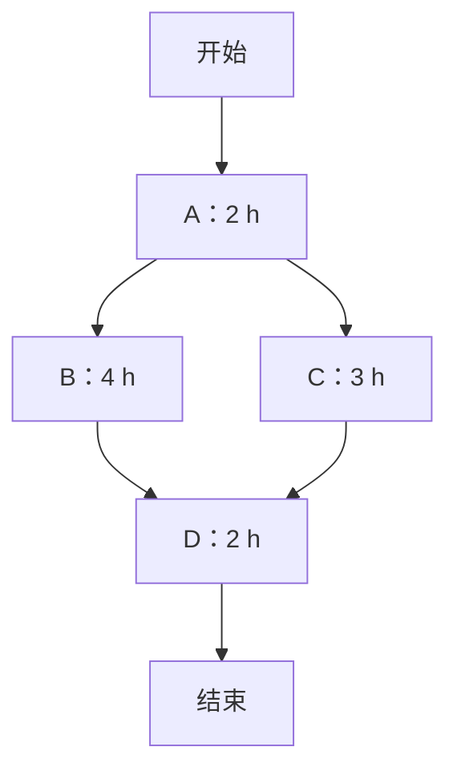
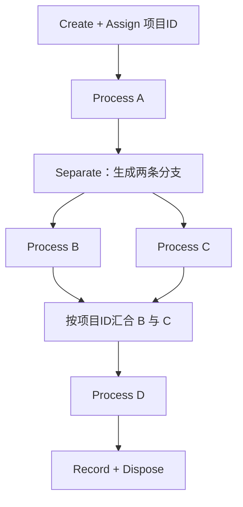

# 03｜项目工序分解、并行与汇合：从概念模型到 Arena

[返回目录](../README.md) · [离散事件与排队](02-discrete-event-queue.md) · [输出分析](04-output-analysis.md) · [进阶练习](../exercises/02-advanced-exercises.md)

## 1. 工序分解的本质

复杂工作可以分解为一系列活动（Activity），每项活动具有持续时间、前置约束和资源需求。仿真关心的不只是各活动的总时长，还包括<strong>哪些活动能并行、何时必须等待，以及资源争用是否造成额外延迟</strong>。

| 概念 | 定义 | 示例 |
| --- | --- | --- |
| 活动/工序 | 一段需要时间的处理任务 | 设计、测试、装配 |
| 前置关系 | 某任务开始前必须完成的任务 | 测试前需完成组装 |
| 分支（Fork） | 一个工作包拆成多个可并行任务 | B 和 C 同时启动 |
| 汇合（Join） | 多条分支完成后才能推进 | B、C 均结束才启动 D |
| 资源约束 | 活动需要共享的有限能力 | 一台设备、一个班组 |
| 随机工时 | 活动耗时不是固定常数 | 三角分布或经验分布 |

## 2. 一个四工序的示例

假设项目有四项工序：A 用 2 小时，B 用 4 小时，C 用 3 小时，D 用 2 小时。B 与 C 都需在 A 完成后才能开始；D 必须等待 B、C <strong>均完成</strong>。



若没有资源冲突、切换时间和额外等待，完成时刻为


```math
T=2+\max(4,3)+2=\boxed{8\,\mathrm{h}}.
```


最长路径是 A→B→D，长度 8 小时；A→C→D 长度 7 小时。这是一个确定性<strong>关键路径</strong>计算。

如果 B 和 C 必须使用同一台容量为 1 的设备，且任务不可抢占，那么它们不能同时加工；在没有额外切换时间时，最短完工时间变为 `2+4+3+2=11` 小时。可见<strong>前置关系允许并行，不代表资源条件允许并行</strong>。

## 3. 从工序网络转换为离散事件模型

应明确四类信息：

1. <strong>实体</strong>：例如一份项目工作包；并行分支需能识别同属哪份工作包。
2. <strong>活动持续时间</strong>：固定值、三角分布、对数正态分布或实际观测分布。
3. <strong>资源</strong>：每道工序需要哪些资源、占用数量、是否允许并发。
4. <strong>完成条件</strong>：D 必须等待同一工作包的 B 与 C 都完成。

对于持续时间随机的情况，单次运行的总工期可写作


```math
T=S_{A}+\max(S_{B},S_{C})+S_{D}
```


（仅适用于无资源冲突、无额外等待的上述网络）。注意


```math
E[\max(S_{B},S_{C})]\ne\max(E[S_{B}],E[S_{C}])
```


一般不成立；因此不能只将各活动替换成平均工时来求平均总工期。这个非线性是进行仿真而不只做静态关键路径计算的一个理由。

## 4. Arena 的基础模块与逻辑

Arena 使用离散事件逻辑连接实体流与资源。常见模块可理解为：

| 模块 | 主要作用 | 建模注意点 |
| --- | --- | --- |
| Create | 产生项目或顾客实体 | 定义到达间隔、起始时间、生成数量 |
| Assign | 设置实体属性与变量 | 可用项目 ID 保留分支来源 |
| Process | 执行资源请求、延迟和释放 | 根据需要选择 Seize–Delay–Release |
| Decide | 按条件或概率选择路径 | 普通分流不自动产生并行副本 |
| Separate | 对实体复制或拆分 | 并行活动需要两条实际执行的分支 |
| Batch | 将实体组成批次 | 汇合时要避免不同项目分支错误配对 |
| Record | 收集性能统计量 | 总工期、等待、队列长度等 |
| Dispose | 让实体离开系统 | 不应遗漏未完成分支 |

### 4.1 一个可复现的模块级方案

以“每次产生一个工作包”的实验为例，可按以下逻辑搭建：



在 Arena 中可组合 Separate 与 Batch 等模块完成复制和汇合。<strong>关键是保证两个分支来自同一项目</strong>：仅按到达先后凑成两项的普通 Batch，可能把不同项目的分支错误地拼在一起。应保留项目 ID，并检查所用模块的分组机制。模块属性名称和选项可能因软件版本不同而略有差异，但先后关系与同步约束不变。

### 4.2 逐步搭建顺序

先使用四个固定工时 `2,4,3,2`，让模型只有一个工作包且无资源冲突。检查输出是否为 8 小时；再将 B、C 设置为争用同一容量为 1 的资源，检查是否变成 11 小时。随后才加入多个工作包、随机工时、优先规则或共享资源，避免复杂模型掩盖基础逻辑错误。

## 5. 与双服务台模型的区别

工序网络的 B/C 是<strong>同一工作包的两项任务</strong>，两项都完成后才能继续 D；并行服务台 M1/M2 则是两台资源，<strong>一名顾客只需任选一台获得服务</strong>。

| 情形 | 并行工序 B/C | 并行服务台 M1/M2 |
| --- | --- | --- |
| 一个实体需要做什么 | 两项都做完 | 选择其中一台服务 |
| 完成条件 | 等待两条路径汇合 | 一次服务完成即可离开 |
| 主要逻辑 | Fork–Join | Shared Queue + Resource Selection |
| 典型错误 | 把两个分支当成二选一 | 在到达时预先锁定独立队列 |

不能因为流程图都有两条并行线，就把它们写成同一种仿真模型。

## 6. 验证与输出指标

<strong>Verification（实现验证）</strong>：程序是否正确执行了设计规则？例如无资源约束时总工期恰好为 8；共享资源时不允许 B/C 同时占用容量为 1 的设备；项目 ID 不发生错误汇合。

<strong>Validation（模型有效性确认）</strong>：规则和输入是否合理刻画了所研究的实际系统？例如真实业务是否允许 B 与 C 并行、持续时间分布是否可信。

可记录每个工作包的完工时间、活动等待时间、资源利用率、在制品数量和系统吞吐量。若比较资源增加前后的方案，建议使用相同外部随机条件配对运行，再分析完工时间差值及其置信区间。

<strong>下一步：</strong>阅读 [04｜输出分析与实验设计](04-output-analysis.md)，将模型输出从“一个数”变成带统计不确定性的估计。
