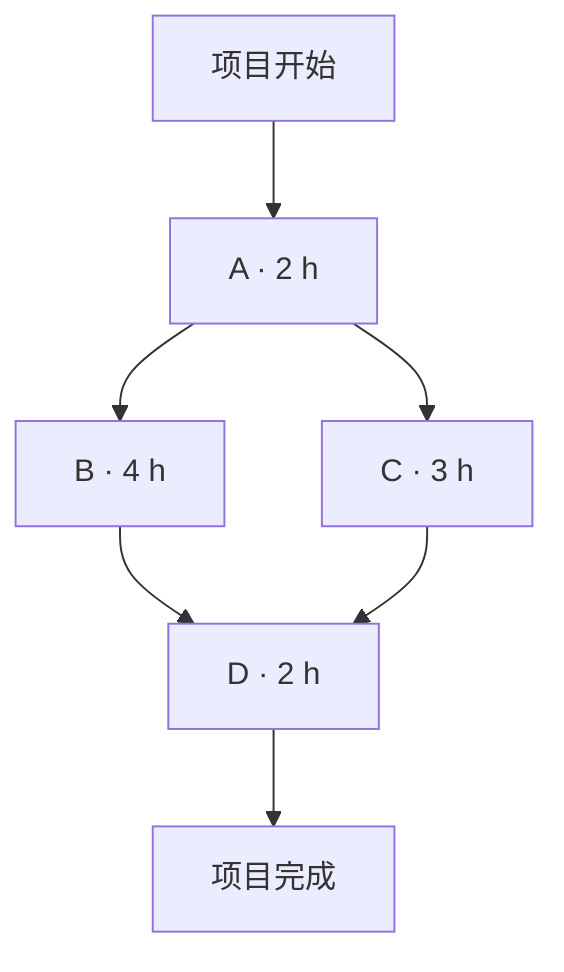
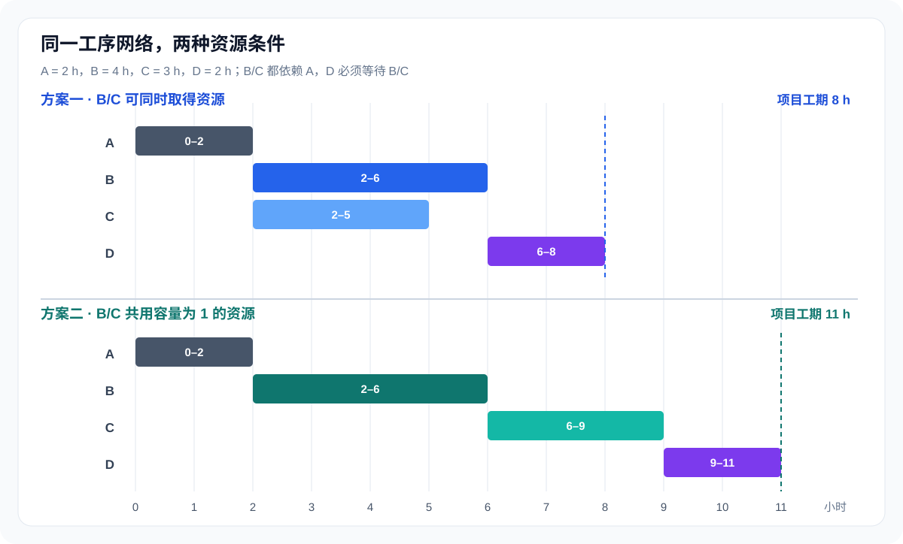
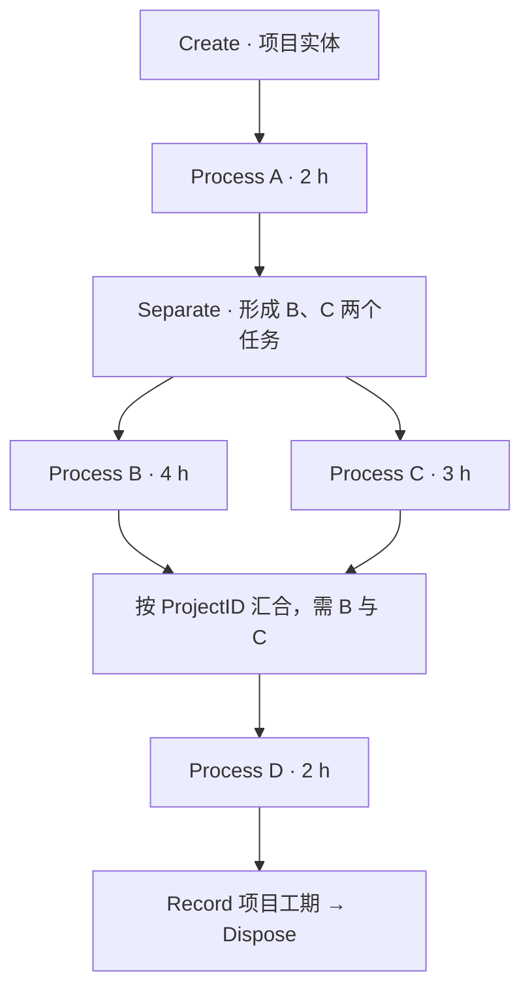

# 03｜项目工序网络与 Arena 建模：先后关系、资源约束和并行汇合

[返回课程目录](../README.md) · [上一讲：离散事件与排队](02-discrete-event-queue.md) · [进阶习题](../exercises/02-advanced-exercises.md) · [下一讲：输出分析](04-output-analysis.md)

项目工序仿真容易在两个地方出错。一是只看见“有四个工序”，却没有把它们的先后关系、资源容量和等待条件区分开；二是画出了两条并行分支，却没有保证同一个项目的两项工作真正都完成以后才进入后续工序。

这一章先把工序网络和关键路径算清楚，再处理资源竞争，最后将同一套逻辑落实到 Arena 模块。所有推导先使用固定时间、单个项目进行校验；随后再讨论多个项目同时运行、随机工时与实验输出。

## 1. 工序分解不是简单地把总工作分成几段

假设要完成一批产品，需要设计、加工、检验和包装。将项目列成活动清单，只说明“有哪些工作”；还不能确定总工期，因为缺少以下信息：哪些工作必须先做，哪些工作允许同时做，每项工作需要占用什么资源，以及完成一项工作后触发什么动作。

在项目管理中，工作分解结构（Work Breakdown Structure，WBS）首先描述交付物和工作范围；工序网络则进一步描述活动之间的时间依赖。二者相关，但不能互相代替。仿真还需要补上资源争用与随机持续时间，才能得到具体的执行轨迹。

| 建模对象 | 要明确的内容 | 示例 |
| --- | --- | --- |
| 活动 Activity | 工作内容及持续时间 | 测试需要 3 小时 |
| 前置关系 Precedence | 某活动开始或结束的条件 | 测试必须等待装配完成 |
| 资源 Resource | 工作占用的有限处理能力 | 只有一台测试设备 |
| 分支 Fork | 一个项目同时产生哪些后续工作 | 设计完成后并行做 B、C |
| 汇合 Join | 什么条件下可以继续推进 | 同一项目的 B、C 均完成 |
| 实体 Entity | 在模型中流动并承载数据的对象 | 一份项目任务单或工件 |
| 统计量 | 要评价的结果 | 总工期、排队时长、设备利用率 |

工序持续时间不等于从项目开始到该工序结束的时刻。例如工序 C 自身只需 3 小时，但可能需要先等 A 完成，或在资源被 B 占用时继续等待。

### 1.1 并行活动、并行机器与串联加工的含义不同

并行活动指同一个项目需要完成多项互不完全依赖的任务，任务可以同时进行，但往往需要全部完成后才可继续。双服务台并行则是顾客在两个服务台中选择其中一个接受一次服务。串联加工是同一零件先经一道工序，再经下一道工序。

| 场景 | 顾客或项目需要经过什么 | 完成条件 |
| --- | --- | --- |
| 并行工序 B、C | 一个项目两项都要做 | B 和 C 均完成 |
| 并行服务台 M1、M2 | 一位顾客选择其中一台 | 所选机器完成一次服务 |
| 串联加工 M1→M2 | 一件零件先 M1 后 M2 | 两道加工均完成 |

三种结构都可能在流程图上出现两台机器或两条线，但实体流动和完成条件完全不同。并行服务台的详细事件表见[第二章](02-discrete-event-queue.md)；双机串联加工见[手工事件调度专题](../manual-event-simulation/README.md)。

## 2. 用有向无环图表示工序先后关系

项目工序常用单代号网络图（Activity-on-Node，AON）。节点表示一项活动，箭头表示活动之间的前置约束。在最常见的“完成—开始”关系下，只有前项完成，后项才能启动。

假设项目共有四项活动：

| 工序 | 持续时间 | 直接前置工序 | 完成后可以触发什么 |
| --- | ---: | --- | --- |
| A | 2 小时 | 无 | B、C 具备启动条件 |
| B | 4 小时 | A | D 的一个前置条件满足 |
| C | 3 小时 | A | D 的另一个前置条件满足 |
| D | 2 小时 | B、C | 项目完成 |



箭头 A→B、A→C 表示两个前置条件；箭头 B→D、C→D 表示 D 有两个必须同时满足的完成条件。只看一条从开始到结束的路径，会遗漏另一条路径对 D 的限制。

### 2.1 为什么网络通常不能形成依赖循环

如果 A 必须等 B 完成才能开始，同时 B 又必须等 A 完成才能开始，且二者尚未启动，就会发生逻辑死锁。一般用于关键路径计算的确定性工序网络因此采用有向无环图（DAG）。

实际业务可能有返工、质量复检或循环加工。这类循环可以用离散事件仿真描述，但不能直接作为不加处理的循环边放进普通关键路径前推算法。计算关键路径前，应先明确所用网络是否确实无环。

### 2.2 不同类型的逻辑关系

最基础的网络通常全部采用 Finish-to-Start（FS，完成后开始）。实际工程也可能出现 Start-to-Start（SS，同时或延迟开始）和 Finish-to-Finish（FF，完成时刻约束）。

记活动 i 的开始时刻为 Sᵢ、完成时刻为 Fᵢ，活动 j 为后续活动，ℓ 是约定的时间滞后量。

| 关系 | 含义 | 对应约束 |
| --- | --- | --- |
| FS | i 完成后 j 才能开始 | j 的开始不早于 i 的完成加 ℓ |
| SS | i 开始后 j 才能开始 | j 的开始不早于 i 的开始加 ℓ |
| FF | i 完成后 j 才能完成 | j 的完成不早于 i 的完成加 ℓ |
| SF | i 开始后 j 才能完成 | j 的完成不早于 i 的开始加 ℓ |

本章四工序算例全部使用 FS 且 ℓ=0。若题目规定“加工完成后必须冷却 1 小时才能检验”，可以把冷却单独列为活动，也可以在 FS 约束中加入 1 小时滞后，但不要两种方式重复计算。

```math
S_j\geq F_i+\ell_{ij}
```

## 3. 没有资源竞争时，怎样用关键路径法计算总工期

先假设各工序工时固定、资源始终充足、没有停机和切换时间。此时只需考虑网络中的前置关系，即可使用关键路径法（Critical Path Method，CPM）。

前推计算用到两个时间：

- ES（Earliest Start）：满足所有前置条件后最早能开始的时刻。
- EF（Earliest Finish）：最早能完成的时刻。

设 dᵢ 是活动 i 的持续时间，Pred(i) 是其直接前置活动集合，则：

```math
\begin{aligned}
ES_i&=\max_{j\in\operatorname{Pred}(i)}EF_j\\
EF_i&=ES_i+d_i
\end{aligned}
```

没有前置活动的第一项工序以 0 为最早开始时刻。若有多个前置活动，必须取它们完成时刻的最大值，因为最后一个前项不完成，后项就不能开始。

### 3.1 第一次计算：从左到右前推

A 没有前项，所以 ES=0、EF=2。B 和 C 均等待 A，所以 ES 都是 2；B 完成于 2+4=6，C 完成于 2+3=5。D 必须等待 B 和 C，都完成的最早时刻为 max(6,5)=6，D 再做 2 小时，项目在 8 完成。

| 工序 | 工时 d | 前置活动 | ES | EF | 推导 |
| --- | ---: | --- | ---: | ---: | --- |
| A | 2 | 无 | 0 | 2 | 0+2 |
| B | 4 | A | 2 | 6 | 2+4 |
| C | 3 | A | 2 | 5 | 2+3 |
| D | 2 | B、C | 6 | 8 | max(6,5)+2 |

```math
T=2+\max(4,3)+2=8
```

此处的工期 8 小时并不是四项工时之和 11 小时。B、C 有部分时间重叠，因而四项工作累计需要 11 个活动·小时，并不表示日历时间必须是 11 小时。

### 3.2 第二次计算：从右到左后推

关键路径法还要回答：某项活动可以最多推迟多久，而不影响整个项目在第 8 小时完成？需要计算最迟开始 LS（Latest Start）和最迟完成 LF（Latest Finish）。

将项目要求的完成时刻设为 T=8。从终点向起点倒推。对于最后一项 D，LF_D=8、LS_D=8−2=6。前面活动 B、C 都必须不晚于 D 的最迟开始时刻 6 完成；因此 B 的 LS=6−4=2，C 的 LS=6−3=3。

若一项活动有多个直接后续工序，它必须不晚于这些后续工序最迟开始时刻中的最小值完成，否则会耽误其中至少一项。

```math
\begin{aligned}
LF_i&=\min_{k\in\operatorname{Succ}(i)}LS_k\\
LS_i&=LF_i-d_i
\end{aligned}
```

| 工序 | ES | EF | LS | LF | 总时差 TF=LS−ES |
| --- | ---: | ---: | ---: | ---: | ---: |
| A | 0 | 2 | 0 | 2 | 0 |
| B | 2 | 6 | 2 | 6 | 0 |
| C | 2 | 5 | 3 | 6 | 1 |
| D | 6 | 8 | 6 | 8 | 0 |

可以逐个核对：D 必须最迟在 6 开始；C 最迟在 6 完成，虽然它最早在 5 完成，所以 C 有 1 小时总时差。B 没有余量，哪怕只推迟一点，也会把 D 的开工推迟。

### 3.3 什么才是关键路径

总时差为 0 的活动是当前工期约束下的关键活动。本例 A、B、D 的总时差均为 0，因此路径 A→B→D 是关键路径，长度为 2+4+2=8。另一条 A→C→D 长度 2+3+2=7，不是关键路径。

关键路径可能不止一条。例如把 C 的工时由 3 改为 4，A→B→D 和 A→C→D 都长 8 小时，两条路径都关键。不能默认一个网络永远只有一条关键路径。

总时差属于<strong>当前确定性工期与前置约束</strong>的计算结果。若活动持续时间在下一次运行中变化，或者资源约束让活动实际开工晚于 ES，关键路径也可能随之改变。

## 4. “允许并行”与“能够并行”之间隔着资源约束

上面的 8 小时隐含 B、C 可以同时获得所需资源。若它们都需要同一台容量为 1 的设备、一次只能加工一个任务，两个活动虽然没有先后依赖，却必须等待资源空闲才能真正开工。

将活动开始时间记为 Bᵢ，实际完成时间记为 Cᵢ。即使所有前置活动已经完成，活动也可能因资源不可用而延迟：

```math
B_i\geq ES_i,\qquad
C_i=B_i+d_i
```

### 4.1 同一台设备先加工 B，再加工 C

A 在 [0,2) 执行。时刻 2，B、C 在逻辑上都具备启动条件；但共享设备只能选一项。如果选择 B 先加工：

| 工序 | 计划前置条件最早满足 | 实际开始 | 实际完成 | 是否发生资源等待 |
| --- | ---: | ---: | ---: | --- |
| A | 0 | 0 | 2 | 否 |
| B | 2 | 2 | 6 | 否 |
| C | 2 | 6 | 9 | 是，等待 4 小时 |
| D | 9 | 9 | 11 | 否 |

B 在 [2,6) 占用设备，C 只能在 [6,9) 加工。D 要等两个工序都完成，所以在 9 开始、11 完成：

```math
T_{\mathrm{shared}}=2+4+3+2=11
```

若设备先加工 C，再加工 B，那么 C 在 [2,5)、B 在 [5,9)，D 仍在 [9,11)；本例没有切换损失，因而两种顺序的最终工期都为 11 小时，但各工序的等待时间不同。



### 4.2 为什么 8 和 11 都正确，却回答了不同的问题

8 小时是前置约束与固定工时决定的无资源冲突完成时间，也是这个问题在资源充足时的下界。11 小时是 B、C 共用容量为 1 的设备且不可抢占、无切换时间时的最短可行工期。

二者并不矛盾。关键路径法反映先后约束造成的时间下界；实际资源受限项目调度（Resource-Constrained Project Scheduling Problem，RCPSP）还必须满足容量限制。

如果一项工序要同时占用“工程师 1 名 + 测试机 1 台”，只有工程师空闲还不够；这两种资源必须同时可用，活动才可以开始。多个活动共同使用多种资源时，决定开工顺序本身就可能成为需要优化的问题。

### 4.3 资源利用率不能直接代表项目工期好坏

从项目开始时刻 0 到全部完工为止观察，本例共享的那台设备只在 [2,9) 加工 B 和 C，累计忙碌 7 小时，因此在完整 11 小时观察窗口的利用率是 7/11≈63.64%。它在自身的 [2,9) 可用窗口内连续工作，局部忙碌率为 100%。二者使用的分母不同。

如果改为两个独立设备分别处理 B 和 C，整个项目 8 小时完成，总机器忙碌时间仍为 4+3=7 设备·小时；若两台资源在整个 [0,8] 均计入可用容量，则总体利用率为 7/(2×8)=43.75%。

增加设备降低了工期，但可能降低平均利用率并增加成本。设备利用率和项目完工时间是两个不同指标，不能只凭一个数决定哪种方案更好。

## 5. Fork–Join：两条分支到底怎样同步

在第 2 节的工序网络中，A 完成后产生两个并行任务 B、C。只有同一项目的 B、C 都完成，才能进入 D。这种结构称为 Fork–Join：先拆成可并行的分支，再在汇合点等待所有需要的前项完成。

可以为每个项目 p 设置两个二元完成标志 z_B(p,t)、z_C(p,t)：相应分支在时刻 t 之前已经完成时取 1，否则取 0。因此：

```math
z_B(p,t)\in\{0,1\},\qquad z_C(p,t)\in\{0,1\}
```

项目 p 允许进入 D 的条件是这两个标志均为 1，即 z_B(p,t)z_C(p,t)=1。对于单个项目、无限资源且没有额外等待的情况：

```math
B_D=\max(C_B,C_C)
```

如果 D 本身需要一台正被其他项目占用的设备，实际开始时刻还要晚于这两个完成时刻的最大值。汇合条件满足，只表示“逻辑上可以申请 D 的资源”，不代表已经获得资源。

### 5.1 为什么分支不是普通二选一

如果在 A 完成后使用普通概率分流，让项目以 50% 概率进入 B、以 50% 概率进入 C，则每个项目只完成了其中一个任务。这个模型把“两个任务都做”误写成“随机选一个任务做”，其完工时间和资源负荷都会变小。

真正的并行分支必须出现两项实际工作。它们可以由两个任务实体表示，也可以用专门的状态变量记录完成情况，但无论如何都要保证 D 只启动一次，并且是在两条必要分支都完成之后。

### 5.2 多个项目同时运行时，项目 ID 为什么不可省略

当模型同时接收两个项目时，一条 B 分支和一条 C 分支即使在时间上相邻，也不一定属于同一个项目。假定两个项目进入分支网络的时刻分别是 2 和 3：

| 项目 | B 的工作区间 | C 的工作区间 | 正确的汇合时刻 |
| --- | --- | --- | ---: |
| 甲 | [2,6) | [2,5) | 6 |
| 乙 | [3,4) | [3,7) | 7 |

按完成时刻排序，最先结束的分支是乙的 B（时刻 4），第二个是甲的 C（时刻 5）。如果直接拿“最先到达汇合点的两项任务”凑成一个批次，就会把乙的 B 和甲的 C 拼成错误的项目。

因此分支实体至少要带有 ProjectID 和 BranchType 两项属性。ProjectID 用于匹配所属项目，BranchType 用于确认所需的 B、C 各完成一次。同一项目的两个分支进入 D 之前，还要清楚保留或恢复该项目的开始时刻，以便统计完整工期。

## 6. 随机工时使关键路径从一个固定结果变成随机结果

真实工作时间通常不是固定值。设计可能提前完成，也可能遇到返工；测试时间也会随设备状态或输入特征变化。若把每项持续时间改为随机变量，单次运行的项目完工时间就具有随机性。

对于本章四工序网络，在资源始终充足、无额外切换时间的条件下：

```math
T=S_A+\max(S_B,S_C)+S_D
```

即使 A、D 的持续时间固定，B、C 的随机波动也会改变哪条分支最后完成，进而改变项目总工期。

### 6.1 为什么不能直接用“平均工时的最大值”

一般而言：

```math
E[\max(S_B,S_C)]
\geq\max(E[S_B],E[S_C])
```

直观上，项目每次都要等两项随机活动中较慢的一项；先取两项的平均值再比较，忽略了“有时 B 慢、有时 C 慢”的切换。

可以用一个很小的离散例子准确计算。设 B、C 相互独立，均以各 50% 的概率需要 1 小时或 3 小时：

| B 工时 | C 工时 | 联合概率 | 两者较慢的时长 |
| ---: | ---: | ---: | ---: |
| 1 | 1 | 0.25 | 1 |
| 1 | 3 | 0.25 | 3 |
| 3 | 1 | 0.25 | 3 |
| 3 | 3 | 0.25 | 3 |

二者的平均工时均为 2，但每次取较大者的期望为：

```math
E[\max(S_B,S_C)]
=0.25\times1+0.75\times3=2.5
```

如果 A、D 分别固定为 2 小时，则平均总工期是 2+2.5+2=6.5 小时，而“把所有活动换成平均时间”只会得到 2+max(2,2)+2=6 小时，少算 0.5 小时。

还可以利用恒等式证明上述不等式：

```math
\max(x,y)=\frac{x+y+|x-y|}{2}
```

因此：

```math
E[\max(S_B,S_C)]
=\frac{E[S_B]+E[S_C]+E[|S_B-S_C|]}{2}
```

由于 E[|S_B−S_C|] 至少为 |E[S_B]−E[S_C]|，就得到本节开头的不等式。若两项持续时间完全相同、始终一起变化，则取最大值未必有额外增加；相关性也会影响总工期分布。

### 6.2 单次仿真的关键路径可能变化

当随机样本满足 S_B>S_C 时，B 分支决定 D 的最早开工时间；当 S_C>S_B 时，C 分支决定它。可以在多次仿真中记录每条路径成为关键路径的比例，并计算项目工期的分位数。

例如“平均工期 8 小时”和“90% 的运行在 10 小时内完成”不是一回事。项目交付承诺更关心延期概率或高分位工期，仅有平均值不足以描述尾部风险。

### 6.3 输入分布不能随意指定

如果一项工序有最短时间 a、最可能时间 m、最长时间 b，可以考虑三角分布，但它的真实适用性仍取决于业务过程。经典 PERT 三点估计常使用 (a+4m+b)/6 作为期望时间的近似，而三角分布的均值是 (a+m+b)/3；两者不能混用为同一个精确公式。

若拥有历史样本，优先检查数据的分布、相关性、截尾和异常值；若多人协作或共享设备导致活动时长相关，更不能默认所有工时相互独立。输入分布的拟合与检验见[第五章](05-input-modeling.md)。

## 7. Arena 中的实体、属性、资源与队列如何对应工序网络

Arena 是基于实体流和离散事件调度的仿真软件。建立工序模型时，应先确认“现实对象是什么”和“软件里移动的实体是什么”。一个实体可以代表一件待加工零件，也可以代表一份项目任务单；如果项目拆成并行分支，模型可能需要多个代表不同工作任务的分支实体。

| 现实含义 | Arena 中常见的表达 | 需要注意的事 |
| --- | --- | --- |
| 新项目进入系统 | Create | 生成一份项目实体，记录到达时刻 |
| 记录项目身份 | Assign + Attribute | 不同项目必须有不同 ProjectID |
| 工序持续一段时间 | Process 或 Delay | 是否需要占用资源必须说清楚 |
| 设备、人员、班组 | Resource | 容量不等于实体数量 |
| 活动等待设备空闲 | Queue / Seize | 队列等待属于资源约束，不是固定加工时长 |
| 前置条件满足后分成两项工作 | Separate 或等价复制逻辑 | 分支必须真实存在，不能只是随机分流 |
| 根据任务类型选择后续路径 | Decide / Assign | 普通 Decide 只决定去向，不自动同时执行两个任务 |
| 等待同项目两项任务完成 | Batch、同步逻辑或匹配条件 | 必须按 ProjectID 配对，不能只按到达先后凑数 |
| 保留项目完工绩效 | Record | 项目级工期只记录一次 |
| 项目真正离开系统 | Dispose | 不应把某个分支完成误当成整个项目完成 |

这里列出的是常见建模构造和逻辑用途，而非针对某个版本界面的逐按钮操作。Arena 官方培训资料覆盖 Create、Assign、Decide、Seize、Delay、Release、资源集合、实体复制与分组等概念；具体选项名称和模块组合应以正在使用的软件版本和课程实验环境为准。

### 7.1 为什么 Process 的 Delay 与 Seize–Delay–Release 不一样

如果活动只表示一段固定延迟，例如一份文件自动传输需要 2 分钟，可以使用不占用有限资源的延迟。多个项目可以同时经历这段时间，不会因为有别的项目正在传输而排队。

如果活动需要使用一台容量为 1 的机器，就必须实现三个动作：申请机器（Seize）、占用机器处理一段时间（Delay）、加工完成后释放机器（Release）。机器正忙时，后续实体会等待获取资源。

仅仅将某个 Process 的处理时间设为 4 小时，不足以保证同一时刻只有一个项目进入这个活动；容量限制必须通过正确的资源请求与释放配置实现。

### 7.2 实体属性与模型变量不是一回事

项目 ID、项目到达时刻、产品类型通常应随实体一起移动，因此适合作为实体属性（Attribute）。项目总完工数量、某个资源的累积故障次数等则可能是整个模型共享的变量（Variable）。

本章多项目模型建议在最初的项目实体上记录：

| 属性名示例 | 作用 |
| --- | --- |
| ProjectID | 用于并行分支在汇合点配对 |
| ProjectStart | 项目进入系统的原始时刻 |
| BranchType | 区分 B 与 C 分支 |
| ReleaseTime | 某道工序具备启动条件的时刻 |

如果使用实体复制创建两个分支，应确认 ProjectID 和 ProjectStart 被正确保留，同时让 B、C 的 BranchType 不同。错误地把实体复制理解成“生成一个全新项目”，会使生成数量、退出数量以及工期统计全部失真。

## 8. 四工序例子怎样在 Arena 中一步步搭建

先搭建只有一个项目、固定工时、资源充足的模型。这种模型只有确定性事件，不依赖随机种子，最终项目总工期必须为 8 小时。只有这个基准通过，才添加资源约束和随机输入。

### 8.1 首先定义一份项目实体

在仿真时刻 0 创建一份项目实体，设置项目编号和原始到达时刻。它先进入 Process A，经历 2 小时处理。假设 A 不受其他实体争用资源影响，项目在时刻 2 完成 A。

如果 A 需要独占机器，也可以将其建成容量为 1 的资源过程；由于当前只有一份项目，在机器初始空闲时，结果仍然是 [0,2)。

### 8.2 在 A 后拆成两个必要分支

A 完成时，不是选一条线走，而是要同时启动 B、C 两项活动。可以使用 Separate 产生所需的分支实体，再借助分支角色将任务分别送入 Process B 和 Process C。



实际搭建时要检查复制后的两条分支是否都被送到正确工序。如果复制出的两个实体再次经过一个没有设置正确分支属性的 Decide，可能同时进入 B，也可能同时进入 C。这时即使汇合处收到两个实体，逻辑仍是错的。

### 8.3 B 和 C 分别处理，并按项目汇合

在无资源冲突的基准模型里，B 的区间为 [2,6)，C 的区间为 [2,5)。C 较早完成，但不能直接启动 D；它必须在汇合点等待到时刻 6，B 也完成后，才能形成一份可进入 D 的完整项目。

Arena 中可用 Batch 或其他同步机制表达等待两项任务完成。若使用 Batch，应检查分组规则是否按 ProjectID 匹配，以及分组大小是否为 2。同时还应保证组成批次的确实是同一个项目的一项 B 和一项 C；仅依靠数量为 2 而不核对分支类型，无法发现某个项目被错误复制成两个 B 的情况。

根据具体的 Batch 类型，分组后的实体数与属性保留方式可能不同。这里的目标是 D 只接收一份“已经完成 B 和 C”的项目实体，ProjectStart 仍可用于统计工期。不能让两个分支各自独立通过 D，否则会把同一项目重复完工两次。

### 8.4 D 完成时记录项目总工期

假设项目在时刻 0 到达，D 在时刻 6 开始、8 完成。项目工期不是 B 或 C 的 Processing Time，也不是 D 的 Processing Time，而是整个项目的终止时刻减去最初进入系统的时刻：

```math
T_p=D_p-A_p
```

可以在 D 之后、Dispose 之前，通过 Record 等方式记录当前仿真时刻 TNOW 与 ProjectStart 的差。此处每份项目只记录一次项目级完工结果。

| 关键时刻 | 模型动作 | 应观察到的结果 |
| ---: | --- | --- |
| 0 | Create 项目 1，开始 A | A 占用 [0,2) |
| 2 | A 完成，B/C 同时具备启动条件 | B 开始；C 开始 |
| 5 | C 完成 | C 分支等待同项目 B |
| 6 | B 完成，B/C 满足汇合条件 | D 开始 |
| 8 | D 完成 | 项目 1 记录工期 8 并离开 |

### 8.5 再增加资源竞争，检查是否得到 11 小时

给 B、C 同时分配同一台容量为 1 的资源 R。按照 B 优先于 C 的服务规则，R 在 [2,6) 加工 B，在 [6,9) 加工 C；两分支于时刻 9 才全部完成，D 在 [9,11) 执行。

这时软件应报告 11 小时的项目工期，而且 B 与 C 不可能同时占用同一份资源 R。若模型仍然报告 8 小时，通常是没有真正设置资源争用，或者设置了两台不同的资源，而不是共享一台机器。

## 9. 多个项目同时运行，为什么更容易出现隐藏错误

单项目模型里，两个分支永远属于同一项目，因此即使没有明确设置匹配机制，也可能碰巧得到正确结果。多个项目交错运行后，错误的汇合策略会立即暴露出来。

延续第 5.2 节的例子，甲的 B/C 分别在 6、5 完成，乙的 B/C 分别在 4、7 完成。正确的输出是甲在 6 满足汇合、乙在 7 满足汇合。如果程序只将最早抵达汇合处的任意两个实体配为一组，那么时刻 5 就可能错误拼出“乙的 B + 甲的 C”。

更严重的是，混合出来的批次可能携带错误的 ProjectStart，造成项目工期计算无法解释。Arena 界面未必会因此弹出错误提示，因为从软件角度看，它可能只是正常处理了两份实体；只有业务层面的项目 ID 核验才能发现问题。

### 9.1 建议检查三种数量守恒

设总共创建了 P 份原始项目，每份项目需要完成 B、C 两个必要分支，没有取消、返工或损失。

| 统计对象 | 正确的最终数量 |
| --- | ---: |
| 原始创建的项目 | P |
| 实际执行的 B 分支 | P |
| 实际执行的 C 分支 | P |
| 完成 D 并离开的完整项目 | P |

不能因为中间产生了 2P 个分支实体，就把系统吞吐量报告成 2P 个完成项目。反过来，若最终完成项目数小于 P，需要检查是否有丢失的分支、未满足的 Batch 汇合条件或尚未结束的任务。

### 9.2 各工序的等待和项目总工期不应混淆

一个项目在系统内可能分别等待 B 的资源、C 的资源和 D 的资源，并在汇合点等待较慢分支。用顺序相加的方式统计项目总工期容易重复计算并行区间：B 和 C 同时工作的一段时间不能被算作两段顺序经历的日历时间。

较稳妥的统计方法是直接记录“项目完成时刻减去原始到达时刻”，再另外记录各分支资源等待、汇合等待和资源忙碌时长。这样项目级总工期和活动级资源负荷都可以独立核查。

## 10. Arena 实验参数与统计输出该怎样设置

同一个模型可以研究“一份项目最短需要多久”，也可以研究“多个项目随机到来时，完成时间的分布和资源拥堵”。这两类实验的运行终止条件和统计单位不同。

### 10.1 固定一份项目的模型核验

为了验证四工序逻辑，先令 Create 只产生一个项目、首个到达时间为 0，所有工时使用固定值，关闭不相关的设备故障与随机分支。无冲突模型应得到 8；共享资源模型应得到 11。这一步的结果应完全可复现，不需要置信区间。

如果设定的 Replication Length 早于项目最终完成时刻，模型可能在工作仍未完成时终止。此时记录的是截尾运行，不是完整项目工期。要么明确延长运行到所有项目完成，要么将截尾情况作为单独研究问题，而不能把没有完成的项目当作工期为 0。

### 10.2 多项目、随机工时的统计输出

| 指标 | 定义 | 必须核对的口径 |
| --- | --- | --- |
| 平均项目工期 | 每份完整项目的终止时间减到达时间，按项目平均 | 不按分支实体数取平均 |
| 项目工期的分位数 | 例如第 90 百分位完成时间 | 反映较慢项目的尾部 |
| 延期比例 | 项目工期超过给定交付期限的比例 | 交付期限单位与项目时间单位一致 |
| 平均资源等待 | 某工序从具备启动条件到实际获得资源的时间 | 与活动自身工时分开 |
| 资源利用率 | 资源累计占用量除以可用资源容量时间 | 有无班次、停机须明确 |
| 平均在制品数 | 时间平均在系统中尚未完成的原始项目数 | 不应将并行任务重复算作多个项目 |
| 完成吞吐率 | 完成的原始项目数除以观察时长 | 不以分支完成次数代替 |

若一个项目拆成两个任务实体，系统级 Entity Count 可能暂时增多，这不一定等于业务意义上的在制项目数。需要根据 ProjectID 对不同分支去重，或者建立合适的项目级状态计数指标。

### 10.3 重复次数、随机种子和预热期

对于具有自然起止点的项目批次，可以进行多次独立重复，每次从一致的初始条件模拟完整的一批项目，记录该次平均工期、延期率等结果，再在运行层面构造置信区间。

对于持续不断有新项目到达的工作中心，初始空系统可能使前期设备利用率和排队等待偏低，需要根据研究目标考虑预热期。无论何种实验，都应保留随机种子、输入分布参数、运行长度、重复次数和资源配置，便于复现。

如果对比“设备容量为 1”与“设备容量为 2”，可以使用对应的随机输入配对比较工期差异，但要注意改动资源配置后随机数消耗顺序可能变化。共同随机数需要合理的随机流分配，而不是简单地将两次运行的种子设置相同。

Arena 官方对 Input Analyzer、Process Analyzer 和 OptQuest 的支持说明，可用于理解输入分布拟合和方案分析的工具安排。具体工具能否使用取决于已安装的软件组件、许可证和版本；这些工具不会代替事件规则与指标定义的正确性。

## 11. 验证工序模型：先核对逻辑，再讨论现实适用性

Verification（实现核验）问的是：程序有没有按我们写定的工序规则运行？Validation（有效性确认）问的是：这些规则和输入是否合理对应现实业务？二者不能互相替代。

### 11.1 一个适合课程作业的验证顺序

| 阶段 | 测试方法 | 期望现象 |
| --- | --- | --- |
| 一 | 单项目、固定工时、资源充足 | 工期 8 |
| 二 | 单项目、B/C 共用容量 1 的设备 | 工期 11，且 B/C 不重叠 |
| 三 | 单项目、B/C 工时相同 | 两分支可同时成为关键路径 |
| 四 | 两个项目、不同分支完成顺序交错 | 只能按 ProjectID 正确汇合 |
| 五 | 只运行到尚未全部完成的时刻 | 不应把未完成项目计作完整完工 |
| 六 | 增加随机工时、运行多次 | 输出可变，需报告统计误差 |

### 11.2 五条可以自动检查的断言

项目模型至少应保证：

1. 每项工序的实际开始时刻不早于所有规定前置条件满足的时刻。
2. 占用同一容量为 1 的资源的活动区间不发生重叠。
3. D 只能在同项目的 B 和 C 均完成之后开始，而且每份项目只执行一次 D。
4. 工序实际完成时刻等于实际开始时刻加本次抽取的处理时长（无抢占时）。
5. 完整运行结束后，创建的项目数量等于真正完成 D 的项目数量，没有遗留的分支或等待项。

如果使用了不可忽略的运输、切换、停机或抢占机制，就需要扩充这些条件；不能将本章的简化条件当成任何项目仿真都必须满足的公理。

### 11.3 解释结果时不能把相关性当成因果性

如果在某次实验中观察到“设备利用率高的运行，平均工期也长”，只能说明这批运行里两者共同变化。较高的到达负荷同时增加设备利用率和排队时间，就可能产生这样的关系。

要研究增加一台设备是否能够缩短项目工期，应明确两种容量方案，尽量控制输入条件并重复运行，再分析成对的工期差。资源配置变化带来的平均改善和不确定性，不能仅由某一轮模拟的两个数字决定。

### 11.4 用可运行程序辅助核对

配套的[项目工序计算示例](../examples/project_fork_join.py)使用 Python 标准库实现四工序网络的前推、后推，并核对资源充足时的工期 8、B/C 共用机器时的工期 11。它不替代 Arena 的实体与资源建模，但能提供一个确定性基准：模型的事件时间首先应与这些可复算的结果一致。

## 12. 练习：从前置关系开始写完整计算过程

### 题 1｜六工序前推与后推

某项目有六项活动：A 用 2 小时；B 用 4 小时，前置活动为 A；C 用 3 小时，前置活动为 A；D 用 3 小时，前置活动为 B；E 用 2 小时，前置活动为 C；F 用 1 小时，需等 D、E 都完成。假定资源无限，求工期、各项 ES/EF/LS/LF、关键路径。

先前推。A 在 [0,2) 完成；B 从 2 到 6，C 从 2 到 5；D 等 B，从 6 到 9；E 等 C，从 5 到 7；F 等 D 和 E，必须在 max(9,7)=9 开始，10 完成。

再从项目完成时刻 10 后推。F 最迟在 9 开始；D、E 都必须最迟在 9 完成，故 D 最迟从 6 开始，E 最迟从 7 开始；由此得到 B 最迟从 2 开始，C 最迟从 4 开始；A 最迟从 min(2,4)−2=0 开始。

| 工序 | 工时 | ES | EF | LS | LF | 总时差 |
| --- | ---: | ---: | ---: | ---: | ---: | ---: |
| A | 2 | 0 | 2 | 0 | 2 | 0 |
| B | 4 | 2 | 6 | 2 | 6 | 0 |
| C | 3 | 2 | 5 | 4 | 7 | 2 |
| D | 3 | 6 | 9 | 6 | 9 | 0 |
| E | 2 | 5 | 7 | 7 | 9 | 2 |
| F | 1 | 9 | 10 | 9 | 10 | 0 |

因此标准答案为：总工期 10 小时，关键路径 A→B→D→F，长度 2+4+3+1=10。C 和 E 各有 2 小时总时差，并不意味着两者各自延迟 2 小时后还可以无条件再相互叠加延迟；同一非关键路径上的时差会相互制约。

### 题 2｜共用资源下的实际开工时刻

仍用四工序例子 A=2、B=4、C=3、D=2，且 B/C 共用一台容量为 1 的设备。规定 C 在两者同时就绪时优先加工。求 B、C、D 的实际开始与完成时刻。

标准答案：A 在时刻 2 完成；C 优先在 [2,5) 加工；B 在资源空闲后从 5 加工到 9；D 必须等两者都结束，所以在 [9,11) 加工。实际开始时刻为 B=5、C=2、D=9，项目仍在时刻 11 完成。

此题虽然更改了 B/C 的调度顺序，但没有改变资源总加工时长 4+3，也没有改变两项完成的最晚时刻 9，因此总工期仍为 11。若未来加入任务切换损失或工序特定截止期限，顺序就可能影响最终结果。

### 题 3｜随机并行工序的平均工期

B 和 C 独立，分别以 50% 概率持续 1 或 3 小时；A、D 各固定为 2 小时。资源充足时求项目期望工期，并解释为何不能把 B、C 的均值都当作 2 后取最大值。

标准答案：B、C 都只持续 1 小时的概率为 0.25，此时 max(B,C)=1；至少一项持续 3 小时的概率为 0.75，此时 max(B,C)=3。

```math
E[T]=2+0.25\times1+0.75\times3+2=6.5
```

均值替换法给出 2+max(2,2)+2=6，低估 0.5 小时，因为它忽略了每次运行中较慢分支可能发生变化。

### 题 4｜为什么汇合不能只按到达先后

项目甲的 B 在时刻 6 完成、C 在时刻 5 完成；项目乙的 B 在时刻 4 完成、C 在时刻 7 完成。某程序每收到两个分支实体，就组成一批并立即启动 D。判断这种做法是否正确。

标准答案：不正确。第一批收到的两个实体可能是乙的 B 和甲的 C，它们并不属于同一个项目。正确做法是按 ProjectID 匹配：甲在 6 才满足汇合，乙在 7 才满足汇合，且每组都必须包含 B 和 C 各一项。

### 题 5｜资源利用率与工期之间的差异

四工序网络里，B 用 4 小时、C 用 3 小时。若只有一台共享设备，项目工期为 11；若两项各有一台独立设备，工期为 8。所有设备从项目开始到结束始终记为可用。求两种方案的设备总体利用率。

只有一台共享设备时，总忙碌时长为 7，容量时间为 1×11，所以利用率是 7/11≈63.64%。

有两台设备时，总忙碌时长仍为 7，容量时间是 2×8=16，因此总体利用率为 7/16=43.75%。这表明增加资源可以缩短工期，却未必提高平均资源利用率。不能因为 43.75% 小于 63.64%，就认定增加设备没有意义。

### 题 6｜加入一段 FS 滞后时间

四工序网络的 A 在 2 完成。现在规定 B 必须在 A 完成至少 1 小时后才能开始，C 仍可在 A 完成后立即开始，其余工时不变。资源充足时求总工期。

标准答案：B 最早在 3 开始，持续 4 小时，时刻 7 完成；C 在 2 开始、5 完成；D 等两者，因此从 7 到 9，项目总工期变为 9 小时。

如果将这段 1 小时等待单独建成“冷却”活动，又在 B 的前置约束中额外加入 1 小时滞后，就会重复计算。需要选择一种一致的建模方式。

## 13. 本章与后续学习的关系

这一章先确定工序网络的逻辑，再通过确定性计算判断 Arena 模型是否正确。下一章[输出分析与实验设计](04-output-analysis.md)会进一步回答：同一模型重复运行多次时如何估计平均工期与置信区间，怎样比较两种资源方案，以及为什么稳态仿真需要考虑预热和输出相关性。

与 Arena 软件操作有关的官方资料，可参考 Rockwell Automation 的[官方培训课程安排](https://www.rockwellautomation.com/en-us/products/software/arena-simulation/support/training/course-agenda.html)和[常见问题](https://www.rockwellautomation.com/en-us/products/software/arena-simulation/support/frequently-asked-questions.html)。课程实践应以实际安装版本的模块选项为准。
