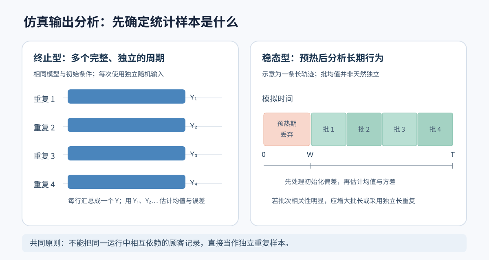

# 04｜仿真输出分析与实验设计：置信区间、稳态估计和方案比较

[返回课程目录](../README.md) · [上一讲：项目工序与 Arena](03-arena-project-process.md) · [离散事件与排队](02-discrete-event-queue.md) · [进阶习题](../exercises/02-advanced-exercises.md) · [下一讲：输入建模](05-input-modeling.md)

前面几章讨论了怎样生成随机输入、推进离散事件、组织工序和分配资源。模型能够运行以后，还需要解决另一类问题：运行得到的数值究竟代表什么，随机误差有多大，两种方案出现的差距是否足以支持决策。

设想用 Arena 比较一家仓库的两种拣货安排。方案 A 的一次仿真得到平均等待 6.1 分钟，方案 B 得到 5.7 分钟。仅凭这两个结果，还不能认定 B 一定更好。下一次运行可能分别得到 5.6 分钟和 6.0 分钟；更重要的是，若两种方案使用的订单需求不同，也无法确定差距来自排程方案，还是来自随机输入。

输出分析（Output Analysis）关注的不是怎样让模型产生数字，而是怎样从这些数字估计系统的真实性能。本章依次讨论统计指标、实验单位、独立重复、置信区间、初始化偏差、批均值、方案比较及方差缩减。所有统计推导都配有可复算的数字。

## 1. 从仿真轨迹到统计结论，究竟经过了几层计算

一次离散事件仿真会产生许多原始记录：顾客到达、进入队列、开始服务、离开系统；机器从空闲转为忙碌；每个订单最终完工。这些记录尚不是实验结论。

以平均等待时间为例，需要先对每位顾客计算等待时长，再根据研究目标汇总一次运行的等待时间，最后汇总多个独立运行结果并计算误差。

| 层次 | 数据形态 | 作用 |
| --- | --- | --- |
| 输入与模型 | 到达间隔、服务时间、资源容量、调度规则 | 决定某次运行会发生什么 |
| 事件轨迹 | 到达、开工、完工等带有时刻的记录 | 还原系统状态如何变化 |
| 实体级观测 | 每位顾客的等待时间、每个项目的工期 | 描述个体经历 |
| 一次运行的统计量 | 当日平均等待、当日总产量、该周期平均队长 | 将一个实验周期汇总成一个观测 |
| 多次运行的统计推断 | 跨运行均值、标准误、置信区间、方案差值 | 评价结果的随机误差和方案差异 |

这里最容易混淆的是“有 1000 位顾客”与“做了 1000 次独立实验”。同一次运行中，相邻顾客受到同一条队列、同一台机器以及前面顾客服务时间的影响，彼此通常并不独立。即使记录了 1000 位顾客，也不能直接把他们当作 1000 次独立重复来套用独立样本的置信区间。

真正的统计单位必须先由实验设计确定：对于终止型系统，往往是一次完整运营周期；对于稳态系统，可以是一次足够长的独立运行，也可以是在条件适当时构造的批均值。



## 2. 三类常见输出：按实体平均、按时间平均和计数

同样叫“平均值”，分母可能完全不同。排队系统中尤其需要区分按顾客平均的等待时间、按时间平均的队列长度，以及单位时间内完成的任务数。

### 2.1 按实体平均的等待时间

记第 i 位顾客的到达时刻为 Aᵢ，开始服务时刻为 Bᵢ，完成服务时刻为 Dᵢ，那么其排队等待时间和系统逗留时间分别为：

```math
\begin{aligned}
W_{q,i}&=B_i-A_i\\
W_i&=D_i-A_i
\end{aligned}
```

若观察集合中共有 n 位符合统计规则的顾客，则平均排队等待时间为：

```math
\overline W_q=\frac{1}{n}\sum_{i=1}^{n}W_{q,i}
```

分母是顾客人数，而不是系统运行了多少分钟。还要写清楚哪些顾客被纳入统计：仅统计观察期内完成服务者，还是统计观察期内到达、最终全部完成服务者？如果大量顾客在观察结束时尚未完成，选择不同会造成明显差异。

### 2.2 按时间平均的队列长度

令 Q(t) 表示时刻 t 正在排队而尚未接受服务的人数。在长度为 T 的观察窗口内：

```math
\overline Q=\frac{1}{T}\int_0^T Q(t)\,\mathrm{d}t
```

离散事件仿真中的队长通常只在事件发生时改变。假设事件时刻为 0=t₀＜t₁＜…＜tₖ=T，而且区间 [tⱼ,tⱼ₊₁) 内的队长固定，那么：

```math
\overline Q=
\frac{\sum_{j=0}^{k-1}Q(t_j)(t_{j+1}-t_j)}{T}
```

分子可以理解为“队长—时间图形下的面积”，单位是人·分钟；再除以分钟，得到平均人数。

### 2.3 一个完整的三顾客算例

假设一台机器按先到先服务（FCFS）处理三位顾客，从时刻 0 开始运行，初始没有等待者。

| 顾客 | 到达 Aᵢ | 开始服务 Bᵢ | 服务时长 | 离开 Dᵢ | 等待 Wq,ᵢ |
| --- | ---: | ---: | ---: | ---: | ---: |
| 1 | 0 | 0 | 3 | 3 | 0 |
| 2 | 1 | 3 | 2 | 5 | 2 |
| 3 | 2 | 5 | 1 | 6 | 3 |

三个等待时间分别是 0、2、3。因此：

```math
\overline W_q=\frac{0+2+3}{3}=\frac{5}{3}\approx1.667\ \mathrm{min}
```

队长则需要按事件间隔计算：

| 时间区间 | 区间长度 | 等待队长 Q | 队长面积 |
| --- | ---: | ---: | ---: |
| [0,1) | 1 | 0 | 0 |
| [1,2) | 1 | 1 | 1 |
| [2,3) | 1 | 2 | 2 |
| [3,5) | 2 | 1 | 2 |
| [5,6) | 1 | 0 | 0 |
| 合计 | 6 | — | 5 |

所以在 [0,6] 观察窗口内：

```math
\overline Q=\frac{0+1+2+2+0}{6}=\frac{5}{6}\approx0.833\ \mathrm{person}
```

平均等待时间约 1.667 分钟，平均队长约 0.833 人。二者数值不同、单位不同，并不存在矛盾。

还可以检验有限样本路径上的一条面积恒等式：三位顾客累计等待时间是 5 人·分钟，队长面积恰好也是 5 人·分钟。这是因为每位顾客排队时，都在队长图形上贡献了一块持续 Wq,ᵢ 的面积。

在系统起止均为空、所有纳入的顾客均已完成的这一完整观察窗口中，有效到达率为 3/6=0.5 人/分钟，因而：

```math
\overline Q=\lambda_{\mathrm{eff}}\overline W_q
=\frac{3}{6}\times\frac{5}{3}=\frac{5}{6}
```

这也是检验仿真统计计算是否一致的一种方法。一般谈论 Little 定律时，仍要区分长期平均、有限窗口、未完成顾客与边界条件；不能对任意截断窗口直接代入上述等式。

### 2.4 吞吐率和资源利用率

若观察窗口 [0,T] 内完成了 Nout 项任务，平均吞吐率为：

```math
\widehat{\mathrm{TH}}=\frac{N_{\mathrm{out}}}{T}
```

若一台机器在窗口内累计忙碌 B 小时，其利用率为 B/T。若有 c 台同类机器且每台容量为 1、全部在整个窗口可用，记第 k 台机器的累计忙碌时间为 Bₖ，则这一资源组的平均利用率为：

```math
\widehat \rho=
\frac{\sum_{k=1}^{c}B_k}{cT}
```

必须先确定 T 的含义：是规定的 8 小时营业窗口，还是“关门后继续完成全部订单”的总时间？利用率的分母不同，得到的结果就不同。

## 3. 首先判断：这是终止型仿真还是稳态仿真

终止型（Terminating Simulation）与稳态型（Steady-State Simulation）并非根据模型里有没有最后一个顾客来区分，而是取决于研究目标和实验中的时间边界。

### 3.1 终止型仿真研究一个完整周期

典型例子包括：一个项目从开工到全部工序完成、一场活动从开门到结束、一天固定时段内的服务运营、某批明确数量的产品全部加工完成。

这类模型有自然的起点和终点，初始状态通常就是研究对象的一部分。假如研究“每天开门后从零排队开始运营的平均等待时间”，早上刚开门队列为空，不属于需要删除的偏差，而是现实制度的一部分。

一个完整周期结束后，进行另一次独立重复。即便每个周期内的 500 位顾客等待时间相互相关，不同周期只要使用适当独立的随机输入，周期级输出仍可作为独立重复观测来分析。

还需要区分两种终止规则：

| 规则 | 停止的时刻 | 适合研究什么 |
| --- | --- | --- |
| 固定时间截断 | 仿真时钟达到 T 后停止统计 | 固定营业时段的系统状态与产出 |
| 停止新到达并清空系统 | 到 T 不再接收新顾客，但继续服务剩余顾客 | 该批到达顾客最终等待和完工情况 |

如果在 T 时刻直接停机，只统计已完成服务的顾客，就可能遗漏仍在排队的人，形成截尾选择问题。若改为清空系统，又要分开报告“营业时段指标”和“营业后清空所需时间”，不能把两种分母混在一起。

### 3.2 稳态仿真研究长期运行状态

持续运营的制造系统、物流分拣中心、网络服务节点，往往更关心长时间运行后的平均等待、平均在制品数量和机器忙碌比例。

这时模拟从空系统启动只是人为选择的初始条件。系统刚启动时几乎不排队，可能使短时间内的平均队长和平均等待偏低，这称为初始化偏差（Initialization Bias）。

稳态估计需要同时处理两件不同的事：

第一，运行时间应足够长，尽量降低初始条件的影响。第二，即使已经进入稳定运行阶段，相邻输出仍可能相关，因此还需要正确估计随机误差。

“运行够长”只能处理部分问题；不等于“记录了很多数据就能当作独立样本”。

### 3.3 什么情况下根本不存在需要估计的稳态

考虑 M/M/1 排队系统，平均到达率为 λ，平均服务率为 μ，利用率参数为：

```math
\rho=\frac{\lambda}{\mu}
```

在标准 M/M/1 无限缓冲模型中，要存在有限的稳态队长均值，需要 λ＜μ。如果 λ=3 人/小时、μ=4 人/小时，则 ρ=0.75，稳态平均排队人数与平均等待时间为：

```math
\begin{aligned}
L_q&=\frac{\rho^2}{1-\rho}
=\frac{0.75^2}{0.25}=2.25\\
W_q&=\frac{L_q}{\lambda}
=\frac{2.25}{3}=0.75\ \mathrm{h}
\end{aligned}
```

这里的理论值可以作为仿真校验参考。但若 λ≥μ，系统长期接收的工作量不小于可处理量，队列不能形成具有有限平均队长的通常稳态分布。删除前 100 小时、再运行 1000 小时，也不会因此得到有限的稳态平均等待。

更一般的仿真系统是否稳定，应根据队列结构、工作量、资源能力和反馈机制判断，不能只依赖一个简单利用率。

## 4. 独立重复：为什么每次运行只汇总成一个 Y

设我们研究一座仓库一天的平均订单等待时间。进行 r 次独立仿真，每次都模拟同样的营业规则、同样的需求分布，但重新产生随机到达与服务过程。

第 j 次运行可能有 420 个订单，第 j 次运行的平均等待时间记为 Yⱼ。这里的统计样本为 Y₁、Y₂、…、Yᵣ，而不是直接把全部运行的订单等待记录混在一起当作 r×420 个独立样本。

如果研究对象是“随机抽取一天，这一天的平均等待时间的期望”，对每个周期等权平均即可。如果研究的是“跨许多天的订单加权平均等待”，每天订单数不同会引出另一种比率估计问题，不能不加区分地使用日均值的简单平均。

### 4.1 样本均值、样本方差和标准误

对 r 个独立周期输出：

```math
\begin{aligned}
\overline Y&=\frac{1}{r}\sum_{j=1}^{r}Y_j\\
s_Y^2&=\frac{1}{r-1}\sum_{j=1}^{r}(Y_j-\overline Y)^2\\
\widehat{\mathrm{SE}}(\overline Y)&=\frac{s_Y}{\sqrt r}
\end{aligned}
```

这三个量含义不同：

| 量 | 回答的问题 | r 增加时的变化 |
| --- | --- | --- |
| 样本均值 | 平均绩效大约是多少 | 不一定单调增加或减小 |
| 样本标准差 sY | 不同完整周期的结果有多分散 | 主要反映周期本身的随机波动 |
| 均值标准误 SE | 对总体平均值的估计有多不精确 | 在方差有限且独立时通常按 r 的平方根缩小 |

例如仓库一天的平均等待在不同日期本来就可能有较大波动。这种实际日际波动用 sY 描述；即使增加重复次数，sY 未必显著下降。重复次数增多，改善的是我们对“平均一天的等待时间”的估计精度。

### 4.2 手算五次运行的 95% 置信区间

假设五次独立重复得到的平均等待时间（单位：分钟）分别为：

| 重复编号 | 1 | 2 | 3 | 4 | 5 |
| --- | ---: | ---: | ---: | ---: | ---: |
| 平均等待 Yⱼ | 4 | 5 | 6 | 7 | 8 |

第一步，计算五次运行的样本均值：

```math
\overline Y=\frac{4+5+6+7+8}{5}=6
```

第二步，计算离均差平方和。相对均值 6 的偏差依次是 −2、−1、0、1、2，因此：

```math
\begin{aligned}
\sum_{j=1}^5(Y_j-\overline Y)^2
&=4+1+0+1+4=10\\
s_Y^2&=\frac{10}{5-1}=2.5\\
s_Y&=\sqrt{2.5}\approx1.581
\end{aligned}
```

第三步，标准误为：

```math
\widehat{\mathrm{SE}}(\overline Y)
=\frac{\sqrt{2.5}}{\sqrt5}
=\sqrt{0.5}\approx0.707
```

第四步，构造双侧 95% 置信区间。如果独立重复输出满足正态假设，或者重复次数足够大使近似合理，可以使用 t 分布形式：

```math
\overline Y\ \pm\
t_{1-\alpha/2,\ r-1}\frac{s_Y}{\sqrt r}
```

其中 α=0.05，自由度 r−1=4，查表得 t₀.₉₇₅,₄≈2.776。代入：

```math
\begin{aligned}
h&=2.776\times0.707\approx1.963\\
\mathrm{CI}_{95\%}
&=6\pm1.963\\
&\approx[4.037,\ 7.963]\ \mathrm{min}
\end{aligned}
```

最终报告可以写为：“基于 5 次独立重复，平均等待时间估计为 6.00 分钟，样本标准差为 1.58 分钟，95% t 置信区间为 [4.04，7.96] 分钟。”

由于这里只有 5 次重复，区间较宽，而且 t 区间对输出分布的形状更敏感。这个算例用于演示计算，不意味着实际仿真实验做 5 次就足够。

### 4.3 如何正确解释 95% 置信区间

在模型、抽样和区间构造假设成立的情况下，假如重复进行整个“采样—计算区间”的过程，大约 95% 的区间会覆盖真正的目标均值。

目标均值是固定的，随机的是重复试验产生的区间。不能把已得到的某一个频率学派区间解释为“真实均值有 95% 的概率落在这里”。也不能认为“有 95% 的顾客等待时间落在这个区间”；后者描述的是顾客等待分布，与总体均值的置信区间不是同一概念。

## 5. 需要多少次重复？运行时间和重复次数不是一个参数

置信区间的半宽 h 决定了结果报告的精度。例如估计等待时间为 6 分钟、95% 区间半宽为 0.5 分钟，通常比半宽为 2 分钟更有助于区分两个资源方案。

在已经做过先导实验并初步得到标准差 s₀ 后，可以用正态近似粗略估计达到目标半宽 h₀ 所需的重复次数：

```math
r_{\mathrm{pilot}}\approx
\left(\frac{z_{1-\alpha/2}s_0}{h_0}\right)^2
```

如果先导实验估计 s₀²=2.5，希望双侧 95% 区间半宽不超过 0.5 分钟，则：

```math
r_{\mathrm{pilot}}\approx
\frac{1.96^2\times2.5}{0.5^2}
=38.416
```

将结果向上取整得到约 39 次。这只是规划数；实际使用 t 临界值时，可能需要更多次重复。完成后应根据新增数据重新估计 s 和实际半宽，不应把先导阶段的估计当作精确承诺。

还要区分两种增加计算量的方式。

对于终止型仿真，若目标是固定长度完整周期的均值，通常增加独立重复次数。把原本 8 小时的营业日改为 80 小时，可能已经改变了研究对象。

对于稳态仿真，增加单次运行长度可以降低时间平均的随机波动，但输出相关性仍然存在；也可以采用多条独立长运行来形成独立统计量。究竟增加运行长度还是增加运行条数，应由统计方法、初始化偏差和计算成本共同决定。

## 6. 稳态仿真的初始化偏差与预热期

稳态仿真最常见的起点是 Q(0)=0，即系统一开始没有任何顾客或任务。现实中长期运行的系统往往并不处于空状态，所以刚开始的队列行为可能不能代表长期平均。

设想一个简化的队长轨迹：前 10 分钟队长始终为 0，此后 90 分钟队长始终为 4。完整 100 分钟的时间平均队长是：

```math
\overline Q_{0:100}
=\frac{0\times10+4\times90}{100}
=3.6
```

如果研究长期运行阶段，忽略最初 10 分钟以后：

```math
\overline Q_{10:100}
=\frac{4\times90}{90}
=4.0
```

这个例子只是说明早期低队长会拉低全程平均值，并不表示所有系统都应设置 10 分钟预热期。实际轨迹不会如此整齐，且系统的长期均值事先通常未知。

### 6.1 删除的是统计记录，不是系统状态

设预热期为 W、总运行长度为 T，W＜T。对时间平均指标，正确的观察窗口是 [W,T]：

```math
\overline Q_{\mathrm{post}}
=\frac{1}{T-W}\int_W^TQ(t)\,\mathrm{d}t
```

如果系统在 W 时刻有 10 位顾客排队，不能因为“预热期结束”就把这 10 位顾客强行删除。队列和资源状态必须继续自然演化，变化的是哪些观测被纳入统计。

同理，如果某位顾客在 W 之前到达、W 之后离开，是否将其完整等待时间纳入统计，要根据预先定义的观测口径处理。按到达时刻筛选与按离开时刻筛选会得到不同的样本集合，不能随意切换。

### 6.2 如何选择预热期

一种实用的初步方法，是先运行若干条独立、较长的轨迹，对相同仿真时刻的队长或等待指标进行跨运行平均，再观察平滑后的曲线是否逐渐进入波动较稳定的区间。这类图形方法常称为 Welch 图形法。

可以按如下过程进行：

1. 先确定目标稳态指标，例如时间平均排队人数。
2. 用多个独立随机种子产生较长的初始轨迹。
3. 将各条轨迹按时间对齐，并对同一时刻或时间窗口的观测取平均。
4. 适度平滑曲线，检查早期趋势何时不再明显受初始状态驱动。
5. 选定候选 W，改变 W 和 T 做敏感性比较，避免仅凭某一张图作结论。

预热期过短，会残留初始化偏差；预热期过长，会浪费数据并增加计算成本。预热并不保证系统已经达到稳态，尤其不能用于“修复”本来不稳定的队列。

## 7. 为什么稳态输出相关性会使置信区间过窄

设稳态观测序列为 X₁、X₂、…、Xₙ。即使每个 Xᵢ 都服从同一个长期分布，相邻值也可能相关。例如一台机器前一刻排队 20 人，下一秒突然变成排队 0 人的概率通常不高。

记序列的滞后 k 自协方差为：

```math
\gamma_k=\operatorname{Cov}(X_t,X_{t+k})
```

在弱平稳条件下，样本均值的方差可以写为：

```math
\operatorname{Var}(\overline X_n)=
\frac{1}{n}\left[
\gamma_0+
2\sum_{k=1}^{n-1}
\left(1-\frac{k}{n}\right)\gamma_k
\right]
```

如果相关性衰减足够快，n 较大时可以近似为：

```math
\operatorname{Var}(\overline X_n)
\approx\frac{1}{n}
\left(\gamma_0+2\sum_{k=1}^{\infty}\gamma_k\right)
```

独立样本的公式只留下 γ₀/n，相当于假定所有非零滞后的自协方差都是零。当多数自协方差为正时，直接忽略它们就会低估标准误，从而给出过窄、过于乐观的区间。

### 7.1 有效样本量的直观计算

考虑相关系数近似按 ρₖ=φᵏ 衰减的平稳序列，其中 0＜φ＜1。若 n 很大，相关性的方差膨胀因子近似为：

```math
1+2\sum_{k=1}^{\infty}\phi^k
=\frac{1+\phi}{1-\phi}
```

因此，一个常用的近似有效样本量为：

```math
n_{\mathrm{eff}}\approx
n\frac{1-\phi}{1+\phi}
```

若 n=900、φ=0.8，则：

```math
n_{\mathrm{eff}}\approx
900\times\frac{0.2}{1.8}=100
```

也就是说，900 条高度相关的观测，在估计均值方面可能只有约 100 条独立观测的精度。这不是说其他 800 条“毫无价值”，而是说它们提供了大量重复信息。该计算是特定相关结构下的大样本近似，不是所有稳态序列通用的固定换算。

## 8. 批均值法：把长轨迹加工成近似独立的统计观测

批均值法（Batch Means）用于处理一条较长的稳态仿真轨迹。基本思想不是逐个顾客套用独立样本公式，而是在删除预热期后，把剩余轨迹切分成若干段，每段先求一个平均值，再考察这些批平均值。

设删除预热期后保留 n=bm 个按相同时间或观测数量划分的序列数据，形成 b 个不重叠批次，每批 m 个观测，第 j 批的均值为：

```math
\overline X_j^{(b)}
=\frac{1}{m}
\sum_{i=(j-1)m+1}^{jm}X_i
```

再对 b 个批均值求平均和样本方差：

```math
\begin{aligned}
\overline X^{(b)}&=\frac{1}{b}\sum_{j=1}^{b}\overline X_j^{(b)}\\
s_b^2&=\frac{1}{b-1}
\sum_{j=1}^{b}
\left(\overline X_j^{(b)}-\overline X^{(b)}\right)^2
\end{aligned}
```

如果批长足够大，使批均值之间的相关性可以忽略，那么可以近似使用：

```math
\overline X^{(b)}
\pm t_{1-\alpha/2,\ b-1}\frac{s_b}{\sqrt b}
```

### 8.1 批长与批数为什么存在权衡

批长 m 过短，相邻批均值仍可能明显正相关，标准误容易被低估。批长越大，批均值之间的相关性往往越弱；但在总运行长度固定时，批数 b 就越少，自由度和方差估计稳定性都会受到影响。

例如保留 500 个时间单位的数据，划分为 5 批，每批 100 个单位。假设各批的时间平均队长是 4、5、3、6、2，则批均值的总体平均值为 4，批间样本方差为 2.5。若这些批均值可以近似视为独立，则形式上可以算出 95% t 区间：

```math
4\pm2.776\sqrt{\frac{2.5}{5}}
\approx[2.037,\ 5.963]
```

这个区间是“在批均值近似独立的前提下”的计算结果。不能因为已经算出了区间，就反过来认定批长 100 一定足够。实际还要检查批均值的滞后相关，必要时增加总运行长度、重新划分批次。

### 8.2 批均值法与独立长重复法的区别

| 比较项 | 多条独立长重复 | 单条长轨迹的批均值 |
| --- | --- | --- |
| 输入随机性 | 每条轨迹独立生成 | 全部批次属于同一条轨迹 |
| 初始化阶段 | 每条轨迹都要考虑预热 | 通常只需处理这一条轨迹的预热 |
| 统计单位 | 每条轨迹的汇总值 | 每一批的平均值 |
| 独立性 | 在随机流独立时可按设计实现 | 通常只能近似成立 |
| 主要注意事项 | 多次预热可能增加计算成本 | 批长过短会保留显著相关性 |

二者都可以用于稳态均值估计，不应把“批均值”与“独立重复”当作同义词。

## 9. 比较两个方案时，先选择实验匹配方式

假设一家分拣中心有两个资源方案：A 使用一台人工复核设备，B 使用两台。研究指标是每次运营周期的平均等待时间，数值越小越好。

首先要明确差值方向。令：

```math
D_j=Y_{A,j}-Y_{B,j}
```

那么 Dⱼ＞0 表示在第 j 组相应实验中，方案 B 的等待时间更短；Dⱼ＜0 表示 A 更短。

### 9.1 A/B 使用完全独立的随机输入

如果两个方案各自进行 rA、rB 次独立重复，并且两组互不相关，可估计平均差为：

```math
\widehat\Delta=\overline Y_A-\overline Y_B
```

其标准误可估计为：

```math
\widehat{\mathrm{SE}}_{\mathrm{ind}}
=\sqrt{\frac{s_A^2}{r_A}+\frac{s_B^2}{r_B}}
```

构造小样本区间时，若不假定两组总体方差相同，可以采用 Welch 的近似自由度，而不是机械地套用配对样本的 r−1 自由度。

### 9.2 A/B 使用相同的外部随机环境进行配对

现实中更常见的决策问题是：“面对同一批随机订单，两种资源安排会有什么差别？”这时可以通过共同随机数为方案 A 和 B 创建可比的随机输入，再以每一对实验为单位计算差值。

假设配对试验获得以下结果（单位：分钟）：

| 实验对 j | A 的平均等待 | B 的平均等待 | 差值 Dⱼ=A−B |
| --- | ---: | ---: | ---: |
| 1 | 12 | 10 | 2 |
| 2 | 10 | 9 | 1 |
| 3 | 14 | 11 | 3 |
| 4 | 11 | 10 | 1 |
| 5 | 13 | 10 | 3 |

先计算五个差值的均值、方差与标准误：

```math
\begin{aligned}
\overline D&=\frac{2+1+3+1+3}{5}=2\\
s_D^2&=\frac{0^2+(-1)^2+1^2+(-1)^2+1^2}{4}=1\\
\widehat{\mathrm{SE}}_{\mathrm{pair}}
&=\frac{1}{\sqrt5}\approx0.447
\end{aligned}
```

对应的 95% 配对 t 置信区间为：

```math
\begin{aligned}
\overline D\pm t_{0.975,4}\frac{s_D}{\sqrt5}
&=2\pm2.776\times0.447\\
&\approx[0.758,\ 3.242]\ \mathrm{min}
\end{aligned}
```

这个例子的区间全在零以上，表明按上述随机实验和统计假设，B 的总体平均等待更短。由于样本仅有 5 对，在真实项目中仍应增加重复并检查输入、模型与统计假设。

如果错误地无视配对结构，A 组样本方差为 2.5，B 组为 0.5，独立组差异标准误会变成：

```math
\widehat{\mathrm{SE}}_{\mathrm{ind}}
=\sqrt{\frac{2.5}{5}+\frac{0.5}{5}}
=\sqrt{0.6}\approx0.775
```

相同数据在配对分析下的标准误是 0.447，在独立分析下是 0.775。差异来自两组结果的正相关被利用了，而不是配对方法天然总会更优。

### 9.3 共同随机数的统计原理

对单对实验输出，差值的方差为：

```math
\operatorname{Var}(Y_A-Y_B)
=\operatorname{Var}(Y_A)+\operatorname{Var}(Y_B)
-2\operatorname{Cov}(Y_A,Y_B)
```

如果两个方案面对较大的订单量时都容易排队，面对较小的订单量时都较少排队，那么它们通常正相关。减去正协方差项，差值方差就会变小。

但若人为配对导致两个结果负相关，差值方差可能反而增大。因此共同随机数（Common Random Numbers，CRN）是有条件地改善差异估计，而不是任何场景下都保证方差下降。

实际建模时，可以为订单到达、订单工作量、机器故障等外部随机来源分别指定随机数流，并在两个方案间保持对应关系。若不同方案在某处消耗了不同数量的随机数，随后的随机序列可能错位；这时即便两个模型用了相同的初始种子，也不意味着它们仍在一一对应地比较相同业务条件。

## 10. 方差缩减：在计算量相近时提高估计精度

增加重复次数是降低 Monte Carlo 随机误差的直接办法，但代价是更多运行。方差缩减（Variance Reduction）则通过重新组织随机输入或利用已知信息，在不改变目标期望的前提下，尝试降低估计量方差。

它不是改变系统的现实波动，也不是删掉“不好看”的输出，而是改进我们估计某个期望值的方式。

### 10.1 共同随机数：适合比较两个方案

前一节的配对比较就是典型应用。CRN 主要服务于“差值估计”，不是为了让单独某个方案的样本方差必然缩小。

目标是估计 E(YA−YB) 时，正协方差能够提高精度；如果只关心 E(YA)，CRN 本身并不会让 A 的单方案方差变小。

### 10.2 对偶变量（Antithetic Variates）

令 U 服从 (0,1) 上的均匀分布，构造互补输入 1−U。因为 1−U 也服从同一均匀分布，可以同时计算：

```math
Y_1=g(U),\qquad Y_2=g(1-U)
```

并使用配对平均：

```math
Z=\frac{Y_1+Y_2}{2}
```

若两个输出在这种配对下负相关，则 Z 的方差会小于两次独立取样均值的方差。

例如要估计 E(U²)。理论值已知：

```math
\mathrm{E}(U^2)
=\int_0^1u^2\,\mathrm{d}u=\frac{1}{3}
```

若取 U=0.2，则互补输入为 0.8，两个输出为 0.04、0.64，配对均值为 0.34。单看这一对不能判断精度；需要考察配对估计量本身的方差。

这里可以精确计算：

```math
\begin{aligned}
\operatorname{Var}(U^2)
&=\mathrm{E}(U^4)-\mathrm{E}(U^2)^2\\
&=\frac{1}{5}-\frac{1}{9}=\frac{4}{45}\\
\operatorname{Cov}(U^2,(1-U)^2)
&=\frac{1}{30}-\frac{1}{9}=-\frac{7}{90}
\end{aligned}
```

因此一个对偶配对均值的方差为：

```math
\begin{aligned}
\operatorname{Var}\left(
\frac{U^2+(1-U)^2}{2}\right)
&=\frac{1}{4}\left(\frac{8}{45}-\frac{7}{45}\right)\\
&=\frac{1}{180}
\end{aligned}
```

作为对照，若使用两个相互独立的均匀数来计算 U² 的普通二次平均，其方差是 (4/45)/2=2/45。对偶法在此例中将方差降至原来的 1/8。

需要注意，这种改善依赖输出函数和配对后的相关性。并不是只要把 U 换成 1−U，就能保证任何复杂仿真模型的输出都负相关。

### 10.3 控制变量（Control Variates）

设 Y 是需要估计期望的输出，C 是与 Y 有关联、且总体均值 μC 已知的辅助变量。构造：

```math
Y_{\mathrm{cv}}=
Y-\beta(C-\mu_C)
```

因为 E(C−μC)=0，当 β 为预先固定的常数时，该变换不会改变目标期望：

```math
\mathrm{E}(Y_{\mathrm{cv}})=\mathrm{E}(Y)
```

其方差展开为：

```math
\operatorname{Var}(Y_{\mathrm{cv}})
=\operatorname{Var}(Y)
+\beta^2\operatorname{Var}(C)
-2\beta\operatorname{Cov}(Y,C)
```

对 β 求导并令导数为零，得到方差最小的理论系数：

```math
\beta^*=
\frac{\operatorname{Cov}(Y,C)}
{\operatorname{Var}(C)}
```

继续用 Y=U² 举例，取 C=U，已知 E(U)=1/2，且：

```math
\begin{aligned}
\operatorname{Var}(U)&=\frac{1}{12}\\
\operatorname{Cov}(U^2,U)
&=\mathrm{E}(U^3)-\mathrm{E}(U^2)\mathrm{E}(U)\\
&=\frac{1}{4}-\frac{1}{6}=\frac{1}{12}
\end{aligned}
```

所以 β*=1，调整后的输出为：

```math
Y_{\mathrm{cv}}=U^2-\left(U-\frac{1}{2}\right)
```

它仍然估计 1/3，方差却变为：

```math
\operatorname{Var}(Y_{\mathrm{cv}})
=\frac{4}{45}-\frac{1}{12}
=\frac{1}{180}
```

实际仿真中可以选择“当天订单总量”“总到达工作量”等与等待时间相关的变量，但必须知道或能够可靠估计这些控制变量的总体均值。β 通常由先导数据估计；如果直接用同一小样本估计 β 并调整均值，还需要考虑系数估计带来的额外影响，不能未经检查就照搬固定 β 的无偏性推导。

### 10.4 三种方法各自解决的问题

| 方法 | 主要操作 | 最适合的目标 | 重要限制 |
| --- | --- | --- | --- |
| 共同随机数 CRN | A/B 使用可对齐的外部随机输入 | 减小方案差值的方差 | 输出协方差可能不是正数 |
| 对偶变量 AV | 同时使用 U 和 1−U | 构造负相关的两次估计 | 依赖输出对输入的响应关系 |
| 控制变量 CV | 减去与已知均值的偏差相联系的项 | 利用已知信息估计单方案均值 | 辅助变量的均值必须可信 |

## 11. Arena 中怎样落实这些统计设计

Arena 模型中的实体、队列与资源能够产生大量自动或人工定义的统计量，但输出分析仍要先由研究者决定统计口径与实验结构。软件给出某个 Half Width 并不意味着实验设计一定合理。

### 11.1 先核对实体级指标与时间持续指标

例如一个订单进入等待队列后，在 Seize 成功时记录排队结束。等待时间应当是开始服务时刻减去进入队列时刻，属于实体级观测。

资源利用率、队列长度属于随时间变化的持续状态，不能通过“每次事件发生时简单算一次队长均值”来代替时间平均。事件密集的时段会被错误赋予更高权重。

使用 Arena 的 Process、Record、统计报表时，应明确记录的是 Count、Tally 还是 Time-Persistent 类统计量；不同类型的报告分母并不相同。

### 11.2 对终止型实验设置重复

以“每天营业 8 小时，结束后清空待处理订单”为例：

1. 为每次重复设置相同的业务规则和一天的到达过程，并保证独立随机输入。
2. 规定第 8 小时停止新增订单，再让系统中剩余订单完成；单独记录关门后清空耗时。
3. 每次重复输出一个或多个周期级指标，例如当天所有入场订单的平均等待、完成订单数、关门后清空时长。
4. 设置一定数量的 Replications，得到重复级数据，再计算各指标的均值、标准差与置信区间。

如果 Arena 版本中采用固定 Replication Length 直接在第 8 小时停止，而不是“停止到达并清空”，模型会保留未完成任务。两种设定不能只改一个数值就认作同一种实验。

### 11.3 对稳态实验设置预热与长运行

以持续工作的分拣系统为例，需要明确总运行长度 T、预热期 W 和重复次数 r，或选择足够长的单次轨迹配合批均值方法。

预热期用于排除初始化阶段的统计记录，系统实体及资源仍应继续自然运行。若希望估计时间平均队长，应确保统计窗口和分母是 [W,T]，而不是对整条轨迹求平均后再口头说明“设置了预热”。

若修改了到达率、资源数或调度策略，需要重新检查稳定性与所需预热长度，不能默认旧方案的设置始终适用。

### 11.4 方案 A/B 使用同类随机数流

若要配对比较两个 Arena 模型，可将相同的外部订单需求和任务工作量映射到对应随机数流，并保持每组实验的配对关系。模型中的条件分支、重试与额外随机抽样可能造成随机数流错位，比较结果应通过样例订单轨迹进行检查。

Arena 的官方说明包含 Output Analyzer、Input Analyzer 与 Process Analyzer 等工具的访问方式。具体功能入口与菜单名称应以安装版本为准；不要将软件生成的区间直接视作对初始化偏差、批间相关性和方案配对方式的自动审核。

## 12. 面对题目，如何选择统计分析方法

| 题目想研究什么 | 一般怎样取统计样本 | 推荐的分析起点 |
| --- | --- | --- |
| 一个项目从开始到完成的总工期 | 每个项目周期或一次完整运行 | 终止型独立重复 |
| 每日固定营业时段的平均等待 | 每次模拟一天得到一个日级指标 | 终止型独立重复 |
| 连续生产线长期平均在制品数 | 一条稳态长轨迹或独立长运行 | 预热后时间平均，检查相关性 |
| 单条长期轨迹的均值区间 | 每段较长轨迹的批均值 | 批均值法 |
| 两种服务台方案的等待差异 | A/B 相互对应的一对运行差值 | 配对比较、共同随机数 |
| 两组完全独立模拟结果的差异 | 每组独立运行的汇总值 | 独立样本均值差及 Welch 区间 |
| 已知订单需求平均值，希望更精确估计等待 | 经过控制变量调整的重复级输出 | 控制变量法 |

实际选方法之前，应先写出研究目标。例如“我想知道关门时队里还有多少订单”与“我想知道这一天到达的订单最终平均等待多少”虽然使用同一模型，却要求不同的停止条件、统计集合与输出分母。

## 13. 习题与完整解析

以下练习覆盖本章主要计算。建议先独立求解，再核对公式中的分母、统计单位与实验条件。

### 题 1｜按实体平均与按时间平均

某单服务台有 3 位顾客：到达时刻为 0、1、2，开始服务时刻为 0、3、5，离开时刻为 3、5、6。系统在时刻 0 初始为空，观察窗口为 [0,6]。求平均排队等待时间、平均等待队长以及机器利用率。

标准答案：平均等待时间 5/3 分钟；平均等待队长 5/6 人；机器利用率 100%。

解析：第一位顾客不等待；第二位等待 3−1=2 分钟；第三位等待 5−2=3 分钟。等待总量为 5 人·分钟，除以 3 位顾客，得到 5/3 分钟。

队列人数在 [1,2) 为 1，在 [2,3) 为 2，在 [3,5) 为 1，其余时间为 0。面积等于 1×1+2×1+1×2=5 人·分钟；除以窗口长度 6，得到 5/6 人。

机器在 [0,3)、[3,5)、[5,6) 连续忙碌，忙碌总时长为 3+2+1=6，所以利用率为 6/6=100%。三个统计量分母分别是顾客数、观察时间和资源容量时间。

### 题 2｜完整计算一个置信区间

某终止型系统进行了 5 次独立重复，得到的每周期平均等待时间分别为 4、5、6、7、8 分钟。已知双侧 95% t 临界值 t₀.₉₇₅,₄=2.776。求样本均值、样本方差、标准误和置信区间。

标准答案：均值 6；方差 2.5；标准误约 0.707；95% 区间约 [4.037，7.963] 分钟。

解析：先求和得 30，除以 5 得均值 6。五个离均差平方分别为 4、1、0、1、4，总和为 10。样本方差的分母是 r−1=4，因此 s²=10/4=2.5。

均值标准误是 s/√r=√(2.5/5)=√0.5≈0.707。半宽 h=2.776×0.707≈1.963，所以下限 6−1.963≈4.037，上限 6+1.963≈7.963。这里不应使用 5 作为样本方差的分母，也不应将 s 直接当作均值标准误。

### 题 3｜为什么 1000 位顾客不是 1000 次独立重复

某模型只运行了一次，期间记录到 1000 位顾客的等待时间。学生将这 1000 个等待时间当作独立样本，计算均值及 t 置信区间。请判断该做法是否必然正确，并说明原因。

标准答案：不必然正确。连续顾客可能受到共同队列、资源占用和前序服务时间影响，等待时间通常相关；直接使用独立样本标准误可能低估误差。

解析：统计区间需要估计样本均值的真实抽样方差。若观测之间正相关，均值方差除了单个观测方差项外，还有自协方差贡献。忽略这些项，相当于高估独立信息量。

若研究完整营业周期的平均等待，可增加独立周期重复，以每次运行的平均值为统计样本；若研究稳态长期平均，则需要预热、长轨迹和能够处理序列相关性的方差估计方法。

### 题 4｜预热期改变了什么

某简化系统前 10 分钟队长为 0，随后 90 分钟队长为 4。求全程平均队长及删除前 10 分钟后的平均队长。

标准答案：全程 3.6 人；删除前 10 分钟后为 4 人。

解析：全程队长面积为 0×10+4×90=360 人·分钟，全程平均为 360/100=3.6。删去预热期后，队长面积为 360，观察时间变为 90，平均为 360/90=4。

改变的是统计窗口，而不是把时刻 10 仍留在系统中的顾客删除。是否应该选择 10 分钟作为预热期，需要另行判断，不能从这道算术题推断所有系统的预热期都是 10 分钟。

### 题 5｜序列相关性和有效样本量

某稳态观测序列共有 900 条记录，其相关系数近似满足 ρₖ=0.8ᵏ。按大样本近似公式估算有效样本量，并解释结果。

标准答案：约 100。

解析：相关性方差膨胀因子为 (1+0.8)/(1−0.8)=9，因此有效样本量 n_eff≈900/9=100。

样本数 900 仍是真实的观测数量，但在估计均值的精度上，只相当于大约 100 个独立观测提供的信息。该结论依赖特定的相关结构和大样本条件，不是对任意序列都可套用的经验比例。

### 题 6｜批均值的置信区间

某稳态仿真在预热后得到 5 个近似独立的批均值：4、5、3、6、2。假设可以使用 t 区间，临界值为 2.776。求总体平均估计与区间。

标准答案：均值 4；样本方差 2.5；标准误约 0.707；区间约 [2.037，5.963]。

解析：五批均值之和为 20，平均为 4。平方偏差为 0、1、1、4、4，总和 10，样本方差为 10/(5−1)=2.5。半宽为 2.776×√(2.5/5)≈1.963。

需要先确认批均值相关性足够小，再使用上述区间。若五批仍明显正相关，计算过程虽然正确，区间的统计可靠性却不足。

### 题 7｜配对方案比较

某两方案在 5 组相同随机订单情境下运行，A 的等待均值分别是 12、10、14、11、13，B 的等待均值是 10、9、11、10、10。规定差值为 A−B。求平均差、差值的样本方差、标准误和 95% 配对区间。

标准答案：平均差 2；差值方差 1；配对标准误约 0.447；95% 区间约 [0.758，3.242]。

解析：逐对相减得到 2、1、3、1、3。差值均值为 10/5=2，偏差为 0、−1、1、−1、1，平方偏差之和为 4，所以样本方差为 4/4=1。

标准误是 √(1/5)≈0.447。代入配对 t 区间 2±2.776×0.447，得到 [0.758，3.242]。差值方向是 A−B，因此正值表示 B 比 A 更短。不能先把两列数据打乱后再配对，也不能在有意使用 CRN 时无视原来的成对关系。

### 题 8｜共同随机数为什么可能降低方差

设一对方案输出的方差分别为 2.5 和 0.5，协方差为 1。求输出差值的方差。如果两方案独立，差值方差会是多少？

标准答案：正相关配对时差值方差为 1；独立时为 3。

解析：直接代入方差恒等式，得到 2.5+0.5−2×1=1。若独立，则协方差为 0，差值方差为 2.5+0.5=3。比较两者可见，CRN 在这个正相关例子中将差值方差降为原来的 1/3。

若协方差为负，则减去两倍负数反而增加差值方差。因此“CRN 总能改善精度”是错误判断。

### 题 9｜对偶变量与控制变量

已知 U 服从 U(0,1)，要求估计 E(U²)。分别考虑对偶配对 [U²+(1−U)²]/2，以及使用 C=U、β=1 的控制变量 U²−(U−1/2)。判断两种估计量是否保持正确期望，并写出理论方差。

标准答案：两种估计量的期望均为 1/3，方差均为 1/180。

解析：对偶配对中的 U 和 1−U 分别仍服从均匀分布，因此两者平方的均值仍为 1/3。根据 Var(U²)=4/45 和 Cov(U²,(1−U)²)=−7/90，得到配对均值方差为 1/180。

控制变量法中，E[U−1/2]=0，所以 E[U²−(U−1/2)]=1/3。利用 Var(U²)=4/45、Var(U)=1/12、Cov(U²,U)=1/12，可得调整后方差为 4/45+1/12−2×1/12=1/180。

这道题的相等结果来自特定数学结构，不表示对偶变量与控制变量在一般仿真问题中一定具有相同方差。

### 题 10｜稳定性和运行长度

某 M/M/1 系统到达率 λ=5 人/小时，服务率 μ=4 人/小时。研究者计划先预热 100 小时，再运行 10000 小时，以得到长期平均队长。该做法是否合理？

标准答案：不合理。标准 M/M/1 无限缓冲模型在 λ≥μ 时不具备具有有限平均队长的稳态分布。

解析：ρ=λ/μ=5/4=1.25。系统平均输入工作量超过处理能力，队列长期会继续积累。增加预热期不能改变服务能力，也不能把一个不稳定系统变为稳定系统。

应先核查研究是否真的需要稳态指标，或者是否应改变模型边界，例如加入有限容量、放弃订单、动态增加资源等实际机制；这些修改会改变原模型，并非统计技巧。

## 14. 实验报告应写到什么程度

一份可复核的仿真报告，需要把系统规则与统计规则同时写清楚。只放一张软件输出截图，通常不足以说明方案结论可信。

| 报告位置 | 应明确的内容 | 常见遗漏 |
| --- | --- | --- |
| 研究目标 | 评价什么指标、改善方向、候选方案是什么 | “性能更好”没有定义 |
| 系统模型 | 到达规则、队列纪律、资源容量、终止条件 | 未说明订单是否在关门后继续处理 |
| 随机输入 | 分布类型、参数、数据来源、随机数流 | 所有方案使用同一初始种子但不同随机消耗 |
| 输出口径 | 实体平均、时间平均、计数或比率；统计集合 | 把顾客平均与时间平均混淆 |
| 实验设计 | 终止型还是稳态；运行长度、预热期、重复次数 | 只写运行 10000 分钟 |
| 统计推断 | 均值、标准差、标准误、置信水平、区间 | 仅报告一次运行结果 |
| 方案比较 | 差值方向、是否配对、差值区间 | 只报告 A/B 各自均值，不分析差值 |
| 可靠性检查 | 确定性手算、极端条件、守恒关系、稳定性 | 把软件运行成功当作模型正确 |

例如可按下面的方式报告一次终止型实验：

> 对每种资源方案独立模拟 40 个完整营业周期。每次营业期为 8 小时，到点停止接收新订单，随后继续处理已进入系统的订单直至清空。以单个周期内所有入场订单的平均排队等待时间作为一次运行的统计量。两种方案使用按订单需求对齐的共同随机数，按周期计算差值 A−B，并报告 40 个配对差值的均值及 95% t 置信区间。

这一段没有提供任何模拟结果，但已经给出了足够明确的统计设计。真正有了数据后，再填写点估计、区间、额外资源成本和业务判断。

## 15. 本章的计算核对与后续学习

本章的三顾客队长面积、五次重复置信区间、配对比较、方差缩减及预热示例，均可使用仓库中的[输出分析验算程序](../examples/output_analysis_checks.py)复现。程序只依赖 Python 标准库，演示数据是固定的，不需要额外安装统计软件。

当题目要求“判断运行了多少次”“计算 95% 置信区间”“比较两个方案”“为什么样本高度相关”“如何降低估计量方差”时，先确定统计对象，再选择对应的计算公式。顺序不能反过来：如果连一次统计观测的含义都没有定义清楚，区间公式再准确也没有实际解释价值。

下一章[输入建模与分布拟合](05-input-modeling.md)将从数据的另一端讨论：到达间隔与服务时间的分布怎样确定，经验数据与理论分布如何比较，以及输入参数不确定性怎样影响仿真结论。

统计公式可参考美国国家标准与技术研究院（NIST）的[均值置信限](https://www.itl.nist.gov/div898/handbook/eda/section3/eda352.htm)、[配对观测分析](https://www.itl.nist.gov/div898/handbook/prc/section3/prc311.htm)与[均值差区间](https://www.itl.nist.gov/div898/handbook/prc/section3/prc312.htm)。Arena 的工具位置与版本差异可参考 Rockwell Automation 的[官方常见问题](https://www.rockwellautomation.com/en-us/products/software/arena-simulation/support/frequently-asked-questions.html)。
