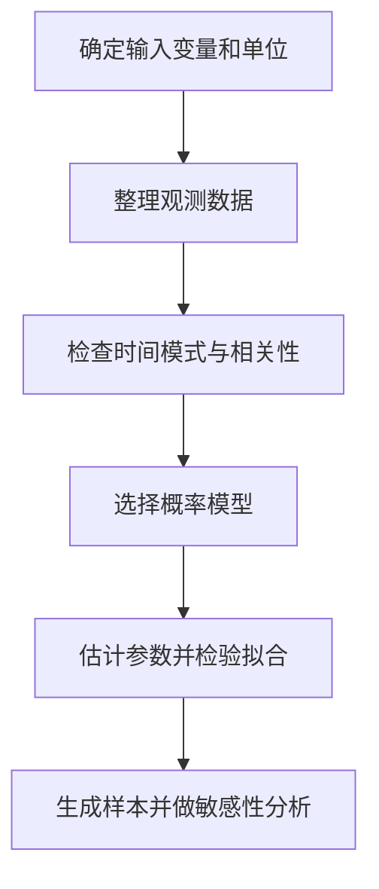
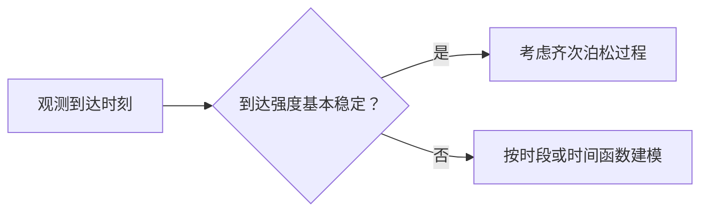

# 05｜仿真输入建模：从数据到随机过程

[返回学习地图](../README.md) · [随机数与变换](01-random-numbers.md) · [排队系统](06-queueing-theory.md) · [专题练习](../exercises/03-input-queue-montecarlo.md)

仿真的输入不是简单地“抽几个随机数”。首先要确定<strong>什么在随机变化、怎样测量、哪些变量相互关联、分布是否随时间改变</strong>，然后才考虑用什么随机数生成方法。

## 1. 输入建模的六个环节



以服务系统为例，到达输入可以表示为“相邻两次到达间隔”或“单位时间内到达人数”，它们不是同一个随机变量。服务时间可以用实际处理分钟数表示，也可以用工序类型、顾客类别等条件变量解释。

## 2. 常见输入变量与分布

| 输入 | 候选模型 | 典型特点与注意点 |
| --- | --- | --- |
| 相邻到达间隔 | 指数、经验分布 | 泊松到达过程才具有独立同分布的指数间隔 |
| 固定时段到达数量 | 泊松、经验计数分布 | 泊松分布描述<strong>计数</strong>，不是间隔时间 |
| 单项服务时间 | Gamma、对数正态、三角、经验分布 | 通常非负，可能右偏 |
| 每日需求件数 | 离散经验分布、计数分布 | 数量必须为非负整数 |
| 设备故障间隔 | 指数、Weibull、经验分布 | 固定故障率不是普遍成立的假设 |
| 任务持续时间 | 固定、三角、PERT 类估计、经验分布 | 无数据时应明确参数的主观来源 |

<strong>选分布应服从数据和机制。</strong>例如正态分布可以取负数，如果服务时间有明显右偏且不可能为负，直接用未经处理的正态分布可能不合适。

## 3. 泊松到达过程与指数间隔

假设到达过程为速率恒定的泊松过程，`N(t)` 表示长度为 `t` 的时间内的到达人数，那么


```math
N(t)\sim\operatorname{Poisson}(\lambda t),\qquad
P(N(t)=k)=e^{-\lambda t}\frac{(\lambda t)^{k}}{k!}.
```


对应的相邻到达间隔 `T` 满足


```math
T\sim\operatorname{Exp}(\lambda),\qquad E(T)=\frac{1}{\lambda},\quad\operatorname{Var}(T)=\frac{1}{\lambda^{2}}.
```


这里的 `λ` 是<strong>单位时间到达率</strong>；平均间隔是 `1/λ`。两者单位互为倒数，例如 `λ=0.4` 人/分钟，则平均间隔为 `2.5` 分钟。

### 3.1 一个到达数据的完整示例

观察到连续五名顾客在时刻 `0,2,3,6,10` 分钟到达。相邻到达间隔为


```math
\Delta=(2,1,3,4).
```


指数分布速率的极大似然估计为


```math
\widehat\lambda=\frac{n}{\sum_{i=1}^{n}\Delta_{i}}=\frac{4}{10}=\boxed{0.4\,\mathrm{persons/min}}.
```


这里共有<strong>四个完整间隔</strong>，不是五个。把初始时刻 `0` 当作一个额外间隔会改变估计。

若采用该指数模型，从 `U=0.8` 生成一个新间隔：


```math
T=-\frac{\ln(1-U)}{\widehat\lambda}
=-\frac{\ln0.2}{0.4}\approx\boxed{4.024\,\mathrm{min}}.
```


这个数值是一次随机实现；它不必等于平均间隔 `2.5` 分钟。

## 4. 无充分数据时的三角分布

当只知道最小值 `a`、最可能值 `b`、最大值 `c`，且 `a<b<c` 时，可把三角分布作为一种透明、可解释的近似输入模型。其反函数生成式为


```math
X=\begin{cases}
a+\sqrt{U(c-a)(b-a)}, & U<\dfrac{b-a}{c-a},\\
c-\sqrt{(1-U)(c-a)(c-b)}, & U\ge\dfrac{b-a}{c-a}.
\end{cases}
```


例如最小 1 小时、最可能 2 小时、最大 5 小时，分段阈值为 `(2-1)/(5-1)=0.25`。若 `U=0.75`，


```math
X=5-\sqrt{(1-0.75)(5-1)(5-2)}=5-\sqrt{3}\approx\boxed{3.268\,\mathrm{h}}.
```


三角分布不等于实际工时的客观规律，结果仍应接受参数扰动和替代分布的敏感性分析。

## 5. 分布拟合与检验

拟合的常见顺序为：先画直方图、经验 CDF 和分组图；再提出候选分布；估计参数；用 Q–Q 图、拟合残差、统计检验和业务机制综合判断。

| 方法 | 主要回答的问题 | 限制 |
| --- | --- | --- |
| 直方图/密度图 | 数据是单峰、多峰、长尾还是集中？ | 形状受分箱影响 |
| 经验 CDF | 各分位点与模型相差多大？ | 不直接解决独立性问题 |
| Q–Q 图 | 样本分位数与理论分位数是否接近？ | 尾部容易受样本量影响 |
| KS 检验 | 经验 CDF 与指定 CDF 最大差异是否过大？ | 参数由样本估计时需调整检验方法 |
| 卡方适合度检验 | 分组频数与理论频数是否一致？ | 结果依赖分组，需关注期望频数 |

不能只看“某个检验的 `p>0.05`”就认为模型正确；尤其参数从同一批数据估计时，原本针对<strong>完全指定分布</strong>的 KS 临界值不能机械照用。

## 6. 非平稳到达与相关输入

现实系统中，上午与下午的到达强度可能不同。如果 `λ` 随时间改变，那么“全日统一一个常数到达率”可能低估高峰排队。可以按时段分别估计速率，或使用非齐次泊松过程 `λ(t)`。



另外，顾客类别可能同时影响到达频率和服务时长；两道连续工序的加工时间也可能共享环境因素。若把这些有关系的输入都当作独立样本，模型可能无法复现拥堵或极端负荷。

可采用条件分布、分组建模、经验重抽样或联合分布建模，并用实际数据检查相关性结构。不要把“独立随机数流”误认为“真实业务变量必然独立”。

## 7. 输入不确定性与敏感性分析

输入随机性和参数估计误差是两类问题：即使真实 `λ` 已知，未来到达仍有随机波动；如果 `λ` 由有限数据估计，那么它本身还存在估计不确定性。

一个简单的敏感性实验是在基准 `λ̂` 附近设置若干合理情景，例如 `0.8λ̂`、`λ̂`、`1.2λ̂`，分别运行并比较等待时间、拥塞概率和利用率。对于接近容量上限的系统，较小的到达率变化就可能引起明显的排队变化。

<strong>学习要点：</strong>先确定随机机制，再选择生成方法；区分“间隔”和“计数”、“随机波动”和“参数不确定性”、“拟合得像”和“模型机制合理”。
