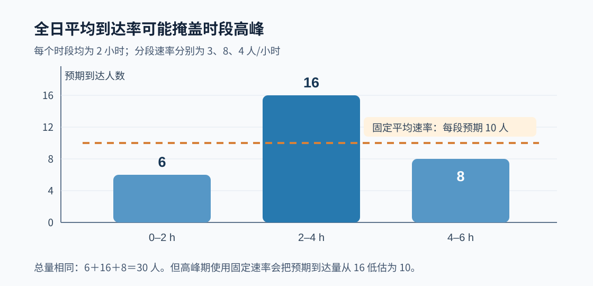

# 05｜仿真输入建模：从原始数据、概率分布到随机过程

[返回课程目录](../README.md) · [上一讲：输出分析与实验设计](04-output-analysis.md) · [随机数与分布变换](01-random-numbers.md) · [排队理论](06-queueing-theory.md) · [输入与排队专题习题](../exercises/03-input-queue-montecarlo.md)

仿真输入建模（Input Modeling）的任务，是为系统中无法事先确定的到达、服务、故障、需求等变量建立可信的随机描述。这个描述必须能够生成新的样本，并且在相关的业务条件下，保留影响系统绩效的统计特征。

例如，收集了某仓库一周的订单处理时间，并不意味着应该立即在 Arena 的 Process 模块中填入一个正态分布。先要确认这些记录是纯粹的加工时间，还是包含了排队、返工和设备等待；确认白班和夜班是否具有相同的加工机制；再决定用一个总体分布、多个条件分布，还是直接使用经验数据。

输入建模与第一章的随机数生成密切相关，但不是同一个问题。第一章研究“怎样从 U(0,1) 生成目标分布的随机变量”；这一章研究“目标分布究竟应当是什么，参数从哪里来，以及这个假设能否代表真实系统”。

## 1. 先确定随机输入变量，而不是先选分布

以一条订单分拣线为例，模型可能需要以下输入：

| 业务现象 | 可以建成的随机输入 | 单位 | 不应混淆的量 |
| --- | --- | --- | --- |
| 顾客陆续到达 | 相邻两次到达的间隔 | 分钟 | 固定时段的到达人数 |
| 每小时收到订单 | 给定时段的订单计数 | 单/小时 | 相邻订单的到达间隔 |
| 设备处理订单 | 单笔实际服务时长 | 分钟/单 | 等待时间或系统逗留时间 |
| 仓库日需求 | 当天新增需求量 | 件/天 | 当天完成发货量 |
| 设备突然停机 | 两次故障之间的运行时间 | 小时 | 每次维修持续时间 |
| 供应商交货 | 从下单到收货的交付提前期 | 天 | 计划提前期或延期天数 |
| 项目工序 | 活动实际持续时间 | 小时 | 包含前置等待的日历工期 |

随机输入通常是外部过程或作业自身的随机量。排队等待时间、设备利用率和最终项目工期一般是仿真输出，它们由输入与资源规则共同决定。除非采用专门的简化模型，否则不应先给“等待时间”拟合一个分布，再把它当作独立输入填入完整的排队模型。

### 1.1 三个必须在建模前回答的问题

第一，样本对应什么操作口径？例如记录的“订单处理 12 分钟”，到底是从进入系统到离开系统的 12 分钟，还是机器真正加工了 12 分钟。如果将包含等待的逗留时间误当作服务时间，模型会在排队环节再次生成等待，造成重复计算。

第二，样本是否来自同一种机制？高优先级订单与普通订单、白天与夜间班次、不同产品型号或机器型号的服务时间，可能分布不同。先把数据全部混合，再寻找一个“拟合分数最高”的单一分布，未必有合理的业务解释。

第三，观测是否独立、是否随时间变化？同一台设备上的连续加工时间可能共享设备状态；每天下午订单到达更密集，也不能简单当成全天相同速率的过程。

这三个问题没有解决，后面的检验统计量即使算得很准确，也只是检验了一个未必符合研究目标的数据集合。

## 2. 输入建模的实际工作顺序

完整流程通常可以组织为：

| 步骤 | 主要操作 | 应得到的成果 |
| --- | --- | --- |
| 1. 定义输入 | 明确变量、单位、业务范围、观测起止 | 输入数据字典 |
| 2. 整理数据 | 去重、排序、处理缺失、检查截尾与异常 | 可复核的原始样本 |
| 3. 探索数据 | 均值、方差、分位数、直方图、经验 CDF、分组曲线 | 候选模型与机制判断 |
| 4. 选择模型 | 参数分布、经验分布、条件分布或随机过程 | 候选模型清单 |
| 5. 估计参数 | 极大似然、矩估计、专家参数或经验频率 | 估计值及单位 |
| 6. 诊断拟合 | 分位数、尾部、KS、卡方、残差与业务逻辑 | 保留或拒绝候选模型 |
| 7. 接入仿真 | 通过逆变换、软件函数、经验重抽样生成输入 | 可运行且单位正确的模型 |
| 8. 检查稳健性 | 替代分布、参数敏感性、输入不确定性 | 对输出结论的影响范围 |

实际工作中可以回到前面修改候选模型，并非只能从第一步机械地走到第八步。例如总体直方图显示两个明显峰值，可能要回头按照订单类型分组，而不是继续尝试更多的单峰分布。

### 2.1 数据清洗不能等于删除“不符合预期”的数值

如果某次服务时间异常长，应先判断它是录入错误、停机造成的非服务等待，还是确实发生了很长的加工任务。不同原因对应完全不同的处理方式。

录入错误可以依据原始业务记录纠正；停机时间可能应拆成故障过程和加工过程；真实的长服务时间则可能是等待时间尾部风险的重要来源，不应仅因为它影响拟合好看程度而删除。

另外，观察窗口可能造成截尾（Censoring）。例如研究设备寿命，某台机器在采集结束时仍未故障，这并不等于其故障时间就是采集结束时刻。它提供的是“寿命至少达到某值”的信息。直接把它当作已经故障的完整寿命，会使寿命分布估计偏低。

若只记录完成服务的订单，也可能漏掉观察结束时仍在服务的长任务。这种样本选择机制需要单独处理。

## 3. 如何描述一组原始数据

假设收集到 n 个正的服务时长 x₁、…、xₙ。最基本的统计量是样本均值和样本方差：

```math
\overline x=\frac{1}{n}\sum_{i=1}^{n}x_i
```

```math
s^2=\frac{1}{n-1}
\sum_{i=1}^{n}(x_i-\overline x)^2
```

样本均值反映中心位置，方差反映离散程度，但二者不能描述全部信息。仿真性能往往对输入的右尾很敏感：平均服务 3 分钟的两种分布，即使均值相同，只要其中一种更容易出现 20 分钟的长任务，排队表现就可能明显不同。

可以进一步计算标准差、变异系数和分位数：

```math
\mathrm{CV}=\frac{s}{\overline x}
```

其中 CV 是变异系数，适用于均值为正且具有相应比例解释的变量。指数分布的理论 CV=1；某些更集中的服务过程 CV 小于 1；长尾过程可能大于 1。但样本 CV 接近 1 只是线索，并不能证明数据服从指数分布。

### 3.1 经验累积分布函数（ECDF）

经验分布函数用数据本身描述“有多少比例的观测不大于某个值”：

```math
F_n(x)=\frac{1}{n}
\sum_{i=1}^{n}\mathbf{1}(x_i\leq x)
```

假设服务时间为 1、2、4、6 分钟，在 x=2 时有 2 个观测不大于 2，因此 Fₙ(2)=2/4=0.5；在 x=5 时有 3 个观测不大于 5，因此 Fₙ(5)=3/4=0.75。

与直方图相比，ECDF 不需要选择分箱宽度，也能直接比较不同候选分布在分位点附近的差异。画图时还应保留样本量信息，因为只有 4 个观测的 ECDF，不能用来断言总体尾部的精确形状。

### 3.2 初步探索至少要看哪几类图

直方图有助于看形状和多峰；ECDF 有助于看概率累计；Q–Q 图将样本分位数与候选理论分位数比较；按日期、小时或订单类型分组的曲线则用来检查非平稳性和异质性。

这些图回答的问题并不相同。即使总体直方图很接近某个概率密度函数，也无法单凭它证明到达间隔相互独立。分布形状和时间依赖结构需要分别检查。

## 4. 常见输入分布：为什么选择、参数代表什么

同一个函数名称在不同软件中可能采用不同参数化方式。尤其是指数、Gamma、Weibull 和正态分布，不能只记公式而不记参数是“率”“尺度”“方差”还是“标准差”。

| 分布或模型 | 常见输入对象 | 重要参数与特征 |
| --- | --- | --- |
| 指数 Exponential | 齐次泊松过程的到达间隔、恒定故障率下的寿命 | 率 λ；均值为 1/λ |
| 泊松 Poisson | 固定长度时段的事件计数 | 期望计数 m；方差也等于 m |
| 正态 Normal | 允许近似对称、负值概率可忽略的变量 | 均值 μ、标准差 σ |
| 对数正态 Lognormal | 正值、右偏的服务或交付时间 | 对数后的均值 μ 与标准差 σ |
| Gamma / Erlang | 正值且形状可调的加工时间、若干阶段总时间 | 形状 k、尺度 θ；均值 kθ |
| Weibull | 设备寿命、失效间隔 | 形状 k、尺度 η；风险率可增减 |
| 三角 Triangular | 仅有最小、最可能和最大估计的工时 | 最小 a、众数 m、最大 b |
| 离散经验分布 | 需求量、类别、批量 | 各取值的经验频率 |
| 连续经验分布 | 缺乏合适参数族的连续输入 | 实际观测或经验 CDF |

选择时至少核对支持集是否符合业务。例如正态分布的定义域是整个实数轴，直接生成服务时间有可能出现负值；Poisson 是整数计数分布，不能直接当作连续服务时间的分布；指数分布对应的恒定风险率假设并不适合所有设备的磨损寿命。

## 5. 泊松到达过程：先分清人数与时间间隔

在最基础的齐次泊松过程（Homogeneous Poisson Process）中，假设事件独立增量，单位时间到达率为固定的 λ，单位为“人/分钟”或“单/小时”。

令 N(t) 表示长度为 t 的时间里发生的到达次数，则：

```math
N(t)\sim\operatorname{Poisson}(\lambda t)
```

```math
\Pr\{N(t)=k\}
=e^{-\lambda t}
\frac{(\lambda t)^k}{k!},
\qquad k=0,1,2,\ldots
```

这里 λt 是该时段的期望到达人数，而 λ 本身是单位时间到达率。

例如每分钟平均到达 0.4 人，观察 5 分钟，期望到达人数为 0.4×5=2。五分钟内恰好到达 3 人的概率为：

```math
\Pr\{N(5)=3\}
=e^{-2}\frac{2^3}{3!}
\approx0.1804
```

不能把这个 Poisson(2) 直接用于生成“下一位顾客还要等待多少分钟”，因为它给出的是非负整数计数，不是时间间隔。

### 5.1 为什么齐次泊松过程对应指数到达间隔

记 T 为当前时刻起等到下一次到达的时间。“T 大于 t”意味着这 t 个时间单位里一次到达都没有，因此：

```math
\Pr(T>t)
=\Pr\{N(t)=0\}
=e^{-\lambda t}
```

所以指数间隔的累积分布函数为：

```math
F_T(t)=1-e^{-\lambda t},\qquad t\geq0
```

相应的密度、期望与方差是：

```math
\begin{aligned}
f_T(t)&=\lambda e^{-\lambda t}\\
\mathrm{E}(T)&=\frac{1}{\lambda}\\
\operatorname{Var}(T)&=\frac{1}{\lambda^2}
\end{aligned}
```

若 λ=0.4 人/分钟，平均到达间隔为 1/0.4=2.5 分钟。注意速率和均值互为倒数，单位也互为倒数。

### 5.2 为什么“指数边际分布”还不够

标准齐次泊松过程的相邻到达间隔是相互独立、同分布的指数变量。如果一批间隔的直方图看起来像指数分布，但顾客总是成团出现、连续短间隔后又出现连续长间隔，那么独立性假设可能不成立。

只拟合单个间隔的边际分布，并不能自动证明整个到达过程是齐次泊松过程。需要同时检查时段速率变化、相邻间隔相关性以及聚集现象。

## 6. 从五个到达时刻，完整推导指数分布的参数估计

某服务窗口连续记录了五个到达时刻：

| 到达编号 | 1 | 2 | 3 | 4 | 5 |
| --- | ---: | ---: | ---: | ---: | ---: |
| 到达时刻（分钟） | 0 | 2 | 3 | 6 | 10 |

连续到达时刻相减，得到四个完整的相邻间隔：

```math
\Delta=(2-0,\ 3-2,\ 6-3,\ 10-6)=(2,1,3,4)
```

虽然看到了五次到达，但只有四个相邻间隔。不能把时刻 0 自身当作一个额外的 0 分钟间隔，更不能把各个绝对到达时刻直接当作间隔样本。

### 6.1 极大似然估计是怎样推导出来的

假设四个间隔是独立同分布的 Exp(λ) 观测。单个间隔的密度为 λe^(-λΔᵢ)，因此似然函数为：

```math
L(\lambda)
=\prod_{i=1}^{n}\lambda e^{-\lambda\Delta_i}
=\lambda^n\exp\left(-\lambda\sum_{i=1}^{n}\Delta_i\right)
```

取自然对数，乘积转为求和：

```math
\ell(\lambda)
=n\ln\lambda-\lambda\sum_{i=1}^{n}\Delta_i
```

对 λ 求导，并令一阶导数为零：

```math
\frac{\mathrm{d}\ell}{\mathrm{d}\lambda}
=\frac{n}{\lambda}-\sum_{i=1}^{n}\Delta_i=0
```

于是：

```math
\widehat\lambda_{\mathrm{MLE}}
=\frac{n}{\sum_{i=1}^{n}\Delta_i}
=\frac{1}{\overline\Delta}
```

本题 n=4、间隔总和为 10 分钟，因此：

```math
\widehat\lambda=\frac{4}{10}
=0.4\ \mathrm{min}^{-1}
```

估计的平均间隔是 1/0.4=2.5 分钟。参数估计是用现有数据推断分布参数，下一步才是用所选分布生成未来的随机间隔。

该推导假设四个间隔都完整观测、没有被选择机制截断，并满足相互独立且同一速率。实际固定窗口数据如果包含尚未结束的间隔或其他截尾信息，似然函数应相应调整。

### 6.2 用反函数法生成下一次到达间隔

令 U 服从 U(0,1)。从：

```math
U=F_T(t)=1-e^{-\lambda t}
```

解出：

```math
T=-\frac{\ln(1-U)}{\lambda}
```

若 U=0.8、λ=0.4：

```math
\begin{aligned}
T&=-\frac{\ln(0.2)}{0.4}\\
&\approx4.0236\ \mathrm{min}
\end{aligned}
```

这只是一次随机实现，不需要等于平均值 2.5 分钟。若连续生成新的间隔 4.024、1.200、0.800 分钟，对应的未来到达时刻应按间隔累加，而不是把每个间隔都当作绝对到达时刻。

### 6.3 Arena 中最容易填错的参数

在常见的 Arena 分布表达式中，EXPO(2.5) 的参数是均值 2.5 个模型时间单位。若课堂模型以分钟为基础单位，并希望平均每 2.5 分钟到达一次，则可使用该表达式；不能因为统计推导得到速率 λ=0.4，就未经换算填成 EXPO(0.4)。

不同软件包及统计教材对指数分布采用的率参数和尺度参数记法可能不同。录入前应查看当前 Arena 版本的表达式帮助，特别核对参数含义与基础时间单位。

## 7. 从数据有限的情境生成输入：三角分布与经验分布

并不是每个项目都有足够多的历史数据。新设备、新工序或一次性项目可能只有工程师给出的时间范围。此时采用明确可解释的近似分布，通常比凭空编造大量所谓“历史样本”更合理。

### 7.1 三角分布的三个参数

用 a 表示最小值，m 表示最可能值（众数），b 表示最大值，且 a＜m＜b。三角分布的均值与方差为：

```math
\begin{aligned}
\mathrm{E}(X)&=\frac{a+m+b}{3}\\
\operatorname{Var}(X)
&=\frac{a^2+m^2+b^2-am-ab-mb}{18}
\end{aligned}
```

注意最可能值 m 不是期望值；只有在适当对称情形下，它才恰好与均值一致。

三角分布的 CDF 在众数处达到的概率是：

```math
F(m)=\frac{m-a}{b-a}
```

所以反函数法需要在该概率处切换公式：

```math
X=
\begin{cases}
a+\sqrt{U(b-a)(m-a)},
&0\leq U<\dfrac{m-a}{b-a}\\
b-\sqrt{(1-U)(b-a)(b-m)},
&\dfrac{m-a}{b-a}\leq U\leq1
\end{cases}
```

### 7.2 手算一次三角分布随机工时

假设工程师估计某工序最少 1 小时、最可能 2 小时、最多 5 小时。令 a=1、m=2、b=5。

分段阈值为：

```math
F(m)=\frac{2-1}{5-1}=\frac{1}{4}=0.25
```

若生成 U=0.75，则应该使用反函数的第二段：

```math
\begin{aligned}
X&=5-\sqrt{(1-0.75)(5-1)(5-2)}\\
&=5-\sqrt3\\
&\approx3.268\ \mathrm{h}
\end{aligned}
```

三角分布均值则为 (1+2+5)/3=8/3≈2.667 小时。单次生成的 3.268 小时与均值不同是正常的。

### 7.3 三角分布和 PERT 不能直接当作同一个分布

经典项目评估中的 PERT 常使用一种三点时间估计近似：

```math
t_{\mathrm{PERT}}\approx
\frac{a+4m+b}{6}
```

它不是三角分布的期望公式 (a+m+b)/3。某些软件中的 Beta-PERT 则构造了经过缩放的 Beta 分布，其具体形状还与选用的参数化有关。若课件只给出“最短、最可能、最长”，仍需确认老师指定的是三角分布、PERT 近似还是 Beta-PERT 模型，不能混用。

### 7.4 离散经验分布：用累计概率划分区间

某仓库每日某类零件需求量只有 0、1、2、3 件，估计概率分别为 0.1、0.2、0.4、0.3。

| 需求量 x | 概率 P(X=x) | 累计概率 F(x) | 可以映射的 U 区间 |
| --- | ---: | ---: | --- |
| 0 | 0.1 | 0.1 | [0,0.1) |
| 1 | 0.2 | 0.3 | [0.1,0.3) |
| 2 | 0.4 | 0.7 | [0.3,0.7) |
| 3 | 0.3 | 1.0 | [0.7,1) |

若 U=0.65，则落在 [0.3,0.7)，生成需求量 X=2。

更正式地，离散反函数取满足 F(x)≥U 的最小支持点。表中的端点开闭规则可采用一致约定；理想连续 U 恰好取到内部端点的概率为零。实际伪随机数是有限离散值，程序实现仍应明确边界归属。

经验分布能够较好保留样本中已经出现的数值，但不能凭空生成未观察到的极端事件。若历史样本很少或严重截尾，把经验分布作为“真实完整分布”也可能低估尾部风险。

## 8. 其他连续分布：看懂参数比记住名称更重要

### 8.1 正态分布与对数正态分布

正态分布常写成：

```math
X\sim N(\mu,\sigma^2)
```

其中 μ 是均值、σ² 是方差、σ 是标准差。正态分布以 μ 为中心对称，但理论上可能取负数。如果某项加工时间接近 10 分钟、标准差只有 0.2 分钟，负值概率极小；如果均值 2 分钟、标准差 3 分钟，直接用正态模型就可能生成大量不合理的负持续时间。

对数正态分布用于描述正值且右偏的变量。其定义是：

```math
\ln X\sim N(\mu,\sigma^2)
```

这里的 μ 和 σ 不是原始 X 的均值与标准差，而是 ln X 的均值与标准差。原变量的均值为：

```math
\mathrm{E}(X)=\exp\left(\mu+\frac{\sigma^2}{2}\right)
```

例如三个观测的对数分别为 0、1、2，则对数均值为 1，采用除以 n 的正态 MLE 对数方差为 2/3；所拟合对数正态分布的原始尺度均值为：

```math
\mathrm{E}(X)
=\exp\left(1+\frac{1}{3}\right)
\approx3.794
```

不能将 exp(μ)=e≈2.718 误写为原变量的均值。实际上 exp(μ) 对应对数正态分布的中位数。

### 8.2 Gamma 与 Erlang

Gamma 分布常用形状 k＞0、尺度 θ＞0 的参数化，均值和方差为：

```math
\mathrm{E}(X)=k\theta,\qquad
\operatorname{Var}(X)=k\theta^2
```

当 k 为正整数时，Erlang 分布可理解为若干相互独立、同率指数阶段持续时间之和。比如两个独立 Exp(λ=0.5) 阶段的总时长，服从形状为 2、尺度为 2 的 Gamma 分布，均值 4、方差 8。

有些资料将 Gamma 的第二个参数写作率 β=1/θ。因此看到 Gamma(2,2) 时必须先确定第二个 2 是尺度还是率；两种参数化虽然这里数值写法一样，但生成的均值不同。

### 8.3 Weibull 与设备失效

在两参数 Weibull 分布中，形状参数为 k＞0，尺度参数为 η＞0，生存函数为：

```math
S(t)=\Pr(T>t)
=\exp\left[-\left(\frac{t}{\eta}\right)^k\right],
\qquad t\geq0
```

其风险率（Hazard Rate）是：

```math
h(t)=\frac{k}{\eta}
\left(\frac{t}{\eta}\right)^{k-1}
```

当 k=1，风险率恒定，对应指数寿命模型；当 k＞1，风险率随使用时间增加，可反映某些磨损机制；当 0＜k＜1，风险率随时间下降，可用于描述某些早期故障机制。

不能因为设备在模型里会随机故障，就默认故障间隔一定是指数分布。如果故障率随设备年龄改变，指数模型的无记忆假设可能与实际不符。

## 9. 参数如何估计：矩估计、极大似然与估计误差

输入数据给出以后，参数不是凭经验随意填写的。常见方法有两类。

矩估计（Method of Moments）要求理论矩与样本矩相等，例如将分布的理论期望设为样本平均值。极大似然估计（Maximum Likelihood Estimation，MLE）则选择使观测数据出现的似然函数最大的参数。

对指数分布，两种方法都给出 λ̂=1/样本均值。对其他分布，二者未必相同。

### 9.1 正态分布的 MLE 方差与无偏样本方差不同

假设四个数据是 1、2、3、4，均值为 2.5，离均差平方和为 5。

正态分布方差的 MLE 为：

```math
\widehat{\sigma}_{\mathrm{MLE}}^2
=\frac{1}{n}\sum_{i=1}^{n}(x_i-\overline x)^2
=\frac{5}{4}=1.25
```

而常见的无偏样本方差为：

```math
s^2=\frac{1}{n-1}
\sum_{i=1}^{n}(x_i-\overline x)^2
=\frac{5}{3}\approx1.667
```

两个结果对应不同的估计准则。课程题目若问“样本方差”，通常使用 n−1；若专门要求正态方差的极大似然估计，则使用 n。

### 9.2 参数估计后的分布仍存在不确定性

对只有四个到达间隔的数据，估计得到 λ̂=0.4，并不意味着真实到达率精确等于 0.4。扩大观察窗口、收集更多数据，参数估计可能发生变化。

这属于输入参数不确定性；即使某个特定 λ 已知，未来到达间隔仍有随机波动，那是过程本身的随机性。第 13 节会进一步讨论两种不确定性怎样进入仿真实验。

## 10. 拟合好不好：从图形到统计检验

拟合优度检验不是一个按下按钮就能“证明分布正确”的过程。原假设通常描述数据来自某种候选分布。检验结果能帮助发现与该假设明显不一致的地方，但不能代替对业务过程、独立性、非平稳性和尾部风险的判断。

### 10.1 直方图、Q–Q 图与概率图

直方图适合看数据的集中程度、偏斜和多峰，但分箱宽度会影响外观。Q–Q 图用于比较样本与某一理论分布的分位数；若点大体接近参考直线，说明该候选模型在相应分位范围内具有一定合理性。

需要特别留意尾部。在库存缺货、交付延期或设备失效问题中，业务损失往往来自少数极端情况。中间部分拟合得好，不意味着尾部一定可信。

### 10.2 KS 检验：完整手算 D⁺、D⁻ 与 D

Kolmogorov–Smirnov（KS）统计量衡量经验 CDF 与完全指定的连续理论 CDF 之间的最大垂直距离。

设样本升序排列为 x₍₁₎≤…≤x₍ₙ₎，理论分布函数为 F(x)，则：

```math
\begin{aligned}
D^+&=\max_{1\leq i\leq n}
\left(\frac{i}{n}-F(x_{(i)})\right)\\
D^-&=\max_{1\leq i\leq n}
\left(F(x_{(i)})-\frac{i-1}{n}\right)\\
D&=\max(D^+,D^-)
\end{aligned}
```

假设检验一个事先完全指定的 U(0,1) 分布，观测为 0.1、0.3、0.7、0.9。对于 U(0,1)，理论 CDF 在这些点处就是 F(x)=x。

| i | x₍ᵢ₎ | F(x₍ᵢ₎) | i/4−F(x₍ᵢ₎) | F(x₍ᵢ₎)−(i−1)/4 |
| --- | ---: | ---: | ---: | ---: |
| 1 | 0.1 | 0.1 | 0.15 | 0.10 |
| 2 | 0.3 | 0.3 | 0.20 | 0.05 |
| 3 | 0.7 | 0.7 | 0.05 | 0.20 |
| 4 | 0.9 | 0.9 | 0.10 | 0.15 |

因此：

```math
D^+=0.20,\qquad D^-=0.20,\qquad D=0.20
```

计算出 D 只是第一步。若题目给出显著性水平与相应临界值，才进一步比较 D 与临界值并作出拒绝或不拒绝的决定。

最重要的限制是：标准的一样本 KS 临界值要求候选连续分布完全指定，不能把从同一组数据刚估出来的参数直接塞入 F，再机械使用“参数事先已知”的临界值。参数估计后的检验需要合适的修正方法或参数自助法校准。在离散分布和存在相关、截尾的数据中，也不能不经调整地套用普通连续独立样本 KS 检验。

### 10.3 卡方适合度检验：从分组频数计算

把数据分为 k 个互不重叠且覆盖样本空间的类别。若第 j 类观察频数为 Oⱼ，按照候选分布预测的期望频数为 Eⱼ，则：

```math
\chi^2=
\sum_{j=1}^{k}\frac{(O_j-E_j)^2}{E_j}
```

假设 100 个观测应以完全已知的等概率落入四类，即四类的期望频数都是 25，实际观察为 21、29、26、24。

| 类别 | Oⱼ | Eⱼ | Oⱼ−Eⱼ | (Oⱼ−Eⱼ)²/Eⱼ |
| --- | ---: | ---: | ---: | ---: |
| 1 | 21 | 25 | −4 | 16/25=0.64 |
| 2 | 29 | 25 | 4 | 16/25=0.64 |
| 3 | 26 | 25 | 1 | 1/25=0.04 |
| 4 | 24 | 25 | −1 | 1/25=0.04 |
| 合计 | 100 | 100 | — | 1.36 |

因此：

```math
\chi^2=0.64+0.64+0.04+0.04=1.36
```

在四类概率完全事先给定、不需要估计参数，且满足适用条件时，自由度为 4−1=3。

若从同一组数据估计了 p 个独立参数，在通常的正则条件下，自由度往往调整为 k−1−p；这依赖具体估计方式与检验构造，并非所有情形都只需机械减去 p。还要保证期望频数足够大；一些课程采用“各类期望频数至少约为 5”的常见经验准则，若太小则应考虑合并相邻区间或换用其他方法。

### 10.4 KS 与卡方分别擅长什么

| 比较 | KS 检验 | 卡方拟合优度检验 |
| --- | --- | --- |
| 数据处理 | 使用连续样本的经验 CDF | 将数据分到若干类别 |
| 核心统计量 | 两条 CDF 的最大差距 D | 频数偏差的加权平方和 |
| 分组依赖 | 不必人为分箱 | 结果受分类方式影响 |
| 常见限制 | 标准临界值要求连续、独立、完全指定分布 | 小期望频数、参数估计与自由度处理 |
| 结果解释 | 检查候选分布与样本是否明显不一致 | 检查分类频率是否明显不一致 |

卡方检验既可能用于离散分布，也可以将连续数据分箱后使用；KS 在课程的基础形式中主要用于连续且完全指定的分布。两者不能互相代替，更不能因为某次检验“没有拒绝原假设”，就宣称该分布已经被证明为真实机制。

### 10.5 多个候选分布该怎样比较

可以综合支持集、概率图、拟合优度与业务背景，再使用对数似然、AIC 等指标辅助比较。AIC 的常见形式是：

```math
\mathrm{AIC}=2p-2\ell(\widehat\theta)
```

其中 p 是估计参数的数量，ℓ(θ̂) 是最大化后的对数似然。在同一组可比数据、合适的似然构造下，AIC 较小表示复杂度惩罚后相对更有支持，并不代表模型一定正确。

例如候选 A 有 1 个参数、最大对数似然为 −18，AIC=2−2×(−18)=38；候选 B 有 2 个参数、最大对数似然为 −16，AIC=4−2×(−16)=36。B 在此指标下优于 A，但还要检查尾部拟合、稳定性以及业务机制；也不能把 AIC=36 解读成“拟合准确率为 36%”。

## 11. 到达率随时间变化：为何全日平均值可能误导

齐次泊松过程假设 λ 恒定。现实中的医院、仓储、交通枢纽和电商订单系统，可能在某些时段集中到达。

例如一家服务中心的到达率分为三个连续的两小时时段：

| 时间段 | 持续时间 | 到达率 λ | 该段期望到达人数 |
| --- | ---: | ---: | ---: |
| 0–2 小时 | 2 小时 | 3 人/小时 | 6 |
| 2–4 小时 | 2 小时 | 8 人/小时 | 16 |
| 4–6 小时 | 2 小时 | 4 人/小时 | 8 |
| 合计 | 6 小时 | 按时长加权平均为 5 人/小时 | 30 |

如果简单使用全程固定 λ=30/6=5 人/小时，就会预测每个两小时段平均到达 10 人。虽然六小时总量仍是 30 人，却把高峰段实际期望的 16 人低估为 10 人。资源排队对短时负载非常敏感，因此“总量拟合正确”不代表“拥堵行为拟合正确”。



### 11.1 非齐次泊松过程

若到达率随绝对时刻变化为 λ(t)，可以采用非齐次泊松过程（Nonhomogeneous Poisson Process，NHPP）。在时间窗口 [a,b] 内，累计强度是：

```math
\Lambda(a,b)=\int_a^b\lambda(t)\,\mathrm{d}t
```

相应到达人数满足：

```math
N(b)-N(a)
\sim\operatorname{Poisson}(\Lambda(a,b))
```

本例三个区间的累计强度为 6、16、8。注意 NHPP 在不相交区间上的增量仍然独立，但相邻到达间隔一般不再是具有同一固定速率的独立同分布指数变量。

若实际数据有明显的按小时或按星期变化，可以先按时段估计 λ(t)，再考虑更平滑的时间变化模型。分段数不应多到每段只有极少数观测，否则参数不稳定。

## 12. 仅拟合边际分布，可能遗漏输入之间的关系

假设订单分为普通单和复杂单。普通单处理时间短，复杂单处理时间长；复杂单可能又集中在某些时段。若单独拟合一个“所有订单的服务时间分布”，并与到达时刻独立抽样，就可能把复杂单错误地均匀分配到全天。

更合理的一种建模方式是先生成订单类别 C，再按类别生成条件服务时间：

```math
\Pr(S\leq s)
=\sum_{c}\Pr(S\leq s\mid C=c)\Pr(C=c)
```

这样既明确了订单类型的比例，也能保留类型与服务时长之间的关联。如果订单类型概率还随时刻 t 变化，则进一步使用 P(C=c|t)。

### 12.1 自相关、交叉相关与隐藏的共同因素

同一设备连续工时可能有自相关；到达率和服务速度也可能受到共同环境影响。常见诊断包括按照时间排序画序列图、计算滞后相关、按班次分组，并与业务人员确认潜在共同因素。

需要明确区分：计算机为不同输入生成独立随机数流，是一种实现选择；现实业务变量是否独立，则是需要数据和机制支持的建模假设。两者不应混为一谈。

若存在明显依赖，可考虑条件分布、分组模型、按日为单位重抽样、保留依赖结构的区块重抽样，或其他适合数据的联合建模方法。不能通过“随机数质量很好”来弥补错误的独立性假设。

### 12.2 数据与模型的分辨率要一致

只有“每天共 300 单”的日报，通常无法重建这 300 单在一天内的具体到达节奏。若模型要评价每分钟队长，就需要相应细粒度的到达时刻、每小时强度曲线或其他可靠的信息。用总量数据随意假定订单均匀到达，会把缺失的信息伪装成已经观测到的规律。

## 13. 输入不确定性：随机过程波动与参数估计误差

输入模型中有两类需要区分的不确定性。

过程随机性（Aleatory Variability）指即使真实参数已知，下一次随机到达或服务时长仍不能提前确定。例如真实 λ=0.4 时，下一次间隔可能是 1 分钟，也可能是 5 分钟。

参数估计不确定性（Parameter or Input Uncertainty）指真实参数未知，只能由有限历史数据估计。原始观测太少时，λ̂=0.4 本身可能有相当大的误差。

### 13.1 简单敏感性分析

可在合理范围内设置三个到达率情景：0.8λ̂、λ̂、1.2λ̂。若 λ̂=0.4，则分别取 0.32、0.40、0.48 人/分钟。每种情景下都运行充分重复，再比较平均等待、资源利用率和超过某等待阈值的比例。

但这些比例是事先设计的情景，不是自动从数据得到的置信区间；不能把 ±20% 当成“统计上保证覆盖真实参数”的区间。

### 13.2 用 Bootstrap 估计输入参数的不确定性

假设有 n 个足够独立、具有代表性的原始间隔。一个基础非参数 Bootstrap 可以这样进行：

1. 从原始 n 个间隔中有放回抽取 n 个值，构造第 1 组重抽样数据。
2. 对重抽样数据重新拟合指数分布，得到第 1 个 λ̂。
3. 重复以上操作 B 次，获得 λ̂₁、…、λ̂B。
4. 查看这些参数估计值的分布、分位数，并在必要时进一步将其作为多个输入情景运行仿真。

例如本章四个间隔 [2,1,3,4]，每次重抽样仍抽四个数，但允许某个值重复出现。由于只有四个原始数据，得到的参数不确定性估计本身也很粗糙；Bootstrap 不能创造原始样本没有包含的业务信息。

如果原始数据明显相关或具有时间变化，直接逐个间隔独立重抽样会破坏其结构，需要改用更合适的区块或条件重抽样方法。

### 13.3 两层模拟的思想

若希望同时考虑参数估计误差与仿真运行的随机波动，可以设计外层参数抽样、内层独立仿真：

| 层次 | 抽什么 | 解决的问题 |
| --- | --- | --- |
| 外层 | 依据原始数据的不确定性产生一组输入参数 θᵇ | 参数估计值可能怎样变化 |
| 内层 | 固定 θᵇ，生成新的到达、服务过程并重复运行 | 给定参数时系统输出怎样随机变化 |

在合适的概率模型下，全方差公式可写为：

```math
\operatorname{Var}(Y)
=\mathrm{E}_{\theta}\left[\operatorname{Var}(Y\mid\theta)\right]
+\operatorname{Var}_{\theta}\left(\mathrm{E}[Y\mid\theta]\right)
```

第一项反映给定参数下的过程波动，第二项反映参数变化引起的输出均值变化。这里把 θ 当作外层不确定性分析中的随机量，具体解释取决于采用 Bootstrap、贝叶斯或其他输入不确定性框架。

如果只在单一 λ̂ 下做 10000 次重复，能够降低对该固定参数模型的仿真误差，却不能消除原始数据只有四个间隔所带来的参数估计误差。二者不能互相替代。

## 14. 在 Arena 中落实输入建模

Arena 中的输入通常出现在 Create 的到达时间设置、Process 的工序持续时间、设备故障设置及其他表达式中。

### 14.1 先统一时间单位

假设数据中的服务时间单位为秒，模型基础时间单位为分钟，那么平均服务时间 90 秒应换算为 1.5 分钟。若直接填入 90，而软件按分钟解释，会把服务时间放大 60 倍。

对于 λ=0.4 人/分钟的指数到达过程，平均间隔为 2.5 分钟。应在 Create 模块中根据当前版本选择正确的分布表达式与时间单位，核对它代表的是“每 2.5 分钟平均一次到达”，而不是“每分钟平均 2.5 人”。

### 14.2 Input Analyzer 能帮助哪些工作

Arena 的 Input Analyzer 可用于探索样本输入、尝试候选分布以及查看拟合结果。它的功能定位是为输入模型提供统计辅助，而不是替研究者确定业务机制是否合理。

实际操作可按以下顺序进行：

1. 准备一列符合口径的原始服务时长或到达间隔。
2. 检查数据单位、缺失、非正值、重复记录与是否存在截尾。
3. 查看样本图形和建议的候选分布，记录参数及其含义。
4. 结合 KS、卡方、图形和业务限制评估拟合。
5. 将确认后的表达式用于相应模块，并核对输出量级。
6. 用固定随机种子做可复现的小样例，检查生成的输入均值、分位数与到达计数是否符合预期。

若工具输出较小的 p 值，需要核查检验方法和参数估计的处理方式；若得到较大的 p 值，也不能跳过时段变化、相关性和尾部检查。

不同 Arena 版本的菜单和表达式名称可能存在差异，应以实际安装版本的帮助文档为准。

### 14.3 输入模型的验证与系统模型的验证是两件事

输入模型验证关注生成的到达间隔、工时、需求量是否满足目标分布及其相关结构。系统模型验证关注这些输入进入排队和资源规则后，实体是否按照设计正确流动。

例如即使 EXPO(2.5) 确实生成了均值约为 2.5 分钟的到达间隔，也不能证明机器的优先规则、服务开始时刻与队长面积计算没有错误。后者仍需使用前面章节的确定性手算、事件表和守恒关系检查。

## 15. 习题与完整解析

### 题 1｜从到达时刻到间隔与速率

连续五名顾客到达于 0、2、3、6、10 分钟。假设相邻到达间隔独立且服从同一指数分布。求间隔样本、样本均值、指数率参数的极大似然估计，并指出该估计的单位。

标准答案：间隔为 [2,1,3,4] 分钟；均值 2.5 分钟；λ̂=0.4 人/分钟。

解析：每一个间隔对应两个连续到达时刻之差，因此五次到达只能产生四个相邻间隔。总间隔时长为 10 分钟，四个间隔的平均值为 10/4=2.5 分钟。指数率的 MLE 为 n/ΣΔᵢ=4/10=0.4 min⁻¹。

速率的数值是 0.4，而平均间隔是 2.5，两者互为倒数。若把五个绝对时刻 0、2、3、6、10 直接求均值，得到的是观测时刻均值，不是间隔分布均值。

### 题 2｜泊松计数的概率

假设每分钟平均到达 0.4 位顾客，且满足齐次泊松过程。求未来 5 分钟恰好到达 3 位顾客的概率。

标准答案：约 0.1804。

解析：未来 5 分钟的到达人数 N 服从 Poisson(λt)=Poisson(2)。恰好 3 次到达的概率为 e⁻²×2³/3!。先计算 2³=8、3!=6，再乘 e⁻²≈0.135335，得到约 0.180447。

此题要求计数概率，因此使用泊松分布；若问“下一位还要多久到达”，才使用指数间隔分布。

### 题 3｜指数反函数法

若到达率为 0.4 人/分钟，利用 U=0.8 生成下一段指数到达间隔，求结果。若采用 Arena 常见的均值参数表达式，应该输入平均间隔多少分钟？

标准答案：生成间隔约 4.024 分钟；均值参数应为 2.5 分钟。

解析：反函数式为 T=−ln(1−U)/λ。代入 U=0.8，得到 T=−ln(0.2)/0.4≈4.0236 分钟。由于 E(T)=1/λ=2.5 分钟，按均值参数化的函数应填写 2.5，而非 0.4。

单次随机实现 4.024 不等于理论平均 2.5，并不代表生成方法出错。

### 题 4｜三角分布计算

某工序最短 1 小时、最可能 2 小时、最长 5 小时。假定 X 服从 Triangular(1,2,5)，求分段阈值、U=0.75 时的随机工时及理论均值。

标准答案：阈值 0.25；随机工时约 3.268 小时；理论均值 8/3≈2.667 小时。

解析：阈值是 (m−a)/(b−a)=(2−1)/(5−1)=0.25。U=0.75 大于阈值，必须使用反函数第二段：X=5−√[(1−0.75)×4×3]=5−√3≈3.268。

三角分布的期望为 (a+m+b)/3=(1+2+5)/3=8/3。不能将最可能值 m=2 直接当作均值，也不能把 PERT 的三点时间公式直接代入三角分布。

### 题 5｜经验离散需求

某零件一天需求为 0、1、2、3 件的概率分别为 0.1、0.2、0.4、0.3。计算累计概率，并根据 U=0.65 生成一次需求。

标准答案：累计概率为 0.1、0.3、0.7、1.0；生成需求为 2 件。

解析：依次对概率累加，得到每个需求值的右侧累计概率。U=0.65 大于 0.3、不大于 0.7，因此落在需求量为 2 的区间。

若使用 U=0.85，则会落在最后一段，生成 3 件。程序实现时应保证所有区间覆盖 [0,1) 且不重叠。

### 题 6｜KS 统计量手算

有四个连续型样本 0.1、0.3、0.7、0.9。候选分布为事先完全指定的 U(0,1)。求 D⁺、D⁻ 和 D。

标准答案：D⁺=0.20，D⁻=0.20，D=0.20。

解析：U(0,1) 的理论 CDF 为 F(x)=x。依次计算 i/4−F(x₍ᵢ₎)，得到 0.15、0.20、0.05、0.10，最大为 0.20。再计算 F(x₍ᵢ₎)−(i−1)/4，得到 0.10、0.05、0.20、0.15，最大为 0.20。所以 D=max(0.20,0.20)=0.20。

本题只求检验统计量。若没有给出显著性水平和临界值，不应仅凭 D=0.20 就宣布通过或未通过检验。

### 题 7｜卡方拟合优度统计量

100 个观测分为四类，观察频数为 21、29、26、24，完全指定模型预测四类概率均为 0.25。求卡方统计量，并指出相应自由度。

标准答案：χ²=1.36；在通常适用条件下自由度为 3。

解析：每类期望频数都是 100×0.25=25。四个偏差为 −4、4、1、−1，其平方分别是 16、16、1、1。将每个平方差除以期望频数 25 再相加，得到 (16+16+1+1)/25=34/25=1.36。

由于四类概率已完全指定、没有从当前数据估计其他参数，自由度为 k−1=3。若改为先用同一组数据估计一个独立参数，就需要重新考虑自由度和检验构造。

### 题 8｜正态方差 MLE 与样本方差

给定四个数据 1、2、3、4，分别求样本方差与假设正态分布时的方差 MLE。

标准答案：无偏样本方差 5/3≈1.667；正态方差 MLE 为 5/4=1.25。

解析：平均数为 2.5，平方偏差为 2.25、0.25、0.25、2.25，总和为 5。无偏样本方差的分母 n−1=3；MLE 方差的分母 n=4。先确定题目问的是哪一种估计，再选择分母。

### 题 9｜非平稳到达与平均速率

某系统每两小时的到达率依次为 3、8、4 人/小时。求六小时总期望到达人数、全程平均到达率，以及如果用这一平均速率建模时，对第二个两小时时段的期望人数误差。

标准答案：总期望 30 人；全程平均 5 人/小时；第二时段预测 10 人，而分段模型预测 16 人，低估 6 人，即相对真实分段期望低估 37.5%。

解析：分段计算得到 2×3=6、2×8=16、2×4=8；合计 30。全程平均速率 30/6=5。统一速率模型预测第二段 2×5=10，与 16 相差 6。以分段模型的期望 16 为基准，相对低估比例为 6/16=37.5%。若以错误预测的 10 为基准比较，则 16 比 10 高 60%，两个百分比的分母不同，不能混为一谈。

### 题 10｜对数正态参数与原尺度均值

假设某正值工时变量满足 ln X 近似正态。现有三条数据的对数值为 0、1、2。按正态 MLE 估计对数均值与方差，再求拟合对数正态分布在原尺度下的理论均值。

标准答案：μ̂=1、σ̂²=2/3，原尺度理论均值约为 3.794。

解析：对数数据均值为 (0+1+2)/3=1。平方偏差和为 1+0+1=2，MLE 方差为 2/3。代入对数正态均值公式 exp(μ+σ²/2)，得到 exp(1+1/3)=exp(4/3)≈3.794。

exp(1)≈2.718 是拟合分布的中位数，不是其原尺度均值。这个区别在右偏服务时间建模中非常重要。

### 题 11｜参数不确定性与运行重复

研究者只有 4 个真实到达间隔，估计得到 λ̂=0.4。随后在固定 λ̂=0.4 的模型下运行 10000 次仿真，得到很窄的平均等待时间区间。是否可以认定真实系统的平均等待时间也已经估计得非常精确？

标准答案：不能。大量仿真重复可以降低固定输入模型下的 Monte Carlo 误差，但不能自动消除原始输入参数估计误差及模型结构误差。

解析：四个间隔可能不足以可靠判断指数分布、同一到达率和独立性是否合理。即使每一次仿真都正确运行，所有重复仍依赖于同一个 λ̂=0.4 和同一组分布假设。若真实 λ=0.5，固定输入参数下的窄区间可能围绕错误的目标值。需要增加真实数据，进行参数敏感性或输入不确定性分析，并检查随机过程的业务假设。

## 16. 如何撰写一份可复核的输入建模说明

课程报告中的输入建模部分，至少应把以下信息交代清楚：

| 内容 | 应报告的要素 | 示例 |
| --- | --- | --- |
| 输入对象 | 是间隔、计数、服务时间还是故障寿命 | 顾客相邻到达间隔 |
| 数据范围 | 采集时段、样本量、单位、筛选条件 | 20 个工作日的分钟级记录 |
| 清洗方法 | 缺失、重复、异常、截尾如何处理 | 区分停机与纯服务时长 |
| 随机结构 | 是否独立、是否有时段变化、是否分组 | 午间到达率较高 |
| 候选模型 | 采用哪些分布及其业务理由 | 分时段泊松、服务时间 Gamma |
| 参数估计 | 方法、结果及参数含义 | 指数率 0.4 人/分钟 |
| 拟合诊断 | 图形、统计量、尾部与限制 | KS、卡方、Q–Q 图 |
| 实现方法 | Arena 中的输入表达式与时间单位 | 平均 2.5 分钟的指数间隔 |
| 不确定性 | 替代分布与参数扰动对输出的影响 | 峰值到达率上调 10% |

本章的指数参数估计、反函数生成、KS、卡方、三角分布、经验需求、分段泊松计数与对数正态均值，均可用[输入建模验算程序](../examples/input_modeling_checks.py)复现，运行只需 Python 标准库。

需要进一步复习随机数基础，可返回[第一章：随机数与分布变换](01-random-numbers.md)；理解输入怎样影响排队表现，可接着阅读[第六章：排队理论](06-queueing-theory.md)。

有关概率分布与拟合检验的原始统计定义，可参考 NIST 的[指数分布](https://www.itl.nist.gov/div898/handbook/eda/section3/eda3667.htm)、[KS 拟合优度检验](https://www.itl.nist.gov/div898/handbook/eda/section3/eda35g.htm)、[Weibull 分布](https://www.itl.nist.gov/div898/handbook/eda/section3/eda3668.htm)。Arena Input Analyzer 的访问方式可参考 Rockwell Automation 的[官方常见问题](https://www.rockwellautomation.com/en-us/products/software/arena-simulation/support/frequently-asked-questions.html)。
