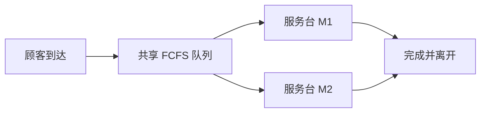
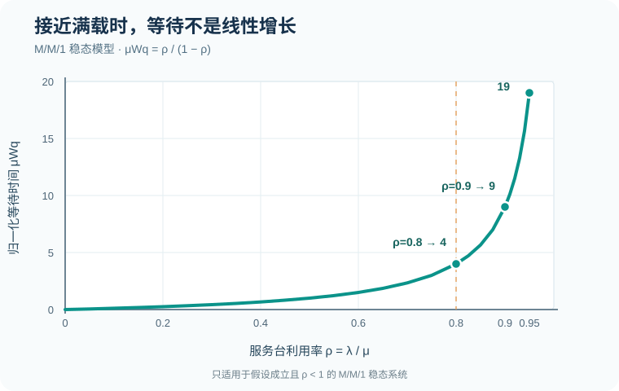

# 06｜排队系统：从利用率到等待时间

[返回学习地图](../README.md) · [离散事件服务台](02-discrete-event-queue.md) · [输入建模](05-input-modeling.md) · [专题练习](../exercises/03-input-queue-montecarlo.md)

排队系统的核心问题不是“服务台平均能处理多少人”，而是<strong>随机到达与随机服务相互叠加后，顾客会等待多久、队列会积累多少，以及增加服务能力能改善多少</strong>。

## 1. 排队系统的基本结构



这个结构中，顾客只需在 M1 或 M2 <strong>任选一个</strong>完成服务；与“一个项目必须完成 B、C 两项并行工序”的 Fork–Join 结构不同。

通常使用 Kendall 记号 `A/S/c`：前两位描述到达间隔与服务时间分布，`c` 是并行服务台数量。`M` 表示无记忆的指数时间分布（对应泊松到达），`D` 表示确定性时间，`G` 表示一般分布。

完整记号有时还包括系统容量、顾客来源总体和服务纪律；<strong>`M/M/2` 不自动等于 M1 优先、两条独立队列或顾客优先级系统</strong>，这些规则需要另外明确。

## 2. 三个容易混淆的平均量

设平均到达率 `λ`（人/小时）、单个服务台平均服务率 `μ`（人/小时）。

| 指标 | 记号 | 含义 |
| --- | --- | --- |
| 平均排队人数 | `L_q` | 只计算等待服务的顾客 |
| 平均系统人数 | `L` | 排队中 + 正在接受服务的顾客 |
| 平均排队时间 | `W_q` | 从到达到开始服务的时间 |
| 平均系统时间 | `W` | 从到达到离开的总时间 |

若系统稳定并满足 Little 定律所需的长期平均条件，


```math
\boxed{L=\lambda_{\mathrm{eff}}W,\qquad L_{q}=\lambda_{\mathrm{eff}}W_{q}}.
```


这里应使用<strong>实际进入并完成系统的长期吞吐率</strong> `λ_(eff)`；若系统会拒绝到达或丢失顾客，它可能小于外部到达率。

## 3. M/M/1：一台服务台的精确公式

假设到达是速率 `λ` 的泊松过程，服务时间独立同分布为参数 `μ` 的指数分布，系统容量无限、FCFS、到达与服务独立。稳定条件为


```math
\boxed{\rho=\frac{\lambda}{\mu}<1}.
```


在稳态下：


```math
P_{0}=1-\rho,\qquad L=\frac{\rho}{1-\rho},\qquad L_{q}=\frac{\rho^{2}}{1-\rho},
```


```math
\boxed{W=\frac{1}{\mu-\lambda},\qquad W_{q}=\frac{\lambda}{\mu(\mu-\lambda)}}.
```


<strong>为什么等待会在高利用率时急剧增加？</strong>平均服务时间是 `1/μ`，但平均系统时间是 `1/(μ-λ)`；随着到达率接近服务率，分母越来越小。在理想 `M/M/1` 模型中，`λ→μ^-` 时等待时间趋于无穷。



*图中纵轴是归一化平均排队时间 `μ W_q=ρ/(1-ρ)`，不是某个具体系统的分钟数。模型假设改变时，曲线也会改变。*

### 3.1 完整计算示例

一台服务台每小时平均能处理 10 人，到达率为每小时 8 人。由 `λ=8,μ=10` 得


```math
\rho=\frac{8}{10}=0.8,
```


```math
W=\frac{1}{10-8}=0.5\,\mathrm{h}=\boxed{30\,\mathrm{min}},
```


```math
W_{q}=\frac{8}{10(10-8)}=0.4\,\mathrm{h}=\boxed{24\,\mathrm{min}}.
```


由 Little 定律，`L=8×0.5=4` 人，`L_q=8×0.4=3.2` 人。平均排队人数可以是非整数，因为它是<strong>长期时间平均</strong>，不是某一时刻的人数。

## 4. M/M/c：多个相同并行服务台

设有 `c` 台相互独立、服务速率均为 `μ` 的服务台，共享一个 FCFS 队列。令


```math
a=\frac{\lambda}{\mu},\qquad \rho=\frac{\lambda}{c\mu}<1.
```


稳态空系统概率为


```math
P_{0}=\left[\sum_{n=0}^{c-1}\frac{a^{n}}{n!}+\frac{a^{c}}{c!(1-\rho)}\right]^{-1}.
```


顾客到达后需要等待的概率（Erlang C 公式）为


```math
P_{\mathrm{wait}}=\frac{a^{c}}{c!(1-\rho)}P_{0}.
```


平均等待和系统时间为


```math
\boxed{W_{q}=\frac{P_{\mathrm{wait}}}{c\mu-\lambda},\qquad W=W_{q}+\frac{1}{\mu}}.
```


然后 `L_q=λ W_q`，`L=λ W`。与 `M/M/1` 相比，不能简单把 `μ` 换成 `cμ` 代入单服务台公式，因为多个并行服务台的服务完成机制不同。

### 4.1 两台服务台的数值示例

仍令 `λ=8` 人/小时，但现在两台机器各自的服务率为 `μ=10` 人/小时，且共享一个 FCFS 队列。此时 `c=2`，


```math
a=0.8,\qquad\rho=\frac{8}{2\times10}=0.4.
```


```math
P_{0}=\left[1+0.8+\frac{0.8^{2}}{2(1-0.4)}\right]^{-1}=\frac{3}{7}\approx0.4286.
```


```math
P_{\mathrm{wait}}=\frac{0.8^{2}}{2(1-0.4)}\times\frac{3}{7}=\frac{8}{35}\approx0.2286.
```


```math
W_{q}=\frac{8/35}{20-8}=\frac{2}{105}\,\mathrm{h}\approx\boxed{1.143\,\mathrm{min}}.
```


```math
W=\frac{2}{105}+\frac{1}{10}\approx\boxed{7.143\,\mathrm{min}}.
```


与上一节单台服务器相比，等待显著缩短，但代价是总服务能力从每小时 10 人提高到 20 人。这不是“在相同资源成本下”的性能比较。

## 5. 对照表：容量、拥塞与模型假设

| 情形 | 可能的系统现象 | 计算时的注意点 |
| --- | --- | --- |
| 到达率远低于处理能力 | 等待通常较短 | 仍有随机波动和偶发排队 |
| 到达率接近处理能力 | 拥塞快速增加 | 不能把高利用率直接等同于高效率 |
| `λ≥ cμ` 且无限等候 | 无有限稳态平均队长 | 无限容量模型不稳定 |
| 有有限等待容量 | 一部分顾客可能被拒绝 | 外部到达率不一定等于吞吐率 |
| 两个独立队列 | 可能出现一台空闲而另一台仍排队 | 不等价于共享队列 |
| 有优先级或抢占 | 不同类别的等待时间不同 | 普通 FCFS 公式不一定适用 |

## 6. 解析公式与仿真如何配合？

排队论解析模型可作为<strong>校验基准</strong>。例如用指数到达、指数服务、单服务台、无容量限制的离散事件仿真，预热后长时间运行，统计量应逐渐接近相应的 `M/M/1` 理论值；但单次运行不可能保证完全相同。

若引入时变到达率、一般服务分布、不同机器效率、共享设备或复杂优先规则，解析公式可能不再适用，此时应显式编写事件规则，通过重复仿真估计等待和利用率。

<strong>自检顺序：</strong>先确认模型类型，再计算 `ρ` 与稳定条件，然后判断使用解析式还是事件仿真，最后统一时间单位，并用 `L=λ_(eff)W` 核对统计结果。
