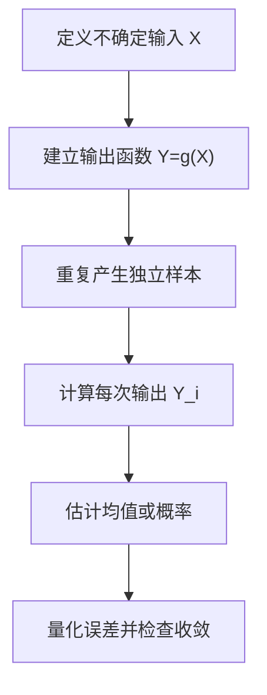
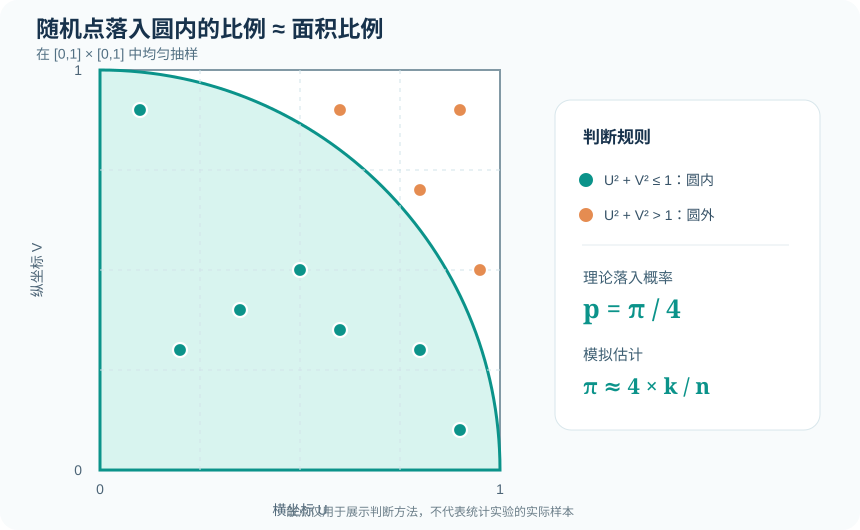

# 07｜蒙特卡洛仿真：从随机样本估计未知结果

[返回学习地图](../README.md) · [随机变量生成](01-random-numbers.md) · [输入建模](05-input-modeling.md) · [专题练习](../exercises/03-input-queue-montecarlo.md)

蒙特卡洛方法（Monte Carlo Simulation）的基本思想是：<strong>当目标量可以表示成随机变量的期望或某个事件的概率时，通过重复随机抽样来近似它</strong>。它不一定涉及事件时钟和排队状态；这与离散事件仿真是两种可以相互结合但并不相同的建模方式。

## 1. 核心框架

假设 `X₁,…,X_n` 是独立同分布的输入，`Y_i=g(X_i)`，目标是 `θ=E[Y]`，那么蒙特卡洛估计量为

`θ̂_n=(1)/(n)Σ_(i=1)^(n)Y_i.`

在 `E|Y|<∞` 等条件下，样本均值根据大数定律趋近真实期望；若还满足有限方差等中心极限定理条件，可以使用正态近似描述估计误差。

## 2. 用随机点估计圆周率

在单位正方形 `[0,1]²` 内均匀抽样点 `(U_i,V_i)`。若 `U_i²+V_i²≤1`，就记为落入四分之一单位圆。

四分之一圆的面积是 `π/4`，正方形面积为 1，所以点落入圆内的概率为

`p=P(U²+V²≤1)=(π)/(4).`

于是令指示变量 `I_i=1(U_i²+V_i²≤1)`，得到

`π̂=4·(1)/(n)Σ_(i=1)^(n)I_i.`

例如 1000 个点中有 782 个位于圆内，估计 `π̂=4×0.782=3.128`。这只是一个示例结果，换一组点通常会有偏差。

因为 `I_i` 服从 Bernoulli 分布，使用样本比例 `p̂`，可近似估计

`SÊ(π̂)=4√((p̂(1-p̂))/(n)).`

代入 `p̂=0.782,n=1000`，标准误约为 `0.0522`；正态近似 95% 区间约为 `[3.026,3.230]`。当样本太少或事件极罕见时，应考虑更合适的区间方法。

## 3. 样本量与误差：为什么不是线性改善？

若输出方差为 `σ²` 且样本独立，

`Var(θ̂_n)=(σ²)/(n), SE(θ̂_n)=(σ)/(√(n)).`

因此<strong>想让标准误减半，通常需要把样本量扩大四倍</strong>。比如从 1000 次模拟增加到 4000 次，其他条件不变时标准误约减为一半，而不是四分之一。

下面的表说明样本量对误差的相对影响：

| 模拟次数 `n` | 相对标准误 `1/√(n)`（以 `n=1000` 为基准） |
| ---: | ---: |
| 250 | 2.00 |
| 1000 | 1.00 |
| 4000 | 0.50 |
| 16000 | 0.25 |

## 4. 库存决策：蒙特卡洛与优化的结合

某商品每日需求 `D∈\{0,1,2,3\}`，概率分别为 `(0.1,0.2,0.4,0.3)`。库存准备量为整数 `s`，每剩余一件的持有成本为 `h=2`，每缺少一件的缺货成本为 `p=4`。总成本定义为

`C(s,D)=2(s-D)^++4(D-s)^+, x^+=max(x,0).`

对 `s=1,2,3` 分别计算期望成本：

| 库存 `s` | 期望剩余 `(s-D)^+` | 期望缺货 `(D-s)^+` | 期望总成本 |
| ---: | ---: | ---: | ---: |
| 1 | 0.1 | 1.0 | `2(0.1)+4(1.0)=4.2` |
| 2 | 0.4 | 0.3 | `2(0.4)+4(0.3)=2.0` |
| 3 | 1.1 | 0 | `2(1.1)=2.2` |

在这三个候选方案中，`s=2` 的理论期望成本最小。此例的分布足够简单，可以精确枚举；这恰好为蒙特卡洛代码提供一个<strong>核验用的正确答案</strong>。当需求来自复杂联合分布、库存跨多个周期、涉及补货延迟时，精确枚举可能困难，仿真便更有价值。

### 4.1 一次模拟在做什么？

先从离散累计概率 `0.1,0.3,0.7,1` 中抽取需求。例如若 `U=0.65`，则 `D=2`。再对库存 `s=2` 计算 `C(2,2)=0`。反复抽样后，把所有成本取平均，就是对 `E[C(2,D)]` 的估计。

可运行并核对解析值的代码见 [Python 库存蒙特卡洛示例](../examples/monte_carlo_inventory.py)。

## 5. 模拟多个方案时为何要用共同随机数？

若比较库存 `s=1,2,3`，可以在每一次重复中<strong>让所有方案使用同一个需求样本</strong>，并分别计算三个成本。这样它们经历的是同一天的相同需求；估计方案差值时常能减少随机波动。

但要注意共同随机数不是无条件提高精度的方法：差值方差的变化取决于方案输出的协方差。更多解释见[04｜输出分析](04-output-analysis.md)。

## 6. 蒙特卡洛与离散事件仿真的关系

| 比较 | 蒙特卡洛方法 | 离散事件仿真 |
| --- | --- | --- |
| 典型目标 | 期望、概率、风险分布 | 随时间变化的队列、资源和系统状态 |
| 是否必须有时钟 | 否 | 通常需要 |
| 核心计算 | 重复随机抽样并计算函数 | 按事件时点更新状态 |
| 常见例子 | 积分、库存成本、可靠度 | 排队系统、生产线、物流流程 |
| 两者能否结合 | 能 | 能：每次运行含随机输入，多次独立重复统计 |

把排队模型重复运行 100 次，本质上也是在利用蒙特卡洛思想估计系统指标；但排队系统内部仍需按照离散事件规则推进。

## 7. 结果解释与常见错误

计算前要确认目标是 `E[Y]`、`P(Y>a)` 还是某个分位数；这几类指标不能混为一谈。做概率估计时，先定义指示变量；做方案比较时，先定义成本函数和优劣方向；报告结果时，至少区分<strong>点估计、标准误、置信区间和模型假设</strong>。

再多的模拟次数也只能减少抽样误差，无法自动纠正错误分布、遗漏变量或不合理的成本函数。模型偏差和蒙特卡洛误差是不同问题。
